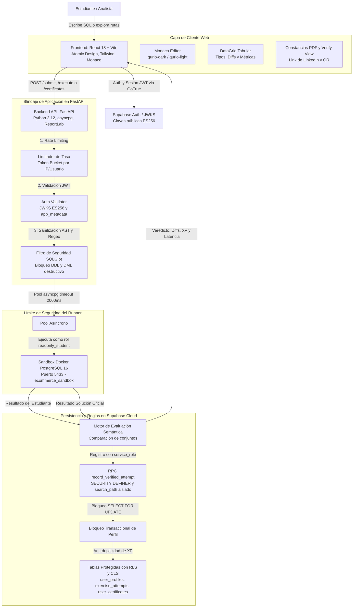
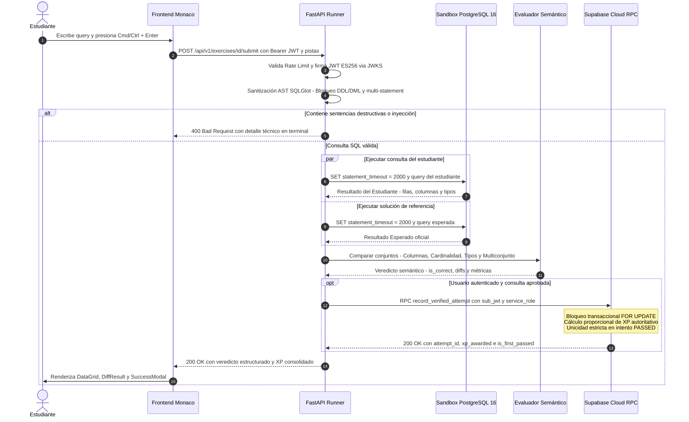
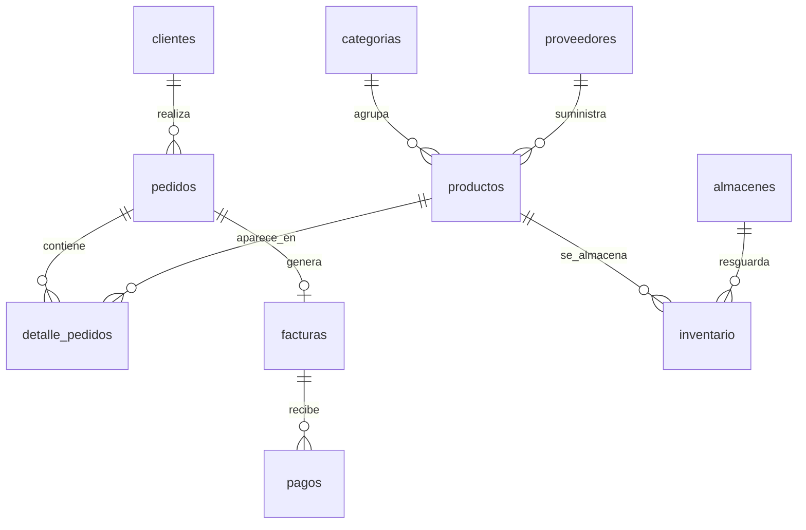

# Qurio: plataforma interactiva de SQL y analítica relacional

<p align="center">
  
</p>

<p align="center">
  <strong>«Aprende SQL. Piensa en queries.»</strong><br />
  Práctica activa de SQL contra PostgreSQL 16 real en un sandbox aislado, con evaluación semántica de resultados, guías visuales y constancias verificables en PDF y QR.
</p>

<p align="center">
  
  
  
  
  
  
  
  
  
  
  
  
</p>

---

## Tabla de contenidos

- [Qué es Qurio](#qué-es-qurio)
- [Características principales](#características-principales)
- [Arquitectura del sistema](#arquitectura-del-sistema)
  - [Diagrama de arquitectura global](#diagrama-de-arquitectura-global)
  - [Flujo de evaluación semántica](#flujo-de-evaluación-semántica)
- [Estructura del monorepo](#estructura-del-monorepo)
- [El dataset: `Ecommerce_Production_DB`](#el-dataset-ecommerce_production_db)
- [Seguridad del sandbox](#seguridad-del-sandbox)
- [Instalación y puesta en marcha local](#instalación-y-puesta-en-marcha-local)
  - [Prerrequisitos](#prerrequisitos)
  - [1. Clonar el repositorio](#1-clonar-el-repositorio)
  - [2. Iniciar contenedores sandbox y API (Docker)](#2-iniciar-contenedores-sandbox-y-api-docker)
  - [3. Ejecutar la API manualmente con Python (opcional)](#3-ejecutar-la-api-manualmente-con-python-opcional)
  - [4. Configurar y ejecutar el frontend (React + Vite)](#4-configurar-y-ejecutar-el-frontend-react--vite)
  - [5. Ejecutar la suite de pruebas automatizadas](#5-ejecutar-la-suite-de-pruebas-automatizadas)
- [Variables de entorno](#variables-de-entorno)
- [Estándares de ingeniería y sistema de diseño](#estándares-de-ingeniería-y-sistema-de-diseño)
- [Licencia y autoría](#licencia-y-autoría)

---

## Qué es Qurio

Casi todas las plataformas para aprender SQL se quedan en cuestionarios de opción múltiple o validan las respuestas comparando texto con expresiones regulares, lo que hace fallar una consulta válida por un alias distinto o un espacio extra.

Qurio parte de una idea simple: escribir SQL real contra un PostgreSQL real.

En lugar de comparar cadenas de texto, el evaluador ejecuta tu consulta en el sandbox y compara el resultado contra la solución esperada (filas, columnas, tipos de datos, cardinalidad, multiconjuntos con `Counter` y orden cuando el reto lo exige). Si tu query devuelve los datos correctos, pasa la prueba sin importar si usaste mayúsculas, minúsculas o alias propios.

Cada consulta corre dentro de un contenedor Docker con PostgreSQL 16 bajo el rol restringido `readonly_student`, con `statement_timeout = 2000ms`, transacciones de solo lectura y un filtro AST (SQLGlot) más regex en FastAPI. La interfaz sigue el flujo de un cliente SQL de escritorio, adaptada también para tablet y móvil.

---

## Características principales

### Editor de trabajo (Monaco) y modo probar / enviar

El editor usa Monaco (el núcleo de VS Code) con los temas `qurio-dark` y `qurio-light`, autocompletado para palabras clave de PostgreSQL, tablas, columnas reales del esquema y alias. La tipografía es `JetBrains Mono` con ligaduras desactivadas (`fontLigatures: false` y `font-variant-ligatures: none`) para que operadores como `>=`, `<=`, `!=` y `<>` se lean tal cual se teclean.

En las consignas, pistas, solución oficial y guías teóricas, las cláusulas y palabras reservadas se resaltan automáticamente en `JetBrains Mono` (`formatSqlProse` / `highlightSqlBlock`). Además, el flujo de trabajo separa la exploración de la entrega:

- `Probar` (`⌘/Ctrl + Shift + Enter`) ejecuta consultas libres en `/api/v1/playground/execute` sin evaluar ni contar intentos fallidos.
- `Enviar solución` (`⌘/Ctrl + Enter`) corre la evaluación semántica completa contra la solución oficial.
- `Shift + Alt + F` (o el botón de formato) ordena la consulta con `sql-formatter` en estilo PostgreSQL.

### SQL Playground, diagrama ER y paleta `⌘K`

El Playground soporta hasta 6 pestañas simultáneas guardadas en `localStorage`, previsualización de tablas en un clic (`SELECT * FROM ... LIMIT 50;`), plantillas rápidas e historial de ejecución. También incluye un diagrama entidad-relación interactivo (`ErDiagramModal`) con las 10 tablas y 9 llaves foráneas, conectores SVG curvos, zoom y salto directo al editor.

La referencia rápida de PostgreSQL 16 (`/reference`) cubre sintaxis buscable (incluida referencia informativa de DDL/DML) y la paleta `⌘K` / `Ctrl+K` permite saltar entre retos, guías, tablas y sintaxis sin soltar el teclado. En móvil, la barra lateral pasa a un drawer deslizable y el Playground divide la pantalla en pestañas (`Tablas`, `Editor SQL`, `Resultados`).

### Visor tabular DataGrid redimensionable

La tabla de resultados numera las filas, muestra tipos inferidos (`VARCHAR`, `INT4`, `DECIMAL`, `TIMESTAMPTZ`, `BOOL`) y marca los valores `NULL` con chips propios. El divisor horizontal entre el editor y los resultados se arrastra entre `28%` y `78%` (guardado en `localStorage`) con un botón para expandir o restaurar al `76%`. Cuando hay diferencias con la salida esperada o un bloqueo de seguridad, `DiffResult` y la consola inferior muestran el detalle exacto.

### Mapa curricular, guías y 76 retos

El catálogo tiene 4 rutas, 16 módulos, 76 retos y 228 pistas progresivas siguiendo las reglas de [`docs/pedagogia/`](./docs/pedagogia/qurio_pedagogical_specification_ai_agent_framework.md) y [`.agents/rules/sql-pedagogy.md`](./.agents/rules/sql-pedagogy.md):

1. **Fundamentos de SQL (`24` retos):** `SELECT`, `WHERE`, operadores lógicos, `ORDER BY`, agregaciones (`COUNT`, `SUM`, `AVG`), `GROUP BY` y `HAVING`.
2. **SQL relacional (`20` retos):** llaves foráneas, `INNER JOIN`, `LEFT JOIN`, `FULL OUTER JOIN`, `CROSS JOIN`, `SELF JOIN`, operaciones de conjunto (`UNION`, `INTERSECT`, `EXCEPT`) y `COALESCE`.
3. **Consultas avanzadas (`16` retos):** subconsultas correlacionadas (`EXISTS` / `NOT EXISTS`), `CASE WHEN`, CTEs con `WITH` y funciones de ventana (`ROW_NUMBER`, `DENSE_RANK`, `SUM OVER`, `LAG`).
4. **Ingeniería y manipulación de datos (`16` retos, DML y DDL):** `INSERT`, `INSERT INTO ... SELECT`, `UPDATE ... FROM`, `DELETE`, `RETURNING`, definición y alteración de tablas (`CREATE TABLE`, `ALTER TABLE`, `DROP TABLE`, `CHECK`, `PK`/`FK`) e índices B-Tree, compuestos y parciales (`CREATE/DROP INDEX`), ejecutados en esquemas temporales `pg_temp` con `ROLLBACK` automático.

Cada módulo cuenta con su guía (`ModuleGuideModal`) sobre el orden lógico de ejecución en PostgreSQL 16, diagramas `Entrada → Cláusula → Salida`, ejemplos sin spoilers y errores comunes. El progreso se navega desde un grid Bento 2×2 o desde `LearningRoadmapMap`, que alterna entre un árbol DAG de 16 nodos (`M13 → [M14, M15] → M16`) y un camino en 4 columnas conectado a las estaciones `#01..#76`.

El sistema otorga 14 medallas por hitos (`20`, `40`, `76` retos), racha (`3`, `7` días), latencia (`<5 ms`) y dominio por tema (`JOIN`, `NULL`, `CTEs`, `Window Functions`, `DML`, `DDL`, `Índices`). Tras 2 intentos fallidos se habilita la revelación de la solución oficial (`/api/v1/exercises/{id}/reveal-solution`), acreditando `0 XP` si se resuelve después de verla. Los visitantes sin cuenta pueden resolver los primeros 3 retos y fusionar su avance al iniciar sesión.

### Constancias en PDF, QR y verificación pública

Las constancias mantienen la paleta oscura (`#080d1d`) con retícula SVG, 4 tarjetas de métricas, firmas vectoriales Bézier, sello `QURIO VERIFIED`, QR escaneable y huella `SHA-256`. El backend genera el PDF A4 con `reportlab` (`GET /api/v1/certificates/{code}/pdf` usando `QrCodeWidget`) y expone el QR SVG en `/qr.svg`.

La ruta pública `/verify/:code` permite validar constancias sin iniciar sesión, añadirlas a LinkedIn (`linkedin.com/profile/add`), copiar un badge HTML o compartirlas en X. Los registros se guardan en `public.user_certificates` con unicidad `(user_id, track_id)` y RLS (`database/supabase/05_certificates.sql`), más respaldo en memoria para entorno local.

### Consola administrativa (`/admin`)

El panel operativo vive en un chunk lazy separado (`vendor-admin`) y exige `app_metadata.role === 'admin'`. Incluye cinco vistas:

- **Operaciones en vivo:** estado del pool `asyncpg`, memoria RSS, RTT al sandbox, `pg_stat_activity` y `pg_cancel_backend`.
- **Usuarios:** directorio, búsqueda, filtros y `UserModerationDrawer` con confirmación en dos pasos.
- **Analítica pedagógica y forense (`SqlDiffViewer`):** revisión de intentos y errores frecuentes.
- **Auditoría AST y seguridad:** registro de consultas bloqueadas.
- **Control del sistema:** killswitches globales o por reto.

Las cuentas admin también habilitan controles de QA para previsualizar constancias con 0% de avance (`qa_preview`), desbloquear pistas al instante y revelar soluciones sin esperar dos fallos.

### Autenticación, perfil y temas

El acceso funciona con correo y contraseña o con OAuth de GitHub mediante Supabase Auth (con el botón de Google listo para activarse). Incluye `/auth/confirm` (`verifyOtp`), `/reset-password` (`PASSWORD_RECOVERY`) y validación inline en formularios.

Los temas claro y oscuro usan tokens en `:root` y `.dark` con script anti-FOUC. El perfil muestra XP calculado en servidor, racha diaria, mapa de calor de 52 semanas, tarjeta de precisión (`ProfilePrecisionCard`), edición de perfil sin saltos de layout (`EditProfileModal`), historial paginado (`QueryHistoryModal`), página 404 con código `SQLSTATE 42P01` y favicon SVG propio.

---

## Arquitectura del sistema

### Diagrama de arquitectura global



### Flujo de evaluación semántica



---

## Estructura del monorepo

```text
Qurio/
├── .agents/
│   ├── rules/                  # Reglas permanentes del repositorio (sql-pedagogy.md, critical-sparring.md, human-writing.md)
│   └── skills/                 # Habilidades del repositorio
├── apps/
│   ├── api/                    # Backend FastAPI (Python 3.12)
│   │   ├── app/
│   │   │   ├── core/           # Config, Auth ES256/JWKS, Rate Limit, System State, Supabase
│   │   │   ├── modules/
│   │   │   │   ├── admin/      # API /admin/* (Live Ops, Usuarios, Analítica, Forense, Killswitches)
│   │   │   │   ├── certificates/ # Constancias PDF/QR ReportLab, SHA-256, LinkedIn y /verify
│   │   │   │   ├── curriculum/ # Catálogo de 76 ejercicios, 228 pistas y fallback
│   │   │   │   └── runner/     # Pool asyncpg, Sandbox pg_temp, Evaluador semántico + AST y Seguridad contextual
│   │   │   └── main.py         # Punto de entrada FastAPI y cabeceras HTTP
│   │   ├── tests/              # Suite de 111 pruebas automáticas (Pytest + Asyncio)
│   │   │   ├── test_admin.py
│   │   │   ├── test_auth.py
│   │   │   ├── test_certificates.py # Emisión QA, PDF %PDF-, QR SVG, LinkedIn y bypass Admin
│   │   │   ├── test_evaluator.py
│   │   │   ├── test_integration.py
│   │   │   ├── test_rate_limit.py
│   │   │   ├── test_schema_consistency.py
│   │   │   ├── test_security.py
│   │   │   └── test_supabase_migration.py
│   │   ├── Dockerfile
│   │   └── requirements.txt    # Incluye reportlab>=4.2.0 para PDF/QR vectoriales
│   │
│   └── web/                    # Frontend React 18 + Vite + TypeScript
│       ├── public/             # favicon.svg y og-preview.svg
│       ├── src/
│       │   ├── components/     # Atomic Design Pragmático
│       │   │   ├── atoms/      # Button, Badge, AdminBadge, TextInput, KbdShortcut, RadioTab
│       │   │   ├── molecules/  # SearchInput, FormField, MetricTile, PedagogyPillarsCard,
│       │   │   │               # MethodologyModal, SqlTransformDiagram, AuthModal, SuccessModal,
│       │   │   │               # EditProfileModal, ProfilePrecisionCard, ProfileBadgesShowcase, QueryHistoryModal, etc.
│       │   │   ├── organisms/  # MonacoEditorPanel, DataGridResults, ExerciseSpecPanel, DashboardHomeView, ExerciseHeaderBar, DesignSystemShowcase,
│       │   │   │               # ErDiagramModal, ModuleGuideModal, SqlReferenceView, CommandPaletteModal,
│       │   │   │               # CertificateModal (+ CertificateShowcase), CertificateVerifyView,
│       │   │   │               # TracksView, SqlPlaygroundView, AdminDashboardView, SidebarNav, TopHeader
│       │   │   └── templates/  # DashboardLayout, WorkspaceLayout
│       │   ├── hooks/          # useAuth, useTheme, useAppRouter, useCurriculumState, useExerciseWorkspace
│       │   ├── lib/            # api, adminApi, schemaGraph, moduleGuides, sqlReference, format, routing
│       │   ├── tests/          # 9 suites Vitest / 58 pruebas (incl. uxUpgrade.test.tsx y admin.test.ts)
│       │   ├── types/          # Definiciones estrictas TypeScript
│       │   ├── App.tsx         # Orquestador modular de plantillas, rutas y modales globales
│       │   └── index.css
│       ├── tailwind.config.js
│       └── vite.config.ts      # Code splitting (vendor-admin, vendor-monaco, vendor-sql-formatter)
│
├── database/
│   ├── sandbox/                # PostgreSQL Sandbox (init.sql + ecommerce_seed.sql)
│   └── supabase/               # Esquemas DDL, catálogo y endurecimiento Supabase Cloud
│       ├── 01_schema.sql
│       ├── 02_seed_curriculum.sql
│       ├── 03_security_hardening.sql
│       ├── 04_admin_rbac.sql
│       ├── 05_certificates.sql # Tabla user_certificates + RLS SELECT
│       ├── rollback_security_hardening.sql
│       └── diagnose_privileges.sql
│
├── docs/                       # PRD, SAD, pedagogía, constancias, auditorías y bitácora
│   ├── audits/
│   ├── constancias/            # DESIGN.md, code.html y screen.png (Terminal Glow Minimal)
│   ├── pedagogia/
│   ├── security/
│   ├── BITACORA.md
│   ├── CURRICULUM_SPEC.md
│   ├── GUIA_EJECUCION_LOCAL.md # Guía paso a paso para levantar la pila local
│   ├── PRD.md
│   └── SAD.md
│
├── graphify-out/               # Grafo de conocimiento estructural del proyecto
├── docker-compose.yml          # Orquestación local (postgres-sandbox + api)
├── AGENTS.md                   # Reglas de ingeniería y Atomic Design
└── README.md                   # Este documento
```

---

## El dataset: `Ecommerce_Production_DB`

El sandbox PostgreSQL contiene una base de datos de comercio electrónico con 10 tablas y 9 relaciones de llave foránea:

| Tabla | Registros | Contenido |
| :--- | :---: | :--- |
| **`clientes`** | 15 | Identificadores, nombres, emails, ciudades, países y fechas de registro. |
| **`categorias`** | 5 | Categorías de catálogo (Laptops, Monitores, Periféricos, Almacenamiento, Mobiliario). |
| **`proveedores`** | 5 | Proveedores internacionales, países de origen y teléfonos de contacto. |
| **`productos`** | 15 | Catálogo con precios unitarios, IDs de categoría y proveedor, y existencias. |
| **`pedidos`** | 15 | Órdenes de compra con estados (`completado`, `pendiente`, `cancelado`, `procesando`), montos y fechas. |
| **`detalle_pedidos`** | 24 | Líneas de pedido que vinculan pedidos y productos con cantidades y precios históricos. |
| **`facturas`** | 13 | Comprobantes fiscales con montos totales, estados (`pagada`, `pendiente`, `anulada`) y fechas de emisión. |
| **`pagos`** | 11 | Transacciones vinculadas a facturas, con método (`tarjeta_credito`, `transferencia`, `paypal`), montos, fechas y estados. |
| **`almacenes`** | 3 | Ubicaciones físicas de distribución (Madrid, Bilbao, Valencia) con capacidad en m². |
| **`inventario`** | 19 | Existencias físicas por producto y almacén con control de stock y fecha de actualización. |



---

## Seguridad del sandbox

Ninguna consulta del usuario toca la base de producción ni tiene salida de red desde el motor de práctica. Las protecciones se dividen en dos capas:

### 1. Aislamiento del sandbox (PostgreSQL en Docker)

- **Contenedor separado:** corre en `postgres:16-alpine`, aislado de las bases de producción y autenticación.
- **Rol `readonly_student` y esquema `pg_temp`:** solo tiene `GRANT SELECT ON ALL TABLES IN SCHEMA public` y `GRANT CONNECT, TEMP ON DATABASE ecommerce_sandbox`, con `REVOKE CREATE ON SCHEMA public FROM PUBLIC`.
- **Modos de ejecución:** las consultas DQL (`read_only`) corren con `SET TRANSACTION READ ONLY`. Las prácticas DML y DDL (`dml` / `ddl`) clonan las 10 tablas en `pg_temp` por transacción (`SET LOCAL transaction_read_only = off`, `lock_timeout = '500ms'`), verifican el resultado y hacen `ROLLBACK`, dejando `public.*` intacto.
- **Límites de recursos:** `statement_timeout = 2000ms`, `work_mem = 16MB` y tope automático de 1,000 filas devueltas.
- **Filtro AST y regex (`security.py`):** valida según el `ExecutionMode` (`read_only`, `dml`, `ddl`) y bloquea sentencias múltiples (`;`), `COPY`, `GRANT`, `REVOKE`, `CREATE FUNCTION`, `CREATE EXTENSION`, `CREATE ROLE` y funciones peligrosas (`pg_sleep`, `pg_terminate_backend`, `dblink`, `pg_read_file`).

### 2. Backend y Supabase Cloud (Hardening v5.0+)

- **JWT (`auth.py`):** validación asimétrica ES256 (ECDSA P-256) con JWKS de Supabase, comprobando `aud`, `iss` y `exp`.
- **RPC atómica (`public.record_verified_attempt`):** `SECURITY DEFINER` con `SET search_path = ''`, acceso exclusivo para `service_role`, bloqueo `SELECT ... FOR UPDATE` y cálculo de XP en servidor.
- **RLS, CLS e integridad:** los clientes no pueden mutar `exercise_attempts` directamente ni editar `xp` o `level` en `user_profiles`. `user_certificates` aplica RLS por `auth.uid()` y el índice `idx_single_awarded_passed_attempt` evita acreditar el mismo reto dos veces.
- **Rate limiting y cabeceras HTTP:** Token Bucket (`120/min` autenticados, `20/min` invitados) y cabeceras `X-Content-Type-Options`, `X-Frame-Options`, `Referrer-Policy` y `Permissions-Policy`.

---

## Instalación y puesta en marcha local

### Prerrequisitos

- Docker Desktop (con Docker Compose)
- Node.js 18+ y npm
- Python 3.12+ (solo si quieres correr la API o las pruebas fuera de Docker)
- Git

### 1. Clonar el repositorio

```bash
git clone https://github.com/ErickKNT/qurio.git
cd Qurio
```

### 2. Iniciar contenedores sandbox y API (Docker)

Levanta el sandbox PostgreSQL 16 y el backend FastAPI:

```bash
docker compose up -d --build
```

Verifica que ambos contenedores estén activos:

```bash
docker ps --filter "name=qurio-"
```

> **Sandbox PostgreSQL:** `localhost:5433` · DB: `ecommerce_sandbox` · Usuario: `readonly_student` · Password: `student_safe_pass`  
> **API FastAPI:** `http://localhost:8000` · Health: `http://localhost:8000/api/v1/health` · Docs: `http://localhost:8000/docs`

### 3. Ejecutar la API manualmente con Python (opcional)

Si prefieres correr la API fuera de Docker con `--reload`, levanta primero solo el sandbox (`docker compose up -d postgres-sandbox`) y luego:

```bash
cd apps/api

# En Windows (PowerShell):
python -m venv .venv
.venv\Scripts\Activate.ps1

# En Linux / macOS:
python3 -m venv .venv
source .venv/bin/activate

pip install -r requirements.txt
copy .env.example .env   # o `cp .env.example .env` en Linux/macOS
uvicorn app.main:app --host 127.0.0.1 --port 8000 --reload
```

### 4. Configurar y ejecutar el frontend (React + Vite)

En otra terminal:

```bash
cd apps/web
npm install
copy .env.example .env   # o `cp .env.example .env` en Linux/macOS
npm run dev
```

La aplicación queda disponible en `http://localhost:5173`.

### 5. Ejecutar la suite de pruebas automatizadas

**Backend (Pytest, 111 pruebas):**
```bash
cd apps/api
pytest tests/ -v
# En Windows con el entorno virtual:
.\.venv\Scripts\pytest.exe tests -v
```

```text
tests/test_admin.py ................ RBAC Admin, Live Ops, Forense, Usuarios, Moderación y Killswitches
tests/test_auth.py ................. JWT ES256, expiración, audiencias e invitados
tests/test_certificates.py ......... Emisión QA Admin, PDF %PDF-, QR SVG, LinkedIn y bypass de solución
tests/test_evaluator.py ............ Comparador semántico, multiconjuntos, NULLs y orden
tests/test_integration.py .......... Endpoints REST, Sandbox Docker y reveal-solution (0 XP)
tests/test_rate_limit.py ........... Límites por Token Bucket (invitado vs autenticado)
tests/test_schema_consistency.py ... 76 retos, SQL en sandbox, determinismo y verificación anti-spoilers
tests/test_security.py ............. Sanitización AST contextual (SQLGlot) para read_only, dml y ddl
tests/test_supabase_migration.py ... Privilegios, CLS, concurrencia y RPC autoritativa
```

**Frontend (Vitest, 58 pruebas en 9 archivos) y build de producción:**
```bash
cd apps/web
npm test
npm run build
```

```text
 ✓ src/lib/__tests__/routing.test.ts (5 tests)
 ✓ src/lib/__tests__/progress.test.ts (6 tests)
 ✓ src/lib/__tests__/supabase.test.ts (4 tests)
 ✓ src/lib/__tests__/achievements.test.ts (6 tests)
 ✓ src/tests/sqlCompleter.test.ts (6 tests)
 ✓ src/lib/__tests__/persistence.test.ts (7 tests)
 ✓ src/tests/pedagogy.test.ts (6 tests)
 ✓ src/tests/admin.test.ts (5 tests)
 ✓ src/tests/uxUpgrade.test.tsx (13 tests)

 Test Files  9 passed (9) | Tests  58 passed (58)
```

---

## Variables de entorno

### Backend (`apps/api/.env`)

| Variable | Tipo | Valor por defecto | Descripción |
| :--- | :---: | :--- | :--- |
| `API_V1_PREFIX` | String | `/api/v1` | Prefijo de rutas de la API REST. |
| `PROJECT_NAME` | String | `Qurio API` | Nombre del servicio. |
| `CORS_ORIGINS` | JSON List | `["http://localhost:5173", "http://127.0.0.1:5173"]` | Orígenes permitidos para CORS. |
| `SANDBOX_DB_HOST` | String | `localhost` | Host del contenedor PostgreSQL Sandbox. |
| `SANDBOX_DB_PORT` | Entero | `5433` | Puerto mapeado de Docker. |
| `SANDBOX_DB_NAME` | String | `ecommerce_sandbox` | Nombre de la base de datos de ejercicios. |
| `SANDBOX_DB_USER` | String | `readonly_student` | Rol con permisos estrictos de solo lectura. |
| `SANDBOX_DB_PASSWORD` | String | `student_safe_pass` | Contraseña del rol sandbox. |
| `SANDBOX_STATEMENT_TIMEOUT_MS` | Entero | `2000` | Límite máximo de ejecución por consulta (ms). |
| `SUPABASE_URL` | String | *(Opcional)* | URL del proyecto Supabase Cloud (`https://<id>.supabase.co`). |
| `SUPABASE_ANON_KEY` | String | *(Opcional)* | Clave anónima pública de Supabase. |
| `SUPABASE_SERVICE_ROLE_KEY` | String | *(Privada)* | Clave privilegiada de backend para RPCs, `user_certificates` y Admin API. **Nunca exponer al cliente**. |
| `SUPABASE_JWT_SECRET` | String | *(Opcional)* | Secreto simétrico HMAC para tokens locales de prueba. |
| `SUPABASE_JWKS_URL` | String | *(Auto)* | URL JWKS (`<SUPABASE_URL>/auth/v1/.well-known/jwks.json`). |
| `SUPABASE_JWT_AUDIENCE` | String | `authenticated` | Audiencia esperada del JWT. |
| `SUPABASE_JWT_ISSUER` | String | *(Auto)* | Emisor esperado del JWT (`<SUPABASE_URL>/auth/v1`). |

Si no se configuran las credenciales de Supabase, el backend usa repositorios semilla en memoria.

### Frontend (`apps/web/.env`)

| Variable | Tipo | Valor por defecto | Descripción |
| :--- | :---: | :--- | :--- |
| `VITE_API_BASE_URL` | String | `http://localhost:8000/api/v1` | URL base del backend FastAPI. |
| `VITE_SUPABASE_URL` | String | *(Opcional)* | URL de tu instancia de Supabase. |
| `VITE_SUPABASE_ANON_KEY` | String | *(Pública)* | Clave pública anónima de Supabase. No incluir claves `service_role` en el cliente web. |

---

## Estándares de ingeniería y sistema de diseño

Las reglas del repositorio están definidas en [`AGENTS.md`](./AGENTS.md):

### 1. Atomic Design pragmático
Todo componente reutilizable pertenece a uno de estos cuatro niveles:
- **Átomos (`src/components/atoms/`):** `Button`, `Badge`, `AdminBadge`, `TextInput`, `KbdShortcut`, `RadioTab`.
- **Moléculas (`src/components/molecules/`):** `SearchInput`, `StreakPill`, `FormField`, `MetricTile`, `AdminMetricTile`, `TrackCard`, `AchievementCard`, `PedagogyPillarsCard`, `MethodologyModal`, `SqlTransformDiagram`, `UserModerationDrawer`, `KillswitchToggle`, `SqlDiffViewer`, `EditProfileModal`, `ProfilePrecisionCard`, `ProfileBadgesShowcase`, `QueryHistoryModal`.
- **Organismos (`src/components/organisms/`):** `MonacoEditorPanel`, `DataGridResults`, `ExerciseSpecPanel`, `DashboardHomeView`, `ExerciseHeaderBar`, `DesignSystemShowcase`, `LearningRoadmapMap`, `ErDiagramModal`, `ModuleGuideModal`, `SqlReferenceView`, `CommandPaletteModal`, `CertificateModal`, `CertificateShowcase`, `CertificateVerifyView`, `TracksView`, `SqlPlaygroundView`, `UserProfileView`, `AdminDashboardView`, `AdminUsersPanel`, `SidebarNav`, `TopHeader`.
- **Plantillas (`src/components/templates/`):** `DashboardLayout`, `WorkspaceLayout`.

### 2. Paleta *Terminal Glow Minimal*
- **Modo oscuro:** fondo `#080d1d` / `#0e1323`, superficies `#161b2b` / `#25293a`, bordes `#2f3446` / `#464554`.
- **Modo claro:** fondo `#F8FAFC`, superficies `#FFFFFF` / `#F1F5F9`, bordes `#E2E8F0`.
- **Acentos:** Cyan `#7bd0ff`, Índigo `#8083ff` / `#c0c1ff`, Esmeralda `#4ae176`, Ámbar `#F59E0B`, Error `#ffb4ab`.
- **Tipografía:** `Inter` / `Plus Jakarta Sans` en interfaz y `JetBrains Mono` (sin ligaduras) para SQL, latencias, tipos de datos y atajos.

---

## Licencia y autoría

Desarrollado por [Erick KNT](https://github.com/ErickKNT/qurio) (`erickipn14@gmail.com`).  
Distribuido bajo licencia MIT.
