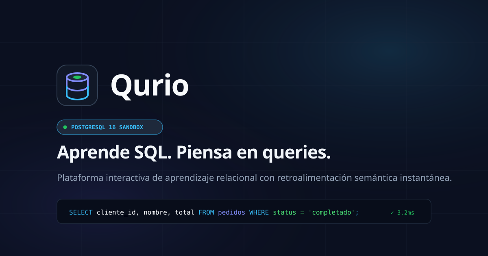
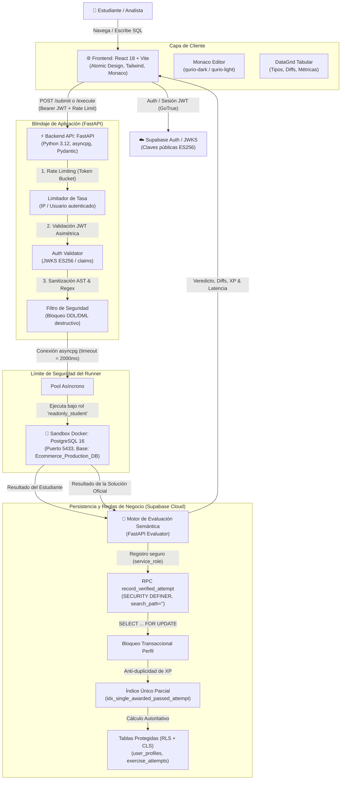

# Qurio — Plataforma Interactiva de Aprendizaje SQL & Analítica Relacional

<p align="center">
  
</p>

<p align="center">
  <strong>«Aprende SQL. Piensa en queries.»</strong><br />
  Plataforma de alta fidelidad técnica para dominar SQL moderno mediante práctica activa contra una base de datos relacional real en un entorno sandbox aislado y seguro.
</p>

<p align="center">
  
  
  
  
  
  
  
  
  
  
</p>

---

## 📑 Tabla de Contenidos

- [¿Qué es Qurio?](#-qué-es-qurio)
- [Características Principales](#-características-principales)
- [Arquitectura del Sistema](#-arquitectura-del-sistema)
  - [Diagrama de Arquitectura Global](#diagrama-de-arquitectura-global)
  - [Flujo de Evaluación Semántica](#flujo-de-evaluación-semántica)
- [Estructura del Monorepo](#-estructura-del-monorepo)
- [El Dataset: `Ecommerce_Production_DB`](#-el-dataset-ecommerce_production_db)
- [Seguridad del Sandbox](#-seguridad-del-sandbox)
- [Instalación y Puesta en Marcha Local](#-instalación-y-puesta-en-marcha-local)
  - [Prerrequisitos](#prerrequisitos)
  - [1. Clonar el Repositorio](#1-clonar-el-repositorio)
  - [2. Iniciar el Sandbox PostgreSQL (Docker)](#2-iniciar-el-sandbox-postgresql-docker)
  - [3. Configurar y Ejecutar la API (FastAPI)](#3-configurar-y-ejecutar-la-api-fastapi)
  - [4. Configurar y Ejecutar el Frontend (React + Vite)](#4-configurar-y-ejecutar-el-frontend-react--vite)
  - [5. Ejecutar la Suite de Pruebas Automatizadas](#5-ejecutar-la-suite-de-pruebas-automatizadas)
- [Variables de Entorno](#-variables-de-entorno)
- [Estándares de Ingeniería & Sistema de Diseño](#-estándares-de-ingeniería--sistema-de-diseño)
- [Licencia y Autoría](#-licencia-y-autoría)

---

## 💡 ¿Qué es Qurio?

La mayoría de las plataformas de aprendizaje de SQL caen en dos extremos: o son cuestionarios teóricos de opción múltiple desvinculados de la realidad, o comparan cadenas de texto SQL con expresiones regulares frágiles (haciendo que una consulta perfectamente válida falle si usas un alias distinto o un espacio extra).

**Qurio** fue concebido bajo una premisa fundamental: **el usuario debe escribir código SQL real contra un motor PostgreSQL real.**

- **Evaluador Semántico de Conjuntos:** No compara el texto de tu consulta. Ejecuta tu código en el sandbox y compara el **conjunto relacional resultante** (filas, columnas, tipos de datos, cardinalidad, multiconjuntos con `Counter` y comprobación estricta de orden cuando se especifica). Si tu lógica arroja el conjunto de datos esperado, tu solución es aprobada, sin importar si usaste mayúsculas, minúsculas o alias alternativos.
- **Entorno Aislado e Inmune:** Cada consulta enviada se ejecuta en un contenedor Docker con PostgreSQL 16 bajo el rol restringido `readonly_student`, con `statement_timeout = 2000ms`, transacciones de solo lectura y un sanitizador de seguridad de doble capa en FastAPI.
- **Experiencia de Estación de Trabajo:** Diseñado para sentirse como una herramienta profesional (estilo DataGrip, TablePlus o VS Code), no como un juguete interactivo infantil.

---

## ✨ Características Principales

### ⚡ IDE de Estación de Trabajo (Monaco Editor)
- Integración completa con el motor de **Monaco Editor** (el núcleo de VS Code).
- Temas cromáticos personalizados: `qurio-dark` y `qurio-light` adaptados al sistema de diseño.
- Resaltado sintáctico de PostgreSQL, autocompletado y tipografía técnica `JetBrains Mono`.
- Atajo de teclado nativo: **`⌘ + Enter`** (macOS) o **`Ctrl + Enter`** (Windows/Linux) para ejecución inmediata.
- Herramientas integradas de formateo de palabras reservadas SQL y restablecimiento de plantilla.

### 🌓 Soporte Nativo de Tema Claro y Oscuro
- Sistema reactivo de tokens de diseño con Tailwind CSS y variables CSS dinámicas en `:root` y `.dark`.
- Conmutador instantáneo en la cabecera superior y en la barra de herramientas del espacio de trabajo.
- Persistencia automática de la preferencia en `localStorage` (`qurio_theme`) y detección inteligente de la preferencia del sistema operativo (`prefers-color-scheme`).
- Script anti-parpadeo (anti-FOUC) integrado en el encabezado HTML para una carga limpia y fluida.

### 🔬 SQL Playground Libre
- Entorno de experimentación interactivo sin restricciones de ejercicio para escribir cualquier consulta `SELECT`.
- Explorador lateral de esquemas en vivo con las **10 tablas relacionales** de `Ecommerce_Production_DB`, recuento de filas y claves primarias/foráneas.
- Inserción de plantillas rápidas (`Top 5 Clientes`, `Productos con Stock Crítico`, `Resumen de Ventas`, `Facturación`).
- Consulta express en un clic (`SELECT * FROM tabla LIMIT 10`) y métricas de latencia de ejecución en milisegundos reales.

### 📊 Visualizador Tabular DataGrid de Alta Fidelidad
- Cuadrícula de datos interactiva con numeración de filas y visualización de tipos de datos inferidos (`VARCHAR`, `INT4`, `DECIMAL`, `TIMESTAMPTZ`, `BOOL`).
- Representación visual explícita para valores `NULL` con chips atenuados.
- Visualizador de discrepancias semánticas (`DiffResult`) que explica con claridad técnica por qué una solución difiere del resultado esperado (diferencia en recuento de filas, columnas faltantes o valores no coincidentes).
- Consola de terminal para visualización limpia de errores de PostgreSQL o bloqueos de seguridad.

### 🗺️ Rutas Curriculares Estructuradas (50 Retos)
El plan de estudios de Qurio está organizado en 3 rutas formativas diseñadas con complejidad progresiva:
1. **SQL Foundations (22 Retos - 44%):** `SELECT`, `WHERE`, operadores lógicos, ordenamiento con `ORDER BY`, agregaciones (`COUNT`, `SUM`, `AVG`), agrupamiento con `GROUP BY` y filtrado posterior con `HAVING`.
2. **Relational SQL & Joins (18 Retos - 36%):** Claves foráneas, `INNER JOIN`, `LEFT JOIN`, `RIGHT JOIN`, `FULL OUTER JOIN`, `CROSS JOIN`, uniones (`UNION`, `UNION ALL`) y subconsultas correlacionadas.
3. **Advanced Queries & Analytics (10 Retos - 20%):** Funciones de ventana (`ROW_NUMBER`, `RANK`, `DENSE_RANK`, `LEAD`, `LAG`), expresiones de tabla comunes (`WITH` / CTEs), lógica condicional con `CASE WHEN` y consultas analíticas de negocio.

### 🏆 Gamificación y Rangos Técnicos
- Sistema de **Puntos de Experiencia (XP)** con cálculo dinámico y penalizaciones visuales progresivas por pistas (-15% por cada pista consultada).
- **Medallas de Ingeniería Desbloqueables:** Insignias de *Habilidad*, *Constancia* y *Progreso* (ej. *Primer Commit SQL*, *Maestro del Join*, *Arquitecto de Agregaciones*, *Sin Pistas*).
- **Perfil del Estudiante:** Gráfico de cadencia diaria de 30 días (mapa de calor estilo GitHub), barra de progreso hacia rangos de ingeniería y log de auditoría con historial de consultas ejecutadas.

### 🛡️ Autenticidad & Estándares Anti-AI Slop
- **Validación Inline Rigurosa:** Cero uso de `alert()` o `confirm()` nativos; todos los errores se muestran inline con tokens de diseño.
- **Página 404 Temática SQL:** Consola interactiva con código de error `SQLSTATE 42P01: relation does not exist in schema public` y sugerencia (`HINT`).
- **Favicon Vectorial Propio:** Isotipo matemático puro (cilindro relacional en capas con núcleo verde esmeralda activo).
- **Metadatos Open Graph:** Imagen y descripción institucional para previsualizaciones sociales atractivas.
- **Transparencia Total:** Política de privacidad honesta (sin cookies publicitarias de terceros) y enlaces reales a perfiles y código fuente (sin direcciones ficticias).

---

## 🏛️ Arquitectura del Sistema

Qurio utiliza un modelo arquitectónico desacoplado de alto rendimiento:

### Diagrama de Arquitectura Global



### Flujo de Evaluación Semántica y Registro Protegido

```mermaid
sequenceDiagram
    autonumber
    actor U as Estudiante
    participant FE as Frontend (Monaco)
    participant API as FastAPI Runner
    participant DB as Docker PostgreSQL Sandbox
    participant EV as Evaluador Semántico
    participant SB as Supabase Cloud (RPC)

    U->>FE: Escribe query y presiona ⌘ + Enter
    FE->>API: POST /api/v1/exercises/{id}/submit (Bearer JWT, query, hints)
    API->>API: Valida Rate Limit y firma JWT (ES256 vía JWKS)
    API->>API: Sanitización de seguridad (Bloqueo DDL/DML, multi-statement)
    alt Contiene sentencias destructivas o inyección
        API-->>FE: 400 Bad Request (Explicación técnica en terminal)
    else Consulta válida
        par Ejecutar consulta del estudiante
            API->>DB: SET statement_timeout = 2000; <query_estudiante>
            DB-->>API: Resultado del Estudiante (filas, columnas, tipos)
        and Ejecutar solución de referencia
            API->>DB: SET statement_timeout = 2000; <query_esperada>
            DB-->>API: Resultado Esperado
        end
        API->>EV: Comparar conjuntos (Columnas, Cardinalidad, Tipos, Multiconjunto)
        EV-->>API: Veredicto semántico (is_correct, diffs, metrics)
        opt Usuario autenticado y consulta aprobada
            API->>SB: RPC record_verified_attempt(sub_jwt, id_ejercicio, ...) [service_role]
            Note over SB: Bloqueo transaccional FOR UPDATE<br/>Cálculo proporcional de XP autoritativo<br/>Validación estricta de unicidad en PASSED
            SB-->>API: 200 OK { attempt_id, xp_awarded, is_first_passed, ... }
        end
        API-->>FE: 200 OK con veredicto estructurado y XP consolidado
        FE->>U: Renderiza DataGrid + SuccessModal / Consola de Diffs
    end
```

---

## 📂 Estructura del Monorepo

```
Qurio/
├── .agents/skills/             # Colección de habilidades para desarrollo asistido
├── apps/
│   ├── api/                    # ⚡ Backend FastAPI (Python 3.12)
│   │   ├── app/
│   │   │   ├── core/           # Configuración Pydantic, Auth ES256/JWKS, Rate Limit y Supabase Service
│   │   │   │   ├── auth.py     # Autenticación autoritativa JWT (ES256/JWKS Supabase)
│   │   │   │   ├── config.py   # Configuración de entornos y secretos
│   │   │   │   ├── rate_limit.py # Limitador de tasa por token-bucket
│   │   │   │   └── supabase.py # Cliente seguro para invocación de RPCs
│   │   │   ├── modules/
│   │   │   │   ├── curriculum/ # Repositorio de ejercicios y catálogo (REST / Fallback)
│   │   │   │   └── runner/     # Pool asyncpg, Evaluador semántico, Seguridad y Router
│   │   │   └── main.py         # Punto de entrada de la aplicación FastAPI
│   │   ├── tests/              # Suite de 64 pruebas automáticas (Pytest + Asyncio)
│   │   │   ├── test_auth.py    # Pruebas de tokens ES256, expiración y audiencias
│   │   │   ├── test_evaluator.py # Pruebas del motor de evaluación de conjuntos
│   │   │   ├── test_integration.py # Pruebas de integración HTTP y Sandbox
│   │   │   ├── test_rate_limit.py  # Pruebas de límites de tasa
│   │   │   ├── test_security.py    # Pruebas de sanitización AST y regex
│   │   │   └── test_supabase_migration.py # 9 suites de privilegios, CLS, concurrencia y RPC
│   │   ├── Dockerfile          # Contenerización de la API
│   │   └── requirements.txt    # Dependencias de Python
│   │
│   └── web/                    # 🌐 Frontend React 18 + Vite + TypeScript
│       ├── public/             # Isotipo SVG, Favicon y vector Open Graph
│       ├── src/
│       │   ├── components/     # Árbol estricto bajo Atomic Design Pragmático
│       │   │   ├── atoms/      # Button, Badge, TextInput, KbdShortcut, RadioTab
│       │   │   ├── molecules/  # SearchInput, FormField, MetricTile, SuccessModal, etc.
│       │   │   ├── organisms/  # MonacoEditorPanel, DataGridResults, ExerciseSpecPanel,
│       │   │   │               # TracksView, SqlPlaygroundView, AchievementsView, etc.
│       │   │   └── templates/  # DashboardLayout, WorkspaceLayout
│       │   ├── hooks/          # useAuth, useTheme (modo claro/oscuro persistente)
│       │   ├── lib/            # Cliente API FastAPI y cliente Supabase SDK
│       │   ├── types/          # Definiciones estrictas de TypeScript
│       │   ├── App.tsx         # Coordinador principal y enrutador de vistas
│       │   └── index.css       # Tokens de diseño Tailwind con variables CSS
│       ├── tailwind.config.js  # Paleta de diseño Terminal Glow Minimal
│       └── vite.config.ts      # Configuración de compilación Vite
│
├── database/
│   ├── sandbox/                # 🐳 Definición del contenedor PostgreSQL Sandbox
│   │   ├── init.sql            # Rol de solo lectura readonly_student y timeouts
│   │   └── ecommerce_seed.sql  # Dataset de 10 tablas de Ecommerce_Production_DB
│   └── supabase/               # ☁️ Esquemas DDL, catálogo y endurecimiento Supabase Cloud
│       ├── 01_schema.sql       # Tablas de perfiles, rutas, módulos, intentos y logros
│       ├── 02_seed_curriculum.sql # Catálogo semilla de ejercicios y pistas
│       ├── 03_security_hardening.sql # Hardening v5.0: RPC autoritativa, RLS/CLS, anti-NULL, search_path=''
│       ├── rollback_security_hardening.sql # Reversión segura preservando índices de integridad
│       └── diagnose_privileges.sql # Auditoría de privilegios tabla/columna y consistencia de XP
│
├── docs/                       # 📚 Documentación técnica, PRD, SAD y bitácora
│   ├── security/               # 🛡️ Auditorías y resultados de seguridad de Fase 9
│   │   ├── SECURITY_AUDIT.md   # Auditoría inicial de superficie de ataque
│   │   └── SECURITY_REMEDIATION_RESULTS.md # Reporte técnico final v5.0 y certificación
│   ├── BITACORA.md             # Registro cronológico detallado de hitos y decisiones
│   ├── PRD.md                  # Especificación de requerimientos de producto
│   └── SAD.md                  # Documento de arquitectura de software
│
├── docker-compose.yml          # Orquestación de contenedores locales (Sandbox + API)
├── AGENTS.md                   # Reglas de ingeniería, Anti-AI Slop y Atomic Design
└── README.md                   # Este documento
```

---

## 🗄️ El Dataset: `Ecommerce_Production_DB`

El sandbox PostgreSQL contiene una base de datos relacional realista de comercio electrónico con 10 tablas interconectadas diseñadas para permitir consultas de cualquier nivel de complejidad:

| Tabla | Registros | Descripción y Contenido |
| :--- | :---: | :--- |
| **`clientes`** | 15 | Identificadores, nombres, emails, ciudades, países y fechas de registro de clientes. |
| **`categorias`** | 5 | Categorías de catálogo (Laptops, Monitores, Periféricos, Almacenamiento, Mobiliario). |
| **`proveedores`** | 5 | Empresas proveedoras internacionales, países de origen y teléfonos de contacto. |
| **`productos`** | 15 | Catálogo con precios unitarios, IDs de categoría y proveedor, y existencias. |
| **`pedidos`** | 15 | Órdenes de compra con estados (`completado`, `pendiente`, `cancelado`, `procesando`), montos y fechas. |
| **`detalle_pedidos`** | 24 | Líneas de pedido que vinculan pedidos y productos con cantidades y precios históricos. |
| **`facturas`** | 13 | Comprobantes fiscales con montos totales, estados (`pagada`, `pendiente`, `anulada`) y fechas de emisión. |
| **`pagos`** | 11 | Registros de transacciones vinculadas a facturas, con método de pago (`tarjeta_credito`, `transferencia`, `paypal`), montos, fechas y estados. |
| **`almacenes`** | 3 | Ubicaciones físicas de distribución (Madrid, Bilbao, Valencia) con capacidad en m². |
| **`inventario`** | 19 | Existencias físicas por producto y almacén con control de stock y actualización temporal. |

---

## 🔒 Seguridad Multicapa y Endurecimiento de Producción

La regla de oro de Qurio es la **seguridad incondicional**. La ejecución de código SQL arbitrario introducido por usuarios y la asignación de recompensas de ingeniería requieren múltiples anillos concéntricos de defensa, formalizados y certificados en la **Fase 9 de Hardening**:

### 1. Aislamiento del Sandbox de Ejecución (PostgreSQL en Docker)
* **Contenedor Dedicado:** El sandbox de práctica se ejecuta en un contenedor Docker aislado (`postgres:16-alpine`), físicamente desacoplado de las bases de datos de producción o autenticación.
* **Rol de Base de Datos Restringido (`readonly_student`):**
  * Permisos exclusivos: `GRANT SELECT ON ALL TABLES IN SCHEMA public`.
  * Revocación total de permisos DDL: `REVOKE CREATE ON SCHEMA public FROM PUBLIC`.
  * Transacciones forzadas de solo lectura: `SET TRANSACTION READ ONLY`.
* **Límites de Recursos y Tiempos de Espera:**
  * `statement_timeout = 2000ms` (bloquea de forma determinista cualquier consulta que exceda 2 segundos).
  * `work_mem = 16MB` (limita la memoria RAM por consulta para mitigar ataques de denegación de servicio por consumo exhaustivo).
* **Filtro AST y Expresiones Regulares en FastAPI (`security.py`):**
  * Bloqueo de sentencias múltiples separadas por punto y coma (prevención de SQL Injection y stacked queries).
  * Bloqueo de DDL: `DROP`, `ALTER`, `CREATE`, `TRUNCATE`.
  * Bloqueo de DML destructivo: `INSERT`, `UPDATE`, `DELETE`, `MERGE`.
  * Bloqueo de funciones de sistema o escalamiento: `pg_sleep`, `pg_terminate_backend`, `dblink`, etc.
  * Limitador automático a un máximo de 1,000 registros devueltos para salvaguardar el ancho de banda.

### 2. Blindaje de Backend y Supabase Cloud (Hardening v5.0)
* **Autenticación Autoritativa JWT (`auth.py`):**
  * Validación estricta asimétrica con algoritmo **ES256 (ECDSA P-256)** mediante el endpoint oficial JWKS de Supabase con caché de claves públicas en memoria y verificación de `aud`, `iss` y vigencia temporal (`exp`).
  * La identidad del usuario (`user_id`) proviene exclusivamente del claim verificado `sub` del JWT en el backend; el cliente web no tiene capacidad de declarar su identidad ni modificar recompensas.
* **Función RPC Atómica y Autoritativa (`public.record_verified_attempt`):**
  * Definida como `SECURITY DEFINER` con blindaje total `SET search_path = ''` para prevenir ataques de secuestro de esquemas (*search_path hijacking*).
  * Acceso estrictamente restringido: `REVOKE EXECUTE ... FROM PUBLIC, anon, authenticated` y otorgado con exclusividad a `service_role` (invocado únicamente desde FastAPI).
  * Bloqueo transaccional de concurrencia: ejecuta `SELECT ... FOR UPDATE` sobre la fila del perfil de usuario, garantizando idempotencia y evitando condiciones de carrera en ráfagas de consultas.
  * Cálculo autoritativo de XP: la función calcula de forma proporcional el XP ganado basado en la recompensa del ejercicio (`xp_reward`) y la tasa de penalización por pistas (-15% por pista utilizada), sin mínimos artificiales y validando rangos $[0, \text{xp\_reward}]$.
  * Actualización atómica del progreso de módulos: calcula en tiempo real los ejercicios únicos aprobados y marca el módulo completado si y solo si todos los ejercicios fueron superados.
* **Seguridad a Nivel de Columna (Column-Level Security - CLS) & RLS:**
  * Prohibición absoluta de mutación: se revocaron todos los permisos de `INSERT`, `UPDATE` y `DELETE` sobre `public.exercise_attempts` para roles de cliente (`anon`, `authenticated`), canalizando todo intento exclusivamente por la RPC verificada.
  * Se revocaron los privilegios `SELECT` por columna en `exercise_attempts` a `PUBLIC` y `anon`.
  * Las columnas sensibles `xp` y `level` de `public.user_profiles` no admiten mutación por parte de `authenticated` ni `anon`.
* **Restricción de Integridad Fuerte:**
  * Índice único parcial `idx_single_awarded_passed_attempt` sobre `(user_id, exercise_id) WHERE status = 'PASSED' AND xp_awarded > 0`. Protege la base de datos a nivel de motor ante cualquier intento de doble otorgamiento de XP en un ejercicio ya aprobado.
* **Rate Limiting (`rate_limit.py`):**
  * Limitador de tasa en memoria por Token Bucket: protege los endpoints `/submit` y `/execute` limitando a 30 consultas por minuto para usuarios autenticados y 10 por minuto para invitados/IPs anónimas.

---

## 🚀 Instalación y Puesta en Marcha Local

### Prerrequisitos

- **Docker Desktop** (con soporte para Docker Compose).
- **Node.js 18+** y **npm** (para el frontend de React).
- **Python 3.12+** (para el backend de FastAPI).
- **Git**.

---

### 1. Clonar el Repositorio

```bash
git clone https://github.com/ErickKNT/qurio.git
cd Qurio
```

---

### 2. Iniciar el Sandbox PostgreSQL (Docker)

Levanta el contenedor de PostgreSQL 16 con el dataset pre-cargado y el usuario de solo lectura:

```bash
docker compose up -d postgres-sandbox
```

Verifica que el contenedor esté saludable (`healthy`):

```bash
docker ps --filter "name=qurio-postgres-sandbox"
```

> **Puerto Local:** `localhost:5433`  
> **Base de Datos:** `Ecommerce_Production_DB`  
> **Usuario de Lectura:** `readonly_student`  
> **Contraseña:** `student_secure_pwd_2026`  
> *(Puedes conectar tu cliente favorito como DataGrip, DBeaver o TablePlus directamente a este puerto).*

---

### 3. Configurar y Ejecutar la API (FastAPI)

Navega a la carpeta de la API:

```bash
cd apps/api
```

Crea y activa un entorno virtual de Python:

```bash
# En Windows (PowerShell):
python -m venv .venv
.venv\Scripts\Activate.ps1

# En Linux / macOS:
python3 -m venv .venv
source .venv/bin/activate
```

Instala las dependencias:

```bash
pip install -r requirements.txt
```

Crea el archivo `.env` a partir del ejemplo:

```bash
# En Windows:
copy .env.example .env

# En Linux / macOS:
cp .env.example .env
```

Inicia el servidor de desarrollo de FastAPI:

```bash
uvicorn app.main:app --host 127.0.0.1 --port 8000 --reload
```

> **API activa en:** `http://localhost:8000`  
> **Documentación interactiva Swagger:** `http://localhost:8000/docs`  
> **Documentación ReDoc:** `http://localhost:8000/redoc`

---

### 4. Configurar y Ejecutar el Frontend (React + Vite)

En una nueva terminal, navega a la carpeta del frontend:

```bash
cd apps/web
```

Instala los paquetes de Node:

```bash
npm install
```

Crea el archivo `.env` para el frontend:

```bash
# En Windows:
copy .env.example .env

# En Linux / macOS:
cp .env.example .env
```

Inicia el servidor de desarrollo con Vite:

```bash
npm run dev
```

> **Aplicación Web activa en:** `http://localhost:5173`

---

### 5. Ejecutar la Suite de Pruebas Automatizadas

La suite de pruebas automatizadas de Qurio evalúa la seguridad, autenticación, rate limiting, evaluación semántica y las migraciones de base de datos con concurrencia contra el Sandbox de Docker:

```bash
cd apps/api
pytest tests/ -v
# En Windows con el entorno virtual activo:
.\.venv\Scripts\pytest.exe tests -v
```

**Resultado verificado:**
```text
tests/test_auth.py::test_guest_user_when_no_authorization_header PASSED
tests/test_auth.py::test_valid_es256_token_decodes_successfully PASSED
tests/test_evaluator.py::test_exact_match_success PASSED
tests/test_evaluator.py::test_order_agnostic_multiset_match PASSED
tests/test_security.py::test_select_query_allowed PASSED
tests/test_security.py::test_drop_table_blocked PASSED
tests/test_rate_limit.py::test_rate_limit_allows_normal_burst_and_blocks PASSED
tests/test_integration.py::test_live_sandbox_execution PASSED
tests/test_supabase_migration.py::test_privileges_are_strictly_revoked_for_public_and_clients PASSED
tests/test_supabase_migration.py::test_record_verified_attempt_rejects_null_parameters PASSED
tests/test_supabase_migration.py::test_authoritative_xp_calculation_across_rewards_and_hints PASSED
tests/test_supabase_migration.py::test_concurrent_attempts_prevent_duplicate_xp PASSED
tests/test_supabase_migration.py::test_unauthorized_user_cannot_record_progress_for_another PASSED

======================== 64 passed in 3.80s ========================
```

Para verificar la compilación estricta de TypeScript y empaquetado optimizado del frontend:

```bash
cd apps/web
npm run build
```

---

## 🔑 Variables de Entorno

### Backend (`apps/api/.env`)

| Variable | Tipo | Valor por Defecto | Descripción |
| :--- | :---: | :--- | :--- |
| `API_V1_STR` | String | `/api/v1` | Prefijo de rutas de la API REST. |
| `PROJECT_NAME` | String | `Qurio Interactive SQL Runner` | Nombre del servicio. |
| `BACKEND_CORS_ORIGINS` | JSON List | `["http://localhost:5173", "http://127.0.0.1:5173"]` | Orígenes permitidos para CORS. |
| `SANDBOX_HOST` | String | `localhost` | Host del contenedor PostgreSQL. |
| `SANDBOX_PORT` | Entero | `5433` | Puerto mapeado de Docker. |
| `SANDBOX_DB` | String | `Ecommerce_Production_DB` | Nombre de la base de datos de ejercicios. |
| `SANDBOX_USER` | String | `readonly_student` | Rol con permisos estrictos de solo lectura. |
| `SANDBOX_PASSWORD` | String | `student_secure_pwd_2026` | Contraseña del rol sandbox. |
| `SUPABASE_URL` | String | *(Opcional)* | URL del proyecto Supabase Cloud (`https://<id>.supabase.co`). |
| `SUPABASE_ANON_KEY` | String | *(Opcional)* | Clave anónima pública de Supabase. |
| `SUPABASE_SERVICE_ROLE_KEY` | String | *(Privada)* | Clave maestra privilegiada de backend para ejecutar la RPC autoritativa `record_verified_attempt`. **Nunca exponer al cliente**. |
| `SUPABASE_JWT_SECRET` | String | *(Opcional)* | Secreto simétrico HMAC para validación de tokens de prueba. |
| `SUPABASE_JWKS_URL` | String | *(Auto)* | URL de claves públicas JWKS (`<SUPABASE_URL>/auth/v1/.well-known/jwks.json`). |
| `SUPABASE_JWT_AUDIENCE` | String | `authenticated` | Audiencia esperada del JWT. |
| `SUPABASE_JWT_ISSUER` | String | *(Auto)* | Emisor esperado del JWT (`<SUPABASE_URL>/auth/v1`). |

*(Nota: Si no se configuran las credenciales de Supabase, el backend utiliza automáticamente un repositorio de datos semilla en memoria con resiliencia total).*

### Frontend (`apps/web/.env`)

| Variable | Tipo | Valor por Defecto | Descripción |
| :--- | :---: | :--- | :--- |
| `VITE_API_URL` | String | `http://localhost:8000` | URL base del backend FastAPI. |
| `VITE_SUPABASE_URL` | String | *(Opcional)* | URL de tu instancia de Supabase. |
| `VITE_SUPABASE_ANON_KEY` | String | *(Pública)* | Clave pública anónima de Supabase. **Prohibido incluir claves service_role en el cliente web.** |

---

## 🎨 Estándares de Ingeniería & Sistema de Diseño

El desarrollo de Qurio sigue directrices estrictas establecidas en [`AGENTS.md`](./AGENTS.md):

### 1. Atomic Design Pragmático
Todo componente reutilizable pertenece obligatoriamente a uno de los 4 niveles jerárquicos:
- **Átomos (`src/components/atoms/`):** Bloques indivisibles estilizados (`Button`, `Badge`, `TextInput`, `KbdShortcut`, `RadioTab`).
- **Moléculas (`src/components/molecules/`):** Combinaciones funcionales (`SearchInput`, `StreakPill`, `FormField`, `MetricTile`, `TrackCard`, `AchievementCard`).
- **Organismos (`src/components/organisms/`):** Módulos autónomos complejos (`MonacoEditorPanel`, `DataGridResults`, `ExerciseSpecPanel`, `TracksView`, `SqlPlaygroundView`, `UserProfileView`, `SidebarNav`, `TopHeader`).
- **Plantillas (`src/components/templates/`):** Estructuras de layout de página desacopladas de la lógica de datos (`DashboardLayout`, `WorkspaceLayout`).

### 2. Estética *Terminal Glow Minimal*
- **Paleta Oscura:** Fondo `#0B1020`, superficies `#111827` / `#172033`, bordes `#1E293B`.
- **Paleta Clara:** Fondo `#F8FAFC`, superficies `#FFFFFF` / `#F1F5F9`, bordes `#E2E8F0`.
- **Acentos Técnicos:** Cyan `#38BDF8`, Índigo `#6366F1`, Esmeralda `#22C55E`, Ámbar `#F59E0B`, Salmón de Error `#EF4444`.
- **Tipografía Dual:** `Inter` / `Plus Jakarta Sans` para lectura de interfaz y `JetBrains Mono` para código SQL, latencias, tipos de datos y atajos de teclado.

---

## 📄 Licencia y Autoría

- **Desarrollado por:** [Erick KNT](https://github.com/ErickKNT/qurio) (`erickipn14@gmail.com`).
- **Licencia:** Este proyecto se distribuye bajo los términos de la **Licencia MIT**. Consulta el archivo `LICENSE` para más información.

---

<p align="center">
  Construido con dedicación para ingenieros de datos, analistas y desarrolladores que desean dominar SQL con rigor.<br />
  <strong>Qurio © 2026</strong>
</p>
