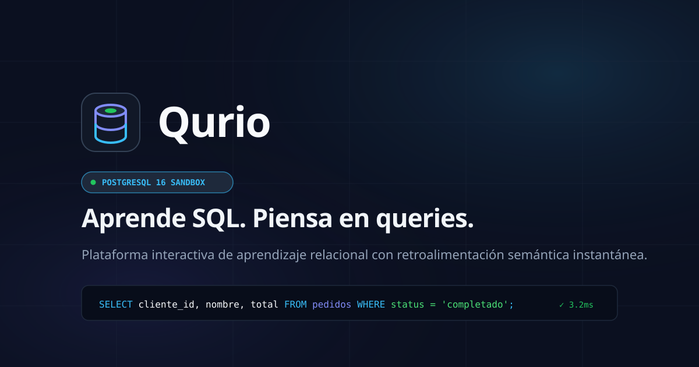
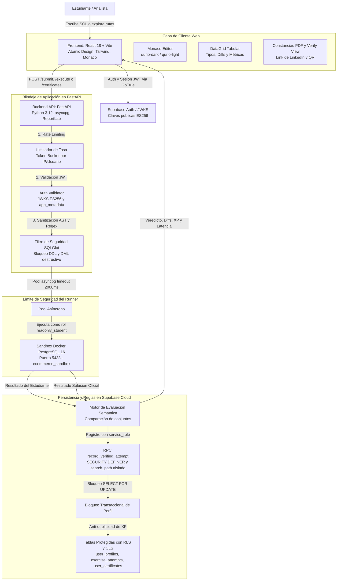
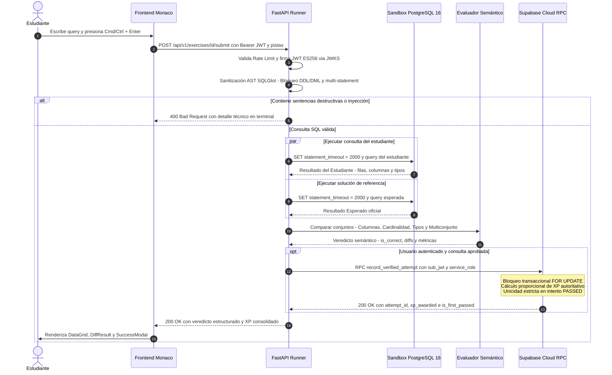
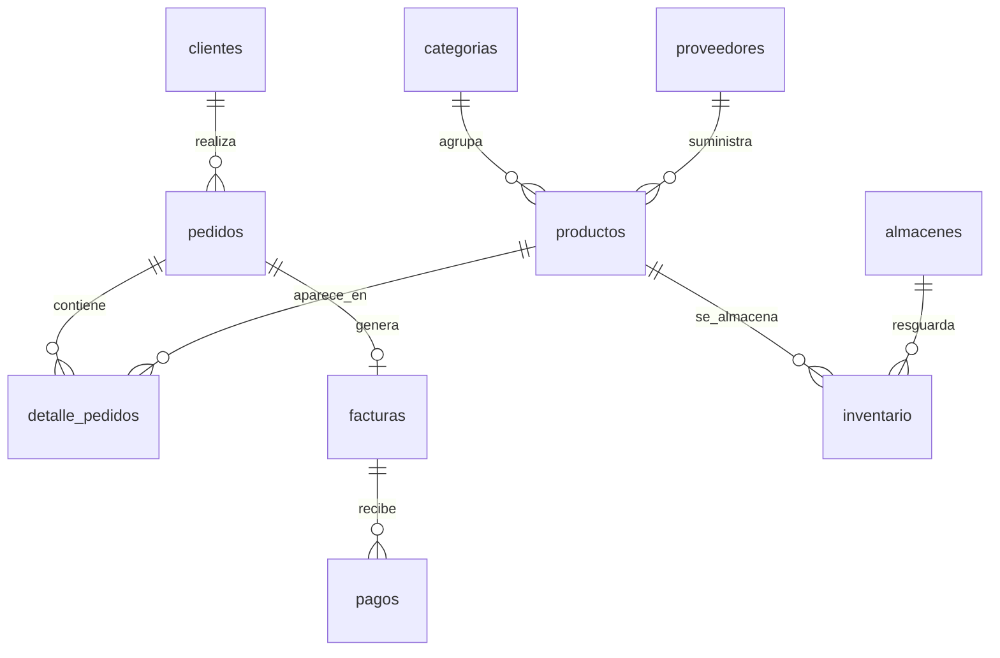

# Qurio — Plataforma Interactiva de Aprendizaje SQL & Analítica Relacional

<p align="center">
  
</p>

<p align="center">
  <strong>«Aprende SQL. Piensa en queries.»</strong><br />
  Plataforma de alta fidelidad técnica para dominar SQL moderno mediante práctica activa contra PostgreSQL 16 real en un sandbox aislado, con evaluación semántica, guías visuales y constancias verificables en PDF/QR.
</p>

<p align="center">
  
  
  
  
  
  
  
  
  
  
  
  
</p>

---

## 📑 Tabla de Contenidos

- [¿Qué es Qurio?](#-qué-es-qurio)
- [Características Principales](#-características-principales)
- [Arquitectura del Sistema](#-arquitectura-del-sistema)
  - [Diagrama de Arquitectura Global](#diagrama-de-arquitectura-global)
  - [Flujo de Evaluación Semántica](#flujo-de-evaluación-semántica)
- [Estructura del Monorepo](#-estructura-del-monorepo)
- [El Dataset: `Ecommerce_Production_DB`](#-el-dataset-ecommerce_production_db)
- [Seguridad del Sandbox](#-seguridad-del-sandbox)
- [Instalación y Puesta en Marcha Local](#-instalación-y-puesta-en-marcha-local)
  - [Prerrequisitos](#prerrequisitos)
  - [1. Clonar el Repositorio](#1-clonar-el-repositorio)
  - [2. Iniciar Contenedores Sandbox y API (Docker)](#2-iniciar-contenedores-sandbox-y-api-docker)
  - [3. Ejecutar la API manualmente con Python (Opcional)](#3-ejecutar-la-api-manualmente-con-python-opcional)
  - [4. Configurar y Ejecutar el Frontend (React + Vite)](#4-configurar-y-ejecutar-el-frontend-react--vite)
  - [5. Ejecutar la Suite de Pruebas Automatizadas](#5-ejecutar-la-suite-de-pruebas-automatizadas)
- [Variables de Entorno](#-variables-de-entorno)
- [Estándares de Ingeniería & Sistema de Diseño](#-estándares-de-ingeniería--sistema-de-diseño)
- [Licencia y Autoría](#-licencia-y-autoría)

---

## 💡 ¿Qué es Qurio?

La mayoría de las plataformas de aprendizaje de SQL caen en dos extremos: o son cuestionarios teóricos de opción múltiple desvinculados de la realidad, o comparan cadenas de texto SQL con expresiones regulares frágiles (haciendo que una consulta perfectamente válida falle si usas un alias distinto o un espacio extra).

**Qurio** fue concebido bajo una premisa fundamental: **el usuario debe escribir código SQL real contra un motor PostgreSQL real.**

- **Evaluador Semántico de Conjuntos:** No compara el texto de tu consulta. Ejecuta tu código en el sandbox y compara el **conjunto relacional resultante** (filas, columnas, tipos de datos, cardinalidad, multiconjuntos con `Counter` y comprobación estricta de orden cuando se especifica). Si tu lógica arroja el conjunto de datos esperado, tu solución es aprobada, sin importar si usaste mayúsculas, minúsculas o alias alternativos.
- **Entorno Aislado e Inmune:** Cada consulta enviada se ejecuta en un contenedor Docker con PostgreSQL 16 bajo el rol restringido `readonly_student`, con `statement_timeout = 2000ms`, transacciones de solo lectura y un sanitizador de seguridad AST (SQLGlot) + Regex en FastAPI.
- **Experiencia de Estación de Trabajo:** Diseñado para sentirse como una herramienta profesional (estilo DataGrip, TablePlus o VS Code), con soporte real para escritorio, tablet y móvil.

---

## ✨ Características Principales

### ⚡ IDE de Estación de Trabajo (Monaco Editor) & Modo Dual Probar / Enviar
- Integración completa con el motor de **Monaco Editor** (el núcleo de VS Code) y temas personalizados `qurio-dark` y `qurio-light`.
- Autocompletado inteligente de SQL PostgreSQL (palabras clave, tablas, columnas reales del esquema y aliases).
- Tipografía técnica `JetBrains Mono` con **ligaduras desactivadas** (`fontLigatures: false` y `font-variant-ligatures: none`), garantizando que operadores como `>=`, `<=`, `!=` y `<>` se muestren literalmente tal como aparecen en el teclado.
- **Resaltado Sintáctico de SQL en Consignas y Guías:** Tanto en las tarjetas de ejercicio, pistas y solución oficial como en las guías teóricas, todas las palabras reservadas y cláusulas SQL destacan automáticamente en `JetBrains Mono` (`formatSqlProse` / `highlightSqlBlock`).
- **Flujo Dual sin Penalización:**
  - **`Probar` (`⌘/Ctrl + Shift + Enter`):** Ejecuta consultas exploratorias libres sobre el Sandbox (`/api/v1/playground/execute`) sin evaluar ni sumar intentos fallidos.
  - **`Enviar Solución` (`⌘/Ctrl + Enter`):** Ejecuta la evaluación semántica completa contra la solución oficial.
- **Formateador jerárquico SQL (`sql-formatter`):** reestructura consultas bajo estilo PostgreSQL mediante botón o atajo **`Shift + Alt + F`**.

### 🔬 SQL Playground Multi-Tab, Diagrama ER & Referencia `⌘K`
- **Playground Multi-Pestaña e Historial:** Hasta **6 pestañas simultáneas** persistentes (`localStorage`), previsualización de tablas en 1 clic (`SELECT * FROM ... LIMIT 50;`), plantillas rápidas y pestaña integrada de **Historial**.
- **Diagrama Entidad-Relación Interactivo (`ErDiagramModal`):** Visualización de las **10 tablas canónicas** y **9 relaciones FK** con conectores SVG curvos, zoom ajustable, resaltado de relaciones y salto directo al Playground.
- **Referencia Rápida PostgreSQL 16 (`/reference`) + Paleta `⌘K`:** Catálogo buscable de sintaxis (incluida referencia informativa DDL/DML) y paleta de comandos rápida (`⌘K` / `Ctrl+K`) para saltar entre retos, guías, tablas y sintaxis.
- **Responsividad Móvil Real:** Barra lateral en drawer deslizable, pestañas móviles dedicada en Playground (`Tablas`, `Editor SQL`, `Resultados`) y salto automático a resultados.

### 📊 Visualizador Tabular DataGrid Redimensionable
- Cuadrícula de datos interactiva con numeración de filas, tipos de datos inferidos (`VARCHAR`, `INT4`, `DECIMAL`, `TIMESTAMPTZ`, `BOOL`) y chips explícitos para valores `NULL`.
- **Panel ergonómico redimensionable:** divisor horizontal arrastrable entre el editor y los resultados (`28%`–`78%`, persistido en `localStorage`) y botón **Expandir / Restaurar** (`76%`).
- Visualizador de discrepancias semánticas (`DiffResult`) y consola de terminal para errores de PostgreSQL o bloqueos AST.

### 🗺️ Mapa Curricular (16 Módulos), 16 Guías Teóricas Modulares & 76 Retos Anti-Spoilers
El plan de estudios oficial consta de **4 rutas formativas (16 módulos, 76 retos y 228 pistas progresivas)** bajo los estándares documentados en [`docs/pedagogia/`](./docs/pedagogia/qurio_pedagogical_specification_ai_agent_framework.md) y [`.agents/rules/sql-pedagogy.md`](./.agents/rules/sql-pedagogy.md):
1. **Fundamentos de SQL (`24` Retos):** `SELECT`, `WHERE`, operadores lógicos, `ORDER BY`, agregaciones (`COUNT`, `SUM`, `AVG`), `GROUP BY` y `HAVING`.
2. **SQL Relacional (`20` Retos):** Claves foráneas, `INNER JOIN`, `LEFT JOIN`, `FULL OUTER JOIN`, `CROSS JOIN`, `SELF JOIN`, operaciones de conjunto (`UNION`, `INTERSECT`, `EXCEPT`) y `COALESCE`.
3. **Consultas Avanzadas (`16` Retos):** Subconsultas correlacionadas (`EXISTS` / `NOT EXISTS`), `CASE WHEN`, CTEs con `WITH` y funciones analíticas de ventana (`ROW_NUMBER`, `DENSE_RANK`, `SUM OVER`, `LAG`).
4. **Ingeniería y Manipulación de Datos (`16` Retos — DML & DDL):** `INSERT`, `INSERT INTO ... SELECT`, `UPDATE ... FROM`, `DELETE`, `RETURNING`, diseño y evolución de tablas (`CREATE TABLE`, `ALTER TABLE`, `DROP TABLE`, `CHECK`, claves `PK`/`FK`) e índices B-Tree, compuestos y parciales (`CREATE/DROP INDEX`), ejecutados en **esquemas efímeros transaccionales `pg_temp` con `ROLLBACK` determinista**.

- **16 Guías Teóricas con Micro-Diagramas (`ModuleGuideModal`):** Explicación del orden lógico de ejecución en PostgreSQL 16, diagramas `Entrada → Cláusula → Salida`, ejemplos ilustrativos libres de spoilers y errores frecuentes por módulo.
- **Grid Bento 2×2 & Mapa Curricular Dual (`LearningRoadmapMap`):** Selector entre **Árbol de Habilidades** (16 nodos en topología DAG hasta `M13 → [M14, M15] → M16`) y **Camino por Etapas** (4 columnas) conectado al panel de estaciones (`#01..#76`).
- **14 Medallas de Ingeniería:** Logros reactivos por progreso (`20`, `40`, `76` retos), racha (`3`, `7` días), baja latencia (`<5 ms`) y dominio técnico (`JOIN`, `NULL`, `CTEs`, `Window Functions`, `DML`, `DDL`, `Índices`).
- **Revelación Controlada de Solución Oficial:** Disponible tras acumular al menos **2 intentos fallidos** (`/api/v1/exercises/{id}/reveal-solution`, acreditando **0 XP** si se resuelve tras verla).
- **Modo Invitado & Fusión Reactiva:** Los visitantes pueden resolver los primeros 3 retos y fusionar automáticamente su progreso al iniciar sesión.

### 🎓 Constancias Verificables en PDF Oscuro, QR SVG, LinkedIn y `/verify/:code`
- **Estética *Terminal Glow Minimal* (Web y PDF):** Lienzo oscuro `#080d1d`, retícula relacional SVG, rosetones técnicos, 4 tarjetas de métricas auditadas, firmas vectoriales Bézier, sello orbital `QURIO VERIFIED` con QR escaneable y huella determinística **`SHA-256`**.
- **Descarga Oficial en PDF A4 (`reportlab`):** Generación vectorial en backend (`GET /api/v1/certificates/{code}/pdf`) con **`QrCodeWidget`** escaneable integrado y endpoint público de QR SVG (`/qr.svg`).
- **Verificación Pública (`/verify/:code`) & LinkedIn:** Página pública sin autenticación para reclutadores, botón **`Añadir a LinkedIn`** (`linkedin.com/profile/add`), copia de badge HTML embeddable y publicación directa en X.
- **Persistencia Idempotente:** Tabla `public.user_certificates` con unicidad `(user_id, track_id)` y RLS estricto (`database/supabase/05_certificates.sql`), más respaldo local en memoria para pruebas locales.

### 🛠️ Consola Administrativa, Live Ops y Controles QA Admin (`Qurio Admin` — `/admin`)
Panel operativo aislado en chunk lazy dedicado (`vendor-admin`) y protegido criptográficamente mediante **`app_metadata.role === 'admin'`**:
- **`[Operaciones en Vivo]`:** Telemetría del pool `asyncpg`, memoria RSS, RTT al Sandbox, `pg_stat_activity` en vivo y `pg_cancel_backend`.
- **`[Usuarios]`:** Directorio unificado, búsqueda, filtros y `UserModerationDrawer` con confirmación en 2 pasos.
- **`[Analítica Pedagógica]`**, **`[Forense de Intentos]` (`SqlDiffViewer`)**, **`[Auditoría AST & Seguridad]`** y **`[Control del Sistema]`** (killswitches globales y por reto).
- **Controles QA Desbloqueados para Admin:** Botones exclusivos para probar constancias con 0% de avance (`qa_preview`), desbloquear todas las pistas al instante y revelar la solución oficial sin requerir 2 fallos previos.

### 🔐 Autenticación Cloud y Recuperación de Contraseña (Supabase Auth)
- Inicio de sesión por correo/contraseña y **OAuth con GitHub** vía Supabase Auth (con botón de Google preparado para futura activación).
- Flujos dedicados `/auth/confirm` (`verifyOtp`), `/reset-password` (`PASSWORD_RECOVERY`) y manejo de errores inline.

### 🌓 Temas Claro/Oscuro, Perfil Bento, Gamificación & Estándares Anti-AI Slop
- Tokens reactivos en `:root` y `.dark` con script anti-FOUC.
- Sistema de XP autoritativo en servidor, racha de práctica, **perfil Bento** con mapa de calor anual (**52 semanas**), tarjeta de precisión SQL (`ProfilePrecisionCard`), edición de perfil con protección CLS (`EditProfileModal`), historial buscable/paginado (`QueryHistoryModal`) e insignias técnicas desbloqueables.
- Página 404 temática (`SQLSTATE 42P01`), favicon SVG propio, cero `alert()`/`confirm()` y transparencia total en privacidad.

---

## 🏛️ Arquitectura del Sistema

Qurio utiliza un modelo arquitectónico desacoplado de alto rendimiento:

### Diagrama de Arquitectura Global



### Flujo de Evaluación Semántica y Registro Protegido



---

## 📂 Estructura del Monorepo

```text
Qurio/
├── .agents/
│   ├── rules/                  # Reglas permanentes del repositorio (sql-pedagogy.md, critical-sparring.md)
│   └── skills/                 # Colección de habilidades para desarrollo asistido
├── apps/
│   ├── api/                    # ⚡ Backend FastAPI (Python 3.12)
│   │   ├── app/
│   │   │   ├── core/           # Config, Auth ES256/JWKS, Rate Limit, System State, Supabase
│   │   │   ├── modules/
│   │   │   │   ├── admin/      # API /admin/* (Live Ops, Usuarios, Analítica, Forense, Killswitches)
│   │   │   │   ├── certificates/ # Constancias PDF/QR ReportLab, SHA-256, LinkedIn y /verify
│   │   │   │   ├── curriculum/ # Catálogo de 76 ejercicios, 228 pistas y fallback
│   │   │   │   └── runner/     # Pool asyncpg, Sandbox pg_temp, Evaluador semántico + AST y Seguridad contextual
│   │   │   └── main.py         # Punto de entrada FastAPI y cabeceras HTTP
│   │   ├── tests/              # Suite de 111 pruebas automáticas (Pytest + Asyncio)
│   │   │   ├── test_admin.py
│   │   │   ├── test_auth.py
│   │   │   ├── test_certificates.py # Emisión QA, PDF %PDF-, QR SVG, LinkedIn y bypass Admin
│   │   │   ├── test_evaluator.py
│   │   │   ├── test_integration.py
│   │   │   ├── test_rate_limit.py
│   │   │   ├── test_schema_consistency.py
│   │   │   ├── test_security.py
│   │   │   └── test_supabase_migration.py
│   │   ├── Dockerfile
│   │   └── requirements.txt    # Incluye reportlab>=4.2.0 para PDF/QR vectoriales
│   │
│   └── web/                    # 🌐 Frontend React 18 + Vite + TypeScript
│       ├── public/             # favicon.svg y og-preview.svg
│       ├── src/
│       │   ├── components/     # Atomic Design Pragmático estricto
│       │   │   ├── atoms/      # Button, Badge, AdminBadge, TextInput, KbdShortcut, RadioTab
│       │   │   ├── molecules/  # SearchInput, FormField, MetricTile, PedagogyPillarsCard,
│       │   │   │               # MethodologyModal, SqlTransformDiagram, AuthModal, SuccessModal,
│   │   │   │   │               # EditProfileModal, ProfilePrecisionCard, ProfileBadgesShowcase, QueryHistoryModal, etc.
│       │   │   ├── organisms/  # MonacoEditorPanel, DataGridResults, ExerciseSpecPanel, DashboardHomeView, ExerciseHeaderBar, DesignSystemShowcase,
│       │   │   │               # ErDiagramModal, ModuleGuideModal, SqlReferenceView, CommandPaletteModal,
│       │   │   │               # CertificateModal (+ CertificateShowcase), CertificateVerifyView,
│       │   │   │               # TracksView, SqlPlaygroundView, AdminDashboardView, SidebarNav, TopHeader
│       │   │   └── templates/  # DashboardLayout, WorkspaceLayout
│       │   ├── hooks/          # useAuth, useTheme, useAppRouter, useCurriculumState, useExerciseWorkspace
│       │   ├── lib/            # api, adminApi, schemaGraph, moduleGuides, sqlReference, format, routing
│       │   ├── tests/          # 9 suites Vitest / 58 pruebas (incl. uxUpgrade.test.tsx y admin.test.ts)
│       │   ├── types/          # Definiciones estrictas TypeScript
│       │   ├── App.tsx         # Orquestador modular de plantillas, rutas y modales globales
│       │   └── index.css
│       ├── tailwind.config.js
│       └── vite.config.ts      # Code splitting (vendor-admin, vendor-monaco, vendor-sql-formatter)
│
├── database/
│   ├── sandbox/                # 🐳 PostgreSQL Sandbox (init.sql + ecommerce_seed.sql)
│   └── supabase/               # ☁️ Esquemas DDL, catálogo y endurecimiento Supabase Cloud
│       ├── 01_schema.sql
│       ├── 02_seed_curriculum.sql
│       ├── 03_security_hardening.sql
│       ├── 04_admin_rbac.sql
│       ├── 05_certificates.sql # Tabla user_certificates + RLS SELECT
│       ├── rollback_security_hardening.sql
│       └── diagnose_privileges.sql
│
├── docs/                       # 📚 PRD, SAD, pedagogía, constancias, auditorías y bitácora
│   ├── audits/
│   ├── constancias/            # DESIGN.md, code.html y screen.png (Terminal Glow Minimal)
│   ├── pedagogia/
│   ├── security/
│   ├── BITACORA.md
│   ├── CURRICULUM_SPEC.md
│   ├── GUIA_EJECUCION_LOCAL.md # Guía paso a paso para levantar la pila local
│   ├── PRD.md
│   └── SAD.md
│
├── graphify-out/               # 🧠 Grafo de conocimiento estructural del proyecto
├── docker-compose.yml          # Orquestación local (postgres-sandbox + api)
├── AGENTS.md                   # Reglas de ingeniería, Anti-AI Slop y Atomic Design
└── README.md                   # Este documento
```

---

## 🗄️ El Dataset: `Ecommerce_Production_DB`

El sandbox PostgreSQL contiene una base de datos relacional realista de comercio electrónico con **10 tablas** y **9 relaciones FK**:

| Tabla | Registros | Descripción y Contenido |
| :--- | :---: | :--- |
| **`clientes`** | 15 | Identificadores, nombres, emails, ciudades, países y fechas de registro de clientes. |
| **`categorias`** | 5 | Categorías de catálogo (Laptops, Monitores, Periféricos, Almacenamiento, Mobiliario). |
| **`proveedores`** | 5 | Empresas proveedoras internacionales, países de origen y teléfonos de contacto. |
| **`productos`** | 15 | Catálogo con precios unitarios, IDs de categoría y proveedor, y existencias. |
| **`pedidos`** | 15 | Órdenes de compra con estados (`completado`, `pendiente`, `cancelado`, `procesando`), montos y fechas. |
| **`detalle_pedidos`** | 24 | Líneas de pedido que vinculan pedidos y productos con cantidades y precios históricos. |
| **`facturas`** | 13 | Comprobantes fiscales con montos totales, estados (`pagada`, `pendiente`, `anulada`) y fechas de emisión. |
| **`pagos`** | 11 | Registros de transacciones vinculadas a facturas, con método de pago (`tarjeta_credito`, `transferencia`, `paypal`), montos, fechas y estados. |
| **`almacenes`** | 3 | Ubicaciones físicas de distribución (Madrid, Bilbao, Valencia) con capacidad en m². |
| **`inventario`** | 19 | Existencias físicas por producto y almacén con control de stock y actualización temporal. |



---

## 🔒 Seguridad Multicapa y Endurecimiento de Producción

La regla de oro de Qurio es la **seguridad incondicional**. La ejecución de código SQL arbitrario introducido por usuarios y la asignación de recompensas de ingeniería requieren múltiples anillos concéntricos de defensa:

### 1. Aislamiento del Sandbox de Ejecución (PostgreSQL en Docker)
* **Contenedor Dedicado:** El sandbox de práctica se ejecuta en un contenedor Docker aislado (`postgres:16-alpine`), físicamente desacoplado de las bases de datos de producción o autenticación.
* **Rol de Base de Datos Restringido (`readonly_student`) + Aislamiento Efímero `pg_temp`:**
  * Permisos exclusivos sobre tablas base: `GRANT SELECT ON ALL TABLES IN SCHEMA public` y `GRANT CONNECT, TEMP ON DATABASE ecommerce_sandbox`.
  * Revocación total de DDL en `public`: `REVOKE CREATE ON SCHEMA public FROM PUBLIC`.
  * **Consultas DQL (`read_only`):** Transacciones forzadas de solo lectura (`SET TRANSACTION READ ONLY`).
  * **Prácticas DML & DDL (`dml` / `ddl`):** Clonación efímera de las 10 tablas canónicas en `pg_temp` por transacción (`SET LOCAL transaction_read_only = off`, `lock_timeout = '500ms'`), verificación post-mutación y **`ROLLBACK` determinista**, dejando `public.*` 100% intacto.
* **Límites de Recursos y Tiempos de Espera:**
  * `statement_timeout = 2000ms` (bloquea de forma determinista cualquier consulta que exceda 2 segundos).
  * `work_mem = 16MB`.
* **Filtro AST Contextual y Expresiones Regulares en FastAPI (`security.py`):**
  * Validación contextual por `ExecutionMode` (`read_only`, `dml`, `ddl`): bloquea siempre sentencias múltiples (`;`), `COPY`, `GRANT`, `REVOKE`, `CREATE FUNCTION`, `CREATE EXTENSION`, `CREATE ROLE` y funciones peligrosas (`pg_sleep`, `pg_terminate_backend`, `dblink`, `pg_read_file`).
  * Limitador automático a un máximo de 1,000 registros devueltos.

### 2. Blindaje de Backend y Supabase Cloud (Hardening v5.0+)
* **Autenticación Autoritativa JWT (`auth.py`):** Validación asimétrica **ES256 (ECDSA P-256)** mediante JWKS de Supabase, verificación de `aud`, `iss` y `exp`.
* **Función RPC Atómica (`public.record_verified_attempt`):** `SECURITY DEFINER` con `SET search_path = ''`, acceso exclusivo a `service_role`, bloqueo `SELECT ... FOR UPDATE` y cálculo autoritativo de XP.
* **CLS, RLS e Integridad Fuerte:** Sin permisos de mutación directos para clientes en `exercise_attempts`, `xp`/`level` protegidos en `user_profiles`, RLS por `auth.uid()` en `user_certificates` e índice único parcial `idx_single_awarded_passed_attempt`.
* **Rate Limiting & Cabeceras HTTP:** Token Bucket (`120/min` autenticados, `20/min` invitados) y cabeceras `X-Content-Type-Options`, `X-Frame-Options`, `Referrer-Policy` y `Permissions-Policy`.

---

## 🚀 Instalación y Puesta en Marcha Local

### Prerrequisitos

- **Docker Desktop** (con soporte para Docker Compose).
- **Node.js 18+** y **npm**.
- **Python 3.12+** (solo si deseas correr la API o las pruebas fuera de Docker).
- **Git**.

---

### 1. Clonar el Repositorio

```bash
git clone https://github.com/ErickKNT/qurio.git
cd Qurio
```

---

### 2. Iniciar Contenedores Sandbox y API (Docker)

Levanta el Sandbox PostgreSQL 16 y el backend FastAPI en contenedores:

```bash
docker compose up -d --build
```

Verifica que ambos contenedores estén activos y saludables:

```bash
docker ps --filter "name=qurio-"
```

> **Sandbox PostgreSQL:** `localhost:5433` · DB: `ecommerce_sandbox` · Usuario: `readonly_student` · Password: `student_safe_pass`  
> **API FastAPI:** `http://localhost:8000` · Health: `http://localhost:8000/api/v1/health` · Docs: `http://localhost:8000/docs`

---

### 3. Ejecutar la API manualmente con Python (Opcional)

Si prefieres ejecutar la API fuera de Docker para desarrollo con `--reload`, levanta primero solo el sandbox (`docker compose up -d postgres-sandbox`) y luego:

```bash
cd apps/api

# En Windows (PowerShell):
python -m venv .venv
.venv\Scripts\Activate.ps1

# En Linux / macOS:
python3 -m venv .venv
source .venv/bin/activate

pip install -r requirements.txt
copy .env.example .env   # o `cp .env.example .env` en Linux/macOS
uvicorn app.main:app --host 127.0.0.1 --port 8000 --reload
```

---

### 4. Configurar y Ejecutar el Frontend (React + Vite)

En una nueva terminal, navega a la carpeta del frontend:

```bash
cd apps/web
npm install
copy .env.example .env   # o `cp .env.example .env` en Linux/macOS
npm run dev
```

> **Aplicación Web activa en:** `http://localhost:5173`

---

### 5. Ejecutar la Suite de Pruebas Automatizadas

**Backend (Pytest — 111 pruebas):**
```bash
cd apps/api
pytest tests/ -v
# En Windows con el entorno virtual:
.\.venv\Scripts\pytest.exe tests -v
```

```text
tests/test_admin.py ................ RBAC Admin, Live Ops, Forense, Usuarios, Moderación y Killswitches
tests/test_auth.py ................. JWT ES256, expiración, audiencias e invitados
tests/test_certificates.py ......... Emisión QA Admin, PDF %PDF-, QR SVG, LinkedIn y bypass de solución
tests/test_evaluator.py ............ Comparador semántico, multiconjuntos, NULLs y orden
tests/test_integration.py .......... Endpoints REST, Sandbox Docker y reveal-solution (0 XP)
tests/test_rate_limit.py ........... Límites por Token Bucket (invitado vs autenticado)
tests/test_schema_consistency.py ... 76 retos, SQL en sandbox, determinismo y verificación anti-spoilers
tests/test_security.py ............. Sanitización AST contextual (SQLGlot) para read_only, dml y ddl
tests/test_supabase_migration.py ... Privilegios, CLS, concurrencia y RPC autoritativa
```

**Frontend (Vitest — 58 pruebas en 9 archivos) y Build de Producción:**
```bash
cd apps/web
npm test
npm run build
```

```text
 ✓ src/lib/__tests__/routing.test.ts (5 tests)
 ✓ src/lib/__tests__/progress.test.ts (6 tests)
 ✓ src/lib/__tests__/supabase.test.ts (4 tests)
 ✓ src/lib/__tests__/achievements.test.ts (6 tests)
 ✓ src/tests/sqlCompleter.test.ts (6 tests)
 ✓ src/lib/__tests__/persistence.test.ts (7 tests)
 ✓ src/tests/pedagogy.test.ts (6 tests)
 ✓ src/tests/admin.test.ts (5 tests)
 ✓ src/tests/uxUpgrade.test.tsx (13 tests)

 Test Files  9 passed (9) | Tests  58 passed (58)
```

---

## 🔑 Variables de Entorno

### Backend (`apps/api/.env`)

| Variable | Tipo | Valor por Defecto | Descripción |
| :--- | :---: | :--- | :--- |
| `API_V1_PREFIX` | String | `/api/v1` | Prefijo de rutas de la API REST. |
| `PROJECT_NAME` | String | `Qurio API` | Nombre del servicio. |
| `CORS_ORIGINS` | JSON List | `["http://localhost:5173", "http://127.0.0.1:5173"]` | Orígenes permitidos para CORS. |
| `SANDBOX_DB_HOST` | String | `localhost` | Host del contenedor PostgreSQL Sandbox. |
| `SANDBOX_DB_PORT` | Entero | `5433` | Puerto mapeado de Docker. |
| `SANDBOX_DB_NAME` | String | `ecommerce_sandbox` | Nombre de la base de datos de ejercicios. |
| `SANDBOX_DB_USER` | String | `readonly_student` | Rol con permisos estrictos de solo lectura. |
| `SANDBOX_DB_PASSWORD` | String | `student_safe_pass` | Contraseña del rol sandbox. |
| `SANDBOX_STATEMENT_TIMEOUT_MS` | Entero | `2000` | Límite máximo de ejecución por consulta (ms). |
| `SUPABASE_URL` | String | *(Opcional)* | URL del proyecto Supabase Cloud (`https://<id>.supabase.co`). |
| `SUPABASE_ANON_KEY` | String | *(Opcional)* | Clave anónima pública de Supabase. |
| `SUPABASE_SERVICE_ROLE_KEY` | String | *(Privada)* | Clave privilegiada de backend para RPCs, `user_certificates` y Admin API. **Nunca exponer al cliente**. |
| `SUPABASE_JWT_SECRET` | String | *(Opcional)* | Secreto simétrico HMAC para tokens locales de prueba. |
| `SUPABASE_JWKS_URL` | String | *(Auto)* | URL JWKS (`<SUPABASE_URL>/auth/v1/.well-known/jwks.json`). |
| `SUPABASE_JWT_AUDIENCE` | String | `authenticated` | Audiencia esperada del JWT. |
| `SUPABASE_JWT_ISSUER` | String | *(Auto)* | Emisor esperado del JWT (`<SUPABASE_URL>/auth/v1`). |

*(Nota: Si no se configuran las credenciales de Supabase, el backend utiliza automáticamente repositorios semilla en memoria).*

### Frontend (`apps/web/.env`)

| Variable | Tipo | Valor por Defecto | Descripción |
| :--- | :---: | :--- | :--- |
| `VITE_API_BASE_URL` | String | `http://localhost:8000/api/v1` | URL base del backend FastAPI. |
| `VITE_SUPABASE_URL` | String | *(Opcional)* | URL de tu instancia de Supabase. |
| `VITE_SUPABASE_ANON_KEY` | String | *(Pública)* | Clave pública anónima de Supabase. **Prohibido incluir claves `service_role` en el cliente web.** |

---

## 🎨 Estándares de Ingeniería & Sistema de Diseño

El desarrollo de Qurio sigue directrices estrictas establecidas en [`AGENTS.md`](./AGENTS.md):

### 1. Atomic Design Pragmático
Todo componente reutilizable pertenece obligatoriamente a uno de los 4 niveles jerárquicos:
- **Átomos (`src/components/atoms/`):** Bloques indivisibles estilizados (`Button`, `Badge`, `AdminBadge`, `TextInput`, `KbdShortcut`, `RadioTab`).
- **Moléculas (`src/components/molecules/`):** Combinaciones funcionales (`SearchInput`, `StreakPill`, `FormField`, `MetricTile`, `AdminMetricTile`, `TrackCard`, `AchievementCard`, `PedagogyPillarsCard`, `MethodologyModal`, `SqlTransformDiagram`, `UserModerationDrawer`, `KillswitchToggle`, `SqlDiffViewer`, `EditProfileModal`, `ProfilePrecisionCard`, `ProfileBadgesShowcase`, `QueryHistoryModal`).
- **Organismos (`src/components/organisms/`):** Módulos autónomos complejos (`MonacoEditorPanel`, `DataGridResults`, `ExerciseSpecPanel`, `DashboardHomeView`, `ExerciseHeaderBar`, `DesignSystemShowcase`, `LearningRoadmapMap`, `ErDiagramModal`, `ModuleGuideModal`, `SqlReferenceView`, `CommandPaletteModal`, `CertificateModal`, `CertificateShowcase`, `CertificateVerifyView`, `TracksView`, `SqlPlaygroundView`, `UserProfileView`, `AdminDashboardView`, `AdminUsersPanel`, `SidebarNav`, `TopHeader`).
- **Plantillas (`src/components/templates/`):** Estructuras de layout desacopladas (`DashboardLayout`, `WorkspaceLayout`).

### 2. Estética *Terminal Glow Minimal*
- **Paleta Oscura:** Fondo `#080d1d` / `#0e1323`, superficies `#161b2b` / `#25293a`, bordes `#2f3446` / `#464554`.
- **Paleta Clara:** Fondo `#F8FAFC`, superficies `#FFFFFF` / `#F1F5F9`, bordes `#E2E8F0`.
- **Acentos Técnicos:** Cyan `#7bd0ff`, Índigo `#8083ff` / `#c0c1ff`, Esmeralda `#4ae176`, Ámbar `#F59E0B`, Error `#ffb4ab`.
- **Tipografía Dual:** `Inter` / `Plus Jakarta Sans` para lectura de interfaz y `JetBrains Mono` (sin ligaduras) para código SQL, latencias, tipos de datos y atajos de teclado.

---

## 📄 Licencia y Autoría

- **Desarrollado por:** [Erick KNT](https://github.com/ErickKNT/qurio) (`erickipn14@gmail.com`).
- **Licencia:** Este proyecto se distribuye bajo los términos de la **Licencia MIT**.

---

<p align="center">
  Construido con dedicación para ingenieros de datos, analistas y desarrolladores que desean dominar SQL con rigor.<br />
  <strong>Qurio © 2026</strong>
</p>
