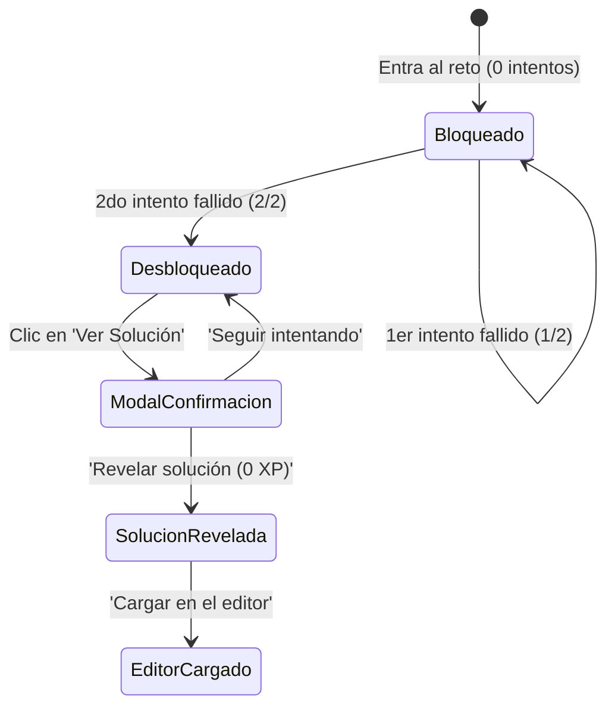

# Catálogo Pedagógico Refinado: Humanización y Botón 'Ver Solución'

> [!NOTE]
> **Documento de Especificación y Propuesta Curricular:** Preparado en la rama `feat/pedagogical-refinement-and-solution-reveal` para revisión y aprobación previa.

---

## 1. Nueva Funcionalidad: Botón 'Ver Solución' (Unlock a 2 Intentos Fallidos + Telemetría)

### 1.1 Justificación Pedagógica y Prevención de Abandono
Cuando un estudiante se atasca durante más de 10 minutos en una consulta SQL, la frustración puede convertirse en abandono definitivo. Sin embargo, darle la respuesta de inmediato elimina el esfuerzo cognitivo. Para equilibrar ambos factores:
* **Barrera de 2 intentos:** El botón permanece bloqueado hasta que el estudiante haya intentado al menos dos veces (`status: 'ERROR'` o `status: 'FAILED'`).
* **Trade-off de Gamificación (0 XP):** Si el estudiante decide revelar la solución, el ejercicio se marca como 'Solución Consultada' y no otorga los puntos de experiencia (XP = 0), preservando la legitimidad del leaderboard y los logros.
* **Telemetría para Mejora Continua:** Cada revelación se audita con el `exercise_id`, número de intentos previos y tiempo transcurrido, permitiendo identificar qué ejercicios son cuellos de botella para mejorar sus pistas o teoría.

### 1.2 Flujo y Estados de Interfaz (UX)



1. **Estado 🔒 Bloqueado:** Botón deshabilitado en tono tenue: `🔒 Ver Solución (0/2 intentos)` o `(1/2)`. Un tooltip explica: *'Ejecuta al menos 2 intentos para desbloquear la solución oficial si te quedas atascado'*.
2. **Estado 🔓 Desbloqueado:** Se activa con acento ámbar/dorado: `🔓 Ver Solución Oficial`.
3. **Modal de Confirmación:** Advierte con claridad: *'Ver la solución oficial te ayudará a destrabarte, pero este reto no otorgará XP (+0 XP). Te recomendamos revisar primero las pistas.'* Opciones: `[Seguir intentando]` (verde primario) o `[Revelar solución]` (ámbar secundario).
4. **Panel de Solución:** Muestra el bloque de código SQL con explicación didáctica y botón `[Cargar en el editor]` para que el usuario pueda ejecutarla, examinar el resultado y aprender.

### 1.3 Arquitectura Técnica de Implementación
* **Backend (`/api/v1/exercises/{id}/reveal-solution`):**
  * Endpoint POST seguro que valida que el usuario o sesión haya registrado al menos 2 intentos fallidos en ese ejercicio.
  * Devuelve `{ solution_query: string, explanation: string }` de forma segura (sin exponer soluciones anticipadamente en el catálogo público).
  * Registra en la base de datos `exercise_telemetry` el evento `solution_revealed`.
* **Frontend (`ExerciseWorkspace` & `ExerciseSpecPanel`):**
  * Mantiene el contador reactivo `failedAttemptsCount` por ejercicio.
  * Si se consulta la solución, actualiza `solution_viewed: true` en el estado de progreso.

---

## 2. Rediseño de Objetivos (Checklist Libre de Spoilers)

> [!IMPORTANT]
> **Regla Estricta:** Los objetivos ahora representan **criterios de éxito y metas funcionales** (el *qué* debe lograr la consulta), sin contener jamás palabras clave de SQL, cláusulas explícitas (`WHERE ...`, `SELECT ...`, `FROM ...`) ni fórmulas matemáticas cableadas. Las pistas sintácticas residen exclusivamente en la pestaña de **Pistas**.

---

# 🏛️ Ruta 1: SQL Foundations

## 📦 Módulo 1: SELECT & Proyecciones de Datos

### Reto #1: Catálogo Básico de Productos
* **ID:** `e0000000-0000-0000-0000-000000000001`
* **Consulta Solución (Interna):** `SELECT nombre_producto, precio FROM productos;`

````carousel
<!-- slide -->
#### 🔴 Consigna Anterior (Técnica / Fricción)
> Imagina que necesitas armar un catálogo sencillo para la tienda. Muestra únicamente el nombre de cada producto (nombre_producto) y su precio (precio) desde la tabla productos.

**Concepto Original:**
> Con SELECT eliges exactamente qué columnas quieres ver de una tabla, como si seleccionaras qué columnas mantener a la vista en una hoja de cálculo.
<!-- slide -->
#### 🟢 Consigna Propuesta (Pedagógica / Humana)
> **Misión:** Imagina que necesitas armar un catálogo sencillo para la tienda. Muestra únicamente el nombre de cada producto (`nombre_producto`) y su precio (`precio`) desde la tabla `productos`.

**Concepto Rápido:** Con `SELECT` eliges exactamente qué columnas quieres ver de una tabla, como si seleccionaras qué columnas mantener a la vista en una hoja de cálculo.

**Puntos Clave:**
- `SELECT` va seguido de las columnas que quieres mostrar, separadas por coma `,`.
- `FROM` indica en qué tabla están guardados esos datos (en este caso, `productos`).
- Al final de cada instrucción en SQL se coloca un punto y coma `;`.

**Bajo el Capó (Nivel 2):** 💡 ¿Cómo lo lee la base de datos? Primero busca la tabla con `FROM` y luego extrae solo las columnas que pediste en `SELECT`.

**Objetivos (Requisitos Sin Spoilers):**
- 1. Identificar la tabla de productos dentro del esquema.
- 2. Seleccionar únicamente el nombre y el costo unitario de cada artículo.
- 3. Ejecutar y verificar los registros devueltos en la cuadrícula.
````

---

### Reto #2: Cálculo de Precios con IVA
* **ID:** `e0000000-0000-0000-0000-000000000008`
* **Consulta Solución (Interna):** `SELECT nombre_producto, precio, ROUND(precio * 1.21, 2) AS precio_con_iva FROM productos;`

````carousel
<!-- slide -->
#### 🔴 Consigna Anterior (Técnica / Fricción)
> Calcula el precio final con impuestos para cada producto. Muestra el nombre_producto, el precio original y calcula el precio con el 21% de IVA (multiplicando precio * 1.21) redondeado a 2 decimales, llamando a esa nueva columna precio_con_iva.

**Concepto Original:**
> En SQL puedes hacer operaciones matemáticas directamente en tu consulta (+, -, *, /) y usar AS para ponerle un nombre claro al resultado.
<!-- slide -->
#### 🟢 Consigna Propuesta (Pedagógica / Humana)
> **Misión:** Calcula el precio final con impuestos para cada producto. Muestra el `nombre_producto`, el `precio` original y calcula el precio con el 21% de IVA (`precio * 1.21`) redondeado a 2 decimales, llamando a esa nueva columna `precio_con_iva`.

**Concepto Rápido:** En SQL puedes hacer operaciones matemáticas directamente en tu consulta (+, -, *, /) y usar `AS` para ponerle un nombre claro al resultado.

**Puntos Clave:**
- Puedes calcular directamente en el `SELECT`: `precio * 1.21`.
- `ROUND(cuenta, 2)` deja el número con 2 decimales limpios.
- `AS precio_con_iva` le da un título descriptivo a tu nueva columna calculada.

**Bajo el Capó (Nivel 2):** 💡 El cálculo se hace al vuelo en la consulta; no altera los valores originales guardados en la tabla.

**Objetivos (Requisitos Sin Spoilers):**
- 1. Mostrar las columnas descriptivas y de precio base del artículo.
- 2. Aplicar el cálculo de la tasa del 21% de impuesto con 2 decimales.
- 3. Asignar un nombre claro y representativo a la columna calculada.
````

---

### Reto #3: Concatenación de Nombre Completo
* **ID:** `e0000000-0000-0000-0000-000000000019`
* **Consulta Solución (Interna):** `SELECT nombre || ' ' || apellido AS cliente_completo, email FROM clientes;`

````carousel
<!-- slide -->
#### 🔴 Consigna Anterior (Técnica / Fricción)
> Prepara un directorio para el equipo de atención al cliente. Une el nombre y el apellido de cada cliente separados por un espacio, nómbralo cliente_completo, y muestra también su email desde la tabla clientes.

**Concepto Original:**
> En SQL, el símbolo '||' sirve para pegar o combinar textos (como juntar el primer nombre y el apellido en una sola columna).
<!-- slide -->
#### 🟢 Consigna Propuesta (Pedagógica / Humana)
> **Misión:** Prepara un directorio para el equipo de atención al cliente. Une el `nombre` y el `apellido` de cada cliente separados por un espacio, nómbralo `cliente_completo`, y muestra también su `email` desde la tabla `clientes`.

**Concepto Rápido:** En SQL, el símbolo `||` sirve para pegar o combinar textos (como juntar el primer nombre y el apellido en una sola columna).

**Puntos Clave:**
- Para unir texto y dejar un espacio en medio usa: `nombre || ' ' || apellido`.
- Los textos fijos en SQL siempre van entre comillas simples: `' '`.
- Usa `AS cliente_completo` para bautizar la nueva columna resultante.

**Bajo el Capó (Nivel 2):** 💡 En SQL estándar, `||` une textos fila por fila sin modificar los datos de origen.

**Objetivos (Requisitos Sin Spoilers):**
- 1. Obtener los registros de la tabla de clientes.
- 2. Combinar el nombre y el apellido en una sola columna con separación legible.
- 3. Presentar la columna unificada junto con la dirección de correo electrónico.
````

---

### Reto #4: Catálogo de Ciudades Únicas (DISTINCT)
* **ID:** `e0000000-0000-0000-0000-000000000020`
* **Consulta Solución (Interna):** `SELECT DISTINCT ciudad FROM clientes;`

````carousel
<!-- slide -->
#### 🔴 Consigna Anterior (Técnica / Fricción)
> Logística necesita saber en qué ciudades tenemos clientes sin que los nombres se repitan. Obtén la lista de ciudades únicas (ciudad) de la tabla clientes.

**Concepto Original:**
> DISTINCT es el filtro quitaduplicados de SQL: se asegura de que cada valor aparezca solo una vez en tu lista final.
<!-- slide -->
#### 🟢 Consigna Propuesta (Pedagógica / Humana)
> **Misión:** Logística necesita saber en qué ciudades tenemos clientes sin que los nombres se repitan. Obtén la lista de ciudades únicas (`ciudad`) de la tabla `clientes`.

**Concepto Rápido:** `DISTINCT` es el filtro quitaduplicados de SQL: se asegura de que cada valor aparezca solo una vez en tu lista final.

**Puntos Clave:**
- `DISTINCT` se escribe justo después de `SELECT`: `SELECT DISTINCT ciudad FROM clientes;`.
- Si varios clientes viven en Madrid, con `DISTINCT` 'Madrid' aparecerá solo una vez.

**Bajo el Capó (Nivel 2):** 💡 La base de datos agrupa y descarta las copias repetidas antes de mostrar el resultado final.

**Objetivos (Requisitos Sin Spoilers):**
- 1. Consultar la ubicación de residencia de los clientes.
- 2. Filtrar el listado para suprimir todas las ciudades repetidas.
- 3. Presentar una lista de ubicaciones geográficas únicas.
````

---

## 📦 Módulo 2: Filtrado con WHERE y Operadores Lógicos

### Reto #5: Productos Premium (> 500€)
* **ID:** `e0000000-0000-0000-0000-000000000002`
* **Consulta Solución (Interna):** `SELECT nombre_producto, precio, stock FROM productos WHERE precio > 500;`

````carousel
<!-- slide -->
#### 🔴 Consigna Anterior (Técnica / Fricción)
> El equipo de marketing prepara una campaña especial de productos exclusivos. Muestra el nombre_producto, el precio y el stock de aquellos productos cuyo precio sea mayor a 500€.

**Concepto Original:**
> WHERE es la condición o filtro de SQL: le pide a la base de datos que solo te entregue las filas que cumplan con una regla específica.
<!-- slide -->
#### 🟢 Consigna Propuesta (Pedagógica / Humana)
> **Misión:** El equipo de marketing prepara una campaña especial de productos exclusivos. Muestra el `nombre_producto`, el `precio` y el `stock` de aquellos productos cuyo precio sea mayor a 500€.

**Concepto Rápido:** `WHERE` es la condición o filtro de SQL: le pide a la base de datos que solo te entregue las filas que cumplan con una regla específica.

**Puntos Clave:**
- `WHERE` se coloca después de `FROM tabla`.
- Usa operadores de comparación habituales: `>` (mayor), `<` (menor), `=` (igual), `>=` (mayor o igual).
- Para este reto la condición es: `WHERE precio > 500;`.

**Bajo el Capó (Nivel 2):** 💡 La base de datos revisa cada fila con `WHERE` y descarta de inmediato las que no cumplen la regla, ahorrando memoria y tiempo.

**Objetivos (Requisitos Sin Spoilers):**
- 1. Seleccionar la descripción, precio y existencias del inventario.
- 2. Establecer una condición para aislar exclusivamente los artículos de alto valor.
- 3. Asegurar que los productos que no alcancen el umbral queden excluidos.
````

---

### Reto #6: Productos en Rango Medio (BETWEEN)
* **ID:** `e0000000-0000-0000-0000-000000000009`
* **Consulta Solución (Interna):** `SELECT nombre_producto, precio FROM productos WHERE precio BETWEEN 100 AND 800;`

````carousel
<!-- slide -->
#### 🔴 Consigna Anterior (Técnica / Fricción)
> El equipo de catálogo desea identificar productos de gama media con precios entre 100€ y 800€ (inclusive). Escribe una consulta que liste el nombre_producto y el precio de los productos que cumplan con dicho rango.

**Concepto Original:**
> El operador BETWEEN evalúa si una expresión se encuentra dentro de un rango cerrado inclusivo [min, max]. Es más conciso y legible que combinar dos condiciones con AND.
<!-- slide -->
#### 🟢 Consigna Propuesta (Pedagógica / Humana)
> **Misión:** Encuentra los productos de gama media para una promoción especial. Muestra el `nombre_producto` y el `precio` de todos los artículos cuyo precio esté entre 100€ y 800€ (ambos inclusive).

**Concepto Rápido:** `BETWEEN` te permite buscar valores dentro de un rango cerrado (entre un mínimo y un máximo). Es mucho más cómodo que escribir dos comparaciones separadas.

**Puntos Clave:**
- `BETWEEN min AND max` incluye ambos extremos del intervalo.
- Escribir `precio BETWEEN 100 AND 800` equivale a `precio >= 100 AND precio <= 800`.
- Sirve tanto para números como para fechas y letras.

**Bajo el Capó (Nivel 2):** 💡 El motor evalúa el rango directamente sobre los datos de la columna de forma optimizada.

**Objetivos (Requisitos Sin Spoilers):**
- 1. Consultar el catálogo de artículos de gama media.
- 2. Delimitar los resultados mediante un operador de rango continuo.
- 3. Comprobar que los límites superior e inferior queden incluidos.
````

---

### Reto #7: Búsqueda por Patrón de Correo (LIKE)
* **ID:** `e0000000-0000-0000-0000-000000000021`
* **Consulta Solución (Interna):** `SELECT nombre, apellido, email FROM clientes WHERE email LIKE '%@email.com';`

````carousel
<!-- slide -->
#### 🔴 Consigna Anterior (Técnica / Fricción)
> El equipo de marketing desea enviar un comunicado a los usuarios registrados con cuentas corporativas estándar que utilicen el dominio genérico '@email.com'. Escribe una consulta que devuelva el nombre, apellido y email de todos los clientes cuyo correo electrónico termine exactamente en '@email.com'.

**Concepto Original:**
> El operador LIKE evalúa si una cadena coincide con un patrón específico utilizando comodines. En PostgreSQL, '%' coincide con cualquier secuencia de caracteres y '_' con un solo carácter.
<!-- slide -->
#### 🟢 Consigna Propuesta (Pedagógica / Humana)
> **Misión:** Marketing quiere enviar un aviso a los usuarios registrados con correos corporativos estándar `@email.com`. Muestra el `nombre`, `apellido` y `email` de aquellos clientes cuyo correo termine exactamente en `@email.com`.

**Concepto Rápido:** `LIKE` te ayuda a buscar coincidencias por partes de un texto usando el comodín `%` (que significa 'cualquier texto que haya antes o después').

**Puntos Clave:**
- `%@email.com` significa: 'no importa lo que haya al inicio, mientras termine en @email.com'.
- El texto a buscar siempre se escribe entre comillas simples: `'%'`.
- Si quisieras buscar que empiece con algo, pondrías el comodín al final: `'Carlos%'`.

**Bajo el Capó (Nivel 2):** 💡 PostgreSQL examina el patrón texto por texto; el símbolo `%` actúa como un comodín flexible.

**Objetivos (Requisitos Sin Spoilers):**
- 1. Consultar los datos de contacto de los clientes registrados.
- 2. Aplicar un filtro de patrón para identificar la terminación del correo corporativo.
- 3. Verificar que solo aparezcan cuentas con el dominio especificado.
````

---

### Reto #8: Filtro de Ciudades Específicas (IN)
* **ID:** `e0000000-0000-0000-0000-000000000022`
* **Consulta Solución (Interna):** `SELECT cliente_id, nombre, apellido, ciudad FROM clientes WHERE ciudad IN ('Madrid', 'Barcelona', 'Valencia');`

````carousel
<!-- slide -->
#### 🔴 Consigna Anterior (Técnica / Fricción)
> Operaciones ha lanzado una promoción especial de envíos exprés para los centros urbanos principales: Madrid, Barcelona y Valencia. Escribe una consulta que devuelva cliente_id, nombre, apellido y ciudad para los clientes que residan en cualquiera de estas tres ciudades.

**Concepto Original:**
> El operador IN es una abreviación concisa y optimizada para múltiples condiciones OR (col = 'A' OR col = 'B' OR col = 'C'). Comprueba si un valor pertenece a una lista explícita.
<!-- slide -->
#### 🟢 Consigna Propuesta (Pedagógica / Humana)
> **Misión:** Operaciones lanzó envíos express para tres ciudades clave: Madrid, Barcelona y Valencia. Muestra el `cliente_id`, `nombre`, `apellido` y `ciudad` de los clientes que vivan en cualquiera de estas tres ciudades.

**Concepto Rápido:** `IN` te permite revisar si un valor coincide con cualquiera de los elementos de una lista. Es la forma limpia y elegante de evitar escribir muchos `OR` seguidos.

**Puntos Clave:**
- Escribe la lista de opciones entre paréntesis y separada por comas: `IN ('Madrid', 'Barcelona', 'Valencia')`.
- Equivale a decir: `ciudad = 'Madrid' OR ciudad = 'Barcelona' OR ciudad = 'Valencia'`.
- Cada nombre de ciudad es un texto y va entre comillas simples.

**Bajo el Capó (Nivel 2):** 💡 En lugar de evaluar condición por condición, PostgreSQL busca eficientemente el valor dentro de la lista en memoria.

**Objetivos (Requisitos Sin Spoilers):**
- 1. Consultar la lista de clientes y sus ciudades de residencia.
- 2. Filtrar los usuarios pertenecientes al listado de centros urbanos clave.
- 3. Resolver el filtro sin encadenar comparaciones individuales repetidas.
````

---

### Reto #9: Productos en Riesgo de Stock (OR)
* **ID:** `e0000000-0000-0000-0000-000000000023`
* **Consulta Solución (Interna):** `SELECT producto_id, nombre_producto, stock FROM productos WHERE stock <= 15 OR stock >= 75;`

````carousel
<!-- slide -->
#### 🔴 Consigna Anterior (Técnica / Fricción)
> Almacén necesita identificar con urgencia los artículos que están en extremos de inventario (aquellos con existencias críticas menores o iguales a 15 unidades, o artículos con sobrestock igual o mayor a 75 unidades). Escribe una consulta que devuelva producto_id, nombre_producto y stock para los productos que cumplan alguna de estas dos condiciones.

**Concepto Original:**
> El operador lógico OR devuelve TRUE si al menos una de las expresiones condicionales evaluadas es verdadera. Permite ampliar el conjunto de resultados para capturar múltiples criterios alternativos.
<!-- slide -->
#### 🟢 Consigna Propuesta (Pedagógica / Humana)
> **Misión:** El almacén necesita ubicar productos en situación crítica de inventario: artículos con muy poco stock (15 o menos unidades) o artículos con sobrestock (75 o más unidades). Muestra el `producto_id`, `nombre_producto` y `stock` que cumplan cualquiera de estas dos condiciones.

**Concepto Rápido:** El operador `OR` te permite pedir resultados que cumplan al menos una de las dos condiciones que indiques.

**Puntos Clave:**
- Si la fila cumple la primera regla O la segunda regla (o ambas), aparecerá en el resultado.
- Menor o igual se escribe `<=`, mayor o igual se escribe `>=`.
- Escribe: `WHERE stock <= 15 OR stock >= 75;`.

**Bajo el Capó (Nivel 2):** 💡 Evaluación de cortocircuito: si la base de datos comprueba que la primera condición es verdadera, no pierde tiempo verificando la segunda.

**Objetivos (Requisitos Sin Spoilers):**
- 1. Consultar los artículos en los extremos de disponibilidad.
- 2. Establecer una doble condición donde baste cumplir cualquiera de los dos extremos.
- 3. Incluir productos en escasez crítica o con exceso de inventario.
````

---

### Reto #10: Facturas de Alto Valor No Pagadas (AND + NOT)
* **ID:** `e0000000-0000-0000-0000-000000000024`
* **Consulta Solución (Interna):** `SELECT factura_id, monto_total, estado_factura FROM facturas WHERE monto_total >= 400 AND estado_factura <> 'pagada';`

````carousel
<!-- slide -->
#### 🔴 Consigna Anterior (Técnica / Fricción)
> El departamento de cobranzas necesita auditar las facturas pendientes o en litigio de importe relevante. Escribe una consulta que devuelva factura_id, monto_total y estado_factura de todas las facturas cuyo monto_total sea mayor o igual a 400 y cuyo estado_factura sea diferente de 'pagada'.

**Concepto Original:**
> El operador lógico AND exige que ambas condiciones se satisfagan simultáneamente. El operador de desigualdad '<>' (o '!=') excluye valores específicos del conjunto de resultados.
<!-- slide -->
#### 🟢 Consigna Propuesta (Pedagógica / Humana)
> **Misión:** Contabilidad necesita revisar facturas importantes pendientes de cobro. Muestra el `factura_id`, `monto_total` y `estado_factura` de aquellas facturas con un monto de 400€ o más y cuyo estado sea distinto de `'pagada'`.

**Concepto Rápido:** Con `AND` exiges que dos reglas se cumplan al mismo tiempo. Para decir 'distinto de' en SQL, usamos el símbolo `<>` (o `!=`).

**Puntos Clave:**
- `AND` exige que ambas condiciones sean verdaderas para que la fila aparezca.
- `<> 'pagada'` excluye todas las facturas que ya estén liquidadas.
- Monto de 400€ o más se escribe: `monto_total >= 400`.

**Bajo el Capó (Nivel 2):** 💡 PostgreSQL evalúa primero la condición que descarte más filas rápidamente para ahorrar trabajo.

**Objetivos (Requisitos Sin Spoilers):**
- 1. Consultar la información contable de las facturas.
- 2. Exigir simultáneamente un importe relevante y un estado pendiente de cobro.
- 3. Excluir explícitamente los comprobantes que ya fueron liquidados.
````

---

## 📦 Módulo 3: Ordenamiento y Paginación

### Reto #11: Clientes Españoles Ordenados por Apellido
* **ID:** `e0000000-0000-0000-0000-000000000003`
* **Consulta Solución (Interna):** `SELECT nombre, apellido, ciudad FROM clientes WHERE pais = 'España' ORDER BY apellido ASC;`

````carousel
<!-- slide -->
#### 🔴 Consigna Anterior (Técnica / Fricción)
> Obtén el nombre, apellido y ciudad de todos los clientes cuyo país sea 'España'. Los resultados deben venir ordenados alfabéticamente de forma ascendente por su apellido.

**Concepto Original:**
> La cláusula ORDER BY ordena el conjunto de tuplas resultante por una o más columnas. ASC ordena de menor a mayor (A-Z) y DESC de mayor a menor (Z-A).
<!-- slide -->
#### 🟢 Consigna Propuesta (Pedagógica / Humana)
> **Misión:** Organiza la lista de clientes que viven en España por orden alfabético. Muestra su `nombre`, `apellido` y `ciudad` de la tabla `clientes`, ordenando los resultados alfabéticamente por su `apellido` (de la A a la Z).

**Concepto Rápido:** `ORDER BY` ordena los resultados de tu consulta por una o más columnas. Por defecto ordena de menor a mayor (A-Z o 1-9) con `ASC`.

**Puntos Clave:**
- `ORDER BY columna ASC` ordena de menor a mayor (ascendente).
- Para ordenar de mayor a menor (Z-A) se usa `DESC`.
- La cláusula `ORDER BY` siempre va al final de la consulta (después de `FROM` y `WHERE`).

**Bajo el Capó (Nivel 2):** 💡 La base de datos primero filtra las filas con `WHERE` y solo al final organiza las filas resultantes en el orden que pediste.

**Objetivos (Requisitos Sin Spoilers):**
- 1. Acotar el conjunto de clientes al país solicitado.
- 2. Seleccionar los campos de identidad y residencia.
- 3. Ordenar alfabéticamente el listado de la A a la Z por el apellido.
````

---

### Reto #12: Top 5 Productos Críticos por Stock
* **ID:** `e0000000-0000-0000-0000-000000000010`
* **Consulta Solución (Interna):** `SELECT nombre_producto, stock FROM productos ORDER BY stock ASC LIMIT 5;`

````carousel
<!-- slide -->
#### 🔴 Consigna Anterior (Técnica / Fricción)
> El almacén necesita reponer con urgencia los artículos con menores existencias. Escribe una consulta que devuelva el nombre_producto y el stock de los 5 productos con menor cantidad disponible en inventario, ordenados de menor a mayor stock.

**Concepto Original:**
> La cláusula LIMIT restringe el número máximo de tuplas retornadas por el motor. Cuando se combina con ORDER BY, permite construir rankings o consultas de tipo 'Top N' de forma muy eficiente.
<!-- slide -->
#### 🟢 Consigna Propuesta (Pedagógica / Humana)
> **Misión:** El almacén necesita reponer con urgencia los artículos que están por agotarse. Muestra el `nombre_producto` y el `stock` de los 5 productos con menor cantidad disponible en inventario.

**Concepto Rápido:** `LIMIT` le pone un tope al número de filas que te devuelve la consulta. Al combinar `ORDER BY` con `LIMIT`, creas rankings o listas de tipo 'Top N' en un segundo.

**Puntos Clave:**
- Para ver los que tienen menos stock, ordenamos con `ORDER BY stock ASC`.
- `LIMIT 5` corta el resultado y solo te muestra las primeras 5 filas.
- El orden es vital: primero ordenas, luego limitas.

**Bajo el Capó (Nivel 2):** 💡 Con `LIMIT`, la base de datos se detiene en cuanto encuentra las primeras N filas requeridas, sin procesar la tabla entera.

**Objetivos (Requisitos Sin Spoilers):**
- 1. Consultar los artículos de menor disponibilidad en almacén.
- 2. Clasificar el inventario de menor a mayor existencia.
- 3. Acotar el resultado para mostrar exactamente los 5 artículos más urgentes.
````

---

### Reto #13: Ordenamiento Multi-Criterio
* **ID:** `e0000000-0000-0000-0000-000000000025`
* **Consulta Solución (Interna):** `SELECT producto_id, categoria_id, nombre_producto, precio FROM productos ORDER BY categoria_id ASC, precio DESC;`

````carousel
<!-- slide -->
#### 🔴 Consigna Anterior (Técnica / Fricción)
> Catalogación requiere listar los productos organizados por su categoría y valor comercial. Escribe una consulta que devuelva producto_id, categoria_id, nombre_producto y precio, ordenados primero por categoria_id en orden ascendente (ASC) y, para productos dentro de la misma categoría, por precio en orden descendente (DESC).

**Concepto Original:**
> La cláusula ORDER BY permite ordenar el resultado por múltiples columnas estableciendo prioridades: si hay valores idénticos en la primera columna, el motor desempata utilizando la segunda columna.
<!-- slide -->
#### 🟢 Consigna Propuesta (Pedagógica / Humana)
> **Misión:** Organiza los productos por su categoría y luego por su valor comercial. Muestra `producto_id`, `categoria_id`, `nombre_producto` y `precio`, ordenándolos primero por categoría de menor a mayor (`categoria_id ASC`), y dentro de cada categoría, del más caro al más barato (`precio DESC`).

**Concepto Rápido:** Puedes ordenar por varias columnas a la vez separándolas por coma. La base de datos ordenará por la primera, y si hay empates, desempatará con la segunda.

**Puntos Clave:**
- Escribe las columnas en orden de prioridad: `ORDER BY col1 ASC, col2 DESC`.
- Cada columna puede tener su propio sentido de orden (`ASC` o `DESC`).

**Bajo el Capó (Nivel 2):** 💡 La base de datos agrupa mentalmente por la primera columna y luego aplica la segunda ordenación sobre cada subgrupo.

**Objetivos (Requisitos Sin Spoilers):**
- 1. Consultar los artículos asociando su familia comercial y precio.
- 2. Ordenar las categorías en sentido ascendente.
- 3. Desempatar los artículos de una misma familia del más caro al más barato.
````

---

### Reto #14: Paginación de Clientes (OFFSET)
* **ID:** `e0000000-0000-0000-0000-000000000026`
* **Consulta Solución (Interna):** `SELECT cliente_id, nombre, email FROM clientes ORDER BY cliente_id ASC LIMIT 5 OFFSET 5;`

````carousel
<!-- slide -->
#### 🔴 Consigna Anterior (Técnica / Fricción)
> Para implementar paginación en el panel administrativo con 5 registros por página, obtén los clientes correspondientes a la segunda página. Escribe una consulta que devuelva cliente_id, nombre y email, ordenados por cliente_id ASC, omitiendo los primeros 5 clientes y limitando el resultado a los siguientes 5 registros.

**Concepto Original:**
> OFFSET salta un número determinado de filas antes de comenzar a devolver resultados, mientras que LIMIT acota el número máximo de tuplas entregadas. Juntos forman el mecanismo clásico de paginación.
<!-- slide -->
#### 🟢 Consigna Propuesta (Pedagógica / Humana)
> **Misión:** Simula la paginación de un panel web que muestra 5 clientes por página. Obtén los clientes de la segunda página mostrando `cliente_id`, `nombre` y `email`, ordenados por `cliente_id ASC`, saltando los primeros 5 registros y mostrando los siguientes 5.

**Concepto Rápido:** `OFFSET` te permite 'saltar' un número de filas antes de empezar a mostrar resultados. Junto con `LIMIT`, es la base de la paginación en cualquier web o app.

**Puntos Clave:**
- `LIMIT 5` indica cuántos registros mostrar por página.
- `OFFSET 5` indica cuántos registros saltarse (en este caso, los 5 de la primera página).
- Siempre debes usar `ORDER BY` al paginar para que los saltos sean consistentes y predecibles.

**Bajo el Capó (Nivel 2):** 💡 `OFFSET` cuenta las filas en el orden indicado y solo empieza a enviar datos al cliente cuando llega al número marcado.

**Objetivos (Requisitos Sin Spoilers):**
- 1. Establecer el orden de visualización de los clientes.
- 2. Omitir el bloque de registros correspondiente a la primera página.
- 3. Acotar el lote devuelto al tamaño de página requerido.
````

---

## 📦 Módulo 4: Agregación y Agrupamiento

### Reto #15: Conteo de Productos por Categoría
* **ID:** `e0000000-0000-0000-0000-000000000004`
* **Consulta Solución (Interna):** `SELECT categoria_id, COUNT(*) AS total_productos FROM productos GROUP BY categoria_id HAVING COUNT(*) > 2;`

````carousel
<!-- slide -->
#### 🔴 Consigna Anterior (Técnica / Fricción)
> El equipo de inventario desea saber cuántos productos existen en cada categoría. Escribe una consulta que devuelva el categoria_id y el total de productos bajo el alias total_productos para aquellas categorías que tengan más de 2 productos registrados.

**Concepto Original:**
> GROUP BY agrupa filas que comparten valores comunes en columnas específicas. HAVING funciona como un WHERE especializado que filtra exclusivamente sobre los grupos agregados.
<!-- slide -->
#### 🟢 Consigna Propuesta (Pedagógica / Humana)
> **Misión:** ¿Cuántos productos tenemos en cada categoría? Muestra el `categoria_id` y el número total de productos bajo el nombre `total_productos`, mostrando únicamente aquellas categorías que tengan más de 2 productos.

**Concepto Rápido:** `GROUP BY` agrupa filas que tienen el mismo valor en una columna, y `COUNT(*)` cuenta cuántas filas hay en cada grupo. Para filtrar sobre el total de un grupo, usamos `HAVING` en vez de `WHERE`.

**Puntos Clave:**
- `GROUP BY categoria_id` junta los productos por su categoría.
- `COUNT(*) AS total_productos` cuenta los productos de cada categoría.
- `HAVING COUNT(*) > 2` filtra los grupos que superan el umbral (a diferencia de WHERE, HAVING filtra grupos, no filas individuales).

**Bajo el Capó (Nivel 2):** 💡 La base de datos primero forma los grupos en memoria con `GROUP BY`, calcula la cuenta, y luego descarta los grupos que no cumplan `HAVING`.

**Objetivos (Requisitos Sin Spoilers):**
- 1. Condensar los artículos agrupándolos por su familia comercial.
- 2. Contar el volumen total de productos asociados a cada familia.
- 3. Descartar los grupos que no superen el volumen mínimo establecido.
````

---

### Reto #16: Métricas Globales de Ventas
* **ID:** `e0000000-0000-0000-0000-000000000011`
* **Consulta Solución (Interna):** `SELECT COUNT(*) AS total_pedidos, SUM(total) AS ingresos_totales, ROUND(AVG(total), 2) AS ticket_promedio FROM pedidos WHERE estado_pedido = 'completado';`

````carousel
<!-- slide -->
#### 🔴 Consigna Anterior (Técnica / Fricción)
> La dirección comercial solicita un resumen ejecutivo de las ventas completadas. Escribe una consulta que calcule el total de pedidos completados bajo el alias total_pedidos, la suma acumulada de ingresos bajo ingresos_totales y el ticket promedio redondeado a 2 decimales bajo ticket_promedio, considerando únicamente pedidos con estado_pedido = 'completado'.

**Concepto Original:**
> Las funciones de agregación global (COUNT, SUM, AVG, MIN, MAX) procesan el conjunto completo de tuplas filtradas sin necesidad de GROUP BY, devolviendo un único registro de resumen ejecutivo.
<!-- slide -->
#### 🟢 Consigna Propuesta (Pedagógica / Humana)
> **Misión:** Genera un resumen ejecutivo de las ventas completadas. Calcula el número de pedidos bajo el nombre `total_pedidos`, la suma total de dinero bajo `ingresos_totales` y el promedio de compra redondeado a 2 decimales bajo `ticket_promedio`, tomando solo los pedidos con estado `'completado'`.

**Concepto Rápido:** Las funciones de resumen (`COUNT`, `SUM`, `AVG`) pueden usarse juntas para obtener métricas globales en una sola consulta sin necesidad de agrupar.

**Puntos Clave:**
- `COUNT(*)` cuenta cuántos pedidos completados hubo.
- `SUM(total)` suma el dinero de todas esas compras.
- `ROUND(AVG(total), 2)` calcula el ticket promedio y lo redondea a 2 decimales.
- El `WHERE estado_pedido = 'completado'` asegura que solo contemos ventas reales.

**Bajo el Capó (Nivel 2):** 💡 La base de datos recorre los pedidos completados acumulando la suma y el conteo en una sola pasada eficiente.

**Objetivos (Requisitos Sin Spoilers):**
- 1. Filtrar las transacciones considerando únicamente las compras exitosas.
- 2. Calcular simultáneamente el recuento, la suma total de ingresos y el promedio.
- 3. Asegurar que los promedios monetarios tengan el formato decimal requerido.
````

---

### Reto #17: Rango de Precios por Categoría (MAX/MIN)
* **ID:** `e0000000-0000-0000-0000-000000000027`
* **Consulta Solución (Interna):** `SELECT categoria_id, MIN(precio) AS precio_minimo, MAX(precio) AS precio_maximo FROM productos GROUP BY categoria_id;`

````carousel
<!-- slide -->
#### 🔴 Consigna Anterior (Técnica / Fricción)
> El departamento de pricing necesita analizar la dispersión de precios en cada departamento comercial. Escribe una consulta que devuelva el categoria_id, el precio más bajo bajo el alias precio_minimo y el precio más alto bajo el alias precio_maximo para cada categoría de productos.

**Concepto Original:**
> Las funciones de agregación MIN() y MAX() calculan los valores extremos dentro de cada grupo formado por GROUP BY. Si no hay GROUP BY, operan sobre la totalidad de la tabla.
<!-- slide -->
#### 🟢 Consigna Propuesta (Pedagógica / Humana)
> **Misión:** Analiza la diferencia de precios en cada departamento. Muestra el `categoria_id`, el precio más bajo bajo el nombre `precio_minimo` y el precio más alto bajo `precio_maximo` para cada categoría de productos.

**Concepto Rápido:** `MIN()` encuentra el valor más pequeño y `MAX()` encuentra el más grande dentro de cada grupo.

**Puntos Clave:**
- `MIN(precio)` obtiene el artículo más barato de la categoría.
- `MAX(precio)` obtiene el artículo más caro de la categoría.
- Debes agrupar con `GROUP BY categoria_id` para que el cálculo se haga por cada categoría individual.

**Bajo el Capó (Nivel 2):** 💡 `GROUP BY` separa los productos por categoría y calcula los valores extremos de cada grupo antes de devolver la respuesta.

**Objetivos (Requisitos Sin Spoilers):**
- 1. Agrupar el catálogo por familia comercial.
- 2. Detectar el artículo más económico de cada grupo.
- 3. Detectar el artículo de mayor valor de cada grupo y nombrar las columnas.
````

---

### Reto #18: Distribución de Clientes por País
* **ID:** `e0000000-0000-0000-0000-000000000028`
* **Consulta Solución (Interna):** `SELECT pais, COUNT(*) AS total_clientes FROM clientes GROUP BY pais ORDER BY total_clientes DESC;`

````carousel
<!-- slide -->
#### 🔴 Consigna Anterior (Técnica / Fricción)
> Expansión internacional requiere un censo de clientes por país de residencia. Escribe una consulta que devuelva la columna pais y el número total de clientes bajo el alias total_clientes, agrupando por país y ordenando el resultado de mayor a menor número de clientes.

**Concepto Original:**
> COUNT(*) devuelve el recuento de tuplas en cada grupo relacional. Combinado con ORDER BY descendente, permite construir rankings de distribución de frecuencias.
<!-- slide -->
#### 🟢 Consigna Propuesta (Pedagógica / Humana)
> **Misión:** ¿De qué países son nuestros clientes? Muestra la columna `pais` y el número total de clientes en cada país bajo el nombre `total_clientes`, ordenando la lista de mayor a menor número de clientes.

**Concepto Rápido:** Combinar `GROUP BY` con `ORDER BY ... DESC` te permite descubrir de dónde viene la mayor parte de tus usuarios en forma de ranking.

**Puntos Clave:**
- `GROUP BY pais` junta a los clientes según su país de residencia.
- `COUNT(*) AS total_clientes` cuenta cuántos clientes hay por país.
- `ORDER BY total_clientes DESC` pone en la cima al país con más clientes.

**Bajo el Capó (Nivel 2):** 💡 Primero se agrupa por país, se realiza el conteo de filas, y finalmente se ordenan los grupos de mayor a menor.

**Objetivos (Requisitos Sin Spoilers):**
- 1. Agrupar la base de usuarios por su país de origen.
- 2. Contar el volumen de clientes registrados en cada territorio.
- 3. Presentar los países en un ranking ordenado de mayor a menor presencia.
````

---

### Reto #19: Stock Total por Proveedor
* **ID:** `e0000000-0000-0000-0000-000000000029`
* **Consulta Solución (Interna):** `SELECT proveedor_id, SUM(stock) AS stock_total FROM productos GROUP BY proveedor_id;`

````carousel
<!-- slide -->
#### 🔴 Consigna Anterior (Técnica / Fricción)
> Gestión de proveedores necesita conocer el volumen total de inventario que suministra cada fabricante. Escribe una consulta que devuelva el proveedor_id y la suma de unidades disponibles bajo el alias stock_total para cada proveedor en la tabla productos.

**Concepto Original:**
> La función SUM() agrega valores numéricos de una columna en un acumulado total por grupo. Devuelve NULL si el grupo solo contiene valores NULL.
<!-- slide -->
#### 🟢 Consigna Propuesta (Pedagógica / Humana)
> **Misión:** Calcula el volumen total de productos que nos suministra cada fabricante. Muestra el `proveedor_id` y la suma de unidades disponibles en stock bajo el nombre `stock_total` desde la tabla `productos`.

**Concepto Rápido:** `SUM(columna)` suma todos los números de esa columna para cada grupo que indiques en `GROUP BY`.

**Puntos Clave:**
- `SUM(stock) AS stock_total` suma las existencias de todos los productos del mismo proveedor.
- `GROUP BY proveedor_id` asegura que tengamos una sola fila por cada fabricante.

**Bajo el Capó (Nivel 2):** 💡 La base de datos agrupa los productos por proveedor y va acumulando el stock de cada fila en un total sumatorio.

**Objetivos (Requisitos Sin Spoilers):**
- 1. Agrupar el inventario en función del fabricante o distribuidor.
- 2. Acumular las unidades totales en almacén provistas por cada entidad.
- 3. Asignar un alias descriptivo al total acumulado.
````

---

### Reto #20: Proveedores de Alto Volumen (HAVING SUM)
* **ID:** `e0000000-0000-0000-0000-000000000030`
* **Consulta Solución (Interna):** `SELECT proveedor_id, SUM(stock) AS stock_total FROM productos GROUP BY proveedor_id HAVING SUM(stock) > 100;`

````carousel
<!-- slide -->
#### 🔴 Consigna Anterior (Técnica / Fricción)
> Compras desea clasificar a sus proveedores estratégicos. Escribe una consulta que obtenga el proveedor_id y el total de existencias bajo el alias stock_total, mostrando únicamente aquellos proveedores cuyo stock total acumulado supere estrictamente las 100 unidades.

**Concepto Original:**
> HAVING es el mecanismo de filtrado para grupos agregados en SQL. Mientras WHERE filtra filas individuales ANTES de agrupar, HAVING filtra grupos DESPUÉS de que las agregaciones han sido calculadas.
<!-- slide -->
#### 🟢 Consigna Propuesta (Pedagógica / Humana)
> **Misión:** Identifica a nuestros proveedores más importantes en volumen. Muestra el `proveedor_id` y su stock total bajo el nombre `stock_total`, mostrando únicamente a aquellos proveedores cuyo stock total acumulado supere las 100 unidades.

**Concepto Rápido:** Recuerda la regla de oro: `WHERE` filtra filas antes de agrupar; `HAVING` filtra grupos después de hacer la suma o cálculo.

**Puntos Clave:**
- Para filtrar sobre la suma (`SUM(stock) > 100`), se debe usar `HAVING` y nunca `WHERE`.
- `HAVING` se coloca siempre después del `GROUP BY`.

**Bajo el Capó (Nivel 2):** 💡 El motor calcula la suma de inventario de cada proveedor y luego descarta a los que no alcancen las 100 unidades.

**Objetivos (Requisitos Sin Spoilers):**
- 1. Calcular el inventario acumulado por cada fabricante.
- 2. Aplicar un filtro posterior a la agregación para evaluar el volumen conjunto.
- 3. Conservar únicamente los proveedores estratégicos de gran volumen.
````

---

### Reto #21: Clientes con Ticket Promedio Alto (HAVING AVG)
* **ID:** `e0000000-0000-0000-0000-000000000031`
* **Consulta Solución (Interna):** `SELECT cliente_id, ROUND(AVG(total), 2) AS ticket_promedio FROM pedidos GROUP BY cliente_id HAVING AVG(total) > 500;`

````carousel
<!-- slide -->
#### 🔴 Consigna Anterior (Técnica / Fricción)
> Fidelización busca identificar a los compradores con mayor poder adquisitivo por compra. Escribe una consulta sobre la tabla pedidos que devuelva el cliente_id y el importe promedio de sus compras redondeado a 2 decimales bajo el alias ticket_promedio, considerando únicamente a los clientes cuyo promedio de compras supere los 500 euros.

**Concepto Original:**
> AVG() calcula la media aritmética ignorando valores NULL. Combinado con HAVING AVG(...) > X permite identificar segmentos basados en comportamiento medio o representativo.
<!-- slide -->
#### 🟢 Consigna Propuesta (Pedagógica / Humana)
> **Misión:** Encuentra a los clientes que hacen compras de alto valor promedio. Muestra el `cliente_id` y su importe promedio de compra redondeado a 2 decimales bajo el nombre `ticket_promedio`, mostrando solo a aquellos clientes cuyo promedio de compras supere los 500€.

**Concepto Rápido:** `HAVING AVG(...) > valor` te permite encontrar clientes o entidades cuyo comportamiento promedio supere un estándar que tú definas.

**Puntos Clave:**
- `ROUND(AVG(total), 2) AS ticket_promedio` calcula la media de gasto por cliente.
- `HAVING AVG(total) > 500` descarta a los clientes que gastan menos de 500€ en promedio.
- Se agrupa por `cliente_id` en la tabla `pedidos`.

**Bajo el Capó (Nivel 2):** 💡 Para cada cliente se promedian sus pedidos y se verifica la condición de corte antes de proyectar.

**Objetivos (Requisitos Sin Spoilers):**
- 1. Calcular el gasto medio por transacción de cada comprador.
- 2. Filtrar a los clientes cuyo promedio supere el umbral de alto poder adquisitivo.
- 3. Asegurar el redondeo monetario adecuado en la columna final.
````

---

### Reto #22: Resumen de Pedidos por Estado
* **ID:** `e0000000-0000-0000-0000-000000000032`
* **Consulta Solución (Interna):** `SELECT estado_pedido, COUNT(*) AS total_pedidos, SUM(total) AS monto_acumulado FROM pedidos GROUP BY estado_pedido ORDER BY monto_acumulado DESC;`

````carousel
<!-- slide -->
#### 🔴 Consigna Anterior (Técnica / Fricción)
> Operaciones comerciales solicita un cuadro de control de pedidos. Escribe una consulta que devuelva estado_pedido, la cantidad de pedidos bajo el alias total_pedidos y la suma acumulada de dinero bajo el alias monto_acumulado, agrupando por el estado del pedido y ordenando por monto_acumulado en orden descendente.

**Concepto Original:**
> En una sola consulta de agregación es posible combinar múltiples funciones agregadas (COUNT, SUM, AVG) sobre la misma partición para construir paneles ejecutivos y tableros analíticos.
<!-- slide -->
#### 🟢 Consigna Propuesta (Pedagógica / Humana)
> **Misión:** Construye un panel de control de pedidos. Muestra el `estado_pedido`, la cantidad de pedidos bajo el nombre `total_pedidos` y la suma acumulada de dinero bajo `monto_acumulado`, agrupando por estado y ordenando del estado con mayor dinero al de menor dinero.

**Concepto Rápido:** Puedes combinar conteos (`COUNT`) y sumas de dinero (`SUM`) en una misma consulta para entender el estado de un negocio de un solo vistazo.

**Puntos Clave:**
- `GROUP BY estado_pedido` agrupa en categorías como 'completado', 'pendiente', etc.
- `COUNT(*)` te dice cuántos pedidos hay en ese estado.
- `SUM(total)` te dice cuánto dinero representan esos pedidos.
- `ORDER BY monto_acumulado DESC` ordena de mayor a menor recaudación.

**Bajo el Capó (Nivel 2):** 💡 La base de datos genera el resumen completo agrupado y lo ordena según la suma monetaria calculada.

**Objetivos (Requisitos Sin Spoilers):**
- 1. Agrupar el histórico de pedidos según su estado operativo.
- 2. Contar el número de operaciones y calcular el dinero asociado a cada estado.
- 3. Ordenar el tablero de mayor a menor recaudación económica.
````

---

# 🏛️ Ruta 2: Relational SQL

## 📦 Módulo 5: Uniones Fundamentales (INNER JOIN)

### Reto #23: Pedidos con Identidad del Cliente
* **ID:** `e0000000-0000-0000-0000-000000000005`
* **Consulta Solución (Interna):** `SELECT p.pedido_id, c.nombre, c.apellido, p.total FROM pedidos p INNER JOIN clientes c ON p.cliente_id = c.cliente_id;`

````carousel
<!-- slide -->
#### 🔴 Consigna Anterior (Técnica / Fricción)
> Genera un reporte que muestre el pedido_id, el nombre del cliente, su apellido y el total del pedido. Relaciona las tablas pedidos y clientes mediante su clave compartida.

**Concepto Original:**
> INNER JOIN combina tuplas de dos tablas basándose en una condición de coincidencia entre claves (PK y FK). Solo incluye registros que tengan correspondencia exacta en ambos lados.
<!-- slide -->
#### 🟢 Consigna Propuesta (Pedagógica / Humana)
> **Misión:** Descubre qué cliente realizó cada pedido. Cruza las tablas `pedidos` y `clientes` mediante su identificador común y muestra el `pedido_id`, el `nombre` del cliente, su `apellido` y el `total` del pedido.

**Concepto Rápido:** `INNER JOIN` es el puente que une dos tablas diferentes basándose en un dato que comparten (como el ID del cliente). Solo muestra filas donde haya coincidencia en ambos lados.

**Puntos Clave:**
- `FROM pedidos p INNER JOIN clientes c ON p.cliente_id = c.cliente_id` conecta las dos tablas.
- Usar alias cortos (`p` y `c`) hace que tu código sea mucho más fácil y rápido de leer.
- Si un pedido no tiene cliente, o un cliente no tiene pedidos, el `INNER JOIN` no lo mostrará.

**Bajo el Capó (Nivel 2):** 💡 La base de datos compara las claves comunes y arma una sola fila combinada en memoria por cada coincidencia.

**Objetivos (Requisitos Sin Spoilers):**
- 1. Conectar las transacciones con el directorio de usuarios mediante su clave compartida.
- 2. Extraer los datos personales del comprador y el total de la orden.
- 3. Verificar que solo aparezcan órdenes con compradores válidos.
````

---

### Reto #24: Gasto Acumulado por Cliente
* **ID:** `e0000000-0000-0000-0000-000000000012`
* **Consulta Solución (Interna):** `SELECT c.cliente_id, c.nombre, c.apellido, SUM(p.total) AS total_gastado FROM clientes c INNER JOIN pedidos p ON c.cliente_id = p.cliente_id GROUP BY c.cliente_id, c.nombre, c.apellido ORDER BY total_gastado DESC;`

````carousel
<!-- slide -->
#### 🔴 Consigna Anterior (Técnica / Fricción)
> El departamento de fidelización necesita saber cuánto ha gastado en total cada cliente. Escribe una consulta que relacione clientes y pedidos, y devuelva cliente_id, nombre, apellido y la suma total de sus compras bajo el alias total_gastado, ordenando a los clientes de mayor a menor gasto total.

**Concepto Original:**
> La combinación de JOIN con GROUP BY es uno de los patrones más recurrentes en SQL analítico: se enriquecen los datos mediante relaciones y luego se condensan por entidad usando funciones de agregación.
<!-- slide -->
#### 🟢 Consigna Propuesta (Pedagógica / Humana)
> **Misión:** Calcula cuánto dinero ha gastado en total cada uno de nuestros clientes. Cruza `clientes` y `pedidos`, y muestra el `cliente_id`, `nombre`, `apellido` y la suma de todas sus compras bajo el nombre `total_gastado`, ordenando de mayor a menor gasto.

**Concepto Rápido:** Unir (`JOIN`) y luego agrupar (`GROUP BY`) es uno de los superpoderes más utilizados en SQL: cruzas datos de dos tablas y calculas un total por cada persona.

**Puntos Clave:**
- Cruza `clientes` y `pedidos` mediante `cliente_id`.
- Agrupa por los datos del cliente (`c.cliente_id, c.nombre, c.apellido`).
- `SUM(p.total) AS total_gastado` suma todas las compras de cada cliente.
- `ORDER BY total_gastado DESC` pone al mejor comprador arriba de todo.

**Bajo el Capó (Nivel 2):** 💡 El motor empareja primero los pedidos de cada cliente y después suma el dinero por cada grupo.

**Objetivos (Requisitos Sin Spoilers):**
- 1. Cruzar las órdenes de compra con la información de los clientes.
- 2. Acumular el monto total pagado por cada persona en su historial.
- 3. Ordenar el resultado destacando a los clientes con mayor volumen de compras.
````

---

### Reto #25: Catálogo con Nombre de Categoría
* **ID:** `e0000000-0000-0000-0000-000000000033`
* **Consulta Solución (Interna):** `SELECT p.producto_id, p.nombre_producto, c.nombre_categoria, p.precio FROM productos p INNER JOIN categorias c ON p.categoria_id = c.categoria_id ORDER BY c.nombre_categoria ASC, p.nombre_producto ASC;`

````carousel
<!-- slide -->
#### 🔴 Consigna Anterior (Técnica / Fricción)
> Catalogación necesita presentar el catálogo con el nombre de su categoría descriptiva en vez del código numérico. Escribe una consulta que devuelva el producto_id, nombre_producto, nombre_categoria y precio, relacionando las tablas productos y categorias mediante categoria_id. Ordena los resultados por nombre_categoria ASC y luego por nombre_producto ASC.

**Concepto Original:**
> El INNER JOIN sustituye claves foráneas numéricas por nombres descriptivos provenientes de tablas maestras o dimensiones (normalización relacional).
<!-- slide -->
#### 🟢 Consigna Propuesta (Pedagógica / Humana)
> **Misión:** Haz que el catálogo de productos sea legible mostrando el nombre de la categoría en lugar de su código numérico. Cruza `productos` con `categorias` y muestra `producto_id`, `nombre_producto`, `nombre_categoria` y `precio`. Ordena primero por categoría (A-Z) y luego por producto (A-Z).

**Concepto Rápido:** En bases de datos relacionales, los nombres descriptivos se guardan en una tabla aparte para no repetir texto. Con `INNER JOIN` los traes a la vista fácilmente.

**Puntos Clave:**
- Une `productos p` con `categorias c` usando `ON p.categoria_id = c.categoria_id`.
- Ahora puedes mostrar `c.nombre_categoria` en vez de un simple número.
- `ORDER BY c.nombre_categoria ASC, p.nombre_producto ASC` organiza la lista alfabéticamente.

**Bajo el Capó (Nivel 2):** 💡 PostgreSQL reemplaza la clave numérica buscando instantáneamente en el índice de categorías.

**Objetivos (Requisitos Sin Spoilers):**
- 1. Cruzar los artículos con la tabla maestra de familias comerciales.
- 2. Sustituir el identificador numérico por el nombre legible de la categoría.
- 3. Organizar alfabéticamente por categoría y luego por nombre de producto.
````

---

### Reto #26: Productos y sus Proveedores Directos
* **ID:** `e0000000-0000-0000-0000-000000000034`
* **Consulta Solución (Interna):** `SELECT pr.producto_id, pr.nombre_producto, pv.nombre_proveedor, pv.pais AS pais_proveedor FROM productos pr INNER JOIN proveedores pv ON pr.proveedor_id = pv.proveedor_id ORDER BY pr.nombre_producto ASC;`

````carousel
<!-- slide -->
#### 🔴 Consigna Anterior (Técnica / Fricción)
> El área de compras requiere auditar el origen geográfico de cada artículo del catálogo. Escribe una consulta que relacione las tablas productos y proveedores, devolviendo producto_id, nombre_producto, nombre_proveedor y el país del proveedor bajo el alias pais_proveedor. Ordena alfabéticamente por nombre_producto ASC.

**Concepto Original:**
> Vincular una tabla transaccional o de artículos con sus entidades suministradoras es esencial en la gestión de la cadena de suministro.
<!-- slide -->
#### 🟢 Consigna Propuesta (Pedagógica / Humana)
> **Misión:** Compras necesita saber de qué país proviene cada producto. Cruza `productos` con `proveedores` y muestra `producto_id`, `nombre_producto`, `nombre_proveedor` y el país del proveedor bajo el nombre `pais_proveedor`. Ordena los productos alfabéticamente.

**Concepto Rápido:** Conectar los artículos con las empresas que los fabrican te permite rastrear el origen de tu inventario en un instante.

**Puntos Clave:**
- Conecta `productos pr` con `proveedores pv` mediante `proveedor_id`.
- Renombra la columna del país con `pv.pais AS pais_proveedor`.
- `ORDER BY pr.nombre_producto ASC` organiza de la A a la Z.

**Bajo el Capó (Nivel 2):** 💡 Se cruzan los registros emparejando la clave del proveedor presente en la ficha de cada producto.

**Objetivos (Requisitos Sin Spoilers):**
- 1. Vincular los artículos del catálogo con su empresa suministradora.
- 2. Extraer el nombre del proveedor y su país de origen con alias claros.
- 3. Ordenar los artículos alfabéticamente.
````

---

### Reto #27: Facturación Detallada con Pagos Aprobados
* **ID:** `e0000000-0000-0000-0000-000000000035`
* **Consulta Solución (Interna):** `SELECT f.factura_id, f.monto_total, pg.metodo_pago, pg.fecha_pago FROM facturas f INNER JOIN pagos pg ON f.factura_id = pg.factura_id WHERE pg.estado_pago = 'aprobado' ORDER BY f.factura_id ASC;`

````carousel
<!-- slide -->
#### 🔴 Consigna Anterior (Técnica / Fricción)
> Contabilidad solicita una conciliación de facturas con sus pagos exitosos. Escribe una consulta que una facturas con pagos mediante factura_id, proyectando factura_id, monto_total de la factura, metodo_pago y fecha_pago, considerando únicamente aquellos registros donde estado_pago = 'aprobado'. Ordena por factura_id ASC.

**Concepto Original:**
> La combinación de INNER JOIN con filtros WHERE permite conciliar movimientos financieros entre entidades relacionadas descartando transacciones pendientes o fallidas.
<!-- slide -->
#### 🟢 Consigna Propuesta (Pedagógica / Humana)
> **Misión:** Concilia las facturas emitidas con sus pagos aprobados. Cruza `facturas` con `pagos` mediante `factura_id`, mostrando `factura_id`, el monto de la factura (`monto_total`), el `metodo_pago` y la `fecha_pago`, tomando únicamente los registros con `estado_pago = 'aprobado'`. Ordena por `factura_id` ascendente.

**Concepto Rápido:** Combinar `INNER JOIN` con un filtro `WHERE` te permite conciliar registros financieros descartando intentos fallidos o pendientes.

**Puntos Clave:**
- Une `facturas f` y `pagos pg` mediante `factura_id`.
- `WHERE pg.estado_pago = 'aprobado'` descarta pagos rechazados o pendientes.
- Ordena de menor a mayor con `ORDER BY f.factura_id ASC`.

**Bajo el Capó (Nivel 2):** 💡 Primero se emparejan las facturas con sus pagos y luego se filtran solo aquellos con estado aprobado.

**Objetivos (Requisitos Sin Spoilers):**
- 1. Cruzar los comprobantes fiscales con sus comprobantes de pago bancarios.
- 2. Restringir la consulta a las transacciones con estado liquidado y aprobado.
- 3. Proyectar los identificadores, fechas y montos en orden secuencial.
````

---

## 📦 Módulo 6: Detección de Ausencias (LEFT JOIN & NULL)

### Reto #28: Clientes sin Compras Registradas (LEFT JOIN & IS NULL)
* **ID:** `e0000000-0000-0000-0000-000000000006`
* **Consulta Solución (Interna):** `SELECT c.cliente_id, c.nombre, c.apellido FROM clientes c LEFT JOIN pedidos p ON c.cliente_id = p.cliente_id WHERE p.pedido_id IS NULL;`

````carousel
<!-- slide -->
#### 🔴 Consigna Anterior (Técnica / Fricción)
> El equipo de marketing necesita reactivar a usuarios registrados que nunca han realizado un pedido en la plataforma. Escribe una consulta que devuelva el ID del cliente, su nombre y su apellido para todos los clientes que no tienen registros en la tabla de compras.

**Concepto Original:**
> LEFT JOIN preserva todas las filas de la tabla izquierda ('clientes'), rellenando con NULL los campos de la tabla derecha ('pedidos') cuando no existe coincidencia. El filtro 'WHERE p.id IS NULL' aísla las tuplas huérfanas.
<!-- slide -->
#### 🟢 Consigna Propuesta (Pedagógica / Humana)
> **Misión:** ¿Qué clientes se han registrado pero nunca han realizado una compra? Haz un `LEFT JOIN` entre `clientes` y `pedidos` para mostrar el `cliente_id`, `nombre` y `apellido` de todos los usuarios sin pedidos registrados.

**Concepto Rápido:** El `LEFT JOIN` conserva a todos los clientes (incluso los que no tienen compras). Cuando un cliente no ha comprado nada, el pedido queda vacío (`NULL`). Si filtras con `WHERE p.pedido_id IS NULL`, ¡encuentras a los inactivos!

**Puntos Clave:**
- `FROM clientes c LEFT JOIN pedidos p ON c.cliente_id = p.cliente_id` conserva a todos los clientes.
- `WHERE p.pedido_id IS NULL` se queda únicamente con los clientes sin compras.
- En SQL nunca se escribe `= NULL`; siempre se escribe `IS NULL`.

**Bajo el Capó (Nivel 2):** 💡 `LEFT JOIN` rellena con valores `NULL` a la derecha cuando no encuentra coincidencias, permitiendo aislar registros sin actividad.

**Objetivos (Requisitos Sin Spoilers):**
- 1. Relacionar clientes y compras conservando a la totalidad de usuarios registrados.
- 2. Identificar a aquellos que no registran ningún pedido en la plataforma.
- 3. Mostrar los datos de contacto de los usuarios inactivos.
````

---

### Reto #29: Productos sin Movimiento de Venta
* **ID:** `e0000000-0000-0000-0000-000000000013`
* **Consulta Solución (Interna):** `SELECT p.producto_id, p.nombre_producto FROM productos p LEFT JOIN detalle_pedidos dp ON p.producto_id = dp.producto_id WHERE dp.detalle_id IS NULL;`

````carousel
<!-- slide -->
#### 🔴 Consigna Anterior (Técnica / Fricción)
> Auditoría de catálogo necesita detectar productos que nunca han sido incluidos en ninguna orden de compra. Escribe una consulta que devuelva el producto_id y el nombre_producto de los artículos que no tienen ninguna línea registrada en detalle_pedidos.

**Concepto Original:**
> El patrón Anti-Join mediante LEFT JOIN ... WHERE right.pk IS NULL permite encontrar registros huérfanos o entidades inactivas con un rendimiento óptimo en motores relacionales.
<!-- slide -->
#### 🟢 Consigna Propuesta (Pedagógica / Humana)
> **Misión:** Detecta qué artículos del catálogo nunca han tenido ventas. Muestra el `producto_id` y `nombre_producto` de aquellos artículos que no tengan ninguna línea registrada en la tabla `detalle_pedidos`.

**Concepto Rápido:** La técnica de buscar ausencias con `LEFT JOIN ... WHERE campo IS NULL` es la forma más rápida y estándar en SQL de encontrar productos o elementos olvidados.

**Puntos Clave:**
- Cruza `productos p` con `detalle_pedidos dp` usando `LEFT JOIN` sobre `producto_id`.
- Filtra con `WHERE dp.detalle_id IS NULL` para hallar los productos que nadie ha comprado jamás.

**Bajo el Capó (Nivel 2):** 💡 Los productos que nunca se incluyeron en un pedido tendrán `dp.detalle_id = NULL` en el resultado del `LEFT JOIN`.

**Objetivos (Requisitos Sin Spoilers):**
- 1. Cruzar el catálogo con las líneas de compra conservando todos los artículos.
- 2. Aislar los productos que no registran ningún movimiento de salida.
- 3. Proyectar el identificador y nombre de los artículos desatendidos.
````

---

### Reto #30: Facturas Pendientes de Cobro (Anti-Join)
* **ID:** `e0000000-0000-0000-0000-000000000036`
* **Consulta Solución (Interna):** `SELECT f.factura_id, f.pedido_id, f.fecha_emision, f.monto_total FROM facturas f LEFT JOIN pagos p ON f.factura_id = p.factura_id WHERE p.pago_id IS NULL ORDER BY f.factura_id ASC;`

````carousel
<!-- slide -->
#### 🔴 Consigna Anterior (Técnica / Fricción)
> Tesorería necesita listar las facturas emitidas para las cuales todavía no se ha registrado ningún abono en la tabla de pagos (patrón Anti-Join). Escribe una consulta mediante LEFT JOIN entre facturas y pagos que obtenga factura_id, pedido_id, fecha_emision y monto_total de aquellas facturas sin ningún pago asociado. Ordena por factura_id ASC.

**Concepto Original:**
> El patrón Anti-Join con LEFT JOIN y predicado IS NULL es la técnica óptima y estándar en SQL para encontrar entidades principales que carecen de registros subordinados.
<!-- slide -->
#### 🟢 Consigna Propuesta (Pedagógica / Humana)
> **Misión:** Tesorería necesita una lista de facturas emitidas que todavía no tienen ningún pago registrado. Haz un `LEFT JOIN` entre `facturas` y `pagos` para obtener `factura_id`, `pedido_id`, `fecha_emision` y `monto_total` de aquellas facturas sin ningún abono. Ordena por `factura_id` ascendente.

**Concepto Rápido:** Encontrar facturas sin pagos es fundamental para el control de cobros. `LEFT JOIN` mantiene todas las facturas y `WHERE p.pago_id IS NULL` localiza las que están impagadas.

**Puntos Clave:**
- Une `facturas f` con `pagos p` mediante `factura_id` usando `LEFT JOIN`.
- `WHERE p.pago_id IS NULL` descarta cualquier factura que ya haya recibido al menos un pago.
- `ORDER BY f.factura_id ASC` presenta las facturas en orden numérico.

**Bajo el Capó (Nivel 2):** 💡 Las facturas sin cobros generarán una fila con `pago_id = NULL` que es capturada por el filtro `WHERE`.

**Objetivos (Requisitos Sin Spoilers):**
- 1. Relacionar las facturas emitidas con la tabla de cobros.
- 2. Filtrar aquellos comprobantes que carecen de registro de abono.
- 3. Presentar los datos de las facturas pendientes de cobro ordenadas por ID.
````

---

### Reto #31: Productos Fuera del Almacén Central (Anti-Join Condicional)
* **ID:** `e0000000-0000-0000-0000-000000000037`
* **Consulta Solución (Interna):** `SELECT p.producto_id, p.nombre_producto FROM productos p LEFT JOIN inventario i ON p.producto_id = i.producto_id AND i.almacen_id = 1 WHERE i.almacen_id IS NULL ORDER BY p.producto_id ASC;`

````carousel
<!-- slide -->
#### 🔴 Consigna Anterior (Técnica / Fricción)
> El responsable del Hub Logístico Central Madrid (almacen_id = 1) desea identificar qué productos del catálogo no disponen de existencias ubicadas en sus instalaciones. Escribe una consulta que relacione la tabla productos con inventario mediante un LEFT JOIN acotado al almacén 1 (ON p.producto_id = i.producto_id AND i.almacen_id = 1) y devuelva producto_id y nombre_producto de los artículos ausentes en dicho almacén. Ordena por producto_id ASC.

**Concepto Original:**
> Agregar condiciones adicionales a la cláusula ON en un LEFT JOIN filtra la tabla derecha antes de realizar la unión, permitiendo evaluar la ausencia de una relación en un contexto específico.
<!-- slide -->
#### 🟢 Consigna Propuesta (Pedagógica / Humana)
> **Misión:** El responsable del almacén central de Madrid (`almacen_id = 1`) quiere saber qué productos del catálogo NO disponen de existencias en ese almacén en particular. Conecta `productos` con `inventario` mediante un `LEFT JOIN` acotado al almacén 1 y muestra el `producto_id` y `nombre_producto` de los artículos ausentes en ese almacén, ordenados por `producto_id` ascendente.

**Concepto Rápido:** Puedes poner condiciones adicionales dentro del `ON` de un `LEFT JOIN`. Así le dices a SQL: 'búscame inventario pero SOLO del almacén 1', y luego filtras los que resulten nulos.

**Puntos Clave:**
- `LEFT JOIN inventario i ON p.producto_id = i.producto_id AND i.almacen_id = 1` acota la búsqueda al almacén 1.
- `WHERE i.almacen_id IS NULL` detecta los productos que no existen en ese almacén.
- `ORDER BY p.producto_id ASC` los ordena de menor a mayor.

**Bajo el Capó (Nivel 2):** 💡 La condición en el `ON` restringe la búsqueda en la tabla derecha antes de cruzarla con la tabla de productos.

**Objetivos (Requisitos Sin Spoilers):**
- 1. Vincular los productos con el inventario acotando la búsqueda a la instalación central.
- 2. Aislar los artículos que no cuentan con existencias en dicha instalación.
- 3. Proyectar el catálogo de productos ausentes en dicho centro.
````

---

### Reto #32: Censo Completo de Pedidos por Cliente (Preservando Ceros)
* **ID:** `e0000000-0000-0000-0000-000000000038`
* **Consulta Solución (Interna):** `SELECT c.cliente_id, c.nombre, c.apellido, COUNT(p.pedido_id) AS total_pedidos FROM clientes c LEFT JOIN pedidos p ON c.cliente_id = p.cliente_id GROUP BY c.cliente_id, c.nombre, c.apellido ORDER BY total_pedidos DESC, c.cliente_id ASC;`

````carousel
<!-- slide -->
#### 🔴 Consigna Anterior (Técnica / Fricción)
> CRM requiere un censo íntegro de la cartera de clientes, visualizando cuántos pedidos ha efectuado cada usuario sin omitir a aquellos que nunca han comprado. Escribe una consulta mediante LEFT JOIN de clientes con pedidos que devuelva cliente_id, nombre, apellido y el recuento total de compras bajo el alias total_pedidos (usando COUNT(p.pedido_id)). Ordena los resultados por total_pedidos DESC y, en caso de empate, por cliente_id ASC.

**Concepto Original:**
> Diferencia crucial entre COUNT(*) y COUNT(columna): COUNT(*) cuenta filas físicas (daría 1 para clientes sin pedidos por la fila generada con NULLs), mientras que COUNT(p.pedido_id) ignora los NULLs y devuelve correctamente 0.
<!-- slide -->
#### 🟢 Consigna Propuesta (Pedagógica / Humana)
> **Misión:** Queremos una lista completa de todos los clientes y saber cuántos pedidos ha hecho cada uno, incluyendo con 0 a los que nunca han comprado. Muestra `cliente_id`, `nombre`, `apellido` y el total de compras bajo el nombre `total_pedidos` (usando `COUNT(p.pedido_id)`). Ordena por número de pedidos de mayor a menor y, en caso de empate, por `cliente_id` ascendente.

**Concepto Rápido:** Un truco clave de SQL: `COUNT(*)` cuenta filas físicas (y a un cliente sin pedidos le contaría 1 por la fila de nulos), mientras que `COUNT(p.pedido_id)` ignora los nulos y devuelve un 0 exacto.

**Puntos Clave:**
- Usa `LEFT JOIN pedidos p ON c.cliente_id = p.cliente_id` para no perder a ningún cliente.
- `COUNT(p.pedido_id) AS total_pedidos` cuenta solo pedidos reales y pone 0 si no hay ninguno.
- `GROUP BY c.cliente_id, c.nombre, c.apellido` agrupa por cliente.
- `ORDER BY total_pedidos DESC, c.cliente_id ASC` desempata en orden.

**Bajo el Capó (Nivel 2):** 💡 Al contar una columna específica de la tabla derecha (`p.pedido_id`), SQL descarta automáticamente las filas con `NULL`.

**Objetivos (Requisitos Sin Spoilers):**
- 1. Conectar usuarios y pedidos garantizando que nadie quede fuera de la lista.
- 2. Contabilizar los pedidos garantizando que los usuarios sin compras muestren 0.
- 3. Ordenar el censo de mayor a menor número de compras y desempatar por ID.
````

---

## 📦 Módulo 7: Consultas Multi-Tabla en Cascada

### Reto #33: Desglose Completo de Líneas de Pedido
* **ID:** `e0000000-0000-0000-0000-000000000014`
* **Consulta Solución (Interna):** `SELECT p.pedido_id, c.nombre AS cliente_nombre, pr.nombre_producto, cat.nombre_categoria, dp.cantidad, dp.precio_unitario FROM pedidos p INNER JOIN clientes c ON p.cliente_id = c.cliente_id INNER JOIN detalle_pedidos dp ON p.pedido_id = dp.pedido_id INNER JOIN productos pr ON dp.producto_id = pr.producto_id INNER JOIN categorias cat ON pr.categoria_id = cat.categoria_id ORDER BY p.pedido_id ASC, pr.nombre_producto ASC LIMIT 10;`

````carousel
<!-- slide -->
#### 🔴 Consigna Anterior (Técnica / Fricción)
> Operaciones necesita auditar las transacciones vinculando todas sus dimensiones relacionales. Escribe una consulta que conecte pedidos, clientes, detalle_pedidos, productos y categorias, y devuelva pedido_id, el nombre del cliente bajo el alias cliente_nombre, nombre_producto, nombre_categoria, cantidad y precio_unitario. Ordena los resultados por pedido_id ASC y nombre_producto ASC, limitando a 10 registros.

**Concepto Original:**
> Las consultas multi-tabla permiten recorrer esquemas en estrella o copo de nieve conectando tablas de hechos (como pedidos y detalle_pedidos) con tablas de dimensiones (clientes, productos, categorías).
<!-- slide -->
#### 🟢 Consigna Propuesta (Pedagógica / Humana)
> **Misión:** Audita las compras mostrando toda la información conectada: pedido, cliente, producto y categoría. Conecta `pedidos`, `clientes`, `detalle_pedidos`, `productos` y `categorias`, y muestra `pedido_id`, el nombre del cliente como `cliente_nombre`, `nombre_producto`, `nombre_categoria`, `cantidad` y `precio_unitario`. Ordena por `pedido_id ASC` y `nombre_producto ASC`, limitando a los primeros 10 registros.

**Concepto Rápido:** En bases de datos reales, la información está repartida en varias tablas especializadas. Conectar tablas en cascada con varios `INNER JOIN` te permite armar la historia completa de una venta.

**Puntos Clave:**
- Encadena cada tabla con su vecina usando su clave común (`pedidos` con `clientes`, `pedidos` con `detalle_pedidos`, `detalle_pedidos` con `productos`, `productos` con `categorias`).
- `LIMIT 10` te muestra una muestra de las primeras 10 líneas de compra.

**Bajo el Capó (Nivel 2):** 💡 El motor va conectando cada tabla paso a paso como si fueran eslabones de una cadena.

**Objetivos (Requisitos Sin Spoilers):**
- 1. Conectar en cadena las 5 entidades del circuito comercial.
- 2. Extraer las dimensiones del comprador, artículo, categoría y transacción.
- 3. Ordenar secuencialmente y acotar el lote a 10 líneas de muestra.
````

---

### Reto #34: Historial de Ventas por Ciudad y Categoría
* **ID:** `e0000000-0000-0000-0000-000000000039`
* **Consulta Solución (Interna):** `SELECT c.ciudad, cat.nombre_categoria, SUM(dp.cantidad * dp.precio_unitario) AS monto_vendido FROM clientes c INNER JOIN pedidos p ON c.cliente_id = p.cliente_id INNER JOIN detalle_pedidos dp ON p.pedido_id = dp.pedido_id INNER JOIN productos pr ON dp.producto_id = pr.producto_id INNER JOIN categorias cat ON pr.categoria_id = cat.categoria_id GROUP BY c.ciudad, cat.nombre_categoria ORDER BY c.ciudad ASC, monto_vendido DESC;`

````carousel
<!-- slide -->
#### 🔴 Consigna Anterior (Técnica / Fricción)
> Dirección estratégica solicita un desglose de facturación territorial por categoría de producto. Conecta clientes, pedidos, detalle_pedidos, productos y categorias para calcular la suma de ventas (SUM(dp.cantidad * dp.precio_unitario)) bajo el alias monto_vendido, agrupada por la ciudad del cliente y el nombre_categoria. Ordena por ciudad ASC y luego por monto_vendido DESC.

**Concepto Original:**
> Al conectar un esquema relacional normalizado en estrella o copo de nieve, se pueden cruzar dimensiones geográficas (ciudad) con dimensiones de producto (categoría) para análisis multidimensional.
<!-- slide -->
#### 🟢 Consigna Propuesta (Pedagógica / Humana)
> **Misión:** Descubre cuánto dinero se ha vendido en cada ciudad por cada tipo de producto. Conecta las tablas necesarias para calcular la suma de ventas (`SUM(dp.cantidad * dp.precio_unitario)`) bajo el nombre `monto_vendido`, agrupando por la `ciudad` del cliente y el `nombre_categoria`. Ordena alfabéticamente por ciudad y luego de mayor a menor venta.

**Concepto Rápido:** Al cruzar varias tablas puedes combinar datos geográficos (ciudad) con datos de producto (categoría) y calcular totales de negocio muy potentes.

**Puntos Clave:**
- Multiplica cantidad por precio para cada artículo: `dp.cantidad * dp.precio_unitario`.
- Suma el total con `SUM(...) AS monto_vendido`.
- `GROUP BY c.ciudad, cat.nombre_categoria` agrupa por ambos criterios.
- `ORDER BY c.ciudad ASC, monto_vendido DESC` organiza las ciudades y sus categorías estrella.

**Bajo el Capó (Nivel 2):** 💡 La base de datos calcula las ventas de cada fila y luego las acumula en la combinación de ciudad y categoría correspondiente.

**Objetivos (Requisitos Sin Spoilers):**
- 1. Cruzar clientes, compras y catálogo para enlazar territorio y producto.
- 2. Calcular la recaudación multiplicando volumen por precio unitario.
- 3. Agrupar por ciudad y familia comercial ordenando de mayor a menor venta.
````

---

### Reto #35: Conciliación de Pedidos, Facturación y Pagos
* **ID:** `e0000000-0000-0000-0000-000000000040`
* **Consulta Solución (Interna):** `SELECT p.pedido_id, p.cliente_id, f.monto_total AS monto_factura, pg.monto AS monto_pago, pg.metodo_pago FROM pedidos p INNER JOIN facturas f ON p.pedido_id = f.pedido_id INNER JOIN pagos pg ON f.factura_id = pg.factura_id ORDER BY p.pedido_id ASC;`

````carousel
<!-- slide -->
#### 🔴 Consigna Anterior (Técnica / Fricción)
> Auditoría financiera requiere verificar la trazabilidad íntegra entre órdenes de compra, facturación emitida y pagos liquidados. Escribe una consulta que una pedidos con facturas y pagos, proyectando pedido_id, cliente_id, monto_total de la factura como monto_factura, el monto del pago como monto_pago y el metodo_pago. Ordena por pedido_id ASC.

**Concepto Original:**
> Las consultas multi-tabla en el dominio contable conectan la orden comercial con el comprobante fiscal y la transacción bancaria para certificar la consistencia del flujo de caja.
<!-- slide -->
#### 🟢 Consigna Propuesta (Pedagógica / Humana)
> **Misión:** Verifica el flujo completo de una compra: el pedido, su factura y su cobro. Conecta `pedidos` con `facturas` y `pagos`, mostrando `pedido_id`, `cliente_id`, el monto de la factura bajo el nombre `monto_factura`, el monto del pago bajo `monto_pago` y el `metodo_pago`. Ordena por `pedido_id` ascendente.

**Concepto Rápido:** Conectar pedidos, facturas y pagos te permite asegurar que cada orden comercial tenga su comprobante y su pago bancario registrado con exactitud.

**Puntos Clave:**
- Une `pedidos p` con `facturas f` mediante `pedido_id`.
- Une `facturas f` con `pagos pg` mediante `factura_id`.
- Usa los alias `monto_factura` y `monto_pago` para distinguir los importes claramente.

**Bajo el Capó (Nivel 2):** 💡 Se enlazan los tres eslabones comerciales: la orden original, el documento fiscal y la transacción financiera.

**Objetivos (Requisitos Sin Spoilers):**
- 1. Enlazar los tres eslabones comerciales: pedido, comprobante fiscal y pago.
- 2. Distinguir con alias transparentes el monto facturado frente al cobrado.
- 3. Mostrar el método de pago y ordenar por número de orden.
````

---

### Reto #36: Trazabilidad Física de Inventario por Almacén
* **ID:** `e0000000-0000-0000-0000-000000000041`
* **Consulta Solución (Interna):** `SELECT pr.nombre_producto, a.nombre_almacen, a.ciudad, i.cantidad_disponible FROM productos pr INNER JOIN inventario i ON pr.producto_id = i.producto_id INNER JOIN almacenes a ON i.almacen_id = a.almacen_id WHERE i.cantidad_disponible > 10 ORDER BY pr.nombre_producto ASC, a.nombre_almacen ASC;`

````carousel
<!-- slide -->
#### 🔴 Consigna Anterior (Técnica / Fricción)
> Operaciones logísticas necesita un informe de existencias distribuidas por punto de almacenamiento. Conecta las tablas productos, inventario y almacenes, proyectando nombre_producto, nombre_almacen, la ciudad del almacén y cantidad_disponible, filtrando únicamente registros con existencias mayores a 10 unidades. Ordena por nombre_producto ASC y luego por nombre_almacen ASC.

**Concepto Original:**
> En modelos de inventario multi-almacén (relación N:M entre productos y almacenes mediante la tabla de enlace inventario), conectar las tres entidades resuelve la ubicación física y disponibilidad exacta.
<!-- slide -->
#### 🟢 Consigna Propuesta (Pedagógica / Humana)
> **Misión:** Consulta la disponibilidad física de inventario por almacén. Conecta `productos`, `inventario` y `almacenes`, mostrando `nombre_producto`, `nombre_almacen`, la `ciudad` del almacén y la `cantidad_disponible`, filtrando únicamente aquellos registros con más de 10 unidades. Ordena por nombre de producto y luego por almacén.

**Concepto Rápido:** La tabla `inventario` actúa como un puente entre productos y almacenes. Conectar las tres tablas te permite saber exactamente cuánto stock hay de cada artículo en cada ciudad.

**Puntos Clave:**
- Conecta `productos` con `inventario` mediante `producto_id`.
- Conecta `inventario` con `almacenes` mediante `almacen_id`.
- `WHERE i.cantidad_disponible > 10` filtra existencias suficientes.
- `ORDER BY pr.nombre_producto ASC, a.nombre_almacen ASC` ordena con prolijidad.

**Bajo el Capó (Nivel 2):** 💡 Se resuelve la relación entre productos y ubicaciones mediante la tabla intermedia de existencias.

**Objetivos (Requisitos Sin Spoilers):**
- 1. Conectar el catálogo con las instalaciones a través de la tabla de existencias.
- 2. Filtrar únicamente las ubicaciones con existencias superiores a 10 unidades.
- 3. Presentar el producto, almacén, ciudad y stock ordenados con prolijidad.
````

---

## 📦 Módulo 8: Operaciones de Conjunto y Joins Especiales

### Reto #37: Directorio Operativo Unificado (UNION)
* **ID:** `e0000000-0000-0000-0000-000000000042`
* **Consulta Solución (Interna):** `SELECT ciudad, 'cliente' AS tipo_entidad FROM clientes UNION SELECT ciudad, 'almacen' AS tipo_entidad FROM almacenes ORDER BY ciudad ASC, tipo_entidad ASC;`

````carousel
<!-- slide -->
#### 🔴 Consigna Anterior (Técnica / Fricción)
> Planificación territorial necesita construir un censo consolidado de todas las ciudades con presencia de la empresa, distinguiendo si la presencia es comercial (clientes) o logística (almacenes). Escribe una consulta mediante el operador UNION que combine ciudad y el literal 'cliente' AS tipo_entidad de la tabla clientes, con ciudad y el literal 'almacen' AS tipo_entidad de almacenes. Ordena por ciudad ASC y tipo_entidad ASC.

**Concepto Original:**
> El operador UNION combina verticalmente el resultado de dos consultas compatibles en tipos de datos y número de columnas, eliminando filas duplicadas de forma automática.
<!-- slide -->
#### 🟢 Consigna Propuesta (Pedagógica / Humana)
> **Misión:** Crea una lista unificada de todas las ciudades donde tenemos presencia, indicando si la presencia es de clientes o de almacenes. Combina con `UNION` la ciudad y la etiqueta `'cliente'` como `tipo_entidad` de la tabla `clientes`, con la ciudad y la etiqueta `'almacen'` como `tipo_entidad` de la tabla `almacenes`. Ordena por ciudad y por tipo de entidad.

**Concepto Rápido:** `UNION` te permite 'apilar' verticalmente los resultados de dos consultas diferentes en una sola lista final, eliminando filas repetidas automáticamente.

**Puntos Clave:**
- Ambas consultas deben devolver la misma cantidad de columnas con tipos compatibles.
- `UNION` junta los resultados de la consulta de clientes con los de la consulta de almacenes.
- El `ORDER BY` se coloca una sola vez al final de todo el bloque.

**Bajo el Capó (Nivel 2):** 💡 PostgreSQL ejecuta las dos consultas por separado, fusiona los resultados y descarta duplicados antes de ordenar.

**Objetivos (Requisitos Sin Spoilers):**
- 1. Obtener la presencia geográfica tanto de clientes como de instalaciones.
- 2. Unificar verticalmente ambos listados en una sola colección consolidada.
- 3. Eliminar duplicidades y ordenar alfabéticamente por ciudad y tipo.
````

---

### Reto #38: Ciudades sin Presencia de Almacenes (EXCEPT)
* **ID:** `e0000000-0000-0000-0000-000000000043`
* **Consulta Solución (Interna):** `SELECT ciudad FROM clientes EXCEPT SELECT ciudad FROM almacenes ORDER BY ciudad ASC;`

````carousel
<!-- slide -->
#### 🔴 Consigna Anterior (Técnica / Fricción)
> Expansión comercial busca detectar mercados desabastecidos de infraestructura logística propia. Escribe una consulta utilizando el operador de diferencia de conjuntos EXCEPT que obtenga las ciudades de la tabla clientes que NO existan en la tabla almacenes. Ordena la lista alfabéticamente por ciudad ASC.

**Concepto Original:**
> El operador EXCEPT (o MINUS en otros motores) devuelve todas las tuplas distintas devueltas por la primera consulta que no están presentes en el resultado de la segunda consulta.
<!-- slide -->
#### 🟢 Consigna Propuesta (Pedagógica / Humana)
> **Misión:** Encuentra ciudades donde tengamos clientes pero todavía NO tengamos ningún almacén logístico. Usa el operador de diferencia `EXCEPT` para restar a las ciudades de `clientes` las ciudades de `almacenes`, ordenando la lista alfabéticamente.

**Concepto Rápido:** `EXCEPT` compara dos listas y te devuelve lo que está en la primera lista pero NO en la segunda (como una resta matemática de conjuntos).

**Puntos Clave:**
- `SELECT ciudad FROM clientes` obtiene las ciudades con clientes.
- `EXCEPT SELECT ciudad FROM almacenes` quita cualquier ciudad donde ya tengamos un almacén.
- Es ideal para detectar zonas desatendidas o mercados potenciales.

**Bajo el Capó (Nivel 2):** 💡 El motor busca los elementos únicos del primer conjunto y elimina cualquiera que coincida con el segundo conjunto.

**Objetivos (Requisitos Sin Spoilers):**
- 1. Obtener el conjunto de ciudades residenciales de los clientes.
- 2. Restar las ciudades que ya disponen de almacén logístico propio.
- 3. Generar la lista de territorios con clientes desprovistos de centro logístico.
````

---

### Reto #39: Matriz de Cobertura Almacén-Categoría (CROSS JOIN)
* **ID:** `e0000000-0000-0000-0000-000000000044`
* **Consulta Solución (Interna):** `SELECT a.nombre_almacen, c.nombre_categoria FROM almacenes a CROSS JOIN categorias c ORDER BY a.nombre_almacen ASC, c.nombre_categoria ASC;`

````carousel
<!-- slide -->
#### 🔴 Consigna Anterior (Técnica / Fricción)
> Para la auditoría de cobertura de almacenamiento, el equipo directivo requiere generar la matriz completa de combinaciones posibles entre cada almacén y cada categoría de producto registrada. Escribe una consulta mediante un producto cartesiano explícito (CROSS JOIN) entre las tablas almacenes y categorias, devolviendo nombre_almacen y nombre_categoria. Ordena por nombre_almacen ASC y nombre_categoria ASC.

**Concepto Original:**
> CROSS JOIN genera el producto cartesiano completo entre dos conjuntos: cada tupla de la primera tabla se combina con cada una de las tuplas de la segunda tabla (N x M).
<!-- slide -->
#### 🟢 Consigna Propuesta (Pedagógica / Humana)
> **Misión:** Genera todas las combinaciones posibles entre cada almacén y cada categoría de productos. Usa un `CROSS JOIN` entre `almacenes` y `categorias`, mostrando `nombre_almacen` y `nombre_categoria`, ordenando por almacén y por categoría.

**Concepto Rápido:** `CROSS JOIN` combina cada fila de una tabla con todas las filas de la otra (producto cartesiano). Si tienes 3 almacenes y 5 categorías, te devolverá 15 combinaciones.

**Puntos Clave:**
- A diferencia de otros JOINs, `CROSS JOIN` no lleva cláusula `ON` porque combina todos contra todos.
- Es muy útil para crear matrices de cobertura, calendarios o combinaciones de prueba.

**Bajo el Capó (Nivel 2):** 💡 La base de datos multiplica las filas de la tabla A por las de la tabla B para generar la cuadrícula completa.

**Objetivos (Requisitos Sin Spoilers):**
- 1. Cruzar todas las instalaciones logísticas contra todas las familias comerciales.
- 2. Generar la matriz completa de combinaciones posibles sin condiciones de enlace.
- 3. Presentar la cuadrícula de cobertura ordenada por almacén y familia.
````

---

### Reto #40: Pares de Productos de la Misma Categoría (SELF JOIN)
* **ID:** `e0000000-0000-0000-0000-000000000045`
* **Consulta Solución (Interna):** `SELECT p1.categoria_id, p1.nombre_producto AS producto_a, p2.nombre_producto AS producto_b, p1.precio AS precio_a, p2.precio AS precio_b FROM productos p1 INNER JOIN productos p2 ON p1.categoria_id = p2.categoria_id AND p1.producto_id < p2.producto_id ORDER BY p1.categoria_id ASC, producto_a ASC, producto_b ASC;`

````carousel
<!-- slide -->
#### 🔴 Consigna Anterior (Técnica / Fricción)
> El motor de recomendaciones busca sugerir productos alternativos de la misma categoría. Escribe una consulta mediante un auto-cruce (SELF JOIN) sobre la tabla productos (p1 y p2) que empareje artículos que compartan la misma categoria_id, asegurando que p1.producto_id < p2.producto_id (para evitar pares simétricos y descartar emparejamientos consigo mismo). Proyecta p1.categoria_id, p1.nombre_producto AS producto_a, p2.nombre_producto AS producto_b, p1.precio AS precio_a y p2.precio AS precio_b. Ordena por p1.categoria_id ASC, producto_a ASC y producto_b ASC.

**Concepto Original:**
> Un SELF JOIN relaciona una tabla consigo misma tratándola como dos instancias relacionales separadas mediante alias distintos. La desigualdad estricta (<) previene pares espejo (A,B y B,A) y auto-emparejamientos (A,A).
<!-- slide -->
#### 🟢 Consigna Propuesta (Pedagógica / Humana)
> **Misión:** Genera sugerencias de productos emparejados dentro de la misma categoría. Cruza la tabla `productos` consigo misma (`p1` y `p2`) para emparejar artículos con la misma `categoria_id`, asegurando que `p1.producto_id < p2.producto_id` para no emparejar un producto consigo mismo ni repetir la pareja al revés. Muestra `categoria_id`, los nombres como `producto_a` y `producto_b`, y los precios como `precio_a` y `precio_b`. Ordena por categoría y nombres.

**Concepto Rápido:** Un `SELF JOIN` consiste en unir una tabla consigo misma (usando dos alias distintos como `p1` y `p2`). El truco `p1.id < p2.id` evita comparar un producto consigo mismo y evita duplicar parejas como (A, B) y (B, A).

**Puntos Clave:**
- `FROM productos p1 INNER JOIN productos p2 ON p1.categoria_id = p2.categoria_id` busca productos de la misma familia.
- `AND p1.producto_id < p2.producto_id` garantiza parejas únicas sin repeticiones espejo.
- Renombra con `AS producto_a`, `AS producto_b`, `AS precio_a`, `AS precio_b`.

**Bajo el Capó (Nivel 2):** 💡 La base de datos trata la tabla como si fueran dos copias independientes en memoria para hacer las combinaciones.

**Objetivos (Requisitos Sin Spoilers):**
- 1. Cruzar la tabla de artículos consigo misma para comparar productos hermanos.
- 2. Emparejar artículos pertenecientes a la misma familia comercial.
- 3. Evitar emparejamientos con el mismo producto y suprimir duplicados simétricos.
````

---

# 🏛️ Ruta 3: Advanced Queries

## 📦 Módulo 9: Subconsultas Analíticas

### Reto #41: Productos sobre el Promedio de Precio
* **ID:** `e0000000-0000-0000-0000-000000000015`
* **Consulta Solución (Interna):** `SELECT nombre_producto, precio FROM productos WHERE precio > (SELECT AVG(precio) FROM productos) ORDER BY precio DESC;`

````carousel
<!-- slide -->
#### 🔴 Consigna Anterior (Técnica / Fricción)
> Estrategia de precios necesita listar los productos que se venden por encima de la media del catálogo completo. Escribe una consulta que devuelva el nombre_producto y su precio para aquellos artículos cuyo precio sea estrictamente superior al promedio global de precios de la tabla productos. Ordena por precio de mayor a menor.

**Concepto Original:**
> Una subconsulta escalar retorna un único valor (una fila, una columna) que puede utilizarse en cualquier lugar donde se admita un literal o expresión, como operandos en condiciones WHERE.
<!-- slide -->
#### 🟢 Consigna Propuesta (Pedagógica / Humana)
> **Misión:** ¿Qué productos se venden por encima del precio promedio de toda la tienda? Muestra el `nombre_producto` y su `precio` para aquellos artículos cuyo precio sea mayor al promedio general de precios de la tabla `productos`. Ordena de mayor a menor precio.

**Concepto Rápido:** Una subconsulta es una consulta dentro de otra. En lugar de calcular el promedio en un papel y escribirlo a mano, dejas que una pequeña subconsulta `(SELECT AVG(precio) FROM productos)` lo calcule automáticamente dentro de tu `WHERE`.

**Puntos Clave:**
- La subconsulta va encerrada entre paréntesis: `WHERE precio > (SELECT AVG(precio) FROM productos)`.
- Al devolver un solo número (escalar), puedes compararlo directamente con `>`.
- `ORDER BY precio DESC` pone los más costosos primero.

**Bajo el Capó (Nivel 2):** 💡 PostgreSQL calcula el promedio global una sola vez y luego compara cada producto contra esa cifra.

**Objetivos (Requisitos Sin Spoilers):**
- 1. Calcular dinámicamente el precio de referencia promedio del catálogo completo.
- 2. Comparar el precio de cada artículo contra dicho valor medio en el filtro.
- 3. Proyectar los artículos de precio superior ordenados del más caro al más barato.
````

---

### Reto #42: Clientes con Pedidos de Alto Monto (IN Subquery)
* **ID:** `e0000000-0000-0000-0000-000000000046`
* **Consulta Solución (Interna):** `SELECT cliente_id, nombre, apellido, email FROM clientes WHERE cliente_id IN (SELECT cliente_id FROM pedidos WHERE total >= 1000) ORDER BY cliente_id ASC;`

````carousel
<!-- slide -->
#### 🔴 Consigna Anterior (Técnica / Fricción)
> El equipo de cuentas VIP necesita identificar a todos los clientes que han realizado al menos una orden de compra de alto valor (total >= 1000). Escribe una consulta sobre la tabla clientes que proyecte cliente_id, nombre, apellido y email, filtrando con una subconsulta no correlacionada mediante el operador IN sobre la tabla pedidos. Ordena por cliente_id ASC.

**Concepto Original:**
> El operador IN combinado con una subconsulta evalúa si el valor de un atributo pertenece al conjunto de valores devuelto por la subconsulta interna.
<!-- slide -->
#### 🟢 Consigna Propuesta (Pedagógica / Humana)
> **Misión:** Identifica a nuestros clientes VIP: aquellos que han hecho al menos un pedido importante (de 1000€ o más). Consulta la tabla `clientes` y muestra `cliente_id`, `nombre`, `apellido` y `email`, filtrando con una subconsulta usando el operador `IN` sobre la tabla `pedidos`. Ordena por `cliente_id` ascendente.

**Concepto Rápido:** Puedes usar `IN (SELECT ...)` para pedirle a una subconsulta la lista de IDs que cumplen una regla y usarla de filtro en tu consulta principal.

**Puntos Clave:**
- `WHERE cliente_id IN (SELECT cliente_id FROM pedidos WHERE total >= 1000)` encuentra a los clientes que tienen compras grandes.
- La consulta externa obtiene los nombres limpios de la tabla de clientes.
- `ORDER BY cliente_id ASC` los presenta en orden.

**Bajo el Capó (Nivel 2):** 💡 La subconsulta genera la lista de clientes con compras grandes y la consulta principal extrae sus datos personales.

**Objetivos (Requisitos Sin Spoilers):**
- 1. Obtener el conjunto de compradores con compras de gran volumen mediante una consulta interna.
- 2. Utilizar dicho conjunto como criterio de pertenencia para filtrar la tabla de clientes.
- 3. Proyectar los datos de contacto de los clientes clasificados en orden.
````

---

### Reto #43: Comprobación de Existencia Eficiente (EXISTS)
* **ID:** `e0000000-0000-0000-0000-000000000047`
* **Consulta Solución (Interna):** `SELECT c.cliente_id, c.nombre, c.apellido FROM clientes c WHERE EXISTS (SELECT 1 FROM pedidos p WHERE p.cliente_id = c.cliente_id AND p.estado_pedido = 'completado') ORDER BY c.cliente_id ASC;`

````carousel
<!-- slide -->
#### 🔴 Consigna Anterior (Técnica / Fricción)
> Marketing busca premiar a los usuarios activos con compras confirmadas. Escribe una consulta sobre la tabla clientes que obtenga cliente_id, nombre y apellido para aquellos usuarios que tengan al menos una orden registrada con estado_pedido = 'completado'. Emplea una subconsulta correlacionada con el operador EXISTS (comprobando p.cliente_id = c.cliente_id) y ordena por cliente_id ASC.

**Concepto Original:**
> El operador EXISTS evalúa si una subconsulta correlacionada devuelve al menos una fila. Posee cortocircuito booleano (short-circuit), deteniendo la búsqueda en cuanto encuentra la primera coincidencia.
<!-- slide -->
#### 🟢 Consigna Propuesta (Pedagógica / Humana)
> **Misión:** Premia a los clientes activos que tengan al menos una compra completada. Muestra el `cliente_id`, `nombre` y `apellido` de aquellos clientes para los que exista al menos un pedido con `estado_pedido = 'completado'`, usando una subconsulta con `EXISTS`. Ordena por `cliente_id` ascendente.

**Concepto Rápido:** `EXISTS` comprueba si una subconsulta encuentra al menos una coincidencia. Es súper eficiente porque tan pronto como encuentra una sola fila que coincida, se detiene y da el visto bueno sin revisar las demás.

**Puntos Clave:**
- `WHERE EXISTS (SELECT 1 FROM pedidos p WHERE p.cliente_id = c.cliente_id AND p.estado_pedido = 'completado')`.
- Se suele escribir `SELECT 1` dentro de `EXISTS` porque lo único que importa es si la fila existe o no.
- Es una subconsulta conectada (correlacionada) con el cliente de la fila actual.

**Bajo el Capó (Nivel 2):** 💡 Cortocircuito: la base de datos deja de buscar en cuanto encuentra la primera compra completada de ese cliente.

**Objetivos (Requisitos Sin Spoilers):**
- 1. Evaluar de forma conectada si existe al menos una compra confirmada por cliente.
- 2. Detener la búsqueda en cuanto se encuentre la primera coincidencia por usuario.
- 3. Listar a los clientes activos ordenados secuencialmente.
````

---

## 📦 Módulo 10: Expresiones Condicionales (CASE)

### Reto #44: Segmentación de Pedidos por Monto
* **ID:** `e0000000-0000-0000-0000-000000000016`
* **Consulta Solución (Interna):** `SELECT pedido_id, total, CASE WHEN total >= 1000 THEN 'Alto Valor' WHEN total >= 300 THEN 'Medio Valor' ELSE 'Bajo Valor' END AS segmento FROM pedidos ORDER BY total DESC;`

````carousel
<!-- slide -->
#### 🔴 Consigna Anterior (Técnica / Fricción)
> Finanzas desea clasificar los pedidos según su cuantía para priorizar la logística. Escribe una consulta que devuelva el pedido_id, el total del pedido y una columna llamada segmento calculada de la siguiente forma: si total >= 1000 asigna 'Alto Valor', si total >= 300 asigna 'Medio Valor', y en cualquier otro caso 'Bajo Valor'. Ordena por total descendente.

**Concepto Original:**
> La expresión CASE permite incorporar bifurcaciones condicionales 'if-then-else' directamente dentro de una consulta SQL, categorizando tuplas dinámicamente sin alterar la base de datos.
<!-- slide -->
#### 🟢 Consigna Propuesta (Pedagógica / Humana)
> **Misión:** Clasifica los pedidos según su valor para organizar la entrega. Muestra el `pedido_id`, el `total` y una nueva columna llamada `segmento` que diga: si el total es de 1000€ o más asigna `'Alto Valor'`, si es de 300€ o más asigna `'Medio Valor'`, y para el resto `'Bajo Valor'`. Ordena de mayor a menor total.

**Concepto Rápido:** `CASE` es como el `SI` o `IF` de la programación: te permite evaluar condiciones fila por fila y asignar una categoría o texto según lo que se cumpla.

**Puntos Clave:**
- La estructura siempre empieza con `CASE` y termina con `END AS nombre_columna`.
- `WHEN condicion THEN 'resultado'` evalúa en orden; la primera regla que se cumpla gana.
- `ELSE 'resultado'` cubre todo lo demás que no haya entrado en las reglas anteriores.

**Bajo el Capó (Nivel 2):** 💡 Para cada fila, PostgreSQL evalúa las condiciones de arriba a abajo y asigna la etiqueta correspondiente.

**Objetivos (Requisitos Sin Spoilers):**
- 1. Evaluar las reglas de cuantía económica para cada orden individual.
- 2. Asignar la etiqueta correspondiente según los umbrales de valor comercial.
- 3. Bautizar la nueva dimensión calculada y ordenar por importe descendente.
````

---

## 📦 Módulo 12: Funciones de Ventana (Window Functions)

### Reto #45: Ranking Relativo por Categoría (DENSE_RANK)
* **ID:** `e0000000-0000-0000-0000-000000000018`
* **Consulta Solución (Interna):** `SELECT categoria_id, nombre_producto, precio, DENSE_RANK() OVER (PARTITION BY categoria_id ORDER BY precio DESC) AS ranking_categoria FROM productos ORDER BY categoria_id ASC, ranking_categoria ASC;`

````carousel
<!-- slide -->
#### 🔴 Consigna Anterior (Técnica / Fricción)
> Análisis de surtido necesita clasificar los artículos dentro de cada categoría según su precio. Escribe una consulta que devuelva categoria_id, nombre_producto, precio y una columna analítica llamada ranking_categoria usando DENSE_RANK() con partición por categoria_id y orden descendente de precio. Ordena el resultado final por categoria_id ASC y ranking_categoria ASC.

**Concepto Original:**
> La cláusula PARTITION BY dentro de OVER() divide las tuplas en particiones independientes antes de aplicar la función de ventana. A diferencia de ROW_NUMBER(), DENSE_RANK() asigna el mismo rango a valores iguales sin dejar huecos en la numeración.
<!-- slide -->
#### 🟢 Consigna Propuesta (Pedagógica / Humana)
> **Misión:** Clasifica los productos dentro de cada categoría del más caro al más barato. Muestra `categoria_id`, `nombre_producto`, `precio` y una columna con el puesto que ocupa llamada `ranking_categoria` usando `DENSE_RANK()`, dividiendo por categoría y ordenando de mayor a menor precio. Ordena por `categoria_id ASC` y `ranking_categoria ASC`.

**Concepto Rápido:** Las funciones de ventana calculan rankings o acumulados sin aplastar las filas. `PARTITION BY categoria_id` reinicia el contador #1, #2, #3 en cada categoría, y `DENSE_RANK()` no deja huecos si hay empates.

**Puntos Clave:**
- `DENSE_RANK() OVER (PARTITION BY categoria_id ORDER BY precio DESC) AS ranking_categoria`.
- `PARTITION BY` actúa como un mini-agrupador para que cada categoría tenga su propio primer lugar.
- A diferencia de GROUP BY, aquí no desaparecen las filas individuales de productos.

**Bajo el Capó (Nivel 2):** 💡 La base de datos organiza los productos por categoría en memoria y asigna los puestos antes de mostrar la tabla.

**Objetivos (Requisitos Sin Spoilers):**
- 1. Segmentar los artículos por familia comercial sin colapsar el listado.
- 2. Calcular la posición relativa de cada artículo según su precio descendente.
- 3. Garantizar que valores idénticos compartan posición sin saltos en la correlación.
````

---

## 📦 Módulo 10: Expresiones Condicionales (CASE)

### Reto #45: Pivoteo Manual de Ventas por Estado (Conditional Aggregation)
* **ID:** `e0000000-0000-0000-0000-000000000048`
* **Consulta Solución (Interna):** `SELECT cliente_id, SUM(CASE WHEN estado_pedido = 'completado' THEN total ELSE 0 END) AS ventas_completadas, SUM(CASE WHEN estado_pedido = 'pendiente' THEN total ELSE 0 END) AS ventas_pendientes FROM pedidos GROUP BY cliente_id ORDER BY cliente_id ASC;`

````carousel
<!-- slide -->
#### 🔴 Consigna Anterior (Técnica / Fricción)
> Control de gestión necesita un cuadro de mando que desglose el importe monetario acumulado de cada cliente según el estado de la compra. Escribe una consulta sobre la tabla pedidos que devuelva cliente_id, la suma de compras completadas bajo el alias ventas_completadas (sumando total cuando estado_pedido = 'completado', de lo contrario 0) y la suma de compras pendientes bajo ventas_pendientes (sumando total cuando estado_pedido = 'pendiente', de lo contrario 0). Agrupa por cliente_id y ordena por cliente_id ASC.

**Concepto Original:**
> La agregación condicional (Conditional Aggregation) anida expresiones CASE dentro de funciones agregadas como SUM() o COUNT(), transformando valores categóricos en columnas métricas independientes (técnica clásica de pivoteo).
<!-- slide -->
#### 🟢 Consigna Propuesta (Pedagógica / Humana)
> **Misión:** Crea una tabla resumen que muestre cuánto dinero tiene cada cliente en compras completadas y cuánto en compras pendientes. Muestra el `cliente_id`, la suma de compras completadas bajo el nombre `ventas_completadas` (sumando el total cuando el estado sea `'completado'` y 0 si no) y la suma de compras pendientes bajo `ventas_pendientes` (sumando el total cuando sea `'pendiente'` y 0 si no). Agrupa y ordena por `cliente_id` ascendente.

**Concepto Rápido:** Poner un `CASE` dentro de una función `SUM()` es un truco maestro de SQL para transformar valores de filas en columnas separadas (técnica de pivoteo de datos).

**Puntos Clave:**
- `SUM(CASE WHEN estado_pedido = 'completado' THEN total ELSE 0 END) AS ventas_completadas` suma solo las ventas hechas.
- `SUM(CASE WHEN estado_pedido = 'pendiente' THEN total ELSE 0 END) AS ventas_pendientes` suma lo pendiente.
- `GROUP BY cliente_id` condensa los resultados por cada cliente individual.

**Bajo el Capó (Nivel 2):** 💡 Cada fila se evalúa por separado: si cumple la regla suma su monto, si no suma 0, produciendo dos columnas limpias.

**Objetivos (Requisitos Sin Spoilers):**
- 1. Evaluar condicionalmente el monto transaccionado según el estado del pedido.
- 2. Acumular las ventas confirmadas y las pendientes en columnas independientes.
- 3. Condensar los importes por cada cliente y ordenar por ID.
````

---

## 📦 Módulo 11: Common Table Expressions (CTEs)

### Reto #46: Facturación por Categoría mediante CTE
* **ID:** `e0000000-0000-0000-0000-000000000017`
* **Consulta Solución (Interna):** `WITH ventas_por_categoria AS (SELECT c.nombre_categoria, SUM(dp.cantidad * dp.precio_unitario) AS facturacion FROM categorias c INNER JOIN productos pr ON c.categoria_id = pr.categoria_id INNER JOIN detalle_pedidos dp ON pr.producto_id = dp.producto_id GROUP BY c.nombre_categoria) SELECT nombre_categoria, facturacion FROM ventas_por_categoria ORDER BY facturacion DESC;`

````carousel
<!-- slide -->
#### 🔴 Consigna Anterior (Técnica / Fricción)
> Para la junta directiva, prepara un informe de facturación por categoría usando una Common Table Expression (CTE). Define una expresión WITH llamada ventas_por_categoria que sume (cantidad * precio_unitario) agrupando por el nombre_categoria, y luego selecciona nombre_categoria y facturacion ordenados de mayor a menor facturación.

**Concepto Original:**
> Las Common Table Expressions (CTEs) crean tablas de resultados temporales nombradas dentro del alcance de una única consulta, mejorando drásticamente la legibilidad y modularidad de queries complejas.
<!-- slide -->
#### 🟢 Consigna Propuesta (Pedagógica / Humana)
> **Misión:** Prepara un reporte ordenado de facturación por categoría usando una expresión `WITH` (CTE). Crea una tabla temporal llamada `ventas_por_categoria` que sume las ventas (`SUM(dp.cantidad * dp.precio_unitario)`) como `facturacion` agrupando por `nombre_categoria`. Luego, consulta esa tabla temporal para mostrar `nombre_categoria` y `facturacion` ordenados de mayor a menor facturación.

**Concepto Rápido:** Una CTE (`WITH ... AS`) es como crear una pequeña tabla temporal con nombre dentro de tu consulta. Hace que las consultas largas sean súper limpias y fáciles de entender por pasos.

**Puntos Clave:**
- Empieza con `WITH nombre_temporal AS (SELECT ...)`.
- Después de cerrar el paréntesis, escribes tu consulta principal llamando a esa tabla temporal como si fuera una tabla normal.
- Ayuda a que cualquiera que lea tu código entienda la lógica paso a paso.

**Bajo el Capó (Nivel 2):** 💡 PostgreSQL calcula el bloque del `WITH` y deja el resultado listo en memoria para la consulta final.

**Objetivos (Requisitos Sin Spoilers):**
- 1. Estructurar el cálculo de facturación por familia en una tabla temporal nombrada.
- 2. Consultar la tabla temporal como origen para la selección final de datos.
- 3. Ordenar el resultado final de mayor a menor recaudación.
````

---

### Reto #47: CTEs Múltiples Encadenadas (Pipeline de Datos)
* **ID:** `e0000000-0000-0000-0000-000000000049`
* **Consulta Solución (Interna):** `WITH gasto_clientes AS (SELECT cliente_id, SUM(total) AS total_gastado FROM pedidos GROUP BY cliente_id), promedio_general AS (SELECT AVG(total_gastado) AS gasto_medio FROM gasto_clientes) SELECT g.cliente_id, g.total_gastado FROM gasto_clientes g, promedio_general p WHERE g.total_gastado > p.gasto_medio ORDER BY g.total_gastado DESC;`

````carousel
<!-- slide -->
#### 🔴 Consigna Anterior (Técnica / Fricción)
> Dirección comercial requiere un pipeline analítico para identificar clientes que superen el gasto medio global. Define dos Common Table Expressions (CTEs): la primera, llamada gasto_clientes, debe calcular cliente_id y SUM(total) AS total_gastado agrupando por cliente_id en pedidos. La segunda, llamada promedio_general, debe calcular AVG(total_gastado) AS gasto_medio a partir de gasto_clientes. Finalmente, consulta gasto_clientes y promedio_general para proyectar cliente_id y total_gastado de aquellos clientes con total_gastado estrictamente superior a gasto_medio. Ordena por total_gastado DESC.

**Concepto Original:**
> Es posible encadenar múltiples CTEs separadas por comas bajo una única cláusula WITH. Cada CTE puede referenciar a las CTEs declaradas previamente, creando un pipeline analítico limpio y modular.
<!-- slide -->
#### 🟢 Consigna Propuesta (Pedagógica / Humana)
> **Misión:** Construye un análisis por pasos usando dos CTEs encadenadas para encontrar a los clientes que gastan más que el promedio de todos los clientes. Primero crea `gasto_clientes` con el `cliente_id` y su gasto total (`SUM(total) AS total_gastado`). Luego crea `promedio_general` que calcule el promedio (`AVG(total_gastado) AS gasto_medio`) a partir de la primera. Finalmente, muestra `cliente_id` y `total_gastado` de aquellos clientes cuyo gasto supere el promedio general, ordenados de mayor a menor gasto.

**Concepto Rápido:** Puedes encadenar varias CTEs separándolas por coma bajo un solo `WITH`. Cada paso puede usar los resultados del paso anterior, creando un pipeline analítico limpio y ordenado.

**Puntos Clave:**
- `WITH paso_1 AS (...), paso_2 AS (...)` encadena dos etapas de análisis.
- El paso 2 calcula el promedio sobre los datos generados por el paso 1.
- La consulta final filtra con `WHERE g.total_gastado > p.gasto_medio` y ordena.

**Bajo el Capó (Nivel 2):** 💡 Se genera un flujo de datos en dos etapas secuenciales antes de emitir la respuesta definitiva.

**Objetivos (Requisitos Sin Spoilers):**
- 1. Encadenar la primera etapa de acumulación de gasto por cliente.
- 2. Calcular el promedio general tomando como entrada la etapa previa.
- 3. Filtrar en la consulta final a los clientes que superen dicho promedio general.
````

---

## 📦 Módulo 12: Funciones de Ventana (Window Functions)

### Reto #48: Ranking de Productos por Precio (ROW_NUMBER)
* **ID:** `e0000000-0000-0000-0000-000000000007`
* **Consulta Solución (Interna):** `SELECT producto_id, nombre_producto, precio, ROW_NUMBER() OVER (ORDER BY precio DESC) AS ranking FROM productos;`

````carousel
<!-- slide -->
#### 🔴 Consigna Anterior (Técnica / Fricción)
> El área de pricing desea clasificar los productos del más caro al más económico. Devuelve el producto_id, nombre_producto, precio y una columna llamada ranking con la posición de cada producto del más caro al más barato.

**Concepto Original:**
> Las funciones ventana (Window Functions) realizan cálculos a través de particiones de tuplas sin colapsar el resultado en una sola fila. ROW_NUMBER() numera secuencialmente cada registro según la cláusula OVER (ORDER BY ...).
<!-- slide -->
#### 🟢 Consigna Propuesta (Pedagógica / Humana)
> **Misión:** Crea una lista clasificada de productos del más caro al más económico. Muestra `producto_id`, `nombre_producto`, `precio` y una columna llamada `ranking` con la posición consecutiva (1, 2, 3...) de cada producto usando `ROW_NUMBER()` ordenado por precio descendente.

**Concepto Rápido:** `ROW_NUMBER() OVER (ORDER BY columna DESC)` numera cada fila con un 1, 2, 3... correlativo según el criterio que elijas, sin colapsar ninguna fila.

**Puntos Clave:**
- Es la función de ventana más simple y directa para enumerar puestos.
- `OVER (ORDER BY precio DESC)` indica en qué orden se reparten los números.
- Conserva todas las filas de la tabla de productos.

**Bajo el Capó (Nivel 2):** 💡 Se ordenan las filas temporalmente y se les estampa un número secuencial de arriba a abajo.

**Objetivos (Requisitos Sin Spoilers):**
- 1. Enumerar correlativamente cada producto según su valor comercial.
- 2. Distribuir las posiciones del artículo más costoso al más económico.
- 3. Mantener todas las filas del catálogo sin agrupar.
````

---

### Reto #50: Análisis de Intervalo Temporal entre Pedidos (LAG)
* **ID:** `e0000000-0000-0000-0000-000000000050`
* **Consulta Solución (Interna):** `SELECT pedido_id, cliente_id, fecha_pedido, LAG(fecha_pedido) OVER (PARTITION BY cliente_id ORDER BY fecha_pedido ASC) AS fecha_pedido_anterior FROM pedidos ORDER BY cliente_id ASC, fecha_pedido ASC;`

````carousel
<!-- slide -->
#### 🔴 Consigna Anterior (Técnica / Fricción)
> El equipo de retención de clientes desea estudiar el comportamiento de recompra. Escribe una consulta sobre la tabla pedidos que proyecte pedido_id, cliente_id, fecha_pedido y el valor del pedido cronológicamente anterior del mismo cliente bajo el alias fecha_pedido_anterior, calculado mediante la función de ventana LAG(fecha_pedido) particionando por cliente_id y ordenando por fecha_pedido ASC. Ordena los resultados finales por cliente_id ASC y fecha_pedido ASC.

**Concepto Original:**
> La función analítica de ventana LAG() permite acceder a los datos de una fila anterior dentro de la misma partición sin necesidad de recurrir a costosos auto-cruces (SELF JOINs).
<!-- slide -->
#### 🟢 Consigna Propuesta (Pedagógica / Humana)
> **Misión:** Analiza cuánto tiempo pasa entre una compra y otra para cada cliente. Muestra el `pedido_id`, `cliente_id`, la `fecha_pedido` y el valor de la fecha del pedido inmediatamente anterior bajo el nombre `fecha_pedido_anterior`, usando la función de ventana `LAG(fecha_pedido)` dividiendo por cliente y ordenando cronológicamente. Ordena los resultados finales por `cliente_id ASC` y `fecha_pedido ASC`.

**Concepto Rápido:** `LAG()` te permite mirar la fila anterior sin tener que cruzar la tabla consigo misma. Es la herramienta favorita para calcular días transcurridos entre dos eventos.

**Puntos Clave:**
- `LAG(fecha_pedido) OVER (PARTITION BY cliente_id ORDER BY fecha_pedido ASC) AS fecha_pedido_anterior`.
- Para el primer pedido de cada cliente, como no hay compra anterior, devolverá `NULL` (lo cual es normal y correcto).
- Permite estudiar la frecuencia de recompra de cada usuario de forma limpia.

**Bajo el Capó (Nivel 2):** 💡 PostgreSQL guarda el valor de la fila anterior en memoria mientras recorre la partición del cliente en orden cronológico.

**Objetivos (Requisitos Sin Spoilers):**
- 1. Dividir las transacciones por cliente ordenándolas en secuencia temporal.
- 2. Recuperar el valor cronológico de la compra inmediatamente anterior.
- 3. Proyectar la fecha previa y ordenar adecuadamente.
````

---
