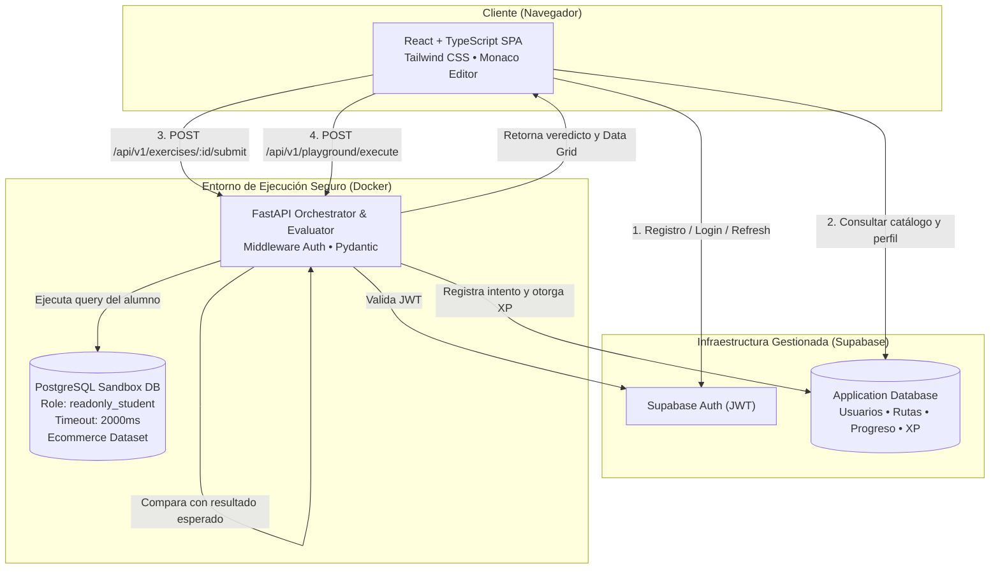
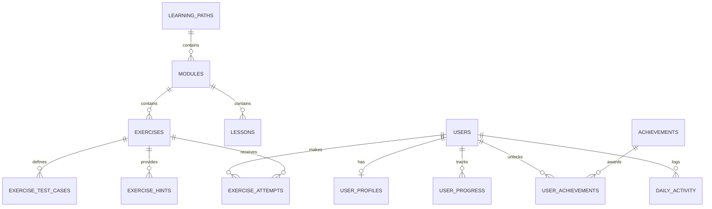

# Qurio — Software Architecture Document (SAD)

**Producto:** Qurio — Interactive SQL Learning Platform  
**Versión:** 1.0 (MVP)  
**Fecha:** Noviembre 2026  
**Estado:** Documento de Arquitectura Base  
**PRD de Referencia:** [`docs/PRD.md`](file:///c:/Desarrollo/Qurio/docs/PRD.md)  
**Intención Fundacional:** [`docs/intent/qurio-mvp.md`](file:///c:/Desarrollo/Qurio/docs/intent/qurio-mvp.md)  
**Sistema de Diseño:** [`Terminal Glow Minimal`](file:///c:/Desarrollo/Qurio/docs/stitch_qurio_interactive_sql_platform/stitch_qurio_interactive_sql_platform/terminal_glow_minimal/DESIGN.md)

---

## 1. Visión y Principios Arquitectónicos

### 1.1 Declaración de Arquitectura
Qurio está estructurado como una **arquitectura híbrida pragmática**:
* **Capa Gestionada (Cloud BaaS):** Utiliza **Supabase** para la gestión de identidad (Auth / JWT), perfiles de usuario, almacenamiento persistente del catálogo formativo y seguimiento de progreso y gamificación.
* **Capa de Cómputo y Evaluación (On-Prem / Docker):** Un backend desacoplado en **FastAPI (Python)** actúa como orquestador y evaluador semántico, ejecutando consultas no confiables contra una instancia de **PostgreSQL Sandbox aislada en Docker**.



### 1.2 Principios de Diseño
1. **Aislamiento Estricto por Diseño (Security by Design):** La base de datos de producción (Supabase) y la base de datos de prácticas de los estudiantes (Docker Sandbox) son físicamente y lógicamente independientes. Las consultas de los estudiantes jamás tocan la base de producción.
2. **Evaluación Semántica sobre Comparación Textual:** Se califica la equivalencia funcional del conjunto de datos devuelto (columnas, filas, tipos, nulos), no el texto literal de la sentencia SQL.
3. **Simplicidad Operativa (YAGNI & Ponytail):** Cero orquestación compleja de Kubernetes o Docker-in-Docker para el MVP. Un único contenedor PostgreSQL sandbox con transacciones controladas y usuarios de solo lectura cubre de forma segura las 3 rutas iniciales.
4. **Ergonomía Profesional:** Tiempos de respuesta inferiores a 800 ms, soporte de atajos de teclado (`⌘ + Enter`), diseño oscuro de alta precisión técnica y feedback didáctico comprensible.

---

## 2. Stack Tecnológico

| Capa | Tecnología | Justificación y Rol |
| :--- | :--- | :--- |
| **Frontend** | React 18 + TypeScript + Vite | SPA reactiva, estricto tipado, alta velocidad de bundling y carga. |
| **Estilos UI** | Tailwind CSS 3.4 | Implementación directa del sistema *Terminal Glow Minimal* y utilidades personalizadas. |
| **Editor SQL** | Monaco Editor (`@monaco-editor/react`) | Mismo motor que VS Code: autocompletado, resaltado de sintaxis PostgreSQL, atajos y números de línea. |
| **Gestión de Estado** | TanStack Query (React Query) + Zustand | Caché optimizada para endpoints del backend y estado local liviano para el IDE y timer. |
| **Backend API** | Python 3.12 + FastAPI | Rendimiento asíncrono excepcional, validación automática mediante Pydantic y documentación OpenAPI nativa. |
| **Motor de Evaluación** | Python (`asyncpg` / `sqlglot`) | Driver PostgreSQL nativo ultra-rápido para ejecución y análisis sintáctico de consultas. |
| **Base de Datos App** | Supabase (PostgreSQL 15+) | Autenticación lista, RLS, tablas de catálogo de cursos y panel administrativo web gratuito. |
| **Base de Prácticas** | PostgreSQL 16 (Contenedor Docker) | Entorno de pruebas realista, datasets semilla precargados y configuración estricta de seguridad. |
| **Contenedores** | Docker & Docker Compose | Entorno reproducible idéntico tanto en desarrollo local como en despliegue VPS. |

---

## 3. Estructura del Repositorio (Monorepo)

Se adopta una estructura de monorepo organizada por aplicaciones y servicios:

```text
qurio/
├── apps/
│   ├── web/                         # Frontend React + TypeScript
│   │   ├── src/
│   │   │   ├── assets/              # Isotipos, iconos SVG de Qurio
│   │   │   ├── components/          # Árbol de Atomic Design Pragmático (Estricto)
│   │   │   │   ├── atoms/           # Botones luminescentes, badges, text inputs, kbd, tooltips
│   │   │   │   ├── molecules/       # SearchInput, StreakPill, FormField (con error inline), MetricCard
│   │   │   │   ├── organisms/       # SidebarNav, TopHeader, MonacoEditorPanel, DataGridResults, BentoStatsGrid
│   │   │   │   └── templates/       # WorkspaceLayout (split pane 30/70), DashboardLayout, ProfileLayout
│   │   │   ├── features/            # Páginas/vistas conectadas a estado que ensamblan templates y organismos
│   │   │   │   ├── dashboard/       # Dashboard principal
│   │   │   │   ├── routes/          # Catálogo y detalle de rutas (Syllabus)
│   │   │   │   ├── workspace/       # IDE de resolución de ejercicios
│   │   │   │   ├── playground/      # Consola interactiva libre
│   │   │   │   └── profile/         # Perfil y logros
│   │   │   ├── hooks/               # useAuth, useExercise, usePlayground, useTimer
│   │   │   ├── services/            # Clientes Supabase y API FastAPI
│   │   │   ├── types/               # Tipos TypeScript compartidos
│   │   │   └── App.tsx
│   │   ├── tailwind.config.js       # Tokens de Terminal Glow Minimal
│   │   └── package.json
│   │
│   └── api/                         # Backend FastAPI
│       ├── app/
│       │   ├── core/                # Configuración, variables de entorno, seguridad JWT
│       │   ├── modules/
│       │   │   ├── exercises/       # Endpoints de consulta y detalle de retos
│       │   │   ├── evaluation/      # Motor de ejecución y comparación semántica
│       │   │   ├── playground/      # Endpoint de ejecución en el sandbox
│       │   │   └── progress/        # Registro de intentos y cálculo de XP
│       │   ├── services/
│       │   │   ├── supabase_client.py # Conexión a Supabase con Service Role
│       │   │   └── sandbox_runner.py  # Pool de conexiones a PostgreSQL Sandbox
│       │   └── main.py              # Punto de entrada de la aplicación FastAPI
│       ├── requirements.txt
│       └── Dockerfile
│
├── database/
│   ├── supabase/                    # Migraciones y DDL para la base de datos de App
│   │   ├── 01_schema.sql
│   │   └── 02_seed_curriculum.sql   # Semilla de las 3 rutas y 50 ejercicios
│   │
│   └── sandbox/                     # Inicialización del PostgreSQL de prácticas
│       ├── init.sql                 # Creación del rol readonly_student y límites
│       └── ecommerce_seed.sql       # Tablas y datos de Ecommerce_Production_DB
│
├── docs/                            # Documentación de ingeniería (PRD, SAD, etc.)
│   ├── intent/
│   ├── PRD.md
│   └── SAD.md
│
├── docker-compose.yml               # Orquestación: api + postgres-sandbox
└── README.md
```

### 3.1 Directrices de Atomic Design Pragmático
Para garantizar una arquitectura frontend limpia y mantenible, el frontend se rige por dos reglas cardinales:
1. **Regla de Estructura Estricta (Cero Componentes Huérfanos):** Está prohibido crear componentes de interfaz fuera del árbol de diseño (`atoms`, `molecules`, `organisms`, `templates`). Cada botón, tarjeta, modal o celda tiene una ubicación inequívoca según su nivel de composición. Las vistas (`features/` o `pages/`) solo ensamblan organismos dentro de templates.
2. **Pragmatismo sin Dogmatismo (Anti-Sobreingeniería):** No se crearán componentes atómicos innecesarios para envolver etiquetas HTML nativas que no aporten tokens del sistema *Terminal Glow Minimal* (ej. no crear un componente `<Span>` o `<Div>`). Un átomo solo se justifica cuando encapsula estilos compartidos, variantes (ej. tamaños, estados luminiscentes), accesibilidad o interactividad reutilizable.

---

## 4. Diseño del Motor de Evaluación SQL (`execution-eval`)

El motor de evaluación es el núcleo crítico de Qurio. Se compone de dos etapas sucesivas: **Ejecución Segura** y **Validación Semántica**.

### 4.1 Flujo de Ejecución y Validación

```mermaid
sequenceDiagram
    autonumber
    actor Alumno as Estudiante (Navegador)
    participant FE as React SPA (Monaco)
    participant API as FastAPI Backend
    participant SB as Supabase DB
    participant PG as PostgreSQL Sandbox (Docker)

    Alumno->>FE: Presiona ⌘ + Enter ("Ejecutar Query")
    FE->>API: POST /api/v1/exercises/:id/submit { query: "SELECT ..." } (Bearer JWT)
    API->>API: Valida Token JWT de Supabase
    API->>API: Filtro de seguridad sintáctico (bloqueo DDL/DML destructivo)
    API->>SB: Obtiene caso de prueba y solución de referencia del ejercicio :id
    
    par Ejecución de Alumno
        API->>PG: SET statement_timeout = 2000; <Query Alumno> (Role: readonly_student)
        PG-->>API: Resultado Alumno (filas, columnas, tipos, tiempo)
    and Ejecución de Referencia
        API->>PG: <Query Referencia>
        PG-->>API: Resultado Esperado
    end

    API->>API: Comparador Semántico (Columnas, Filas, Tipos, NULLs, Orden si aplica)
    
    alt ¿Solución Correcta?
        API->>SB: Registra intento exitoso, calcula XP y actualiza racha
        API-->>FE: HTTP 200 { status: "PASSED", xp_awarded: 45, execution_time_ms: 14, data: [...] }
        FE->>Alumno: Resplandor verde, desbloqueo de nivel y botón "Siguiente"
    else ¿Solución Incorrecta o Error SQL?
        API->>SB: Registra intento fallido
        API-->>FE: HTTP 200 { status: "FAILED", diff: { expected: [...], actual: [...] }, error: "..." }
        FE->>Alumno: Resplandor ámbar/rojo, visualización del diff y botón de pistas
    end
```

### 4.2 Medidas de Seguridad del Sandbox
1. **Rol Limitado (`readonly_student`):**
   ```sql
   CREATE ROLE readonly_student WITH LOGIN PASSWORD 'student_safe_pass';
   GRANT CONNECT ON DATABASE ecommerce_sandbox TO readonly_student;
   GRANT USAGE ON SCHEMA public TO readonly_student;
   GRANT SELECT ON ALL TABLES IN SCHEMA public TO readonly_student;
   ALTER DEFAULT PRIVILEGES IN SCHEMA public GRANT SELECT ON TABLES TO readonly_student;
   ```
2. **Restricciones de Conexión del Motor:**
   * `statement_timeout = '2000ms'` (evita bloqueos o bucles infinitos).
   * `idle_in_transaction_session_timeout = '3000ms'`.
   * `work_mem = '16MB'` (previene agotamiento de memoria por ordenamientos gigantes).
   * `default_transaction_read_only = on`.
3. **Filtro Anti-Abuso en FastAPI:**
   * Bloqueo de sentencias de múltiples queries (múltiples `;`).
   * Bloqueo explícito de funciones del sistema como `pg_sleep`, `pg_terminate_backend`, `pg_read_file`, `dblink`.
4. **Límite de Salida (*Row Cap*):**
   * Se fuerza un `LIMIT 1000` si la consulta no incluye límite propio, previniendo volcados masivos en el navegador.

### 4.3 Algoritmo de Comparación Semántica
Dos consultas se consideran funcionalmente equivalentes si:
1. **Normalización de Encabezados:** Los nombres de las columnas coinciden (insensible a mayúsculas/minúsculas) o son alias válidos requeridos por la consigna.
2. **Coincidencia de Cardinalidad:** Devuelven el mismo número exacto de filas devueltas.
3. **Coincidencia de Valores y Nulos:**
   * Se comparan los valores celda por celda mapeados a tipos estándar Python (`str`, `int`, `float`, `None`).
   * Los valores numéricos con coma flotante se comparan con tolerancia delta (`abs(a - b) < 0.001`).
   * Los valores `NULL` coinciden estrictamente con `NULL` (o `None`).
4. **Sensibilidad al Orden:**
   * Si el ejercicio exige explícitamente `ORDER BY` en sus metadatos (`check_order: true`), la comparación se hace como una lista ordenada (`O(N)`).
   * Si el ejercicio no requiere orden específico (`check_order: false`), se compara mediante multiconjunto/frecuencias (*multiset comparison*) para no penalizar al estudiante por el orden arbitrario que decida el planificador de PostgreSQL.

---

## 5. Modelo de Datos de la Aplicación (Supabase)

### 5.1 Diagrama Entidad-Relación



### 5.2 Diccionario de Tablas Principales

#### `user_profiles`
Extensión del perfil público del usuario registrado en `auth.users`:
* `id` (UUID, PK, FK a `auth.users.id`, ON DELETE CASCADE)
* `username` (VARCHAR(50), UNIQUE, NOT NULL)
* `display_name` (VARCHAR(100), NOT NULL)
* `avatar_url` (TEXT, NULL)
* `level` (INT, DEFAULT 1)
* `xp` (INT, DEFAULT 0)
* `current_streak_days` (INT, DEFAULT 0)
* `max_streak_days` (INT, DEFAULT 0)
* `created_at` (TIMESTAMPTZ, DEFAULT NOW())

#### `learning_paths`
* `id` (VARCHAR(50), PK) — ej. `'sql-foundations'`
* `title` (VARCHAR(150), NOT NULL)
* `description` (TEXT, NOT NULL)
* `difficulty` (VARCHAR(20), NOT NULL) — `'Principiante'`, `'Intermedio'`, `'Avanzado'`
* `estimated_hours` (INT, NOT NULL)
* `badge_reward` (VARCHAR(100), NOT NULL)
* `sort_order` (INT, NOT NULL)

#### `modules`
* `id` (UUID, PK, DEFAULT gen_random_uuid())
* `path_id` (VARCHAR(50), FK a `learning_paths.id`)
* `module_number` (INT, NOT NULL)
* `title` (VARCHAR(150), NOT NULL)
* `description` (TEXT, NULL)

#### `exercises`
* `id` (UUID, PK, DEFAULT gen_random_uuid())
* `module_id` (UUID, FK a `modules.id`)
* `title` (VARCHAR(150), NOT NULL)
* `prompt` (TEXT, NOT NULL) — Enunciado del problema de negocio
* `initial_code` (TEXT, DEFAULT '-- Escribe tu consulta aquí\n')
* `solution_query` (TEXT, NOT NULL) — Query de referencia del evaluador
* `target_database` (VARCHAR(50), DEFAULT 'ecommerce_sandbox')
* `xp_reward` (INT, DEFAULT 45)
* `difficulty` (VARCHAR(20), DEFAULT 'Principiante')
* `check_order` (BOOLEAN, DEFAULT FALSE)
* `sort_order` (INT, NOT NULL)

#### `exercise_hints`
* `id` (UUID, PK, DEFAULT gen_random_uuid())
* `exercise_id` (UUID, FK a `exercises.id`)
* `hint_order` (INT, NOT NULL) — 1, 2, 3
* `content` (TEXT, NOT NULL)
* `xp_penalty_percent` (INT, DEFAULT 15)

#### `exercise_attempts`
* `id` (UUID, PK, DEFAULT gen_random_uuid())
* `user_id` (UUID, FK a `auth.users.id`)
* `exercise_id` (UUID, FK a `exercises.id`)
* `submitted_sql` (TEXT, NOT NULL)
* `status` (VARCHAR(20), NOT NULL) — `'PASSED'`, `'FAILED'`, `'ERROR'`
* `execution_time_ms` (INT, NOT NULL)
* `error_message` (TEXT, NULL)
* `hints_used` (INT, DEFAULT 0)
* `xp_awarded` (INT, DEFAULT 0)
* `created_at` (TIMESTAMPTZ, DEFAULT NOW())

#### `achievements` y `user_achievements`
Catálogo de medallas e insignias desbloqueadas por el alumno (`badge_id`, `name`, `icon`, `criteria_json`).

---

## 6. Esquema del Dataset de Práctica (`Ecommerce_Production_DB`)

El sandbox contiene un conjunto de datos realista de comercio electrónico con 10 tablas relacionadas:

```text
ECOMMERCE_SANDBOX
├── clientes           (cliente_id, nombre, apellido, email, ciudad, fecha_registro)
├── categorias         (categoria_id, nombre_categoria, descripcion)
├── productos          (producto_id, categoria_id, nombre_producto, precio, stock)
├── almacenes          (almacen_id, nombre_almacen, ubicacion, capacidad)
├── inventario         (almacen_id, producto_id, cantidad_disponible)
├── proveedores        (proveedor_id, nombre_proveedor, pais, telefono)
├── pedidos            (pedido_id, cliente_id, fecha_pedido, estado_pedido, total)
├── detalle_pedidos    (detalle_id, pedido_id, producto_id, cantidad, precio_unitario)
├── facturas           (factura_id, pedido_id, fecha_emision, monto_total)
└── pagos              (pago_id, factura_id, metodo_pago, monto, fecha_pago, estado_pago)
```

Este conjunto de datos permite plantear desafíos completos de:
* Filtrado y agregación (ventas totales por mes, productos más caros por categoría).
* Relaciones complejas (clientes que nunca han comprado con `LEFT JOIN ... WHERE NULL`).
* Subconsultas y análisis (pedidos por encima del promedio, clientes con mayor recurrencia).
* Funciones de ventana (ranking de productos más vendidos por almacén con `DENSE_RANK()`).

---

## 7. Contratos de la API (RESTful `/api/v1`)

### 7.1 Autenticación
Los endpoints protegidos reciben el header estándar:  
`Authorization: Bearer <supabase_jwt>`

### 7.2 Endpoints de Currículo y Ejercicios
* `GET /api/v1/learning-paths`: Lista las 3 rutas activas y su progreso para el usuario.
* `GET /api/v1/learning-paths/{id}`: Detalle de la ruta (Syllabus con módulos y ejercicios).
* `GET /api/v1/exercises/{id}`: Obtiene el enunciado, esquema de tablas y código inicial (sin exponer la query de solución).

### 7.3 Endpoints de Evaluación y Ejecución
* `POST /api/v1/exercises/{id}/submit`:
  * **Request:**
    ```json
    {
      "query": "SELECT nombre, apellido FROM clientes WHERE ...",
      "hints_revealed": 1
    }
    ```
  * **Response (Aprobado):**
    ```json
    {
      "status": "PASSED",
      "xp_awarded": 38,
      "execution_time_ms": 18,
      "columns": ["nombre", "apellido"],
      "rows": [["Carlos", "Mendoza"], ["Elena", "Gómez"]],
      "explanation": "Excelente. Al utilizar LEFT JOIN con IS NULL identificaste con éxito los registros huérfanos."
    }
    ```

* `POST /api/v1/playground/execute`:
  * **Request:**
    ```json
    {
      "query": "SELECT * FROM productos LIMIT 10;",
      "database": "ecommerce_sandbox"
    }
    ```
  * **Response:**
    ```json
    {
      "status": "SUCCESS",
      "execution_time_ms": 9,
      "row_count": 10,
      "columns": [{"name": "producto_id", "type": "INT"}, {"name": "nombre_producto", "type": "VARCHAR"}],
      "rows": [...]
    }
    ```

---

## 8. Estrategia de Infraestructura y Despliegue

### 8.1 Desarrollo Local
* El desarrollador corre `docker compose up -d` en su máquina local:
  * Levanta el contenedor `postgres-sandbox` en el puerto `5433` con los scripts de semilla.
  * Levanta el contenedor `api` (FastAPI) en el puerto `8000` con auto-reload.
* El frontend corre con `npm run dev` en `localhost:5173`, conectándose a Supabase Cloud para datos y a `localhost:8000` para la ejecución de consultas.

### 8.2 Despliegue en Producción (VPS Único)
* Un único servidor Linux económico (ej. Ubuntu 24.04 en Hetzner o DigitalOcean, 2GB RAM / 1 vCPU):
  * **Caddy / Nginx:** Proxy inverso con certificados SSL automáticos Let's Encrypt.
  * **Web SPA:** Compilada en archivos estáticos servidos por Caddy en milisegundos.
  * **FastAPI:** Ejecutándose en contenedor Docker con Uvicorn workers.
  * **PostgreSQL Sandbox:** En contenedor Docker en red interna aislada sin puerto expuesto a internet (solo accesible por FastAPI).
  * **Supabase:** Proyecto en la nube gestionada (Tier Gratuito / Hobby).

---

## 9. Observabilidad y Monitoreo

1. **Logging Estructurado:** Logs en formato JSON en FastAPI registrando: `timestamp`, `user_id`, `exercise_id`, `execution_time_ms`, `status` y `error_code`.
2. **Alertas de Rendimiento:** Registro de advertencia cuando una consulta de alumno supere los **1,500 ms** de ejecución.
3. **Métricas de Sandbox:** Endpoint `/api/v1/health` que comprueba la conectividad y latencia de conexión con el PostgreSQL Sandbox para mostrar el indicador *"PostgreSQL 16 • Online"* en la barra superior.
