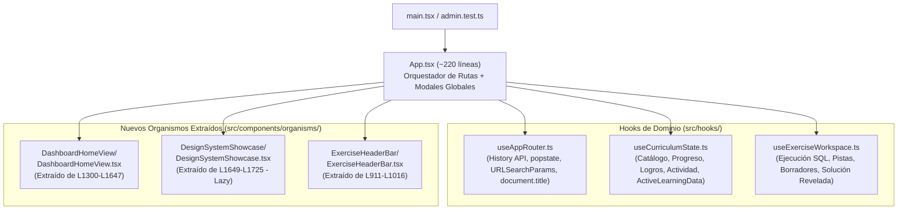

# Auditoría Técnica y Plan Maestro de Refactorización — `App.tsx`

**Archivo auditado:** [`apps/web/src/App.tsx`](file:///c:/Desarrollo/Qurio/apps/web/src/App.tsx)  
**Fecha:** 2026-11-17  
**Rol:** Lead Code & Systems Auditor  

---

## 1. Resumen Ejecutivo

- **Veredicto general del archivo:** **Rechazado** (Requiere refactorización estructural y corrección de defectos de concurrencia/estado antes de escalar).
- **Conteo de incidencias por severidad:**
  - **Crítica:** 1
  - **Alta:** 5
  - **Media:** 5
  - **Baja:** 2
- **Diagnóstico general:** [`App.tsx`](file:///c:/Desarrollo/Qurio/apps/web/src/App.tsx) opera como un *God Component* monolítico de **1,795 líneas** que viola frontalmente la regla arquitectónica del proyecto (Atomic Design Pragmático, Regla 1.3 de [`AGENTS.md`](file:///c:/Desarrollo/Qurio/AGENTS.md)), concentrando en un único cierre léxico el enrutador artesanal (`History API`), más de 30 estados locales (`useState`), sincronización de progreso y gamificación, lógica de evaluación del IDE y el marcado completo del Dashboard junto con un showcase de desarrollo. Esta concentración provoca fugas de cierres obsoletos (*stale closures*) en los `useEffect` de enrutamiento y carga inicial, pérdida silenciosa de promesas rechazadas (`Unhandled Promise Rejections`), corrupción del historial de navegación al cambiar de ejercicio, pérdida de estado de pistas al navegar hacia atrás/adelante (`popstate`), e indisponibilidad de la paleta de comandos (`⌘K`) dentro de la vista del IDE por retorno temprano del árbol JSX.

---

## 2. Matriz de Hallazgos

| ID | Severidad | Dimensión | Línea / Elemento | Problema Concreto |
|---|---|---|---|---|
| **H01** | **Crítica** | Mantenibilidad y Diseño | L137–L1792 (`App`) | *God Component* de 1,795 líneas que acopla enrutador, gestor de estado global, capa de negocio y vistas completas (violación de Atomic Design Regla 1.3). |
| **H02** | **Alta** | Confiabilidad y Manejo de Errores | L314–L346 (`useEffect` de carga) | Condición de carrera (*stale closure*) con `authoritativeCompletedIds` y re-disparo redundante de `api.getExercises()` y `api.getTracks()` por dependencia `pendingExerciseId`. |
| **H03** | **Alta** | Confiabilidad y Manejo de Errores | L351–L391, L759–L763 (`useEffect` progreso) | Promesas sin bloque `.catch()` ni cancelación: si una petición falla, `isProgressLoading` queda bloqueado en `true` indefinidamente y sin trazabilidad. |
| **H04** | **Alta** | Confiabilidad y Manejo de Errores | L255–L311 (`handleLocationChange`) | *Stale closure* sobre `currentExerciseIndex` y omisión de reinicio de `hintsUnlocked`, `isTrialResult`, `resultRows` y `resultColumns` al navegar con `popstate`. |
| **H05** | **Alta** | Confiabilidad y Manejo de Errores | L749–L756 (`setAuthoritativeCompletedIds`) | Efecto secundario impuro (`setTracks`) anidado dentro del actualizador funcional de otro `setState` (`setAuthoritativeCompletedIds`). |
| **H06** | **Alta** | Mantenibilidad y Diseño | L905–L1136 vs L1758–L1783 | Retorno temprano en `currentPath === 'exercise'` desmonta `CommandPaletteModal` y `ModuleGuideModal`, rompiendo el atajo global `⌘K` en el IDE aunque su listener sigue activo. |
| **H07** | **Media** | Confiabilidad y Manejo de Errores | L608–L624 (`handleIssueTrackCertificate`) | Fallo de emisión de constancia en la vista `tracks` escribe en `resultError` (estado exclusivo del IDE), ocultando silenciosamente el error al usuario. |
| **H08** | **Media** | Confiabilidad y Manejo de Errores | L538 vs L561, L1406–L1407, L1582 | Inconsistencia de navegación: `handleSelectExercise` usa `replace = true` destruyendo el historial entre retos, se duplica `navigate()` tras llamarlo y L1582 omite `navigate()` desincronizando la URL. |
| **H09** | **Media** | Seguridad y Exposición | L262–L281 (`handleLocationChange`) | Detección de flujos sensibles de autenticación mediante `.includes()` sobre cadenas crudas de `window.location.search` y `window.location.hash` en vez de `URLSearchParams`. |
| **H10** | **Media** | Rendimiento y Escalabilidad | L685–L858, L627–L645 (`useCallback`) | Re-creación continua de `handleExecuteSolution` en cada pulsación de tecla (`sqlCode` en dependencias) y omisión de `isAdmin` en las dependencias de `handleConfirmRevealSolution`. |
| **H11** | **Media** | Confiabilidad y Manejo de Errores | L783–L791 (`handleExecuteSolution`) | Condición de carrera e inconsistencia de fuente de verdad en `queryHistory`: mezcla historial remoto (`persistence.getUserAttemptsHistory`) con sobrescritura síncrona local (`api.getQueryHistory()`). |
| **H12** | **Baja** | Mantenibilidad y Diseño | L106–L118 (`ViewLoadingFallback` / `import`) | Declaración de funciones y componentes intercalada con sentencias `import` a mitad del módulo, degradando la estructura estática del archivo. |
| **H13** | **Baja** | Mantenibilidad y Diseño | L143–L145, L880–L889, L1650–L1725 | Código de *showcase* de desarrollo y estado de formulario de prueba (`formEmail`, `formError`) acoplados al bundle de producción del componente raíz. |

---

## 3. Desglose Técnico de Hallazgos

### [H01] - Componente Raíz Monolítico (*God Component*) y Violación de Arquitectura UI
- **Evidencia:** [`App.tsx` (L137–L1792)](file:///c:/Desarrollo/Qurio/apps/web/src/App.tsx#L137-L1792)
  ```tsx
  export const App: React.FC = () => {
    const [currentPath, setCurrentPath] = useState<AppPath>('dashboard');
    // ... +30 definiciones de useState, 6 useEffect, 12 handlers de negocio y ~900 líneas de JSX inline
  ```
- **Causa Raíz y Riesgo:** `App.tsx` concentra responsabilidades de enrutamiento, sincronización de sesión/persistencia, lógica de evaluación SQL, orquestación de modales y el renderizado directo de toda la vista de `dashboard` ([L1300–L1728](file:///c:/Desarrollo/Qurio/apps/web/src/App.tsx#L1300-L1728)) y la barra superior/estado de `exercise` ([L905–L1136](file:///c:/Desarrollo/Qurio/apps/web/src/App.tsx#L905-L1136)). Cualquier cambio de estado (como escribir un carácter en el editor SQL actualizando `sqlCode`) fuerza la re-evaluación de todo el componente raíz. Además, incumple directamente la regla arquitectónica del proyecto (Atomic Design Pragmático, Regla 1.3), que prohíbe tener marcado y estilos de vistas embebidos fuera de organismos y contenedores de página dedicados.
- **Solución Propuesta:** Extraer la vista del Dashboard a `src/components/organisms/DashboardHomeView/DashboardHomeView.tsx`, el showcase de diseño a `src/components/organisms/DesignSystemShowcase/DesignSystemShowcase.tsx`, la cabecera del IDE a `src/components/organisms/ExerciseHeaderBar/ExerciseHeaderBar.tsx`, y encapsular el enrutamiento y el estado del dominio en hooks dedicados (`useAppRouter`, `useCurriculumState`, `useExerciseWorkspace`).

---

### [H02] - Condición de Carrera (*Stale Closure*) y Re-fetching Redundante en Carga Inicial
- **Evidencia:** [`App.tsx` (L314–L346)](file:///c:/Desarrollo/Qurio/apps/web/src/App.tsx#L314-L346)
  ```tsx
  useEffect(() => {
    api.getExercises().then((data) => {
      if (data && data.length > 0) {
        setExercises((prev) =>
          data.map((ex) => {
            const prevEx = prev.find((p) => p.id === ex.id);
            return {
              ...ex,
              is_completed: authoritativeCompletedIds.has(ex.id) || Boolean(prevEx?.is_completed),
            };
          })
        );
        if (pendingExerciseId) {
          // ...
          setPendingExerciseId(null);
        }
      }
    });
    api.getTracks().then((data) => { ... });
    setQueryHistory(api.getQueryHistory());
  }, [pendingExerciseId]);
  ```
- **Causa Raíz y Riesgo:**
  1. **Re-ejecución de red innecesaria:** Al incluir `pendingExerciseId` como dependencia del `useEffect` que descarga el catálogo, cuando se resuelve un enlace profundo y se ejecuta `setPendingExerciseId(null)` en [L335](file:///c:/Desarrollo/Qurio/apps/web/src/App.tsx#L335), el efecto vuelve a dispararse por segunda vez, llamando nuevamente a `api.getExercises()` y `api.getTracks()`.
  2. **Stale Closure:** `authoritativeCompletedIds` se lee dentro del `.then()` pero no está en el arreglo de dependencias, por lo que si `getCompletedExerciseIds` resuelve antes o después, `authoritativeCompletedIds` puede referenciar el `Set` vacío del primer render.
- **Solución Propuesta:** Separar la descarga única del catálogo (`useEffect` con `[]` y control `cancelled`) de la resolución de `pendingExerciseId` en otro `useEffect` que dependa únicamente de `[exercises, pendingExerciseId]`.

---

### [H03] - Promesas sin Manejo de Errores (`Unhandled Rejections`) y Bloqueo de `isProgressLoading`
- **Evidencia:** [`App.tsx` (L349–L392)](file:///c:/Desarrollo/Qurio/apps/web/src/App.tsx#L349-L392)
  ```tsx
  useEffect(() => {
    setIsProgressLoading(true);
    persistence.getCompletedExerciseIds(profile?.id).then((completedIds) => {
      // ...
      persistence.getUserDailyActivity(profile.id).then((act) => {
        setDailyActivity(act);
      });
      // ...
      setIsProgressLoading(false);
    });
  }, [profile?.id, guestSyncCount, exercises.length]);
  ```
- **Causa Raíz y Riesgo:** Ninguna de las llamadas asíncronas en [L315](file:///c:/Desarrollo/Qurio/apps/web/src/App.tsx#L315), [L340](file:///c:/Desarrollo/Qurio/apps/web/src/App.tsx#L340), [L351](file:///c:/Desarrollo/Qurio/apps/web/src/App.tsx#L351), [L368–L379](file:///c:/Desarrollo/Qurio/apps/web/src/App.tsx#L368-L379), [L388](file:///c:/Desarrollo/Qurio/apps/web/src/App.tsx#L388) o [L759–L763](file:///c:/Desarrollo/Qurio/apps/web/src/App.tsx#L759-L763) cuenta con bloques `.catch()` ni `.finally()`. Si `persistence.getCompletedExerciseIds(profile?.id)` rechaza la promesa (ej. interrupción de red con Supabase o token expirado), `setIsProgressLoading(false)` en [L390](file:///c:/Desarrollo/Qurio/apps/web/src/App.tsx#L390) jamás se ejecuta, dejando `TracksView` bloqueado permanentemente en estado de carga y generando un `UnhandledPromiseRejection` sin contexto de observabilidad.
- **Solución Propuesta:** Encapsular la sincronización en una función `async` con `try / catch / finally` y bandera `cancelled` para evitar actualizaciones de estado tras desmontaje o cambio rápido de `profile?.id`:
  ```tsx
  useEffect(() => {
    let cancelled = false;
    const syncProgress = async () => {
      setIsProgressLoading(true);
      try {
        const completedIds = await persistence.getCompletedExerciseIds(profile?.id);
        if (cancelled) return;
        // ... resto de cargas con Promise.allSettled
      } catch (err) {
        console.error('[App] Error sincronizando progreso:', err);
      } finally {
        if (!cancelled) setIsProgressLoading(false);
      }
    };
    syncProgress();
    return () => { cancelled = true; };
  }, [profile?.id, guestSyncCount, exercises.length]);
  ```

---

### [H04] - *Stale Closure* y Estado Residual Corrupto al Navegar con el Historial (`popstate`)
- **Evidencia:** [`App.tsx` (L290–L311)](file:///c:/Desarrollo/Qurio/apps/web/src/App.tsx#L290-L311)
  ```tsx
      if (parsed.path === 'exercise' && parsed.exerciseId) {
        const idx = exercises.findIndex((e) => e.id === parsed.exerciseId);
        if (idx !== -1) {
          if (idx !== currentExerciseIndex) {
            setCurrentExerciseIndex(idx);
            const draft = persistence.getExerciseDraft(exercises[idx].id);
            setSqlCode(draft !== null ? draft : exercises[idx].initial_code);
            setExecutionStatus('IDLE');
            setResultError(undefined);
            setResultDiff(undefined);
          }
        } else {
          setPendingExerciseId(parsed.exerciseId);
        }
      }
    };
    // ...
  }, [exercises, isPasswordRecovery]);
  ```
- **Causa Raíz y Riesgo:**
  1. `currentExerciseIndex` se evalúa en `if (idx !== currentExerciseIndex)` ([L294](file:///c:/Desarrollo/Qurio/apps/web/src/App.tsx#L294)), pero **no está incluido en las dependencias del `useEffect`** (`[exercises, isPasswordRecovery]`). Por tanto, el listener `popstate` captura siempre el valor que tenía `currentExerciseIndex` cuando se cargó `exercises` (índice `0`). Si el usuario navega del ejercicio `0` al `2` y luego presiona el botón "Atrás" del navegador para volver al ejercicio `0`, `idx` (`0`) será igual al `currentExerciseIndex` obsoleto (`0`), ignorando el cambio de ejercicio.
  2. A diferencia de `handleSelectExercise` ([L529–L537](file:///c:/Desarrollo/Qurio/apps/web/src/App.tsx#L529-L537)), este bloque olvida limpiar `hintsUnlocked`, `isTrialResult`, `rowCount`, `resultColumns`, `resultRows` y `resultMessage`, filtrando pistas desbloqueadas y filas de resultados de un ejercicio anterior al nuevo.
- **Solución Propuesta:** Centralizar el reseteo de estado del ejercicio en una función memoizada e incluir `currentExerciseIndex` (o un `useRef` del índice actual) en el manejador de cambio de ubicación.

---

### [H05] - Efecto Secundario Impuro Anidado Dentro de un Actualizador de Estado (`setState` Updater)
- **Evidencia:** [`App.tsx` (L749–L756)](file:///c:/Desarrollo/Qurio/apps/web/src/App.tsx#L749-L756)
  ```tsx
  setAuthoritativeCompletedIds((prev) => {
    const next = new Set(prev);
    next.add(activeExercise.id);
    setTracks((currentTracks) =>
      computeOfficialTracksProgress(currentTracks, exercises, next, false)
    );
    return next;
  });
  ```
- **Causa Raíz y Riesgo:** En React, las funciones reductoras pasadas a `setState(prev => next)` deben ser estrictamente puras, ya que React (especialmente en `StrictMode` y concurrencia de React 18) las invoca múltiples veces para detectar efectos secundarios. Llamar a `setTracks` dentro del actualizador de `setAuthoritativeCompletedIds` viola el contrato de pureza de React y además es redundante, puesto que ya existe un `useEffect` reactivo en [L395–L407](file:///c:/Desarrollo/Qurio/apps/web/src/App.tsx#L395-L407) que recalcula `tracks` automáticamente cuando cambia `authoritativeCompletedIds`.
- **Solución Propuesta:** Eliminar la llamada a `setTracks` de adentro del actualizador de `setAuthoritativeCompletedIds`:
  ```tsx
  setAuthoritativeCompletedIds((prev) => {
    const next = new Set(prev);
    next.add(activeExercise.id);
    return next;
  });
  ```

---

### [H06] - Inaccesibilidad de la Paleta de Comandos (`⌘K`) en la Vista de Ejercicios por Retorno Temprano
- **Evidencia:** [`App.tsx` (L212–L221)](file:///c:/Desarrollo/Qurio/apps/web/src/App.tsx#L212-L221), [`L905–L1136`](file:///c:/Desarrollo/Qurio/apps/web/src/App.tsx#L905-L1136) y [`L1758–L1783`](file:///c:/Desarrollo/Qurio/apps/web/src/App.tsx#L1758-L1783)
  ```tsx
  // L212: Listener activo globalmente
  useEffect(() => {
    const handleGlobalKeyDown = (e: KeyboardEvent) => {
      if ((e.metaKey || e.ctrlKey) && e.key.toLowerCase() === 'k') {
        e.preventDefault();
        setCommandPaletteOpen((prev) => !prev);
      }
    };
  // ...
  // L905: Retorno temprano para 'exercise' (no incluye CommandPaletteModal)
  if (currentPath === 'exercise') {
    return (
      <>
        <WorkspaceLayout ... />
        <RevealSolutionModal ... />
        <GuestTrialCompleteModal ... />
        <AuthModal ... />
      </>
    );
  }
  ```
- **Causa Raíz y Riesgo:** Cuando `currentPath === 'exercise'` (o `currentPath === 'admin'`), el componente retorna tempranamente antes de llegar a [L1759](file:///c:/Desarrollo/Qurio/apps/web/src/App.tsx#L1759) donde se monta `<CommandPaletteModal />`. Sin embargo, el listener de teclado `handleGlobalKeyDown` sigue interceptando `⌘+K` / `Ctrl+K`, ejecutando `e.preventDefault()` y alternando `commandPaletteOpen` en memoria sin que el modal exista en el DOM, además de duplicar el montaje de `<GuestTrialCompleteModal />` y `<AuthModal />` en dos ramas del componente ([L1110–L1133](file:///c:/Desarrollo/Qurio/apps/web/src/App.tsx#L1110-L1133) y [L1732–L1755](file:///c:/Desarrollo/Qurio/apps/web/src/App.tsx#L1732-L1755)).
- **Solución Propuesta:** Unificar el retorno principal para que los modales transversales (`AuthModal`, `GuestTrialCompleteModal`, `CommandPaletteModal`, `ModuleGuideModal`, `CertificateModal`, `MethodologyModal`) se rendericen una única vez en el nivel superior, independientemente del layout activo (`WorkspaceLayout` o `DashboardLayout`).

---

### [H07] - Pérdida Silenciosa de Errores al Emitir Certificados en la Vista de Rutas
- **Evidencia:** [`App.tsx` (L608–L624)](file:///c:/Desarrollo/Qurio/apps/web/src/App.tsx#L608-L624)
  ```tsx
  const handleIssueTrackCertificate = useCallback(
    async (track: Track, qaPreview: boolean) => {
      try {
        const record = await api.issueCertificate({ ... });
        setTracksCertificate(toCertificateData(record));
      } catch (err: any) {
        setResultError(err?.message || 'No se pudo emitir la constancia.');
      }
    },
    [profile]
  );
  ```
- **Causa Raíz y Riesgo:** `handleIssueTrackCertificate` se invoca desde `<TracksView />` (`currentPath === 'tracks'`), pero en el bloque `catch` asigna el fallo a `setResultError(...)`. `resultError` solo se pasa como prop a `<DataGridResults />` dentro de la vista `currentPath === 'exercise'` ([L1065](file:///c:/Desarrollo/Qurio/apps/web/src/App.tsx#L1065)). En consecuencia, si la emisión de la constancia falla en `TracksView`, el error queda completamente invisible para el usuario (violando la Regla 1.1 de Manejo Riguroso de Errores) y además contamina el panel de resultados SQL cuando el usuario vuelva a abrir un ejercicio.
- **Solución Propuesta:** Propagar el error a `TracksView` mediante un estado dedicado o re-lanzarlo para que `TracksView` lo presente inline sin contaminar `resultError` del ejecutor SQL.

---

### [H08] - Inconsistencia en el Historial de Navegación (`pushState` vs `replaceState` y Estado Desincronizado)
- **Evidencia:** [`App.tsx` (L538)](file:///c:/Desarrollo/Qurio/apps/web/src/App.tsx#L538), [`L542–L562`](file:///c:/Desarrollo/Qurio/apps/web/src/App.tsx#L542-L562), [`L1406–L1407`](file:///c:/Desarrollo/Qurio/apps/web/src/App.tsx#L1406-L1407) y [`L1582`](file:///c:/Desarrollo/Qurio/apps/web/src/App.tsx#L1582)
  ```tsx
  // L538: dentro de handleSelectExercise
  navigate('exercise', { exerciseId: ex.id }, true); // replace = true
  // ...
  // L542: handleOpenExerciseFromCatalog llama a handleSelectExercise (replace) y luego a navigate (push)
  const handleOpenExerciseFromCatalog = (ex: Exercise) => {
    const idx = exercises.findIndex((e) => e.id === ex.id);
    if (idx !== -1) {
      handleSelectExercise(idx);
    }
    // ...
    navigate('exercise', { exerciseId: ex.id });
  };
  // ...
  // L1582: cambia el estado interno sin actualizar window.location
  onClick={() => setCurrentPath('tracks')}
  ```
- **Causa Raíz y Riesgo:**
  1. En [L1582](file:///c:/Desarrollo/Qurio/apps/web/src/App.tsx#L1582) (y [L1719](file:///c:/Desarrollo/Qurio/apps/web/src/App.tsx#L1719)), se llama a `setCurrentPath('tracks')` directamente en lugar de `navigate('tracks')`, cambiando la vista renderizada pero dejando `window.location.pathname` en `/`, lo que rompe el botón "Atrás" y la compartición de URL.
  2. Cuando se invoca `handleOpenExerciseFromCatalog` ([L545](file:///c:/Desarrollo/Qurio/apps/web/src/App.tsx#L545)) o los botones del Dashboard ([L1406–L1407](file:///c:/Desarrollo/Qurio/apps/web/src/App.tsx#L1406-L1407), [L1459–L1460](file:///c:/Desarrollo/Qurio/apps/web/src/App.tsx#L1459-L1460), [L1592–L1593](file:///c:/Desarrollo/Qurio/apps/web/src/App.tsx#L1592-L1593)), primero se llama a `handleSelectExercise` —que ejecuta `window.history.replaceState(..., targetUrl)` sobrescribiendo la entrada del Dashboard en el historial— y en la línea siguiente se llama a `navigate('exercise', ...)` que ya no hace `pushState` porque `window.location.pathname !== targetUrl` ([L236](file:///c:/Desarrollo/Qurio/apps/web/src/App.tsx#L236)) evalúa a `false`. Como resultado, la entrada previa en el historial del navegador es reemplazada en lugar de apilada.
- **Solución Propuesta:** Hacer que `handleSelectExercise(index: number, replace = false)` utilice `pushState` por defecto salvo cuando se cambie desde el selector interno o `popstate`, eliminar las llamadas duplicadas a `navigate()` tras `handleSelectExercise`, y reemplazar `setCurrentPath('tracks')` en [L1582](file:///c:/Desarrollo/Qurio/apps/web/src/App.tsx#L1582) por `navigate('tracks')`.

---

### [H09] - Parsing Frágil de Parámetros de Autenticación en URL mediante `.includes()`
- **Evidencia:** [`App.tsx` (L262–L281)](file:///c:/Desarrollo/Qurio/apps/web/src/App.tsx#L262-L281)
  ```tsx
  if (
    isPasswordRecovery ||
    parsed.path === 'reset-password' ||
    hash.includes('type=recovery') ||
    search.includes('type=recovery') ||
    hash.includes('reset-password')
  ) {
    setCurrentPath('reset-password');
    return;
  }
  ```
- **Causa Raíz y Riesgo:** Evaluar `search` y `hash` mediante coincidencia de subcadenas (`.includes()`) en lugar de parsear clave-valor con `URLSearchParams` permite falsos positivos si cualquier otro parámetro en la query string o fragmento contiene la subcadena `type=recovery`, `type=signup` o `reset-password`, desviando forzosamente al usuario a las pantallas de restablecimiento de contraseña o confirmación de cuenta.
- **Solución Propuesta:** Parsear formalmente tanto `window.location.search` como el fragmento `window.location.hash.replace(/^#/, '')` con `new URLSearchParams(...)` y verificar `params.get('type') === 'recovery'` / `params.get('type') === 'signup'`.

---

### [H10] - Invalidación Continua de `useCallback` en cada Pulsación del Editor y Dependencia Faltante
- **Evidencia:** [`App.tsx` (L627–L645)](file:///c:/Desarrollo/Qurio/apps/web/src/App.tsx#L627-L645) y [`L685–L858`](file:///c:/Desarrollo/Qurio/apps/web/src/App.tsx#L685-L858)
  ```tsx
  // L627: usa isAdmin en L629 pero no lo declara en dependencias (L645)
  const handleConfirmRevealSolution = useCallback(async () => {
    const failedCount = failedAttemptsByExercise[activeExercise.id] || 0;
    if (failedCount < 2 && !isAdmin) return;
    // ...
  }, [activeExercise, failedAttemptsByExercise]);

  // L849: handleExecuteSolution se recrea en cada pulsación de tecla porque depende de sqlCode
  }, [
    activeExercise,
    sqlCode,
    hintsUnlocked,
    profile,
    exercises,
    isAuthenticated,
    refreshProfile,
    revealedSolutions,
  ]);
  ```
- **Causa Raíz y Riesgo:**
  1. En `handleConfirmRevealSolution`, `isAdmin` se evalúa en [L629](file:///c:/Desarrollo/Qurio/apps/web/src/App.tsx#L629) pero se omite en el array de dependencias ([L645](file:///c:/Desarrollo/Qurio/apps/web/src/App.tsx#L645)), pudiendo retener un valor `false` obsoleto tras hidratarse el perfil del administrador. (Asimismo, en `handleExecuteSolution`, `isAuthenticated` en [L855](file:///c:/Desarrollo/Qurio/apps/web/src/App.tsx#L855) ni siquiera se utiliza dentro del cuerpo del callback, mientras que `GUEST_TRIAL_EXERCISE_IDS` se omite).
  2. Como `sqlCode` cambia con cada pulsación de tecla en Monaco Editor, tanto `handleExecuteSolution` como `handleRunExerciseTrial` invalidan su referencia en cada carácter escrito, forzando re-renders innecesarios en `<MonacoEditorPanel />`.
- **Solución Propuesta:** Añadir `isAdmin` a las dependencias de `handleConfirmRevealSolution`, limpiar dependencias muertas (`isAuthenticated`) en `handleExecuteSolution`, y mantener una referencia (`useRef`) al último `sqlCode` para estabilizar `onExecute` y `onRunTrial`.

---

### [H11] - Condición de Carrera entre Historial Local y Remoto tras Evaluar una Solución
- **Evidencia:** [`App.tsx` (L758–L764)](file:///c:/Desarrollo/Qurio/apps/web/src/App.tsx#L758-L764) y [`L783–L791`](file:///c:/Desarrollo/Qurio/apps/web/src/App.tsx#L783-L791)
  ```tsx
  // L761: Petición asíncrona al historial remoto de Supabase
  persistence.getUserAttemptsHistory(profile.id).then((hist) => {
    if (hist && hist.length > 0) setQueryHistory(hist);
  });
  // ...
  // L783: Escritura y lectura síncrona inmediata en localStorage
  api.saveQueryHistory({ ... });
  setQueryHistory(api.getQueryHistory());
  ```
- **Causa Raíz y Riesgo:** Para un usuario autenticado, en [L761](file:///c:/Desarrollo/Qurio/apps/web/src/App.tsx#L761) se dispara una promesa a `persistence.getUserAttemptsHistory(profile.id)` e inmediatamente después, en [L791](file:///c:/Desarrollo/Qurio/apps/web/src/App.tsx#L791), se sobrescribe `queryHistory` con `api.getQueryHistory()` (almacenamiento local). Si la promesa remota falla o retorna vacío, o dependiendo del orden de resolución, `queryHistory` alterna de forma no determinista entre los registros de `localStorage` y los de Supabase.
- **Solución Propuesta:** Separar claramente la fuente de datos según `isAuth`: si el usuario está autenticado, actualizar `queryHistory` a partir de la respuesta autoritativa de Supabase (con fallback optimista); si es invitado, usar `api.getQueryHistory()`.

---

### [H12] - Declaraciones de Funciones y Componentes Intercaladas con `import`
- **Evidencia:** [`App.tsx` (L85–L135)](file:///c:/Desarrollo/Qurio/apps/web/src/App.tsx#L85-L135)
  ```tsx
  function toCertificateData(record: CertificateRecord): CertificateData { ... }

  const ViewLoadingFallback: React.FC = () => ( ... );
  import { useAuth } from '@/hooks/useAuth';
  import { useTheme } from '@/hooks/useTheme';
  ```
- **Causa Raíz y Riesgo:** Intercalar código ejecutable (`toCertificateData`, `ViewLoadingFallback`, `React.lazy`) antes de los `import` de las líneas 112–135 incumple las reglas estándar de módulos ES (`import/first`) y dificulta el análisis estático de dependencias.
- **Solución Propuesta:** Agrupar la totalidad de las sentencias `import` al inicio del archivo antes de cualquier declaración de constantes, funciones auxiliares o `React.lazy`.

---

### [H13] - Código de *Showcase* y Estado de Prueba Acoplados al Componente de Producción
- **Evidencia:** [`App.tsx` (L143–L145)](file:///c:/Desarrollo/Qurio/apps/web/src/App.tsx#L143-L145), [`L880–L889`](file:///c:/Desarrollo/Qurio/apps/web/src/App.tsx#L880-L889) y [`L1650–L1725`](file:///c:/Desarrollo/Qurio/apps/web/src/App.tsx#L1650-L1725)
  ```tsx
  const [activeTab, setActiveTab] = useState<'overview' | 'components'>('overview');
  const [formEmail, setFormEmail] = useState('');
  const [formError, setFormError] = useState('');
  ```
- **Causa Raíz y Riesgo:** El estado `formEmail`, `formError`, `activeTab`, el validador `handleValidateEmail` y las ~75 líneas de catálogo de átomos/moléculas ([L1650–L1725](file:///c:/Desarrollo/Qurio/apps/web/src/App.tsx#L1650-L1725)) son artefactos de verificación visual que permanecen incrustados en el flujo principal del Dashboard y se incluyen en el chunk principal para todos los usuarios aunque estén ocultos tras `isAdmin`.
- **Solución Propuesta:** Extraer el escaparate de componentes a un organismo independiente (`src/components/organisms/DesignSystemShowcase/DesignSystemShowcase.tsx`) cargado bajo demanda con `React.lazy`.

---

## 4. Plan Maestro de Refactorización (Sin Romper Dependencias)

### 4.1 Mapa de Dependencias (Análisis de Impacto)

#### Dependencias Entrantes (¿Quién importa o depende de `App.tsx`?)
| Archivo Consumidor | Tipo de Acoplamiento | Contrato que NO puede romperse |
|---|---|---|
| [`apps/web/src/main.tsx`](file:///c:/Desarrollo/Qurio/apps/web/src/main.tsx#L3) | `import App from './App'` | `App.tsx` debe mantener su **exportación por defecto (`export default App`)**. |
| [`apps/web/src/tests/admin.test.ts`](file:///c:/Desarrollo/Qurio/apps/web/src/tests/admin.test.ts#L46) | `import { App } from '@/App'` | `App.tsx` debe mantener su **exportación nombrada (`export const App`)**, su guardia sigilosa RBAC en `/admin` (`SQLSTATE 42P01` para no-admins) y los `document.title` exactos. |
| [`apps/web/e2e/pilot_e2e_suite.mjs`](file:///c:/Desarrollo/Qurio/apps/web/e2e/pilot_e2e_suite.mjs) | Pruebas E2E (Playwright) | Depende de: URLs (`/`, `/tracks`, `/exercises/:id`, `/playground`, `/profile`), `document.title`, clave `qurio_draft_sql_${id}` en `localStorage`, `qurio_guest_progress_v1` y textos de botones (`Iniciar Sesión`, `Enviar Solución`, `Rutas de Aprendizaje`). |

#### Dependencias Salientes (¿De qué depende `App.tsx`?)
1. **Capa de Hooks y Contexto:** [`useAuth.tsx`](file:///c:/Desarrollo/Qurio/apps/web/src/hooks/useAuth.tsx) y [`useTheme.tsx`](file:///c:/Desarrollo/Qurio/apps/web/src/hooks/useTheme.tsx).
2. **Capa de Servicios (`src/lib/`):** [`api.ts`](file:///c:/Desarrollo/Qurio/apps/web/src/lib/api.ts), [`persistence.ts`](file:///c:/Desarrollo/Qurio/apps/web/src/lib/persistence.ts), [`progress.ts`](file:///c:/Desarrollo/Qurio/apps/web/src/lib/progress.ts), [`routing.ts`](file:///c:/Desarrollo/Qurio/apps/web/src/lib/routing.ts), [`format.tsx`](file:///c:/Desarrollo/Qurio/apps/web/src/lib/format.tsx).
3. **Plantillas (`src/components/templates/`):** `DashboardLayout` y `WorkspaceLayout`.
4. **Organismos, Moléculas y Átomos (`src/components/`):** 16 organismos (15 en `React.lazy`), 8 moléculas y 5 átomos.

---

### 4.2 Arquitectura Destino (Cumplimiento de Atomic Design Regla 1.3)

El objetivo es reducir [`App.tsx`](file:///c:/Desarrollo/Qurio/apps/web/src/App.tsx) de **1,795 líneas a ~220 líneas**, convirtiéndolo exclusivamente en un **Orquestador de Plantillas y Modales Globales**:



---

### 4.3 Fases de Ejecución Incremental (Strangler Fig Pattern)

#### Fase 1: Saneamiento In-Situ de `App.tsx`
- **Hallazgos que resuelve:** `H02`, `H03`, `H05`, `H07`, `H09`, `H12`.
- **Acciones:**
  1. Mover todos los `import` a la cabecera del archivo (`H12`).
  2. Separar el `useEffect` de descarga inicial del catálogo (`[]`) de la resolución de `pendingExerciseId` (`H02`).
  3. Blindar el `useEffect` de progreso con `async/await`, `try/catch/finally` y bandera `cancelled` para que `isProgressLoading` nunca quede bloqueado en `true` (`H03`).
  4. Eliminar `setTracks` de adentro del actualizador de `setAuthoritativeCompletedIds` (`H05`).

#### Fase 2: Extracción del Hook de Enrutamiento (`src/hooks/useAppRouter.ts`)
- **Hallazgos que resuelve:** `H04`, `H08`, `H09`.
- **Acciones:**
  1. Extraer la gestión de `currentPath`, `verifyCode`, `navigate`, `popstate` y actualización de `document.title` a `src/hooks/useAppRouter.ts`.
  2. Reemplazar los `.includes()` sobre `window.location.search` y `window.location.hash` por `URLSearchParams` (`H09`).
  3. Corregir `handleSelectExercise(idx, replace = false)` para apilar entradas en el historial (`pushState`) al abrir ejercicios desde el Dashboard o Catálogo y usar `replaceState` en el selector interno del IDE (`H08`).

#### Fase 3: Extracción de los Organismos Visuales (`DashboardHomeView`, `DesignSystemShowcase`, `ExerciseHeaderBar`)
- **Hallazgos que resuelve:** `H01`, `H13`.
- **Acciones:**
  1. Crear `src/components/organisms/DesignSystemShowcase/DesignSystemShowcase.tsx` con su propio estado local (`formEmail`, `formError`), cargado con `React.lazy` (`H13`).
  2. Crear `src/components/organisms/DashboardHomeView/DashboardHomeView.tsx` extrayendo las líneas 1300–1647 de `App.tsx` sin alterar ningún texto ni selector E2E (`H01`).
  3. Crear `src/components/organisms/ExerciseHeaderBar/ExerciseHeaderBar.tsx` extrayendo las líneas 912–1016 de `App.tsx`.
  4. Registrar los nuevos organismos en `src/components/organisms/index.ts`.

#### Fase 4: Extracción de los Hooks de Dominio (`useCurriculumState` y `useExerciseWorkspace`)
- **Hallazgos que resuelve:** `H01`, `H07`, `H10`, `H11`.
- **Acciones:**
  1. Crear `src/hooks/useCurriculumState.ts` encapsulando la carga y cómputo de `exercises`, `tracks`, `authoritativeCompletedIds`, `isProgressLoading`, `dailyActivity`, `totalAttemptsCount`, `attemptStats`, `queryHistory`, `recommendedExercise`, `activeLearningData` y `evaluatedAchievements`, unificando la fuente de verdad de `queryHistory` (`H11`).
  2. Crear `src/hooks/useExerciseWorkspace.ts` encapsulando la ejecución y evaluación semántica de retos, pistas, borradores y revelación de soluciones, estabilizando `handleExecuteSolution` y `handleRunExerciseTrial` con `useRef` para `sqlCode` y añadiendo `isAdmin` a las dependencias de `handleConfirmRevealSolution` (`H10`).

#### Fase 5: Unificación de Modales Globales en `App.tsx`
- **Hallazgos que resuelve:** `H06`.
- **Acciones:**
  1. Unificar el retorno JSX de `App.tsx` para que `AuthModal`, `GuestTrialCompleteModal`, `CommandPaletteModal`, `ModuleGuideModal`, `CertificateModal` y `MethodologyModal` se monten una única vez en el fragmento raíz, habilitando `⌘K` también dentro de la vista `exercise`.

---

### 4.4 Protocolo de Verificación Anti-Regresión

Después de completar cada fase, se debe ejecutar:

1. **Compilación TypeScript y Bundle de Producción:**
   ```bash
   cd apps/web && npm run build
   ```
2. **Suite de Pruebas Unitarias e Integración (Vitest):**
   ```bash
   cd apps/web && npm test
   ```
3. **Suite E2E de Navegador Real (Playwright):**
   ```bash
   node apps/web/e2e/pilot_e2e_suite.mjs
   ```
4. **Actualización del Grafo de Conocimiento (Graphify):**
   ```bash
   python -m graphify update .
   ```
5. **Registro en Bitácora:**
   Actualizar [`docs/BITACORA.md`](file:///c:/Desarrollo/Qurio/docs/BITACORA.md).
