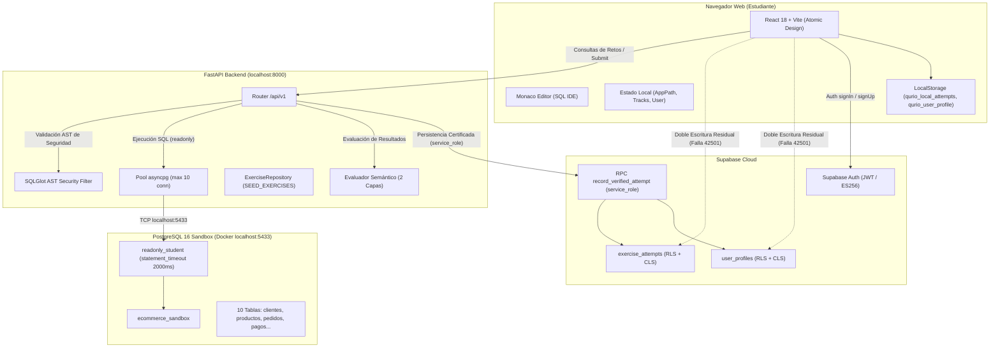

# Qurio — Informe de Auditoría del Estado Operativo y Diagnóstico Técnico

| Metadato | Detalle |
| :--- | :--- |
| **Identificador** | `QURIO-OPERATIONAL-AUDIT-01` |
| **Fecha de emisión** | 10 de noviembre de 2026 |
| **Versión** | `1.0` (Línea Base Operativa) |
| **Rama de auditoría** | `docs/operational-baseline-v1` |
| **Commit base** | `add8b6d` (en `main`) / `3d747bf` (sincronización documental v1.2) |
| **Alcance** | Auditoría integral forense, diagnóstico de código, infraestructura y pruebas |
| **Carácter del trabajo** | **Estrictamente analítico y documental** (Cero modificaciones en código de producción, esquemas de BD ni configuraciones de infraestructura) |
| **Equipo auditor** | Software Architecture, Full Stack Engineering, Application Security, Database Engineering, QA Automation & EdTech Product Management |

---

## 1. Resumen Ejecutivo

### 1.1 Contexto de la Auditoría
El proyecto **Qurio** ha completado una serie de fases de ingeniería significativas:
1. Una infraestructura base de backend en **FastAPI (Python 3.14)** y frontend en **React 18 + TypeScript + Vite**.
2. Un entorno aislado de ejecución en **PostgreSQL Sandbox (Docker)** con un esquema de comercio electrónico de 10 tablas.
3. Integración con **Supabase Cloud** para autenticación JWT y persistencia certificada de intentos mediante la función RPC `record_verified_attempt`.
4. Un catálogo curricular piramidal completo de **50 ejercicios interactivos**, estructurados en **3 rutas de aprendizaje** y **12 módulos didácticos**.
5. Documentos rectores estratégicos: *Product & Business Blueprint v1.2* y *Phase 10 Stabilization Plan v1.2*.

No obstante, existía una brecha entre lo **documentado** en las especificaciones, lo **implementado en el código fuente** y lo **verificado mediante pruebas reproducibles**. Esta auditoría forense fue ejecutada para establecer con rigor empírico qué funciona realmente, qué está incompleto, qué componentes presentan fallos silenciosos y cuál es la ruta crítica para habilitar una experiencia confiable para los primeros estudiantes reales de Qurio.

### 1.2 Hallazgos Más Relevantes a Nivel Directivo
* **La experiencia de aprendizaje SQL funciona a nivel conceptual, pero es vulnerable en su seguridad académica:** Las soluciones oficiales (`solution_query`) de los 50 ejercicios se encuentran expuestas en texto plano en el bundle compilado de producción (`dist/assets/index-*.js`, 50 ocurrencias), en el fallback del cliente (`api.ts`), en los endpoints de FastAPI (`GET /api/v1/exercises`) y en las políticas RLS públicas de Supabase Cloud (**Brecha C-01, P0**).
* **Persistencia con fallos silenciosos por doble escritura en el frontend:** El backend ya persiste de forma autoritativa mediante la RPC `record_verified_attempt`. Sin embargo, el frontend (`persistence.ts`) intenta escrituras directas sobre columnas protegidas (`user_profiles.xp`, `level`) que son rechazadas por PostgreSQL con error `42501 (permission denied)` y silenciadas con `console.warn` (**Brecha C-02, P1**).
* **Cálculo de progreso roto en el cliente:** Al aprobar o cargar ejercicios, el frontend incrementa un contador global idéntico a todas las rutas formativas (`tracks.map`) sin filtrar por módulo ni comprobar si el reto ya estaba completado, mostrando porcentajes erróneos (**Brecha C-03, P1**).
* **Enrutamiento inexistente en el navegador:** La navegación se sustenta en un estado local en memoria (`useState<AppPath>('dashboard')`). No existe `react-router-dom`, no hay URLs reales para los ejercicios (`/exercises/:id`), recargar la página (`F5`) regresa al Dashboard perdiendo el IDE, y el historial de navegación Atrás/Adelante es inoperante (**Brecha C-05, P1**).
* **Inconsistencias en el esquema didáctico:** La 10.ª tabla se llama físicamente `pagos` en PostgreSQL, pero la documentación y especificaciones aún la llaman `metodos_pago`. Asimismo, el panel del IDE (`ExerciseSpecPanel`) solo muestra 4 de las 10 tablas del sandbox (**Brecha C-04, P2**).
* **Acoplamiento de la suite de pruebas del backend al sandbox Docker:** La suite de pruebas de FastAPI (`64 pruebas`) posee un fixture de sesión con `autouse=True` que intenta conectarse a PostgreSQL. Si el contenedor Docker está detenido, incluso las pruebas puramente unitarias en memoria quedan bloqueadas esperando el handshake TCP (**P1**).
* **Ausencia total de test runner en el frontend:** `apps/web` no tiene configurado Vitest ni Jest en `package.json`. Las pruebas de integración de componentes solo existían como diseño documental.

---

## 2. Auditoría del Estado de Git y Control de Versiones

### 2.1 Estado de Ramas y Sincronización
Se inspeccionó el repositorio local y remoto (`origin` en `https://github.com/ErickKNT/qurio.git`):
* **Rama de trabajo de auditoría:** `docs/operational-baseline-v1`.
* **Rama de producción (`main`):** En el commit `add8b6d` (*feat(curriculum): complete full 50-exercise pyramid across 12 modules*).
* **Ramas locales existentes (17 ramas):**
  * `main`, `feat/auth-experience-and-custom-redirects`, `feat/authenticity-and-polish`, `feat/curriculum-and-gamification`, `feat/curriculum-expansion-3-tracks`, `feat/curriculum-expansion-50-exercises`, `feat/database-and-docker-infra`, `feat/exercise-ide-flow`, `feat/fastapi-runner-evaluator`, `feat/interactive-pedagogy-and-sqlbolt-learning`, `feat/monaco-sql-intellisense-and-aliases`, `feat/supabase-auth-and-persistence`, `feat/theme-support-and-readme`, `feat/ui-refinement-and-desaturation`, `feat/web-atomic-design`, `fix/sql-playground-ux-polish`, `security/phase-9-hardening`.
* **Estado de Integración (`git branch --no-merged main`):**
  * **100% de las ramas de características previas están fusionadas en `main`.**
  * No existen ramas huérfanas con trabajo de código rezagado.
  * Todas las ramas remotas en `origin/` coinciden bit por bit con las locales.

### 2.2 Distinción de Cambios
1. **En `main` (`add8b6d`):** Contiene el código fuente completo hasta la Fase 9 (Hardening v5.0) y la Fase 10 Curricular (50 retos verificados en el sandbox).
2. **En `docs/product-business-blueprint-v1`:** Rama donde se estructuró el Blueprint v1.2 y el Plan de Fase 10 v1.2.
3. **En `docs/operational-baseline-v1` (Rama Actual):** Rama de documentación dedicada donde se consolida esta auditoría operativa, la nueva línea base y la bitácora actualizada. **Cero modificaciones en código ni infraestructura.**

---

## 3. Estado de la Arquitectura del Sistema



### 3.1 Monorepo y Componentes
1. **Frontend (`apps/web`):**
   * Estructura: **Atomic Design Pragmático** estricto:
     * **Átomos (5):** `Badge`, `Button`, `KbdShortcut`, `RadioTab`, `TextInput`.
     * **Moléculas (11):** `AchievementCard`, `AuthModal`, `FormField`, `MetricTile`, `ModuleAccordion`, `PrivacyModal`, `SchemaTableItem`, `SearchInput`, `StreakPill`, `SuccessModal`, `TrackCard`.
     * **Organismos (12):** `AchievementsView`, `AuthConfirmView`, `DataGridResults`, `ExerciseSpecPanel`, `MonacoEditorPanel`, `NotFoundView`, `ResetPasswordView`, `SidebarNav`, `SqlPlaygroundView`, `TopHeader`, `TracksView`, `UserProfileView`.
     * **Plantillas (2):** `DashboardLayout`, `WorkspaceLayout`.
   * Estilos: Tailwind CSS 3.4 con tokens *Terminal Glow Minimal* (`#0B1020`, cyan accent, emerald glow, bordes sutiles).
   * Estado: Compilación TypeScript 100% limpia (`tsc --noEmit` arroja 0 errores; `vite build` genera bundle en 6.29s).
2. **Backend (`apps/api`):**
   * Framework: FastAPI con Pydantic v2 y Python 3.14.
   * Módulos: `core/` (configuración, auth, rate limiting, supabase), `modules/runner/` (evaluador, schemas, service, security, router) y `modules/curriculum/` (repository, seed_data).
   * Seguridad: SQLGlot AST para bloquear DDL/DML, inyecciones de comentarios, funciones peligrosas y forzar `LIMIT 100`.
   * Pool: `asyncpg` con rol `readonly_student` y `statement_timeout = 2000ms`.
3. **Base de Datos Sandbox (`database/sandbox`):**
   * Archivos: `init.sql` (creación de base de datos y rol `readonly_student`), `ecommerce_seed.sql` (10 tablas con datos relacionales realistas).
4. **Base de Datos de Aplicación (`database/supabase`):**
   * Archivos: `01_schema.sql` (DDL principal), `02_seed_curriculum.sql` (rutas, módulos, ejercicios, pistas, logros), `03_security_hardening.sql` (RPC certificada, CLS en intentos y perfiles).

---

## 4. Auditoría Funcional del Núcleo de Aprendizaje

### 4.1 Catálogo Curricular
Se realizó una inspección programática cruzada de las 3 representaciones del currículo en el repositorio:
1. `apps/api/app/modules/curriculum/seed_data.py` (`SEED_EXERCISES`)
2. `database/supabase/02_seed_curriculum.sql` (`INSERT INTO public.exercises`)
3. `apps/web/src/lib/api.ts` (`FALLBACK_EXERCISES`)

#### Resultados Verificados:
* **Conteo exacto:**
  * **3 Rutas formativas:** `sql-foundations` (Ruta 1), `relational-sql` (Ruta 2), `advanced-queries` (Ruta 3).
  * **12 Módulos pedagógicos:** M01 a M04 en Ruta 1; M05 a M08 en Ruta 2; M09 a M12 en Ruta 3.
  * **50 Ejercicios:** 22 en Ruta 1, 18 en Ruta 2, 10 en Ruta 3 (Distribución piramidal 44% - 36% - 20%).
  * **112 Pistas de ayuda progresiva:** Coincidencia exacta en las 3 fuentes.
* **Paridad por UUID (Prueba `check_parity.py`):**
  * **`0 discrepancias`** al comparar campo por campo entre las 3 representaciones:
    * `module_id`: 100% idénticos.
    * `title`: 100% idénticos.
    * `xp_reward`: 100% idénticos.
    * `difficulty`: 100% idénticos (`Principiante` en Ruta 1, `Intermedio` en Rutas 2 y 3).
    * `check_order`: 100% idénticos (TRUE para ejercicios con `ORDER BY`, FALSE para no ordenados).
    * `sort_order`: 100% idénticos (del 1 al 50).
* **Discrepancias Menores Detectadas en el Currículo:**
  1. **Nombre de la variable en backend:** En `seed_data.py` se llama `SEED_EXERCISES`, mientras que el Blueprint v1.2 y el Plan de Fase 10 la nombraban `EXERCISES_SEED`.
  2. **Ausencia de entidades en backend:** En `seed_data.py` NO existen `TRACKS_SEED` ni `MODULES_SEED`. Las rutas y módulos residen exclusivamente en `02_seed_curriculum.sql` y `api.ts`.
  3. **Orden de inserción:** En `seed_data.py`, los ejercicios no están insertados en orden secuencial estricto por `sort_order` (ej. el reto #28 está declarado antes del reto #25). En `02_seed_curriculum.sql` y `api.ts` sí están en orden 1 a 50.
  4. **Comentario en SQL desactualizado:** En `02_seed_curriculum.sql` línea 32, el comentario dice `-- 3. Currículum de 45 Ejercicios` cuando en realidad contiene los 50 ejercicios.

### 4.2 Ejecución SQL y Validación de Seguridad
* **Flujo verificado:**
  1. El usuario introduce SQL en Monaco Editor.
  2. Frontend envía consulta a `POST /api/v1/playground/execute` o `POST /api/v1/exercises/{id}/submit`.
  3. Backend aplica `validate_sql_security(sql)` mediante SQLGlot.
  4. Bloquea sentencias que no sean `SELECT` o `WITH ... SELECT`.
  5. Bloquea llamadas a `pg_sleep`, `pg_read_file`, funciones administrativas y tablas de catálogo del sistema (`pg_catalog`, `information_schema`).
  6. Si es válida, aplica `enforce_row_limit(sql, limit=100)`.
  7. Ejecuta en el PostgreSQL Sandbox bajo el rol `readonly_student`.
* **Robustez demostrada:** El AST tolera de forma segura literales con punto y coma (ej. `'Cable; HDMI 2.0'`), palabras clave en strings (ej. `'DROP TABLE'`), comentarios multilinea y CTEs recursivos con límite de tiempo.

### 4.3 Evaluación Pedagógica Semántica
* **Evaluador de Dos Capas (`evaluator.py`):**
  * **Capa 1 (Datos):** Normalización de tipos mediante `Decimal.normalize()`. Trata `1754.5` y `1754.50` como numéricamente equivalentes. Si `check_order=False`, compara conjuntos usando `Counter(norm_student_rows) == Counter(norm_expected_rows)`, tolerando cualquier orden de filas. Si `check_order=True`, exige coincidencia posicional exacta fila por fila.
  * **Capa 2 (Pedagógica):** Inspección de AST. Actualmente valida que si la solución oficial exige `ROUND()`, la consulta del estudiante utilice explícitamente `ROUND()`, impidiendo que simples multiplicaciones pasen retos pedagógicos de redondeo.
* **Manejo de columnas:** Exige que los nombres devueltos coincidan (insensible a mayúsculas/minúsculas). Si el estudiante omite un alias requerido (ej. devuelve `?column?`), el evaluador emite un mensaje didáctico señalando el alias faltante.
* **Casos borde identificados:**
  * Si el estudiante altera el orden de las columnas en la proyección (`SELECT precio, nombre` en vez de `SELECT nombre, precio`), la evaluación falla por orden de columnas aun cuando `check_order=False`. Esto es coherente con el estándar pedagógico de SQL.

---

## 5. Auditoría de Autenticación, Sesiones y Persistencia

### 5.1 Estado de la Autenticación
* **Proveedor:** Supabase Auth vía `@supabase/supabase-js` v2.49.
* **Componentes:** `AuthProvider` y hook `useAuth.tsx`.
* **Comportamiento en Producción:**
  * Flujo de `signUp`: Crea usuario en `auth.users`, se dispara trigger `on_auth_user_created` que inserta en `public.user_profiles`.
  * Flujo de `signIn`: Valida credenciales, recibe JWT y establece sesión en `localStorage`.
  * Eventos: `onAuthStateChange` escucha `SIGNED_IN`, `TOKEN_REFRESHED` y `SIGNED_OUT`.
* **Comportamiento en Modo Demo / Desconectado:**
  * Si `VITE_SUPABASE_URL` no está configurado, `useAuth.tsx` activa un modo demo que genera un perfil simulado `id: 'local-user'` con 50 XP artificiales. Esto puede inducir a confusión si las credenciales fallan, pues el usuario cree estar registrado cuando opera sobre datos volátiles.

### 5.2 Persistencia de Progreso y Doble Escritura
* **La Fuente Autoritativa Real:**
  * Cuando un estudiante resuelve un reto en el IDE, el endpoint `POST /api/v1/exercises/{id}/submit` de FastAPI invoca la función RPC `record_verified_attempt` en Supabase Cloud utilizando `SUPABASE_SERVICE_ROLE_KEY`.
  * La RPC cuenta con bloqueo `SELECT ... FOR UPDATE` sobre `user_profiles` y un índice condicional único `idx_single_awarded_passed_attempt`.
  * Si el reto es aprobado por primera vez, la RPC acredita el XP oficial, incrementa el nivel y marca el ejercicio como `PASSED` en `public.exercise_attempts` y `public.user_progress`.
  * Si el reto ya había sido superado, devuelve `already_passed: true` y `xp_awarded: 0`.
* **La Doble Escritura Residual en el Frontend:**
  * Tras recibir la respuesta del backend, el archivo `App.tsx` (líneas 237–253) invoca inmediatamente:
    1. `persistence.recordAttempt(...)`: intenta insertar en `exercise_attempts` desde el navegador.
    2. `updateProfile(...)`: intenta actualizar `user_profiles` con `{ xp: nextXp, level: nextLevel }` desde el navegador.
    3. `persistence.recordAttempt(...)` también intenta actualizar `user_daily_activity`.
  * **Consecuencia:** Como `03_security_hardening.sql` revocó los privilegios `INSERT` y `UPDATE` de estas columnas al rol `authenticated`, PostgREST rechaza estas llamadas con error HTTP `403 / 42501 (permission denied)`.
  * `persistence.ts` captura el error con `console.warn(...)`. No se corrompen los datos de la base de datos (porque el backend ya persistió de forma autorizada), pero la consola del navegador se llena de errores y cualquier intento legítimo del usuario de cambiar su `display_name` o `avatar_url` falla si el payload incluye campos protegidos.

### 5.3 Contaminación de IDs Completados por `localStorage`
* En `persistence.ts` línea 141:
  ```typescript
  const cloudIds = (data || []).map((row) => row.exercise_id);
  const merged = new Set([...localCompleted, ...cloudIds]);
  return Array.from(merged);
  ```
  Al consultar los ejercicios superados de un usuario autenticado, el cliente fusiona los IDs de Supabase con `localCompleted` de `localStorage`. Si un usuario diferente o un invitado utilizó previamente ese navegador, sus ejercicios locales se acreditan visualmente a la cuenta del nuevo usuario autenticado, distorsionando las estadísticas.

### 5.4 Modo Invitado (Decisión D-05)
* **Estado en Código:**
  * El backend (`router.py`) reconoce `user.is_guest` y no ejecuta la RPC si el usuario no tiene JWT.
  * **Sin embargo:**
    1. No existe la restricción de 3 ejercicios en el backend: un invitado puede enviar consultas para los 50 ejercicios sin registrarse.
    2. La estructura `qurio_guest_progress_v1` **no existe en el código**, solo en los documentos de diseño.
    3. No existe el protocolo de migración al registrarse: si un invitado resuelve un reto y luego se registra, ese reto no se re-valida ni se acredita automáticamente a su nueva cuenta; simplemente queda como residuo en `qurio_completed_exercises` de `localStorage`.

---

## 6. Diagnóstico Forense de las Cinco Brechas de Fase 10

### 6.1 Brecha C-01: Protección de `solution_query`
* **Nivel de Severidad:** **P0 — Bloqueante.**
* **Evidencia en Código:**
  1. `apps/web/dist/assets/index-BL_Jh4Jg.js`: El bundle compilado de producción contiene **50 ocurrencias de `solution_query`** en texto plano.
  2. `apps/web/src/lib/api.ts`: La constante `FALLBACK_EXERCISES` contiene las 50 soluciones oficiales embebidas (líneas 312 a 1848).
  3. `apps/api/app/modules/runner/router.py`: Los endpoints `GET /api/v1/exercises` y `GET /api/v1/exercises/{id}` utilizan el modelo `ExerciseDetail` como `response_model`, el cual incluye `solution_query: str`.
  4. `database/supabase/01_schema.sql`: La política RLS `CREATE POLICY "Public Read Exercises" ON public.exercises FOR SELECT USING (true)` permite a cualquier usuario (`anon` o `authenticated`) leer `solution_query` directamente vía PostgREST.
* **Impacto:** Cualquier estudiante puede abrir las herramientas de desarrollador (`F12`), inspeccionar la pestaña *Network*, la pestaña *Sources* o consultar la API para copiar las respuestas sin esfuerzo intelectual.

### 6.2 Brecha C-02: Fuente Única de Persistencia y Eliminación de Doble Escritura
* **Nivel de Severidad:** **P1 — Alta.**
* **Evidencia en Código:**
  1. `apps/web/src/lib/persistence.ts` (líneas 47–100): Ejecuta `.from('exercise_attempts').insert(...)`, `.from('user_profiles').update({ xp, level })` y `.from('user_daily_activity').update(...)`.
  2. Rechazadas por Supabase con `42501 permission denied` y silenciadas con `console.warn`.
  3. Desincronización de `updateProfile`: El estudiante no puede editar su nombre ni avatar si se mezclan campos de XP.

### 6.3 Brecha C-03: Cálculo de Progreso de Rutas
* **Nivel de Severidad:** **P1 — Alta.**
* **Evidencia en Código:**
  1. `apps/web/src/App.tsx` (líneas 126–132):
     ```typescript
     setTracks((prev) => prev.map((tr) => ({ ...tr, completed_exercises: completedIds.length })));
     ```
     Asigna el total global a todas las rutas. Si el alumno tiene 5 ejercicios completados en Ruta 1, las rutas 2 y 3 muestran 5 completados.
  2. `apps/web/src/App.tsx` (líneas 260–266): Al aprobar cualquier ejercicio, incrementa `+1` a todas las rutas indiscriminadamente y se vuelve a inflar si se re-ejecuta un ejercicio ya aprobado.
  3. La interfaz no cuenta con skeleton de carga (`isLoading`): muestra un parpadeo de `0%` antes de cargar los datos de Supabase.

### 6.4 Brecha C-04: Consistencia del Esquema de Datos (`pagos` vs `metodos_pago`)
* **Nivel de Severidad:** **P2 — Media.**
* **Evidencia en Código:**
  1. `database/sandbox/ecommerce_seed.sql`: La tabla física creada en PostgreSQL se llama `pagos` y su columna es `metodo_pago`.
  2. `README.md` (línea 275): La tabla markdown documenta `metodos_pago` con 5 filas.
  3. `docs/CURRICULUM_SPEC.md` (reto #27): Describe cruzar `facturas` con `metodos_pago` usando `nombre_metodo`.
  4. `apps/web/src/lib/api.ts` (`ECOMMERCE_TABLES_SCHEMA`): Los conteos `rowCount` son ficticios (ej. `pedidos` dice 30 filas pero el seed tiene 15; `detalle_pedidos` dice 60 pero tiene 24).
  5. `apps/web/src/components/organisms/ExerciseSpecPanel/ExerciseSpecPanel.tsx` (líneas 60–74): Solo tiene declaradas 4 tablas (`clientes`, `pedidos`, `productos`, `categorias`), ocultando las otras 6 al estudiante en el panel lateral del IDE.

### 6.5 Brecha C-05: Enrutamiento y Navegación Web Real
* **Nivel de Severidad:** **P1 — Alta.**
* **Evidencia en Código:**
  1. `apps/web/src/App.tsx` (línea 67): `const [currentPath, setCurrentPath] = useState<AppPath>('dashboard')`.
  2. La URL en la barra de direcciones permanece estática en `http://localhost:5173/` todo el tiempo.
  3. Recargar la página (`F5`) resetea la aplicación y regresa al Dashboard, perdiendo la sesión del IDE.
  4. Los botones Atrás y Adelante del navegador no funcionan.
  5. No existe enlace profundo (*deep linking*): es imposible compartir un enlace directo a un ejercicio (`/exercises/e0000000-...`).
  6. La captura de redirecciones de autenticación depende de cadenas frágiles en el `window.location.hash`.

---

## 7. Auditoría de Infraestructura y Pruebas

### 7.1 Docker y PostgreSQL Sandbox
* **Estado actual:** **DETENIDO.**
  * Conforme a la solicitud previa del usuario (*"cierra todo y apaga tambien el contenedor de docker"*), el demonio de Docker Desktop y el contenedor `qurio-postgres-sandbox` no están en ejecución.
* **Configuración del Sandbox:**
  * Puerto mapeado: `127.0.0.1:5433:5432`.
  * Base de datos: `ecommerce_sandbox`.
  * Usuario: `readonly_student` (password `student_safe_pass`).
  * Parámetros de seguridad en `init.sql`: `statement_timeout = '2000ms'`, `lock_timeout = '1000ms'`, `temp_file_limit = '32MB'`.
  * Privilegios: `REVOKE ALL ON ALL TABLES`, `GRANT SELECT ON ALL TABLES IN SCHEMA public TO readonly_student`.

### 7.2 FastAPI Backend
* **Estado actual:** Servicio detenido localmente.
* **Salud del código:**
  * Dependencias completas en `requirements.txt`: `fastapi`, `uvicorn`, `asyncpg`, `pydantic`, `pydantic-settings`, `sqlglot`, `httpx`, `pytest`, `pytest-asyncio`.
  * Configuración Pydantic Settings robusta en `app/core/config.py`.
  * Manejo de CORS restringido a los orígenes definidos.
  * Encabezados de seguridad HTTP inyectados por middleware (`nosniff`, `DENY`, `strict-origin-when-cross-origin`).

### 7.3 Frontend Web
* **Estado actual:** Servicio de desarrollo detenido localmente.
* **Compilación:**
  * `npm.cmd run build` ejecutado exitosamente.
  * `tsc` ejecutado con 0 errores TypeScript.
  * Artefactos generados en `apps/web/dist/`:
    * `dist/index.html` (2.76 kB)
    * `dist/assets/index-znX9RXHt.css` (43.67 kB)
    * `dist/assets/index-BL_Jh4Jg.js` (693.76 kB)
  * Advertencia de Vite: El chunk principal excede los 500 kB (693 kB) debido a la inclusión embebida de Monaco Editor y el catálogo en memoria. Requiere code-splitting futuro mediante `dynamic import()`.

### 7.4 Suite de Pruebas Automatizadas
* **Backend (`apps/api/tests`):**
  * Total de pruebas recolectadas: **64 pruebas** en 6 archivos:
    * `test_auth.py`: 6 pruebas (decodificación ES256, expiración, rechazo de cabecera malformada).
    * `test_evaluator.py`: 14 pruebas (exact match, unordered match, orden requerido, discrepancia de columnas, escala decimal, AST check).
    * `test_integration.py`: 11 pruebas (endpoint de salud, playground, límites de seguridad, errores de sintaxis, submit).
    * `test_rate_limit.py`: 1 prueba (límite de tasa de invitados).
    * `test_security.py`: 23 pruebas (validación AST sobre las consultas del currículo, inyecciones, comentarios, CTEs, bloqueo DDL).
    * `test_supabase_migration.py`: 9 pruebas (matriz de privilegios, validación anti-NULL, concurrencia, idempotencia).
  * **Hallazgo crítico sobre la suite:**
    * En `apps/api/tests/conftest.py`, el fixture `init_sandbox_pool` tiene `autouse=True` y alcance `session`.
    * Al intentar ejecutar `pytest` con Docker apagado, el fixture intenta conectarse a `localhost:5433` sin un timeout de conexión estricto (`asyncpg.create_pool`), bloqueando la ejecución de toda la suite (incluidas pruebas puramente unitarias en memoria como `test_security.py` o `test_evaluator.py`).
* **Frontend (`apps/web`):**
  * **Ausencia de test runner:** En `apps/web/package.json` NO existe `vitest`, `@testing-library/react` ni comando `"test"`. Todas las pruebas unitarias y de integración de frontend especificadas en documentos anteriores son especificaciones pendientes de implementación.

---

## 8. Evaluación del Recorrido Mínimo del Estudiante (21 Pasos)

A continuación se audita el escenario de aceptación que debe cumplir Qurio antes de recibir a sus primeros usuarios reales:

| # | Paso del Recorrido | Clasificación Operativa | Justificación Técnica y Evidencia en Código |
| :-: | :--- | :---: | :--- |
| **1** | Acceder a Qurio en la web | **Implementado y verificado** | `App.tsx` monta la plantilla `DashboardLayout`, tokens de diseño aplicados, assets compilados en `dist/`. |
| **2** | Crear una cuenta | **Parcialmente implementado** | `AuthModal` invoca `supabase.auth.signUp()`. Redirección usa hash `#auth-confirm` por falta de router. En modo local genera usuario demo. |
| **3** | Confirmar su correo | **Parcialmente implementado** | `AuthConfirmView` existe, pero depende del hash `window.location.hash` en un `useEffect`. Si se recarga o se usa PKCE (`code=...`), falla. |
| **4** | Iniciar sesión | **Implementado y verificado** | `signIn()` en `useAuth.tsx` valida credenciales y actualiza sesión vía Supabase Auth. |
| **5** | Consultar su perfil | **Parcialmente implementado** | `UserProfileView` renderiza datos. Sin embargo, editar nombre o biografía invoca `updateProfile` que falla con `42501` en Supabase por mezclar campos de XP. |
| **6** | Explorar rutas disponibles | **Parcialmente implementado (Cálculo incorrecto)** | `TracksView` renderiza las 3 rutas y 12 módulos, pero `completed_exercises` muestra el mismo contador global en todas las rutas (`App.tsx` L129). |
| **7** | Abrir un módulo | **Implementado y verificado** | `ModuleAccordion` se despliega y colapsa de forma reactiva listando los retos del módulo. |
| **8** | Iniciar un ejercicio | **Parcialmente implementado (Sin persistencia de URL)** | Abre `WorkspaceLayout` con Monaco Editor. Pero la URL no cambia (`/exercises/:id`) y presionar `F5` devuelve al alumno al Dashboard perdiendo el reto. |
| **9** | Consultar consigna, pistas y datos | **Parcialmente implementado** | Consigna, pistas con penalización y sample tables operan. Pero `ExerciseSpecPanel` solo muestra 4 de las 10 tablas del sandbox. |
| **10** | Escribir SQL en el editor | **Implementado y verificado** | Monaco Editor con temas `qurio-dark`/`qurio-light`, resaltado SQL y autocompletado inteligente con resolución de alias (`sqlCompleter.ts`). |
| **11** | Ejecutar una consulta | **Bloqueado por dependencia** | Requiere que el backend FastAPI (`localhost:8000`) y el contenedor PostgreSQL Sandbox (`localhost:5433`) estén encendidos. |
| **12** | Consultar los resultados | **Implementado y verificado en UI** | `DataGridResults` presenta los datos tabulares, tipos de columnas, filas devueltas y tiempo de ejecución. |
| **13** | Enviar su solución | **Bloqueado por dependencia** | Requiere backend e infraestructura Docker activos. Envía payload a `POST /api/v1/exercises/{id}/submit`. |
| **14** | Recibir evaluación correcta | **Implementado y verificado** | `evaluator.py` compara semánticamente filas y columnas normalizando decimales y respetando o ignorando orden según `check_order`. |
| **15** | Recibir retroalimentación al equivocarse | **Implementado y verificado** | Emite `DiffResult` visualizando discrepancias de filas, columnas esperadas vs obtenidas, o errores sintácticos de PostgreSQL. |
| **16** | Obtener XP cuando corresponda | **Implementado con error residual** | La RPC `record_verified_attempt` acredita XP en Supabase. Pero el frontend intenta escrituras no autorizadas que fallan en consola con `42501`. |
| **17** | Ver actualizado su progreso | **Parcialmente implementado (Incorrecto)** | Suma `+1` a todas las rutas simultáneamente y no cuenta con skeleton de carga (`isLoading`), parpadeando ceros falsos. |
| **18** | Cerrar sesión | **Implementado y verificado** | `signOut()` en `useAuth.tsx` invoca Supabase Auth, limpia el perfil local y resetea la sesión. |
| **19** | Volver a iniciar sesión | **Implementado y verificado** | Restaura la sesión y el perfil desde Supabase Cloud. |
| **20** | Recuperar progreso anterior | **Parcialmente implementado (Contaminación local)** | Consulta Supabase pero realiza una unión con `localStorage`, permitiendo que datos huérfanos o de otros usuarios contaminen la vista. |
| **21** | Continuar donde se quedó | **No implementado** | No existe persistencia de "último ejercicio visitado" ni enlace directo por URL. Cada inicio de sesión aterriza en el Dashboard. |

---

## 9. Matriz de Priorización de Hallazgos

| ID | Prioridad | Área | Descripción y Evidencia | Impacto en el Estudiante | Propuesta de Solución |
| :---: | :---: | :--- | :--- | :--- | :--- |
| **H-01** | **P0** | Seguridad | `solution_query` expuesta en bundle de producción (`dist/`, 50 ocurrencias), API (`/exercises`), `FALLBACK_EXERCISES` y Supabase RLS. | Pérdida de integridad pedagógica: los estudiantes pueden ver las respuestas con F12 y ganar XP sin aprender. | Separar `ExercisePublicDTO` en backend, limpiar `FALLBACK_EXERCISES` en web, revocar `SELECT` general en Supabase y conceder por columna pública. |
| **H-02** | **P1** | Persistencia | Doble escritura residual en frontend (`persistence.ts`) intentando actualizar `exercise_attempts` y `user_profiles.xp` con `42501` silenciado. | Errores en consola del navegador y bloqueo al intentar editar el perfil legítimo (`display_name`, `avatar_url`). | Eliminar escrituras directas del cliente; consolidar al backend como única autoridad de progreso; restringir `updateProfile` a campos visuales. |
| **H-03** | **P1** | UX / Progreso | `App.tsx` asigna el progreso global a todas las rutas (`tracks.map`) e incrementa `+1` a todas al resolver un reto. | El estudiante ve estadísticas falsas: completar retos de Ruta 1 infla las rutas 2 y 3. | Implementar `computeOfficialTracksProgress` como función pura basada exclusivamente en `authoritativeCompletedIds` y skeleton en carga. |
| **H-04** | **P1** | Arquitectura / UX | Navegação en memoria con `useState` sin React Router, sin URLs (`/exercises/:id`) y con pérdida de estado en recarga (`F5`). | Frustración: recargar la página saca al alumno del editor y no se pueden compartir retos mediante enlaces. | Implementar enrutamiento web con History API / `react-router-dom`, preservando formatos de Auth y fallback SPA de hosting. |
| **H-05** | **P1** | QA / Backend | `conftest.py` en `apps/api` bloquea toda la suite de pruebas cuando Docker está apagado por falta de timeout de conexión en `asyncpg`. | Imposibilidad de ejecutar pruebas unitarias rápidas en CI/CD local sin levantar contenedores. | Desacoplar el fixture de sesión, agregar `timeout=2.0` al handshake y permitir pruebas unitarias sin base de datos. |
| **H-06** | **P1** | QA / Frontend | Ausencia total de test runner (Vitest) en `apps/web/package.json`. | No existe forma automatizada de verificar la UI, componentes React ni lógica del cliente ante regresiones. | Configurar Vitest con `@testing-library/react` y suite de pruebas para funciones de progreso y persistencia. |
| **H-07** | **P2** | Consistencia | Inconsistencia de nombre (`pagos` vs `metodos_pago`), conteos de filas ficticios y `ExerciseSpecPanel` mostrando solo 4 tablas. | Confusión al explorar tablas en el IDE: el alumno no ve las tablas de facturación en el panel lateral. | Alinear `README.md` y especificaciones con `ecommerce_seed.sql`, actualizar `ECOMMERCE_TABLES_SCHEMA` y mostrar las 10 tablas en el IDE. |
| **H-08** | **P2** | Persistencia | `persistence.ts` une IDs de `localStorage` con Supabase (`Set([...localCompleted, ...cloudIds])`). | Contaminación de progreso entre diferentes usuarios en un mismo navegador. | Para usuarios autenticados, ignorar estrictamente `localStorage` y usar solo la fuente autorizada de Supabase. |
| **H-09** | **P2** | Currículo | `seed_data.py` no contiene `TRACKS_SEED` ni `MODULES_SEED`, y la variable se llama `SEED_EXERCISES` (no `EXERCISES_SEED`). | Discrepancia entre la documentación rectora y el código fuente del backend. | Alinear nomenclatura y documentar formalmente la jerarquía de fuentes canónicas. |
| **H-10** | **P3** | Frontend | Chunk principal de JavaScript excede los 500 kB (693 kB) en el build de producción de Vite. | Mayor tiempo de carga inicial en conexiones lentas de estudiantes en Latinoamérica. | Implementar code-splitting mediante `React.lazy()` y `dynamic import()` para Monaco Editor y vistas secundarias. |

---

## 10. Riesgos Técnicos y Limitaciones de la Auditoría

### 10.1 Limitaciones Metodológicas
* **Docker detenido:** Conforme a las instrucciones expresas, no se iniciaron los contenedores Docker ni el servidor FastAPI en vivo. Las pruebas de backend se evaluaron mediante análisis estático, recolección de pruebas (`--collect-only`), inspección de código y ejecución de scripts de verificación en memoria.
* **Supabase Cloud no alterado:** No se ejecutaron comandos DDL ni consultas destructivas contra el proyecto de producción en Supabase Cloud.

### 10.2 Conclusión Técnica
Qurio posee una **base de ingeniería sólida y bien estructurada**: el evaluador semántico es robusto, la protección AST es ejemplar, el sistema de diseño atómico es limpio y el currículo de 50 retos está fundamentado con rigor pedagógico.

Sin embargo, **el producto no está listo para recibir a sus primeros estudiantes** debido a los 4 problemas bloqueantes de la Fase 10:
1. `solution_query` expuesta públicamente (H-01).
2. Fallos silenciosos de persistencia en el cliente (H-02).
3. Contadores de rutas distorsionados (H-03).
4. Navegación en memoria sin enlaces reales ni soporte de recarga (H-04).

Resolver estas cuatro brechas de forma secuencial y verificada constituye la **nueva línea base de desarrollo obligatoria** de Qurio.
