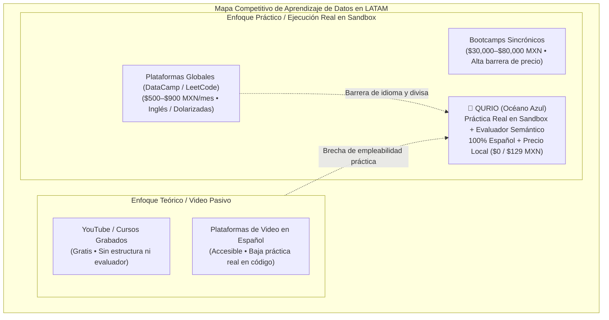
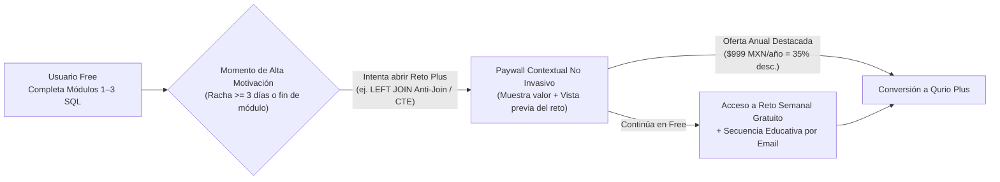
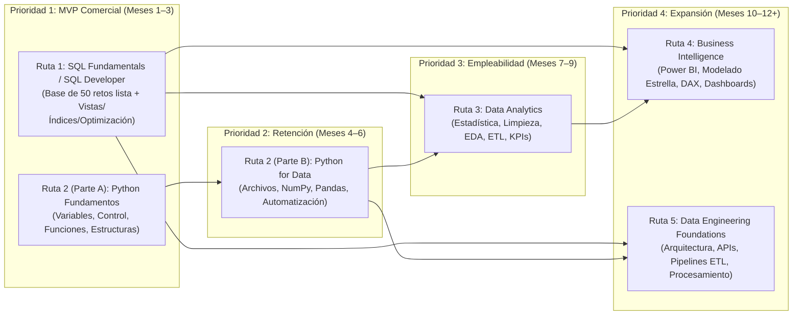
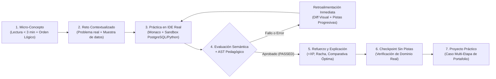
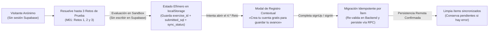
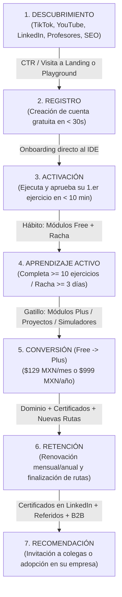
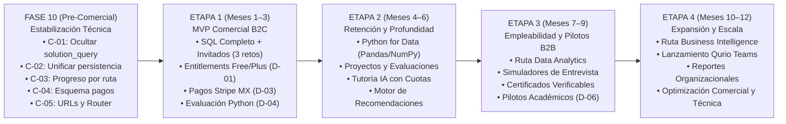
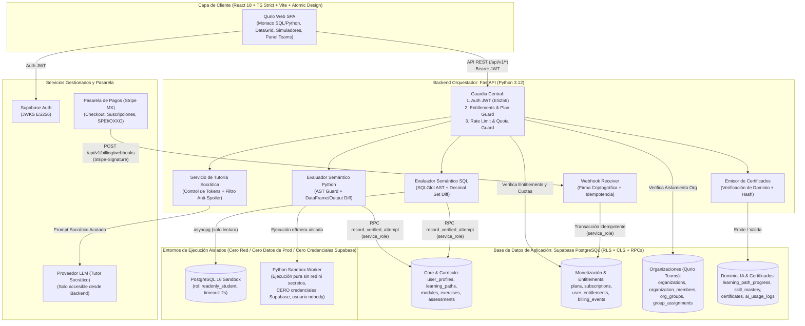
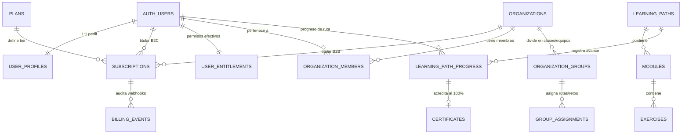
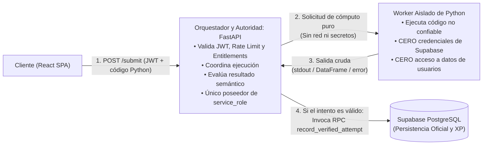

# QURIO — Product & Business Blueprint

| Metadato | Detalle |
| :--- | :--- |
| **Documento** | `docs/product/QURIO_PRODUCT_BUSINESS_BLUEPRINT.md` |
| **Versión** | `1.2` |
| **Fecha de actualización** | `10 de noviembre de 2026` |
| **Estado de Decisiones (`D-01` a `D-07`)** | **Aprobadas por el propietario del producto** |
| **Estado del Documento** | **Propuesta estratégica y arquitectónica documentada — Validación final del documento completo pendiente** |
| **Repositorio de referencia** | [`https://github.com/ErickKNT/qurio`](https://github.com/ErickKNT/qurio) |
| **Plan técnico vinculado** | [`docs/roadmap/PHASE_10_STABILIZATION_PLAN.md`](../roadmap/PHASE_10_STABILIZATION_PLAN.md) (v1.2) |
| **Autoría del análisis** | Equipo Multidisciplinario de Producto, Diseño Instruccional, Arquitectura de Software, Seguridad de Aplicaciones, QA, Monetización SaaS y Estrategia Comercial |
| **Audiencia objetivo** | Product Owner, Product Management, Ingeniería de Software (Frontend/Backend/Infra), Diseño UX/UI, Diseño Curricular y Operaciones Comerciales |

---

## Alcance y Estado de Gobernanza del Documento

Este **Product & Business Blueprint v1.2** constituye el documento de referencia estratégica, funcional, pedagógica, arquitectónica y comercial de **Qurio**. Su propósito es guiar la evolución de Qurio desde su estado actual —un MVP técnico funcional de aprendizaje interactivo de SQL con 50 retos verificados, evaluación semántica en PostgreSQL 16 y seguridad endurecida en Supabase— hacia una **plataforma EdTech SaaS sostenible en español especializada en SQL, Python y Análisis de Datos** para México y Latinoamérica.

Para total claridad de gobernanza, este documento distingue explícitamente tres niveles de estado:

1. **Decisiones `D-01` a `D-07` aprobadas por el propietario del producto:** Las siete definiciones puntuales sobre el corte inicial `Free`/`Plus` por IDs estables (`D-01`), jerarquía de eslóganes (`D-02`), evaluación de Stripe México sin integración aún (`D-03`), diseño independiente del motor de ejecución Python (`D-04`), modo invitado de 3 ejercicios con migración verificada e idempotente (`D-05`), aplazamiento de precios académicos de `Qurio Teams` (`D-06`) y priorización bloqueante de `C-01` a `C-05` en la Fase 10 (`D-07`) cuentan con aprobación del propietario del producto.
2. **Propuesta estratégica, curricular y arquitectónica documentada:** El resto del documento —incluyendo el diseño detallado de las 5 rutas, el modelo de dominio $M_k$, la estrategia Go-To-Market, la estructura de entidades SaaS y los escenarios financieros— constituye una **propuesta estratégica documentada** que sirve como marco de planificación.
3. **Validación final del documento completo y del producto pendiente:** La aceptación de las decisiones `D-01` a `D-07` **no equivale a declarar que el producto completo, sus precios o su arquitectura futura están cerrados o aprobados en su totalidad**. La validación integral del documento completo y la adopción definitiva de cada etapa posterior (como la elección final de la arquitectura del runner de Python o los precios comerciales tras pruebas reales) permanecen sujetas a revisión y aprobación explícita antes de su implementación.

**Restricciones obligatorias de alcance:**
1. Este documento es **exclusivamente documental**: **no modifica el código fuente actual, no altera infraestructura ni ejecuta migraciones en bases de datos**.
2. Los precios de suscripción individual (\$129 MXN/mes y \$999 MXN/año), las metas de conversión, las proyecciones financieras y los plazos del roadmap se mantienen como **hipótesis comerciales y operativas sujetas a validación empírica con usuarios reales**. Los precios definitivos y descuentos del segmento académico (`Qurio Teams`) quedan explícitamente pospuestos hasta concluir las validaciones de campo definidas en `D-06`.

---

## Historial de Cambios

| Versión | Fecha | Autor / Rol | Descripción del Cambio |
| :---: | :---: | :--- | :--- |
| **1.0** | `2026-11-09` | Equipo Multidisciplinario (PM, Product Design, Software Architect, Monetization, Curriculum, Business Strategy) | Elaboración inicial del *Product & Business Blueprint* integral de Qurio. Incluye auditoría de código real contra visión comercial, análisis de 5 segmentos de mercado, modelo freemium (*Free*, *Plus*, *Teams*), arquitectura curricular de 5 rutas, sistema de dominio de competencias, estrategia Go-To-Market (México/LATAM), roadmap de 12 meses, arquitectura de *entitlements* y pagos, y modelado de *Unit Economics*. |
| **1.1** | `2026-11-10` | Equipo Multidisciplinario (PM, Software Architecture, AppSec, QA, UX Engineering) | Incorporación de las decisiones aprobadas **D-01 a D-07** y refinamiento técnico de seguridad y arquitectura: (1) Precisión en `C-01` sobre revocación del permiso `SELECT` general de tabla en PostgreSQL/Supabase y concesión explícita por columna, encapsulamiento de `service_role` en backend, sincronización de fallback con fuente canónica y pruebas integrales anti-filtración; (2) Clarificación en `D-04` de la separación de responsabilidades entre FastAPI (validación, evaluación, persistencia e invocación de RPC) y el worker aislado de Python (ejecución pura sin credenciales de Supabase ni permisos sobre datos de usuarios), manteniendo alternativas abiertas a evaluación formal; (3) Mecanismo de migración de invitados (`D-05`) seguro, idempotente, con soporte de sincronización parcial, conservación de pendientes ante errores y sin garantías de latencia no verificadas; (4) Sustitución de rutas absolutas por relativas y delimitación de gobernanza. |
| **1.2** | `2026-11-10` | Equipo Multidisciplinario (PM, Software Architecture, AppSec, QA, UX Engineering) | **Revisión final de consistencia técnica documental v1.2:**<br>1) **`C-01` (Fuente Maestra del Currículo):** Identificación formal de `EXERCISES_SEED` en `seed_data.py` como la **única fuente maestra** del currículo y definición de `02_seed_curriculum.sql` (seed DB con `solution_query`) y `FALLBACK_EXERCISES` en `api.ts` (catálogo cliente sin `solution_query`) como **representaciones derivadas**, estableciendo el mecanismo de sincronización y prueba de paridad en 7 atributos (IDs, Títulos, Módulos, Dificultad, XP, Orden y Metadatos públicos).<br>2) **`C-03` (Fuente Autoritativa de Progreso y Estados de Carga):** Establecimiento estricto de que para usuarios autenticados únicamente `authoritativeCompletedIds` determina los ejercicios completados (eliminando `ex.is_completed` como vía alterna), separación lógica explícita para progreso temporal de invitados (`computeGuestTrialTracksProgress`) y representación del estado `isLoading` mediante skeleton visual (`is_progress_loading: true`, `completed_exercises: null`) para evitar porcentajes transitorios falsos.<br>3) **`D-05` (Recuperación de Migraciones Interrumpidas):** Protocolo robusto para elementos en `syncing` tras interrupción/cierre del navegador, restauración segura a `pending`, reintentos idempotentes, tratamiento de respuestas HTTP perdidas mediante verificación del estado remoto (`PASSED` en Supabase) antes de descartar o reintentar, limpieza local exclusivamente tras persistencia confirmada, prevención de sincronizaciones paralelas para el mismo `(user_id, exercise_id)` y especificación de pruebas unitarias y de integración. |

---

## Tabla de Contenidos

1. [Contexto Estratégico, Visión y Posicionamiento](#1-contexto-estratégico-visión-y-posicionamiento)
2. [Auditoría del Estado Actual del Repositorio vs. Visión Comercial](#2-auditoría-del-estado-actual-del-repositorio-vs-visión-comercial)
3. [Análisis de Segmentos de Mercado (B2C y B2B)](#3-análisis-de-segmentos-de-mercado-b2c-y-b2b)
4. [Modelo de Negocio y Estrategia de Monetización](#4-modelo-de-negocio-y-estrategia-de-monetización)
5. [Catálogo de Aprendizaje y Arquitectura Curricular Escalable](#5-catálogo-de-aprendizaje-y-arquitectura-curricular-escalable)
6. [Diseño de la Experiencia de Aprendizaje y Medición de Dominio](#6-diseño-de-la-experiencia-de-aprendizaje-y-medición-de-dominio)
7. [Estrategia Comercial, Marketing y Embudo de Crecimiento](#7-estrategia-comercial-marketing-y-embudo-de-crecimiento)
8. [Roadmap de Producto de 12 Meses](#8-roadmap-de-producto-de-12-meses)
9. [Arquitectura Técnica Actual y Evolución SaaS](#9-arquitectura-técnica-actual-y-evolución-saas)
10. [Métricas de Negocio, Unit Economics y Escenarios Financieros](#10-métricas-de-negocio-unit-economics-y-escenarios-financieros)
11. [Riesgos, Mitigaciones y Gobernanza de Decisiones](#11-riesgos-mitigaciones-y-gobernanza-de-decisiones)

---

## 1. Contexto Estratégico, Visión y Posicionamiento

### 1.1 Propósito y Declaración de Visión
**Qurio** es una plataforma interactiva de aprendizaje tecnológico enfocada en el dominio práctico de **SQL, Python y Análisis de Datos**. Su propósito es cerrar la brecha entre la teoría pasiva (cursos en video donde el alumno solo observa) y la exigencia técnica real del mercado laboral, permitiendo que estudiantes, principiantes y profesionales escriban código real, analicen conjuntos de datos con lógica empresarial y construyan un portafolio verificable.

* **Visión a mediano plazo (12–24 meses):** Convertirse en la plataforma interactiva de referencia en español (iniciando en México y expandiéndose a Hispanoamérica) para desarrollar y certificar competencias técnicas en datos mediante práctica activa en entornos de ejecución reales (*sandboxes*).
* **Arquitectura de Identidad Verbal y Eslogan Oficial (Decisión Aprobada `D-02`):**
  * **Eslogan Principal de Marca (Paraguas Multi-Tecnología):**
    > **«Aprende datos. Practica. Construye tu futuro.»**
    * *Ámbito de uso:* Portada principal (*landing page*), títulos y metadatos globales (`index.html`, Open Graph general), presentaciones institucionales, comunicaciones comerciales y vistas de catálogo donde conviven SQL, Python, Data Analytics, Business Intelligence y Data Engineering.
  * **Lema Específico de la Experiencia SQL (Sub-identidad conservada):**
    > *«Aprende SQL. Piensa en queries.»*
    * *Ámbito de uso:* Encabezados, descripciones y certificados específicos de la **Ruta 1 (SQL Fundamentals / SQL Developer)**, el **SQL Playground** y el entorno del editor de consultas relacionales.
  * **Escalabilidad de Marca hacia Nuevas Tecnologías:** Esta arquitectura verbal de dos niveles permite conservar el posicionamiento técnico y artesanal que dio origen a Qurio en SQL, mientras habilita lemas equivalentes por especialidad a medida que se publiquen nuevas rutas (ej. *«Domina Python. Piensa en estructuras de datos.»* o *«Analiza datos. Piensa en decisiones.»*) bajo un único paraguas de marca coherente.

### 1.2 Tesis de Mercado: ¿Por qué México y Latinoamérica necesitan a Qurio?
El ecosistema de aprendizaje de datos en América Latina presenta tres fricciones estructurales que Qurio resuelve de raíz:

1. **La trampa del "Tutorial Hell" (Educación Pasiva en Español):** Las plataformas líderes en español se basan mayoritariamente en videocursos largos. El estudiante consume horas de video sin escribir una sola consulta o script, sufriendo parálisis al enfrentarse a una prueba técnica real.
2. **Barrera Lingüística y de Poder Adquisitivo frente a Plataformas Globales:** Las plataformas interactivas anglosajonas (DataCamp, LeetCode Premium, Codecademy Pro, StrataScratch) operan principalmente en inglés y con precios dolarizados (\$25 a \$45 USD/mes, equivalentes a ~\$500–\$900 MXN/mes), lo que excluye a una gran proporción de estudiantes universitarios y profesionistas junior en México y LATAM.
3. **Evaluadores Sintácticos Frágiles o Entornos Ficticios:** Muchas herramientas gratuitas evalúan mediante expresiones regulares sobre cadenas de texto o cuestionarios de opción múltiple. Qurio ejecuta código real en motores reales (PostgreSQL 16 hoy; Python aislado en su siguiente etapa) y evalúa la **equivalencia semántica del conjunto de datos resultante** junto con la inspección del árbol sintáctico abstracto (AST).

### 1.3 Posicionamiento Competitivo



| Categoría Competitiva | Ejemplos de Referencia | Idioma Principal | Motor de Ejecución / Evaluación | Rango de Precio en México | Diferencial Clave de Qurio |
| :--- | :--- | :---: | :--- | :---: | :--- |
| **Plataformas de Video en Español** | Platzi, Udemy, Crehana | Español | Video pasivo + quizzes de opción múltiple | \$350 – \$600 MXN/mes | Qurio evalúa código real sobre PostgreSQL 16 y Python en un IDE profesional, no videos. |
| **Plataformas Interactivas Globales** | DataCamp, Codecademy, StrataScratch | Inglés | Sandbox interactivo en la nube | \$500 – \$900 MXN/mes (\$25–\$45 USD) | Qurio está diseñado nativamente en español con casos de negocio locales y a ~1/5 del costo mensual. |
| **Sitios de Práctica Sintáctica** | SQLBolt, W3Schools, SQLZoo | Inglés | Tablas estáticas en navegador / regex simple | Gratis | Qurio ofrece evaluación semántica de conjuntos + AST, proyectos de portafolio, simuladores y certificados. |
| **Bootcamps Intensivos** | Henry, Laboratoria, TripleTen | Español | Proyectos revisados manualmente | \$35,000 – \$85,000 MXN | Qurio entrega autonomía práctica inmediata de forma autogestionada por \$0 a \$129 MXN/mes. |

---

## 2. Auditoría del Estado Actual del Repositorio vs. Visión Comercial

Antes de proyectar nuevas capacidades, el equipo de arquitectura e ingeniería inspeccionó el código fuente real del repositorio para establecer una **línea base verificada** y evitar asumir funcionalidades inexistentes.

### 2.1 Inventario Técnico Verificado en el Código Actual

| Capa / Componente | Estado Real en el Código | Archivos Verificados |
| :--- | :--- | :--- |
| **Frontend SPA & UI** | **Implementado y funcional.** React `^18.3.1`, TypeScript `^5.7.3` (`strict: true`), Vite `^6.2.0`, Tailwind CSS `^3.4.17`. Árbol estricto bajo *Atomic Design Pragmático* (`atoms`, `molecules`, `organisms`, `templates`). Soporte nativo de tema oscuro/claro (`ThemeProvider` en [`useTheme.tsx`](../../apps/web/src/hooks/useTheme.tsx)). | [`apps/web/package.json`](../../apps/web/package.json), [`apps/web/src/App.tsx`](../../apps/web/src/App.tsx) |
| **IDE & Autocompletado SQL** | **Implementado y funcional.** Monaco Editor (`@monaco-editor/react ^4.7.0`) con temas `qurio-dark` y `qurio-light`, atajo `⌘/Ctrl + Enter` y motor propio de autocompletado contextual con resolución de alias SQL (`c.`, `p.`). | [`MonacoEditorPanel.tsx`](../../apps/web/src/components/organisms/MonacoEditorPanel/MonacoEditorPanel.tsx), [`sqlCompleter.ts`](../../apps/web/src/components/organisms/MonacoEditorPanel/sqlCompleter.ts) |
| **Motor de Ejecución SQL** | **Implementado y funcional.** FastAPI (`>=0.115.0`) + `asyncpg` (`>=0.30.0`) conectado al contenedor Docker `postgres:16-alpine` (puerto `5433`) bajo el rol restringido `readonly_student` con `statement_timeout = 2000ms`, `lock_timeout = 1000ms`, `work_mem = 16MB` y `temp_file_limit = 32MB`. | [`apps/api/app/modules/runner/service.py`](../../apps/api/app/modules/runner/service.py), [`database/sandbox/init.sql`](../../database/sandbox/init.sql) |
| **Seguridad AST y Rate Limit** | **Implementado y funcional.** Validación AST con `sqlglot` (`>=25.0.0`, dialecto `postgres`) que bloquea DDL/DML, múltiples sentencias, funciones peligrosas (`pg_sleep`, `dblink`, `pg_read_file`) y fuerza `LIMIT 1000`. Rate Limiter en memoria (`20 req/min` invitados por IP, `120 req/min` autenticados por UID) y `asyncio.Semaphore(10)`. | [`apps/api/app/modules/runner/security.py`](../../apps/api/app/modules/runner/security.py), [`apps/api/app/core/rate_limit.py`](../../apps/api/app/core/rate_limit.py) |
| **Evaluador Semántico** | **Implementado y funcional.** Comparación en dos capas: Capa 1 de equivalencia de datos con precisión `Decimal`, cardinalidad, nombres de columnas y multiconjunto (`Counter`) u orden estricto (`check_order`); Capa 2 de inspección pedagógica AST (ej. validación de uso explícito de `ROUND`). | [`apps/api/app/modules/runner/evaluator.py`](../../apps/api/app/modules/runner/evaluator.py) |
| **Currículo Actual** | **Implementado para SQL (50 retos).** 3 rutas SQL (*SQL Foundations* con 22 retos, *Relational SQL & Joins* con 18 retos, *Advanced Queries & Analytics* con 10 retos), distribuidos en 12 módulos y 112 pistas sobre el dataset `Ecommerce_Production_DB` (10 tablas). Sincronizado en backend, frontend fallback y seed SQL. | [`apps/api/app/modules/curriculum/seed_data.py`](../../apps/api/app/modules/curriculum/seed_data.py), [`database/supabase/02_seed_curriculum.sql`](../../database/supabase/02_seed_curriculum.sql), [`docs/CURRICULUM_SPEC.md`](../CURRICULUM_SPEC.md) |
| **Autenticación y Hardening** | **Implementado y funcional.** Validación JWT asimétrica ES256 vía JWKS en FastAPI (`pyjwt[crypto]`). En Supabase Cloud, `03_security_hardening.sql` revoca `INSERT/UPDATE` directo de clientes en `exercise_attempts` y `xp/level` en `user_profiles`, delegando la certificación de intentos exclusivamente a la RPC `public.record_verified_attempt` (`SECURITY DEFINER`, `SET search_path = ''`, `SELECT ... FOR UPDATE`, índice único parcial `idx_single_awarded_passed_attempt`). | [`apps/api/app/core/auth.py`](../../apps/api/app/core/auth.py), [`apps/api/app/core/supabase.py`](../../apps/api/app/core/supabase.py), [`database/supabase/03_security_hardening.sql`](../../database/supabase/03_security_hardening.sql) |
| **Suite de Pruebas** | **Implementada (64/64 pasando).** Pruebas automatizadas con `pytest` y `pytest-asyncio` cubriendo auth ES256/HS256, evaluador, seguridad AST, rate limiting, sandbox e integridad de migraciones RLS/CLS/RPC. | [`apps/api/tests/`](../../apps/api/tests/) |

### 2.2 Contradicciones y Brechas entre la Visión Comercial y el Estado Actual del Código

La auditoría técnica reveló **9 contradicciones o brechas críticas** entre la documentación previa / visión comercial y la implementación real actual.

> [!IMPORTANT]
> **Decisión Ejecutiva Aprobada (`D-07` — Prioridades Técnicas de Fase 10):** Las brechas **`C-01` a `C-05`** dejan de ser simples recomendaciones generales y se convierten en **prioridades técnicas obligatorias de la Fase 10 (Estabilización y Preparación Comercial)** antes de integrar pagos o *entitlements*. Su diagnóstico forense línea por línea, diseño de solución y plan de pruebas se encuentran especificados en [`docs/roadmap/PHASE_10_STABILIZATION_PLAN.md`](../roadmap/PHASE_10_STABILIZATION_PLAN.md).

| # | Área | Estado Normativo | Contradicción / Hallazgo Detectado | Impacto en el Producto y Negocio | Plan de Acción Aprobado |
| :-: | :--- | :---: | :--- | :--- | :--- |
| **C-01** | **Seguridad Curricular (`solution_query` expuesta)** | **Prioridad Bloqueante Fase 10 (`D-07`)** | El documento [`docs/SAD.md`](../SAD.md) afirma que `GET /api/v1/exercises/{id}` devuelve el reto *"sin exponer la query de solución"*. Sin embargo, en [`seed_data.py`](../../apps/api/app/modules/curriculum/seed_data.py), [`repository.py`](../../apps/api/app/modules/curriculum/repository.py), [`router.py`](../../apps/api/app/modules/runner/router.py), [`api.ts`](../../apps/web/src/lib/api.ts) y la configuración de privilegios de [`01_schema.sql`](../../database/supabase/01_schema.sql), **`solution_query` se envía íntegra al navegador**, puede consultarse vía PostgREST y está embebida en el bundle JS (`FALLBACK_EXERCISES`). | Un usuario con DevTools abierto puede leer `solution_query` en la pestaña Network, mediante consulta directa a PostgREST o en el bundle estático, copiando la respuesta para ganar XP o aprobar evaluaciones/certificados. | Separar `ExercisePublicDTO` (sin `solution_query`) de `ExerciseInternal` (exclusivo en backend); revocar el permiso `SELECT` general de tabla en `public.exercises` y conceder `SELECT` explícito solo sobre las columnas públicas necesarias; encapsular `service_role` exclusivamente en el backend; definir `EXERCISES_SEED` (`seed_data.py`) como la única fuente maestra del currículo y a `02_seed_curriculum.sql` y `FALLBACK_EXERCISES` (`api.ts`) como representaciones derivadas, con prueba automatizada de paridad en 7 atributos (IDs, títulos, módulos, dificultad, XP, orden y metadatos públicos), e incorporar pruebas anti-filtración en endpoints, bundles y permisos DB. Ver [Sección 2.3](#23-especificación-de-seguridad-para-la-protección-de-soluciones-c-01) y [`PHASE_10_STABILIZATION_PLAN.md`](../roadmap/PHASE_10_STABILIZATION_PLAN.md). |
| **C-02** | **Doble escritura residual en Frontend (`persistence.ts`)** | **Prioridad Bloqueante Fase 10 (`D-07`)** | Tras aplicar [`03_security_hardening.sql`](../../database/supabase/03_security_hardening.sql), el backend certifica el intento vía RPC `record_verified_attempt`. No obstante, [`apps/web/src/lib/persistence.ts`](../../apps/web/src/lib/persistence.ts) e invocaciones en [`App.tsx`](../../apps/web/src/App.tsx) y [`useAuth.tsx`](../../apps/web/src/hooks/useAuth.tsx) aún intentan ejecutar `.from('exercise_attempts').insert(...)`, `.from('user_profiles').update({ xp, level, username, current_streak_days })` y `.from('user_daily_activity').insert/update(...)` desde el navegador, las cuales son rechazadas por PostgreSQL (`42501 permission denied`) y silenciadas con `console.warn`. | Genera escrituras directas no autorizadas (`403/42501`) hacia Supabase desde el cliente, bloquea actualizaciones legítimas de perfil al mezclar columnas revocadas y desincroniza `user_daily_activity`. | Consolidar al backend como única fuente autoritativa del progreso oficial de usuarios autenticados; eliminar toda escritura directa de intentos, XP, nivel o actividad oficial desde el frontend; restringir `updateProfile` del cliente a campos visuales (`display_name`, `avatar_url`, `bio`); propagar en `EvaluationResponse` los datos autoritativos devueltos por `record_verified_attempt` sin modificar la RPC existente. Ver [`PHASE_10_STABILIZATION_PLAN.md`](../roadmap/PHASE_10_STABILIZATION_PLAN.md). |
| **C-03** | **Cálculo de progreso de rutas en `App.tsx`** | **Prioridad Fase 10 (`D-07`)** | En [`App.tsx`](../../apps/web/src/App.tsx), al cargar o aprobar un ejercicio se asigna `completed_exercises: completedIds.length` (el total global) e incrementa `+1` a **todas** las rutas (`tracks.map`), sin filtrar por ruta ni verificar si el ejercicio ya estaba completado previamente. | Muestra el mismo contador erróneo de ejercicios completados en las 3 rutas dentro de la vista `/tracks` e infla el contador al re-ejecutar ejercicios ya aprobados. | Establecer que para usuarios autenticados únicamente `authoritativeCompletedIds` determina el progreso oficial (eliminando `ex.is_completed` o `localStorage` como fuentes de aprobación); separar la lógica para progreso temporal de invitados; filtrar ejercicios activos y no excluidos; y representar el estado `isLoading` mediante skeleton visual (`is_progress_loading: true`, `completed_exercises: null`) para no presentar porcentajes definitivos falsos. Ver [`PHASE_10_STABILIZATION_PLAN.md`](../roadmap/PHASE_10_STABILIZATION_PLAN.md). |
| **C-04** | **Inconsistencia en el nombre de la 10.ª tabla y conteos del Sandbox** | **Prioridad Fase 10 (`D-07`)** | En [`README.md`](../../README.md) y [`CURRICULUM_SPEC.md`](../CURRICULUM_SPEC.md) se menciona la tabla `metodos_pago`, mientras que en [`database/sandbox/ecommerce_seed.sql`](../../database/sandbox/ecommerce_seed.sql) la tabla física creada en PostgreSQL se llama `pagos` (con columna `metodo_pago`). Además, existen discrepancias de `rowCount` en [`api.ts`](../../apps/web/src/lib/api.ts) y [`ExerciseSpecPanel.tsx`](../../apps/web/src/components/organisms/ExerciseSpecPanel/ExerciseSpecPanel.tsx) solo muestra 4 de las 10 tablas. | Confunde a los usuarios que exploran el esquema en el IDE o Playground frente a la documentación escrita y tablas de ejemplo. | Definir [`database/sandbox/ecommerce_seed.sql`](../../database/sandbox/ecommerce_seed.sql) (tabla `pagos` y columna `metodo_pago`) como fuente canónica sin modificar el esquema físico ni los datos seed; sincronizar documentación, nombres de tablas, columnas, conteos y componentes visuales, e incorporar pruebas automatizadas contra divergencias. Ver [`PHASE_10_STABILIZATION_PLAN.md`](../roadmap/PHASE_10_STABILIZATION_PLAN.md). |
| **C-05** | **Enrutamiento en memoria sin URLs reales** | **Prioridad Bloqueante Fase 10 (`D-07`)** | El enrutamiento en [`App.tsx`](../../apps/web/src/App.tsx) utiliza estado local en memoria (`useState<AppPath>('dashboard')`) sin sincronizar `window.location.pathname`. Recargar la página pierde la vista actual, el botón Atrás/Adelante del navegador no navega entre vistas y escribir una URL inexistente carga el Dashboard en vez de `NotFoundView`. | Impide enlaces profundos (*deep linking* compartibles como `/tracks/sql-foundations` o `/exercises/:id`), retornos de pasarela de pago y verificación pública de certificados. | Implementar enrutamiento web real preservando todos los formatos reales de autenticación de Supabase, esperando la carga del catálogo antes de declarar un 404 en `/exercises/:exerciseId`, especificando el fallback SPA de hosting y probando con `history.pushState` / `popstate`. Ver [`PHASE_10_STABILIZATION_PLAN.md`](../roadmap/PHASE_10_STABILIZATION_PLAN.md). |
| **C-06** | **Ausencia de control de acceso por plan (*Entitlements*)** | **Planificado Post-Fase 10 (`D-01`)** | Actualmente el 100% de los 50 ejercicios, pistas y el Playground son públicos y gratuitos incluso para usuarios invitados (`get_optional_current_user`). No existen tablas de planes, suscripciones ni validación de permisos Premium en backend. | No es posible monetizar contenido avanzado ni limitar cuotas de ejecución diferenciadas por plan (*Free* vs *Plus*). | Implementar el motor de *Entitlements* en backend y base de datos mediante identificadores estables de ejercicio (`access_tier`), conforme a la decisión `D-01` ([Sección 4.5](#45-reglas-de-autorización-free-vs-plus-y-evolución-del-catálogo-sin-pérdida-de-progreso-decisión-aprobada-d-01) y [Sección 9](#9-arquitectura-técnica-actual-y-evolución-saas)). |
| **C-07** | **Ausencia de entorno de ejecución para Python y Analítica** | **Diseño Separado (`D-04`)** | El repositorio actual es exclusivamente un motor SQL (Monaco configurado para SQL + runner `asyncpg` contra PostgreSQL). No existe aún un runner para Python, Pandas, evaluación de DataFrames ni visualización de gráficos. | La visión de Qurio como plataforma de *SQL, Python y Análisis de Datos* requiere extender la arquitectura del runner más allá de PostgreSQL. | Evaluar la arquitectura del runner aislado de Python como una decisión arquitectónica independiente conforme a `D-04`, manteniendo las alternativas abiertas a evaluación técnica formal sin implementar aún ([Sección 9.6](#96-decisión-arquitectónica-independiente-motor-de-ejecución-de-python-decisión-aprobada-d-04)). |
| **C-08** | **Gamificación actual basada solo en ejercicios unitarios** | **Planificado Etapa 2** | Hoy un usuario acumula XP y completa módulos resolviendo ejercicios individuales (con hasta 3 pistas reveladas). No existen aún exámenes integradores sin pistas, proyectos prácticos ni simuladores de entrevista con tiempo límite. | Contradice el principio pedagógico de que no debe ser posible completar una ruta solo acumulando XP sin demostrar dominio real. | Introducir *Evaluaciones de Dominio (Checkpoints)* sin pistas y *Proyectos Capstones* como requisito obligatorio de aprobación de ruta ([Sección 6.2](#62-regla-de-oro-de-la-gamificación-subordinación-al-dominio-real) y [Sección 6.3](#63-modelo-de-medición-del-dominio-de-cada-habilidad-skill-mastery-model)). |
| **C-09** | **Identidad de marca y eslogan** | **Aprobado (`D-02`)** | El código actual (`index.html`, `README.md`, `og-preview.svg`, `AGENTS.md`) utiliza únicamente el lema *"Aprende SQL. Piensa en queries."*, enfocado en SQL. | Al expandir el producto a Python, Data Analytics y BI, un eslogan exclusivo de SQL en la portada limita la percepción de marca. | Adoptar *"Aprende datos. Practica. Construye tu futuro."* como eslogan principal de marca y conservar *"Aprende SQL. Piensa en queries."* como lema específico de la experiencia SQL (`D-02`, [Sección 1.1](#11-propósito-y-declaración-de-visión)). |

---

### 2.3 Especificación de Seguridad para la Protección de Soluciones (`C-01`)

Dado el carácter crítico de `C-01` para la integridad académica y comercial de Qurio, el diseño de remediación se rige por las siguientes seis reglas obligatorias (desarrolladas a detalle en [`docs/roadmap/PHASE_10_STABILIZATION_PLAN.md`](../roadmap/PHASE_10_STABILIZATION_PLAN.md)):

1. **Mecánica de Privilegios en PostgreSQL / Supabase (Revocación de Permiso General + Concesión Explícita por Columna):**
   * En PostgreSQL, **no basta con ejecutar `REVOKE SELECT (solution_query)` a nivel de columna si continúa existiendo un permiso `SELECT` general concedido sobre la tabla completa** (`GRANT SELECT ON TABLE public.exercises TO anon, authenticated`), ya que el privilegio a nivel de tabla prevalece sobre las revocaciones individuales de columna y mantiene expuestas todas las columnas a través de PostgREST.
   * Por tanto, la política de base de datos debe obligatoriamente:
     1. **Revocar el permiso `SELECT` general sobre la tabla `public.exercises`** para los roles públicos y de cliente (`REVOKE SELECT ON public.exercises FROM PUBLIC, anon, authenticated;`).
     2. **Conceder explícitamente `GRANT SELECT (...)` únicamente sobre la lista blanca de columnas públicas necesarias** (`id`, `module_id`, `title`, `prompt`, `initial_code`, `target_database`, `xp_reward`, `difficulty`, `check_order`, `sort_order`, `created_at`) a `anon` y `authenticated`, omitiendo `solution_query`.
     3. Mantener el permiso `SELECT` completo exclusivamente para el rol `service_role`.
2. **Disponibilidad Exclusiva de las Soluciones en el Backend:**
   * `solution_query` debe permanecer disponible única y exclusivamente dentro del entorno de ejecución del servidor backend (FastAPI) a través del modelo privado `ExerciseInternal`, utilizado únicamente durante el flujo interno de evaluación en `POST /api/v1/exercises/{exercise_id}/submit`.
   * Todos los endpoints de lectura pública (`GET /api/v1/exercises` y `GET /api/v1/exercises/{exercise_id}`) y el resultado de evaluación (`EvaluationResponse`) deben serializarse mediante DTOs públicos (`ExercisePublicDTO`) que carecen estructuralmente del campo `solution_query`.
3. **Encapsulamiento Estricto del Cliente con `service_role`:**
   * La credencial privilegiada `SUPABASE_SERVICE_ROLE_KEY` y el cliente/adaptador que la utiliza para leer `solution_query` o invocar RPCs administrativas deben estar **100% encapsulados en el backend FastAPI** ([`apps/api/app/core/supabase.py`](../../apps/api/app/core/supabase.py) y [`apps/api/app/modules/curriculum/repository.py`](../../apps/api/app/modules/curriculum/repository.py)).
   * Está terminantemente prohibido exponer `SUPABASE_SERVICE_ROLE_KEY` al navegador, incluirla en variables de entorno con prefijo `VITE_*`, imprimirla en logs de aplicación o empaquetarla en los bundles del frontend.
4. **Fuente Maestra Única del Currículo y Representaciones Derivadas:**
   * **Fuente Maestra Canónica Única:** Se establece formalmente a `EXERCISES_SEED` (junto con `TRACKS_SEED` y `MODULES_SEED`) en [`apps/api/app/modules/curriculum/seed_data.py`](../../apps/api/app/modules/curriculum/seed_data.py) como la **única fuente maestra canónica de verdad** de todo el currículo en el repositorio.
   * **Representaciones Derivadas:**
     1. [`database/supabase/02_seed_curriculum.sql`](../../database/supabase/02_seed_curriculum.sql): Representación derivada para el sembrado inicial y migraciones en PostgreSQL/Supabase, generada a partir de la fuente maestra, que incluye `solution_query` para que la base de datos de backend contenga las soluciones oficiales.
     2. `FALLBACK_EXERCISES` en [`apps/web/src/lib/api.ts`](../../apps/web/src/lib/api.ts): Representación derivada pública para el cliente web, sin `solution_query`, utilizada como fallback en memoria en caso de contingencia de red.
   * **Mecanismo de Sincronización y Prueba Automatizada de Paridad en 7 Atributos:**
     * Cualquier modificación, adición o corrección al currículo debe realizarse en la fuente maestra `seed_data.py` y propagarse de forma sincronizada hacia sus representaciones derivadas.
     * Se establece una prueba automatizada en `pytest` (`T-10.1-U3`) que verifica la paridad exacta entre la fuente maestra y las representaciones derivadas en los siguientes **7 atributos requeridos**:
       1. **IDs:** UUIDs idénticos para cada uno de los 50 ejercicios.
       2. **Títulos:** Texto idéntico en `title`.
       3. **Módulos:** Correspondencia exacta de `module_id`.
       4. **Dificultad:** Valores idénticos de `difficulty` (`EASY`, `MEDIUM`, `HARD`).
       5. **XP:** Puntos exactos de recompensa `xp_reward`.
       6. **Orden:** Mismo orden relativo y flags (`sort_order`, `check_order`).
       7. **Metadatos públicos:** Paridad en `prompt`, `initial_code`, `hints`, `sample_data` y `wiki`.
   * **Fallback en memoria del Backend:** Cuando el repositorio del backend opera en modo fallback local (sin conexión a Supabase), los métodos públicos (`list_public_exercises`, `get_public_by_id`) transforman cada instancia de `EXERCISES_SEED` a `ExercisePublicDTO` (excluyendo `solution_query`), mientras que solo el método privado `get_internal_for_evaluation` conserva acceso a `ExerciseInternal.solution_query`.
   * **Fallback en memoria del Frontend:** `FALLBACK_EXERCISES` se deriva exclusivamente de la proyección pública (`ExercisePublicDTO` sin `solution_query`). La prueba de seguridad confirma la ausencia total de la clave `solution_query` en todo `apps/web/`.
5. **Requisitos de Pruebas Anti-Filtración:**
   * La verificación de `C-01` exige pruebas automatizadas que comprueben que `solution_query` no se filtra a través de:
     1. **Endpoints y respuestas API:** `GET /api/v1/exercises`, `GET /api/v1/exercises/{id}` y `POST /api/v1/exercises/{id}/submit`.
     2. **Modelos DTO y métodos públicos del repositorio:** ni en consultas a Supabase ni en el fallback en memoria del backend.
     3. **Código fuente y bundles compilados del frontend:** inspección estática de `apps/web/src/` y de los artefactos compilados en `apps/web/dist/assets/*.js`, además de verificar que ninguna variable `VITE_*` contenga llaves `service_role`.
     4. **Permisos reales de base de datos:** pruebas estáticas sobre las sentencias `REVOKE`/`GRANT` de la migración SQL y pruebas de integración contra un entorno Supabase de pruebas verificando que peticiones directas a PostgREST con `anon` y `authenticated` solicitando `select=solution_query` son rechazadas con `42501 permission denied`.

---

## 3. Análisis de Segmentos de Mercado (B2C y B2B)

### 3.1 Regla Estratégica de Secuenciación de Mercado
> [!IMPORTANT]
> **Prioridad B2C antes que B2B:** Qurio validará primero la tracción, retención, experiencia pedagógica y disposición de pago en el mercado individual (**B2C: Segmentos 1, 2 y 3** durante los Meses 1 a 6). La expansión hacia licencias institucionales y corporativas (**B2B: Segmentos 4 y 5**) se ejecutará a partir del Mes 7, apalancando un producto ya probado y casos de éxito reales.

### 3.2 Matriz Resumen de Segmentos

| Segmento | Tipo | Prioridad | Ticket Objetivo (Hipótesis) | Ciclo de Venta | Potencial de Ingresos (12m) |
| :--- | :---: | :---: | :---: | :---: | :---: |
| **1. Estudiantes y principiantes en tecnología** | B2C | **Alta (P1 — Adquisición)** | Free $\to$ Plus (\$129 MXN/mes o \$999 MXN/año) | Autogestionado (1–14 días) | Medio en conversión directa; **Muy Alto** en volumen, viralidad y boca a boca. |
| **2. Buscadores de empleo en áreas de datos (*Career Switchers*)** | B2C | **Crítica (P0 — Monetización Inicial)** | Plus (\$129 MXN/mes o \$999 MXN/año) | Autogestionado (1–7 días) | **Muy Alto.** Mayor urgencia de compra y disposición a pagar por proyectos y simuladores de entrevista. |
| **3. Profesionales en actualización (*Upskilling*)** | B2C / B2B2C | **Alta (P1 — Monetización / LTV)** | Plus Anual (\$999 MXN/año) | Autogestionado (1–3 días) | **Alto.** Menor sensibilidad al precio, baja tasa de cancelación y puente de entrada hacia sus empresas. |
| **4. Escuelas, universidades y academias** | B2B EdTech | **Media (P2 — Meses 7–9)** | Teams Académico (Hipótesis con descuento por volumen sobre \$199 MXN/usuario/mes) | Consultivo (1–4 meses, sujeto a ciclos escolares) | **Medio-Alto.** Otorga prestigio institucional, volumen masivo de usuarios y semillero B2C. |
| **5. Empresas que capacitan colaboradores** | B2B Corp | **Media-Baja en MVP / Alta en Meses 9–12 (P3)** | Teams (\$199 MXN/usuario/mes) | Consultivo B2B (2–8 semanas) | **Muy Alto en ARR.** Contratos recurrentes de múltiples asientos y bajo churn. |

---

### 3.3 Desarrollo Detallado por Segmento

#### Segmento 1: Estudiantes Universitarios y Principiantes en Tecnología
* **Perfil del usuario:** Estudiantes de ingenierías (Sistemas, Industrial, Mecatrónica, Actuaría, Administración, Economía) de 18 a 24 años en México y LATAM, o autodidactas que están teniendo su primer contacto con bases de datos y programación.
* **Problemas que intenta resolver:**
  * En la universidad les enseñan teoría de bases de datos en pizarrón o con herramientas obsoletas sin casos prácticos modernos.
  * Instalar y configurar PostgreSQL, pgAdmin o entornos de Python localmente les genera frustración técnica antes de escribir su primera línea de código.
  * Los cursos en inglés les resultan densos y las suscripciones en dólares están fuera de su presupuesto estudiantil.
* **Motivaciones:** Aprobar materias clave con excelencia, entender cómo se aplica la teoría en el mundo real, sentir progreso rápido (dopamina constructiva vía XP, rachas y niveles) y prepararse para su primera beca o práctica profesional (*internship*).
* **Barreras de compra:** Bajo poder adquisitivo propio; dependencia económica familiar; falta de tarjeta de crédito (frecuente uso de débito, SPEI o efectivo en OXXO); alta sensibilidad al precio mensual recurrente.
* **Necesidades funcionales:**
  * Ejecución en el navegador con **cero configuración local**.
  * Micro-lecciones claras en español con retroalimentación inmediata cuando cometen errores de sintaxis o lógica.
  * Sistema de pistas progresivas que no les regale la respuesta pero evite que abandonen por frustración.
  * Gamificación social (racha diaria, insignias compartibles, perfil público).
* **Propuesta de valor de Qurio:** *"Tu laboratorio interactivo de SQL y Python en el navegador: practica gratis con bases de datos reales, sin instalar nada y a tu propio ritmo."*
* **Potencial comercial:** Moderado en conversión inmediata a pago (2%–4%), pero fundamental como **motor de adquisición orgánica y viralidad** en campus universitarios y redes sociales (TikTok/Instagram).
* **Prioridad de atención:** **P1 (Adquisición y Activación en MVP Comercial — Meses 1–3).**

#### Segmento 2: Personas que Buscan Conseguir Empleo en Áreas de Datos (*Job Seekers & Career Switchers*)
* **Perfil del usuario:** Recién egresados, desarrolladores junior o profesionistas en transición de carrera (22 a 32 años) que aspiran a puestos de *Data Analyst Junior*, *BI Analyst*, *SQL Developer* o *Analytics Engineer*.
* **Problemas que intenta resolver:**
  * Fracasan en las pruebas técnicas en vivo (*live coding* de SQL y Python) durante los procesos de selección porque solo han visto videos teóricos.
  * No cuentan con proyectos reales ni evidencia verificable en su CV o LinkedIn que demuestre a los reclutadores que saben resolver problemas de negocio con datos.
  * No saben qué nivel de complejidad (ej. *Window Functions*, *CTEs*, limpieza con *Pandas*) les van a evaluar en una entrevista real.
* **Motivaciones:** Conseguir un empleo bien remunerado en tecnología/datos en los próximos 3 a 6 meses; superar el filtro técnico de recursos humanos; ganar confianza frente a entrevistas técnicas.
* **Barreras de compra:** Escepticismo ante "otro curso más" que promete empleo sin práctica real; temor a pagar una suscripción y no tener disciplina para terminarla.
* **Necesidades funcionales:**
  * Retos avanzados idénticos a pruebas técnicas reales (`LEAD/LAG`, `DENSE_RANK`, cohortes, retención, conciliación financiera).
  * **Simuladores de entrevistas técnicas** con cronómetro y sin pistas.
  * **Proyectos prácticos guiados** con datasets realistas de e-commerce, fintech y logística exportables a su portafolio.
  * **Certificados verificables** con URL pública que muestre las competencias técnicas validadas semánticamente.
* **Propuesta de valor de Qurio:** *"Entrena como en una prueba técnica real: domina SQL y Python resolviendo casos de negocio reales y aprueba tu próxima entrevista de datos por una fracción de lo que cuesta una plataforma en dólares."*
* **Potencial comercial:** **Muy Alto (Conversión estimada 5%–8%).** Es el segmento con mayor dolor agudo y retorno de inversión directo (un empleo de \$18,000–\$35,000 MXN/mes justifica de inmediato invertir \$129 MXN/mes o \$999 MXN/año).
* **Prioridad de atención:** **P0 (Núcleo de Monetización B2C — Meses 1–6).**

#### Segmento 3: Profesionales que Desean Actualizar sus Habilidades (*Upskilling*)
* **Perfil del usuario:** Analistas de negocio, financieros, mercadólogos, ingenieros industriales, contadores o gerentes de operaciones (25 a 42 años) que hoy dependen excesivamente de hojas de cálculo (Excel) y necesitan dominar SQL, Python o Power BI para automatizar reportes y analizar mayores volúmenes de datos.
* **Problemas que intenta resolver:**
  * Sus archivos de Excel se bloquean con decenas de miles de filas o dependen del equipo de TI para que les extraigan cada consulta de la base de datos.
  * Tienen muy poco tiempo libre (trabajan tiempo completo) y no pueden tomar un bootcamp sincrónico de 3 horas diarias.
* **Motivaciones:** Obtener un ascenso salarial, automatizar tareas repetitivas en su trabajo actual, ganar autonomía técnica en su empresa y no quedarse obsoletos.
* **Barreras de compra:** Falta de tiempo; abandono si los ejercicios se sienten académicos o infantiles en lugar de aplicables a su trabajo diario.
* **Necesidades funcionales:**
  * Sesiones de **microlearning de 10 a 15 minutos** efectivos al día.
  * Casos de negocio empresariales (facturación, inventarios, KPIs financieros, embudos de ventas).
  * Rutas de *Python for Data* (automatización de archivos Excel/CSV con Pandas) y *Business Intelligence* (DAX y modelado en Power BI).
  * Emisión de comprobantes/recibos para reembolso corporativo de capacitación.
* **Propuesta de valor de Qurio:** *"Pasa de Excel a SQL, Python y BI en 15 minutos al día con una estación de trabajo profesional diseñada para resolver problemas reales de negocio."*
* **Potencial comercial:** **Alto.** Alta afinidad por el plan anual (\$999 MXN/año) y principal vector de entrada (*land-and-expand*) para recomendar **Qurio Teams** a sus líderes de área.
* **Prioridad de atención:** **P1 (Retención y Plan Anual — Meses 1–6).**

#### Segmento 4: Escuelas, Universidades y Academias
* **Perfil del usuario:** Directores de carrera de ingeniería/negocios, coordinadores académicos y profesores de asignaturas como *Bases de Datos*, *Programación para Ciencia de Datos* e *Inteligencia de Negocios*.
* **Problemas que intenta resolver:**
  * Los profesores invierten decenas de horas calificando manualmente tareas de código SQL o scripts de Python entregados en PDF o archivos `.sql` sueltos.
  * Los laboratorios de cómputo físicos tienen restricciones de permisos para instalar motores de bases de datos, o los alumnos tienen equipos heterogéneos.
  * Dificultad para detectar plagio o saber qué alumnos realmente están practicando semana a semana.
* **Motivaciones:** Automatizar la evaluación práctica, modernizar el plan de estudios con herramientas de la industria, mejorar los indicadores de aprovechamiento académico y ofrecer valor tangible a sus estudiantes.
* **Barreras de compra:** Procesos burocráticos de compras y presupuesto anual universitario; aversión al cambio de algunos docentes tradicionales; requerimiento de precios preferenciales por volumen estudiantil.
* **Necesidades funcionales:**
  * Creación de **grupos/clases** por semestre y código de invitación.
  * **Asignación de módulos o ejercicios como tareas** con fecha límite.
  * **Calificación automática** mediante el motor semántico de Qurio y exportación de calificaciones a CSV/LMS.
  * Panel de seguimiento docente para identificar alumnos rezagados.
* **Propuesta de valor de Qurio:** *"Automatiza al 100% la práctica y calificación de tus laboratorios de SQL y Python con un entorno en la nube seguro y métricas de avance por alumno en tiempo real."*
* **Potencial comercial:** **Medio-Alto a mediano plazo.** Aunque el precio unitario académico suele requerir descuento por volumen, permite contratos de 30 a 500 licencias por institución y posiciona la marca Qurio ante cientos de futuros profesionales.
* **Prioridad de atención:** **P2 (Pilotos con profesores aliados en Meses 7–9; Escalamiento en Meses 10–12).**

#### Segmento 5: Empresas que Necesitan Capacitar Colaboradores (PyMEs y Corporativos)
* **Perfil del usuario:** Líderes de Datos (*Heads of Data / BI*), Gerentes de Operaciones, Directores de TI y áreas de Recursos Humanos / *Learning & Development (L&D)* en empresas medianas y grandes de retail, banca, fintech, logística y consultoría.
* **Problemas que intenta resolver:**
  * Cuellos de botella en el equipo de ingeniería de datos porque las áreas de negocio (operaciones, finanzas, marketing) no saben consultar datos por sí mismas (*Self-Service Analytics*).
  * Contratar cursos externos presenciales es costoso, difícil de medir y los empleados olvidan lo aprendido a las dos semanas por falta de práctica continua.
* **Motivaciones:** Democratizar el acceso a datos en la organización (*Data Literacy*), estandarizar el nivel técnico de nuevos ingresos (*onboarding* técnico) y medir con precisión el retorno de inversión (ROI) de la capacitación.
* **Barreras de compra:** Requerimientos de facturación fiscal local (CFDI en México), controles de seguridad de la información, necesidad de reportes ejecutivos de uso y preferencia por proveedores consolidados.
* **Necesidades funcionales:**
  * **Panel de Administración Organizacional (`Qurio Teams`)**: gestión de asientos (alta/baja de colaboradores).
  * Asignación de rutas por rol (ej. *SQL + BI* para analistas comerciales; *SQL + Python* para analistas de datos).
  * **Reportes ejecutivos de desempeño y dominio de competencias** por equipo.
  * Aislamiento estricto de los datos de la organización (*multi-tenant isolation*).
* **Propuesta de valor de Qurio:** *"Transforma a tu equipo operativo en un equipo orientado a datos con rutas prácticas evaluadas automáticamente y reportes reales de dominio técnico."*
* **Potencial comercial:** **Muy Alto en ingresos recurrentes (ARR) y retención.** Un solo cliente corporativo de 25 asientos a \$199 MXN/mes genera \$4,975 MXN/mes (\$59,700 MXN/año), equivalente a ~46 suscriptores individuales.
* **Prioridad de atención:** **P3 (Preparación en Meses 7–9; Lanzamiento comercial en Meses 10–12).**

---

## 4. Modelo de Negocio y Estrategia de Monetización

> [!WARNING]
> **Hipótesis Comerciales Pendientes de Validación:** Todos los precios expresados a continuación (\$0 MXN, \$129 MXN/mes, \$999 MXN/año y \$199 MXN/usuario/mes) son **hipótesis iniciales de trabajo** definidas para el mercado mexicano. Deberán validarse mediante pruebas de elasticidad de precios, encuestas de disposición de pago (*Van Westendorp*) y experimentos de conversión antes de fijarse definitivamente. **No deben implementarse en el código en esta fase.**

### 4.1 Arquitectura de Planes (Freemium B2C + Licenciamiento B2B)

| Dimensión / Característica | **Qurio Free** | **Qurio Plus (Individual)** | **Qurio Teams (Institucional / B2B)** |
| :--- | :--- | :--- | :--- |
| **Precio Hipótesis (MXN)** | **\$0 MXN** | **\$129 MXN / mes**<br>**\$999 MXN / año** *(~\$83.25/mes — Ahorro 35%)* | **\$199 MXN / usuario / mes**<br>*(Facturación mensual o anual por contrato)* |
| **Objetivo Estratégico** | Adquisición orgánica, activación rápida, hábito de estudio y demostración del valor diferencial del evaluador semántico. | Monetización B2C de estudiantes comprometidos, buscadores de empleo y profesionales en *upskilling*. | Monetización B2B de alto LTV en universidades, academias de tecnología y equipos corporativos. |
| **Rutas de Aprendizaje** | Acceso completo a **Fundamentos de SQL** (Módulos introductorios) y **Módulo 1 de Python**. | **Acceso ilimitado al 100% de las rutas publicadas** (SQL completo, Python for Data, Data Analytics, BI, Data Engineering). | Todo lo de **Qurio Plus** + rutas personalizadas o asignadas por la organización. |
| **Ejercicios Interactivos** | Acceso a los primeros **15–20 ejercicios básicos** de SQL y primeros retos de Python. | **Acceso total al catálogo de ejercicios** (intermedios, avanzados, casos de negocio complejos). | Acceso total + asignación de ejercicios obligatorios con fecha límite. |
| **Cuota de Ejecución en Sandbox** | Estándar protegida (ej. hasta 60 ejecuciones/día, `statement_timeout = 2000ms`). | Prioritaria ampliada (ej. hasta 500 ejecuciones/día, acceso a datasets extendidos). | Cuota dedicada empresarial / académica con prioridad en el pool de ejecución. |
| **SQL & Python Playground** | Acceso al dataset base (`Ecommerce_Production_DB`) con historial local limitado (últimas 10 consultas). | Acceso a **múltiples datasets de industria** (E-commerce, Fintech, Logística, SaaS), historial en la nube y exportación CSV/JSON. | Todo lo de Plus + posibilidad futura de esquemas de práctica personalizados para la institución. |
| **Retroalimentación y Errores** | Veredicto semántico (`PASSED`/`FAILED`), tabla de discrepancias básica y pistas estándar con penalización de XP. | **Diagnóstico pedagógico detallado de errores**, explicación paso a paso de la solución óptima tras aprobar y análisis de eficiencia de la consulta. | Todo lo de Plus + visibilidad para el instructor de los errores más frecuentes del grupo. |
| **Proyectos Prácticos (Capstones)** | Vista previa de enunciados (1 mini-proyecto introductorio guiado). | **Acceso completo a todos los Proyectos Prácticos de Portafolio** con revisión semántica multi-etapa. | Evaluación de proyectos por cohorte y repositorio de entregas del equipo. |
| **Evaluaciones y Simuladores** | 1 evaluación diagnóstica inicial por ruta. | **Evaluaciones de certificación por módulo** + **Simuladores de Entrevistas Técnicas** cronometrados. | Exámenes personalizables por el instructor/líder con bloqueo de pistas y ventana horaria. |
| **Tutoría Inteligente (IA)** | No incluida (o demostración única de 3 consultas de prueba). | **Incluida con cuota mensual controlada server-side** (ej. 50 asistencias socráticas/mes sin revelar el código solución). | Cuota configurable por organización con políticas de activación/desactivación durante exámenes. |
| **Gamificación y Estadísticas** | XP, niveles, rachas diarias, medallas básicas y mapa de calor de 30 días. | **Estadísticas avanzadas de dominio por competencia**, radar de habilidades, historial de 365 días y protector de racha mensual. | Tableros comparativos saludables por grupo/equipo y métricas de constancia. |
| **Certificados** | Constancia simple de módulos gratuitos. | **Certificados Internos Verificables de Finalización de Ruta** con ID único, QR y URL pública de validación. | Certificados co-brandeados (Logo de la Institución/Empresa + Qurio) y reporte de acreditación. |
| **Administración y Reportes** | No aplica (cuenta individual). | Gestión de suscripción y recibos individuales. | **Panel de Administración Organizacional**: grupos, asignación de rutas, gestión de instructores, alta/baja de asientos y reportes exportables de desempeño. |

---

### 4.2 Filosofía del Recorte Freemium: ¿Qué es Gratis y por qué?

El error más común en plataformas EdTech es colocar el *paywall* demasiado pronto (antes de que el usuario experimente el "Momento Aha!") o demasiado tarde (regalando todo el catálogo sin dejar razones de peso para actualizar a Plus).

#### Lo que SIEMPRE debe permanecer Gratuito (`Qurio Free`):
1. **La experiencia completa del IDE y Evaluador Semántico en los fundamentos:** El usuario gratuito no debe recibir una versión degradada o "de juguete" del editor. Debe usar el mismo **Monaco Editor**, el mismo autocompletado inteligente y el mismo **PostgreSQL 16 Sandbox** en los módulos fundamentales (`SELECT`, `WHERE`, `ORDER BY`, `GROUP BY` básico). Esto construye confianza técnica inmediata (*"esta plataforma sí ejecuta SQL real"*).
2. **El bucle central de hábito (Gamificación base):** XP, niveles, rachas diarias e insignias iniciales deben ser 100% gratuitos. La racha diaria es el mecanismo principal de retención orgánica.
3. **El SQL Playground con el dataset base (`Ecommerce_Production_DB`):** Permitir que estudiantes usen el Playground de Qurio para practicar consultas básicas convierte a Qurio en una herramienta de uso recurrente y recomendada por profesores en clase.

#### Lo que justifica la suscripción a `Qurio Plus` (Gatillos de Valor Real):
Un usuario paga **\$129 MXN/mes** (el equivalente aproximado a dos cafés comerciales en México) o **\$999 MXN/año** cuando pasa de *"quiero curiosear qué es SQL"* a **"necesito dominar esta habilidad para conseguir trabajo, aprobar una materia difícil o destacar en mi puesto"**:
1. **Profundidad Curricular Empleable:** Los temas que realmente filtran candidatos en entrevistas técnicas (`JOINs` multi-tabla complejos, `Anti-Joins`, `Subconsultas correlacionadas`, `CASE WHEN` con pivoteo, `CTEs`, `Window Functions`, optimización de índices, `Pandas` y `ETL`) pertenecen a **Qurio Plus**.
2. **Simuladores de Entrevistas Técnicas y Evaluaciones de Dominio:** Entrenamiento bajo condiciones reales (tiempo límite, sin pistas, casos de empresas reales).
3. **Proyectos de Portafolio Verificables:** Casos integradores de extremo a extremo que el estudiante puede enlazar en su CV y LinkedIn.
4. **Explicaciones Detalladas y Tutoría Socrática con IA:** Entender *por qué* falló una consulta compleja o cómo optimizar su plan de ejecución sin perder horas buscando en foros.
5. **Certificados Internos Verificables:** Respaldados por evaluación semántica real (imposibles de obtener solo dando clic en "Siguiente video").

---

### 4.3 Estrategia de Conversión, Retención y Prevención de Cancelaciones (*Anti-Churn*)



#### Estrategias de Conversión (Free $\to$ Plus):
1. **Paywall de Progresión Natural (Contextual):** En lugar de bloquear toda la pantalla con anuncios agresivos, el catálogo muestra todos los módulos abiertos a la inspección visual. Cuando el usuario completa los módulos gratuitos de *SQL Foundations* y está en su pico de dopamina tras resolver un reto, el siguiente reto de nivel intermedio (*Relational SQL* / *Advanced Queries*) presenta una invitación contextual para desbloquear **Qurio Plus**.
2. **Muestra de Valor Previa (*Try-Before-You-Buy*):** Permitir a todo usuario Free desbloquear **1 reto Plus de cortesía** o participar en el **Reto Semanal de la Comunidad** para experimentar la calidad de los ejercicios avanzados.
3. **Anclaje en Suscripción Anual (\$999 MXN/año):**
   * \$129 MXN $\times$ 12 meses = \$1,548 MXN.
   * El plan anual de **\$999 MXN** representa un **ahorro del 35.4%** (equivalente a **\$83.25 MXN/mes**, o pagar ~7.7 meses y recibir 12).
   * Beneficio financiero clave para Qurio: multiplica el flujo de caja inmediato, reduce los costos porcentuales de comisión por transacción de pasarela y elimina el *churn* voluntario e involuntario de los primeros 11 meses.
4. **Métodos de Pago Localizados para México y LATAM:** Dado que en México y Latinoamérica muchos estudiantes no cuentan con tarjeta de crédito, el procesador de pagos (ej. Stripe México) debe habilitar tarjetas de débito nacionales, **SPEI (transferencia bancaria)** y vouchers en efectivo (**OXXO Pay**) específicamente para el **Plan Anual (\$999 MXN)** o pases semestrales prepagados.

#### Estrategias de Retención y Prevención de Cancelaciones (*Churn Mitigation*):
1. **Hábito de Micro-práctica y Protector de Racha (*Streak Freeze*):** Los suscriptores Plus cuentan con protectores de racha automáticos para evitar que un día de enfermedad o exámenes rompa una racha de 30 días (una de las causas principales de desmotivación y abandono en aplicaciones gamificadas).
2. **Flujo de Cancelación Empático (*Save Flow*):** Si un usuario solicita cancelar su suscripción Plus:
   * **Opción 1 (Pausa de Suscripción):** Permitir pausar el cobro por 1 mes sin perder su progreso, racha congelada ni historial (ideal para periodos de vacaciones o sobrecarga laboral).
   * **Opción 2 (Cambio a Plan Anual con Descuento de Retención):** Si cancela por precio mensual.
   * **Cero Patrones Oscuros (*Anti-Dark Patterns*):** En cumplimiento con la filosofía de autenticidad de Qurio ([`AGENTS.md`](../../AGENTS.md)), cancelar debe tomar máximo 2 clics si el usuario decide no pausar.
3. **Recuperación de Fallos de Cobro (*Dunning Management*):** Reintentos inteligentes de cobro y notificación inline/email cuando una tarjeta de débito carece de fondos temporales o expira, otorgando un periodo de gracia (`past_due`) de 5 días antes de revocar los *entitlements*.

### 4.4 Futuro Modelo B2B, Licenciamiento Institucional y Vías de Ingreso Adicionales (`D-06`)

* **Licenciamiento Corporativo `Qurio Teams` (Hipótesis de Referencia: \$199 MXN/usuario/mes):**
  * **Paquetes Empresariales:** Mínimo sugerido de 5 asientos para PyMEs (facturación mensual o anual con CFDI).
* **Licenciamiento Académico `Qurio Teams` (Decisión Aprobada `D-06`):**
  * Se mantiene el concepto estratégico de licencias institucionales para escuelas, universidades, academias y centros de capacitación, pero **se posponen explícitamente los precios definitivos y esquemas de descuento académico**.
  * **Requisitos obligatorios antes de fijar precios o descuentos académicos:**
    1. **Entrevistas estructuradas con profesores y coordinadores académicos:** Comprender cómo asignan laboratorios hoy, quién aprueba el presupuesto (docente, jefatura de carrera, dirección administrativa o pago por alumno) y qué ciclo de compra tienen.
    2. **Ejecución de pilotos educativos controlados (Etapa 3):** Operar al menos 3 grupos piloto reales para medir uso concurrente en horario de clase y tasa de adopción estudiantil.
    3. **Validación de necesidades funcionales docentes:** Confirmar qué reportes, formatos de exportación de calificaciones (CSV/LMS) y controles anti-copia son indispensables frente a accesorios.
    4. **Evaluación de costos reales de soporte e infraestructura:** Medir el costo de atención a docentes/alumnos y el pico de cómputo en los sandboxes cuando un grupo de 40–60 estudiantes ejecuta consultas simultáneamente.
    5. **Análisis del volumen real de usuarios activos por institución:** Determinar la relación entre asientos asignados y alumnos activos antes de comprometer descuentos por volumen.
* **Ingresos Adicionales Potenciales (Fase de Expansión — Año 2):**
  1. **Exámenes de Certificación Independientes (*Standalone Assessments*):** Usuarios que ya saben SQL/Python y desean presentar únicamente el examen práctico integrador y proyecto para obtener el certificado verificable mediante un pago único.
  2. **Bolsa de Talento Verificado (*Qurio Talent Match*):** Conectar a los estudiantes del top 5% de desempeño (con consentimiento expreso) con empresas aliadas que buscan contratar analistas de datos pre-evaluados técnicamente.
  3. **Bootcamps Híbridos / Cohortes Guiadas (*Cohort-Based Courses*):** Programas intensivos de 4 semanas que utilizan la plataforma Qurio como motor práctico más sesiones semanales en vivo con mentores.

---

### 4.5 Reglas de Autorización `Free` vs. `Plus` y Evolución del Catálogo sin Pérdida de Progreso (Decisión Aprobada `D-01`)

Para materializar la frontera entre **Qurio Free** y **Qurio Plus** con rigor de seguridad y respeto absoluto al historial de aprendizaje de los usuarios, se establecen las siguientes reglas arquitectónicas vinculantes:

#### 1. Referencia Inicial de Catálogo Gratuito vs. Premium
* Se mantienen **aproximadamente 20 ejercicios gratuitos de SQL** como línea base de `Qurio Free` (cubriendo la totalidad de M01 `SELECT`, M02 `WHERE`, M03 `ORDER BY`, los primeros ejercicios fundamentales de M04 `GROUP BY` y la introducción a M05 `INNER JOIN`).
* Este bloque inicial garantiza que cualquier estudiante experimente el valor real de Qurio (Monaco Editor, autocompletado contextual, ejecución real en PostgreSQL 16 y evaluación semántica de conjuntos).
* El contenido de **Qurio Plus** concentra la profundidad técnica empleable: agregaciones complejas con `HAVING`, `LEFT JOIN` y *Anti-Joins*, consultas multi-tabla en cascada, álgebra de conjuntos (`UNION`/`EXCEPT`/`INTERSECT`), subconsultas correlacionadas, `CASE WHEN` con pivoteo, `CTEs`, `Window Functions`, Vistas, Índices, Optimización, Evaluaciones sin pistas (*Checkpoints*), Simuladores de Entrevista y Proyectos Prácticos (*Capstones*).

#### 2. Autorización Basada en Identificadores Estables y Verificación Backend
> [!CAUTION]
> **Prohibición Estricta de Autorización por Posición o Cliente:** Está terminantemente prohibido determinar si un ejercicio es gratuito o Premium utilizando índices de arreglos en el frontend (`index < 20`), el campo visual `sort_order`, parámetros en la URL o banderas almacenadas en `localStorage`/estado de React.

* **Atributo Explícito en Base de Datos por UUID Estable:** Cada ejercicio en `public.exercises` se identifica por su clave primaria inmutable (`id UUID`, ej. `e0000000-0000-0000-0000-000000000001`) y posee un atributo explícito `access_tier VARCHAR(20) NOT NULL DEFAULT 'FREE' CHECK (access_tier IN ('FREE', 'PLUS'))`.
* **Verificación en el Backend (FastAPI):**
  * Al solicitar el catálogo (`GET /api/v1/exercises`), el backend incluye el metadato público `access_tier: "FREE" | "PLUS"` en cada ejercicio para que la interfaz muestre el indicador visual correspondiente.
  * Al solicitar el detalle o ejecutar/evaluar una solución (`POST /api/v1/exercises/{exercise_id}/submit`) sobre un ejercicio cuyo `access_tier == 'PLUS'`, el backend verifica en servidor la tabla `public.user_entitlements` (o el derecho de *grandfathering* del usuario). Si el usuario no cuenta con acceso válido, el backend rechaza la operación con `HTTP 403 Forbidden` (`code: "ENTITLEMENT_REQUIRED"`).

#### 3. Preservación del Progreso de Usuarios Existentes y Manejo de Modificaciones del Catálogo
El catálogo vivo de Qurio evolucionará con el tiempo (se insertarán nuevos ejercicios intermedios, se reordenarán módulos o algún ejercicio gratuito podría reclasificarse). Para garantizar **cero pérdida de progreso, XP o historial**:

1. **Inmutabilidad del Historial de Intentos (`exercise_attempts`) y XP Acumulado:**
   * El progreso de un usuario registrado se almacena asociado al `exercise_id` (UUID estable) en `public.exercise_attempts`, y su `xp` / `level` están consolidados en `public.user_profiles`.
   * Reordenar `sort_order`, mover un ejercicio de un módulo a otro o insertar nuevos ejercicios en un módulo **jamás elimina ni invalida** los registros `PASSED` previos ni resta puntos de experiencia (`xp`) ya ganados por el usuario.
2. **Regla de Derechos Adquiridos (*Grandfathering* por Ejercicio Completado):**
   * Si un usuario existente ya aprobó (`status = 'PASSED'` en `public.exercise_attempts`) un ejercicio antes de que dicho ejercicio fuera clasificado como `PLUS`, el usuario **conserva permanentemente su estado de completado (`is_completed = true`), su XP otorgado y el derecho de consultar su historial** en ese ejercicio.
   * La regla de autorización en el backend evalúa:
     $$\text{Acceso Permitido}(u, e) \iff \left(e.\text{access\_tier} = \text{'FREE'}\right) \lor \left(u.\text{effective\_tier} \in \{\text{'PLUS'}, \text{'TEAMS'}\}\right) \lor \text{HasPreviouslyPassed}(u, e)$$
3. **Inserción o Retiro de Ejercicios en Módulos Completados:**
   * Si se agregan nuevos ejercicios a un módulo que el usuario ya había completado al 100%, el usuario conserva todas sus insignias y XP adquiridos; el porcentaje de avance del módulo/ruta se recalcula dinámicamente sobre el catálogo activo (`is_active = true`), invitándolo opcionalmente a resolver los retos nuevos sin penalizar su nivel.
   * Si un ejercicio obsoleto debe retirarse del catálogo, nunca se hace `DELETE` físico si tiene intentos históricos: se marca como `is_archived = true` para preservar la integridad referencial de `exercise_attempts`, excluyéndolo del denominador de progreso de los nuevos estudiantes.

---

### 4.6 Evaluación Técnica y Operativa del Proveedor de Pagos: Stripe México y Alternativas (Decisión Aprobada `D-03`)

Se establece a **Stripe México** como el **candidato inicial principal** para procesar pagos y suscripciones de Qurio, manteniendo la restricción de **no integrar ningún SDK ni webhook en el código hasta finalizar la Fase 10**. A continuación se documentan los requisitos arquitectónicos, operativos y financieros que deben verificarse antes de su implementación:

#### 1. Ciclo de Vida de Suscripciones, Renovaciones y Cancelaciones
* **Alta de Suscripción (`Checkout Session`):** Se utilizará *Stripe Checkout* hospedado para delegar el cumplimiento PCI-DSS SAQ-A y soportar autenticación bancaria **3D Secure 2 (3DS2)**, obligatoria en la mayoría de los bancos emisores mexicanos para reducir contracargos.
* **Renovaciones Automáticas:** Aplican exclusivamente a métodos de pago tokenizables con mandato de cobro recurrente (tarjetas de crédito y débito participantes). En cada ciclo, Stripe emite una factura (`invoice`) e intenta el cargo automático; solo cuando se recibe el evento `invoice.paid`, el backend extiende `user_entitlements.valid_until` al nuevo `current_period_end`.
* **Cancelaciones (`cancel_at_period_end`):** Cuando un usuario solicita cancelar su plan mensual o anual, se configura `cancel_at_period_end = true` en la suscripción. El estado permanece `active` y el usuario conserva el 100% de sus beneficios `Qurio Plus` hasta el último segundo del periodo ya pagado (`current_period_end`). Al vencer dicho plazo, el webhook `customer.subscription.deleted` degrada `effective_tier` a `'FREE'` sin borrar su progreso.

#### 2. Webhooks, Verificación Criptográfica e Idempotencia
* **Verificación de Firma:** El endpoint receptor (`POST /api/v1/billing/webhooks/stripe`) debe leer el cuerpo crudo (`raw body` en bytes) y validar la cabecera `Stripe-Signature` contra el `STRIPE_WEBHOOK_SECRET` con una tolerancia máxima de marca de tiempo de 300 segundos para prevenir ataques de repetición (*replay attacks*).
* **Idempotencia Estricta y Manejo de Eventos Fuera de Orden:**
  * Stripe no garantiza entrega única ni orden estricto de llegada de los eventos (`checkout.session.completed`, `invoice.paid`, `customer.subscription.updated`).
  * Cada evento recibido debe registrarse por su `evt_...` único en `public.billing_events (provider_event_id UNIQUE)` dentro de la misma transacción que actualiza `subscriptions` y `user_entitlements`.
  * Si un evento llega duplicado, la restricción `UNIQUE` lo detecta y el endpoint responde `HTTP 200 OK` sin re-ejecutar cambios.
  * Para evitar que un evento atrasado sobrescriba un estado más reciente, toda actualización de `subscriptions` debe comparar el timestamp del evento o consultar el estado canónico de la suscripción cuando exista ambigüedad de orden.

#### 3. Periodos de Gracia (*Dunning*) y Reembolsos / Contracargos
* **Fallos de Cobro en Renovación y Periodo de Gracia (`past_due`):**
  * En México es común que tarjetas de débito fallen en la madrugada del día de cobro por saldo insuficiente temporal o bloqueos preventivos del banco emisor.
  * Al recibir `invoice.payment_failed`, la suscripción pasa a estado `past_due`, pero se otorga un **periodo de gracia de 5 días naturales** en `user_entitlements` mientras *Stripe Smart Retries* reintenta el cobro y Qurio muestra un aviso inline no bloqueante invitando a actualizar el método de pago. Si tras agotarse los reintentos la factura no se paga, se revoca el acceso `PLUS`.
* **Reembolsos (`charge.refunded`) y Disputas (`charge.dispute.created`):**
  * Si se procesa un reembolso total o se abre un contracargo bancario, el webhook revoca inmediatamente `user_entitlements` (`effective_tier = 'FREE'`, `valid_until = NOW()`) y registra la incidencia en `billing_events` para auditoría antifraude.

#### 4. Métodos de Pago Disponibles en México y Restricciones de Recurrencia
> [!WARNING]
> **No asumir soporte recurrente universal:** No todos los métodos de pago locales en México soportan cargos automáticos recurrentes mensuales. La arquitectura de cobro debe distinguir entre métodos **recurrentes (Pull)** y métodos **de pago único asíncrono (Push)**:

| Método de Pago en México | Tipo de Flujo | ¿Soporta Cobro Recurrente Automático? | Estrategia de Uso en Qurio |
| :--- | :---: | :---: | :--- |
| **Tarjetas de Crédito (Visa, Mastercard, Amex)** | Síncrono / Tokenizable (*Pull*) | **Sí** (con 3DS inicial cuando el banco lo exige). | Habilitado para **Plan Mensual (\$129 MXN)** y **Plan Anual (\$999 MXN)**. |
| **Tarjetas de Débito Nacionales (BBVA, Nu, Santander, Banorte, HSBC, etc.)** | Síncrono / Tokenizable (*Pull*) | **Parcial / Sí** (sujeto a políticas de cada banco emisor para cargos recurrentes sin CVV). | Habilitado para **Plan Mensual** y **Plan Anual**, apoyado por *Smart Retries* y recordatorios con enlace de pago si el banco rechaza un cobro automático. |
| **SPEI (Transferencia Interbancaria CLABE)** | Asíncrono (*Push* por el usuario desde su app bancaria) | **No.** El banco no permite debitar automáticamente la cuenta CLABE del usuario cada mes sin su instrucción manual. | Habilitar **exclusivamente para pagos de periodo completo por adelantado** (ej. **Plan Anual de \$999 MXN** como pase de 12 meses, o facturas con envío automático de enlace de renovación manual). |
| **OXXO Pay (Voucher en Efectivo)** | Asíncrono diferido (*Push* en tienda física, confirmación en 1–48 h) | **No.** Requiere que el usuario imprima/muestre un código de barras y pague en caja en cada ocasión. | Habilitar **exclusivamente para el Plan Anual prepagado (\$999 MXN)**. El acceso `PLUS` se activa únicamente cuando llega el webhook `checkout.session.async_payment_succeeded` (nunca al generar el voucher). |
| **Billeteras Digitales (Apple Pay / Google Pay)** | Síncrono Tokenizado (*Pull*) | **Sí** (sobre tarjetas vinculadas compatibles). | Habilitado en Checkout móvil/web para reducir fricción en dispositivos compatibles. |

#### 5. Costos, Comisiones y Aspectos Fiscales que Deben Verificarse
Antes de activar cobros en producción, el propietario del producto deberá verificar en el tarifario vigente de Stripe México y con su asesor contable:
1. **Comisión estándar con tarjetas nacionales:** Históricamente publicada alrededor de **3.6% + \$3.00 MXN** por transacción exitosa (más el 16% de IVA aplicable sobre la comisión de la pasarela).
2. **Sobrecosto por tarjetas internacionales o conversión de divisa:** Comisiones adicionales (+1.5% a +2.0%) cuando paguen estudiantes desde otros países de LATAM (Colombia, Perú, Chile, Argentina).
3. **Comisión específica de OXXO Pay y SPEI:** Verificar el porcentaje/tarifa fija vigente para vouchers en efectivo y transferencias CLABE, así como los límites máximos de monto en efectivo en OXXO.
4. **Costo de *Stripe Billing*:** Verificar la tarifa adicional por gestión de suscripciones recurrentes (ej. ~0.5%–0.7% sobre el volumen de facturación recurrente) frente a pagos únicos.
5. **Calendario de transferencias (*Payouts*) y reserva:** Plazo de liquidación a la cuenta bancaria en México (típicamente $T+2$ a $T+7$ días hábiles tras el primer cobro) y requisitos de alta (RFC, e.firma, cuenta CLABE empresarial o de persona física con actividad empresarial).
6. **Emisión de CFDI 4.0 (Facturación en México):** Stripe emite recibos comerciales (*invoices*), pero **no timbra CFDI fiscales mexicanos de forma nativa** sin una app o integración conectada (ej. Facturapi, Facturama o portal de autofacturación). Se debe decidir si el timbrado CFDI se conectará vía webhook con un proveedor PAC mexicano para los usuarios que soliciten factura fiscal.

#### 6. Comparativa de Alternativas Evaluadas para México y LATAM

| Proveedor | Fortalezas Principales | Limitaciones / Consideraciones en México y LATAM | Cuándo considerar cambiar o complementar |
| :--- | :--- | :--- | :--- |
| **Stripe México** *(Candidato Inicial Principal — `D-03`)* | Mejor API y DX de la industria, *Stripe Checkout* y *Customer Portal* listos para producción, soporte nativo de tarjetas, SPEI y OXXO Pay en MXN, excelente manejo de webhooks e idempotencia. | No timbra CFDI 4.0 por sí solo; en ventas al resto de LATAM cobra en tarjeta internacional salvo tener entidades locales. | Opción recomendada para el lanzamiento del MVP Comercial en México. |
| **Mercado Pago** | Altísima penetración en estudiantes y jóvenes de México, Argentina, Colombia y Chile; saldo en cuenta Mercado Pago y meses sin intereses. | API de suscripciones (*Preapproval*) históricamente más rígida y con menor flexibilidad en portales de autogestión de clientes que Stripe; comisiones variables según plazo de liberación del dinero. | Considerar como **segundo método complementario** si las encuestas a estudiantes muestran alta demanda de pago con saldo de billetera Mercado Pago. |
| **Conekta** | Especializado en México, pionero en OXXO Pay y SPEI referenciado, soporte local en español. | Menor alcance internacional para cuando Qurio escale a Sudamérica; ecosistema de herramientas SaaS globales más reducido que Stripe. | Alternativa local si se requiriera una negociación específica de volumen en efectivo en México. |
| **Paddle / Lemon Squeezy** *(Merchant of Record - MoR)* | Actúan como revendedor legal global: calculan, retienen y declaran impuestos digitales (IVA/VAT) en decenas de países automáticamente. | Comisión más alta (~5% + \$0.50 USD $\approx \$10\text{ MXN}$ fijos por cobro, lo cual encarece tickets bajos de \$129 MXN) y menor soporte para métodos en efectivo mexicanos como OXXO o SPEI. | Útil en el futuro **únicamente para tráfico internacional fuera de México** si se desea evitar gestiones tributarias en múltiples jurisdicciones extranjeras. |


---

## 5. Catálogo de Aprendizaje y Arquitectura Curricular Escalable

### 5.1 Principios de Diseño Curricular
1. **Lanzamiento Incremental Basado en Valor:** No es necesario ni recomendable esperar a tener las 5 rutas completas para salir al mercado. El **MVP Comercial (Meses 1–3)** prioriza una **Ruta 1 (SQL Developer) robusta y profunda** (aprovechando los 50 ejercicios ya construidos y añadiendo los módulos de Vistas, Índices y Optimización + Evaluaciones + Proyecto) junto con los **Fundamentos de la Ruta 2 (Python for Data)**.
2. **Estructura Jerárquica Estandarizada:**
   $$\text{Ruta de Aprendizaje (Track)} \longrightarrow \text{Módulo (Module)} \longrightarrow \text{Micro-Lección + Ejercicios Interactivos} \longrightarrow \text{Checkpoint de Módulo (Sin Pistas)} \longrightarrow \text{Proyecto Final de Ruta (Capstone)}$$
3. **Contextualización Laboral Latinoamericana:** Todos los ejercicios utilizan esquemas de negocio verosímiles (comercio electrónico, pagos digitales/fintech, logística de última milla, suscripciones SaaS, recursos humanos) en lugar de ejemplos abstractos (`foo`, `bar`, `tabla_a`).

### 5.2 Mapa de Dependencias y Orden de Publicación de Rutas



### 5.3 Matriz Maestra de las 5 Rutas Curriculares

| Orden | Ruta | Prerrequisitos | Estado Actual en Repo | Meta de Lanzamiento | Nivel Taxonómico (Bloom) |
| :---: | :--- | :--- | :--- | :---: | :--- |
| **1** | **SQL Fundamentals / SQL Developer** | Ninguno (Alfabetización digital básica). | **75% construido** (50 ejercicios en 12 módulos hasta Window Functions). Faltan Vistas, Índices, Optimización, Checkpoints y Capstone. | **Meses 1–3 (MVP Comercial)** | Recordar $\to$ Aplicar $\to$ Analizar $\to$ Evaluar |
| **2** | **Python for Data** | Ninguno para Módulos 1–5; nociones de tablas recomendadas para Pandas. | **0% construido** (Requiere diseño de ejercicios y runner Python). | **Parte A: Meses 1–3**<br>**Parte B: Meses 4–6** | Recordar $\to$ Aplicar $\to$ Analizar $\to$ Crear |
| **3** | **Data Analytics** | Ruta 1 (SQL hasta JOINs/GROUP BY) y Ruta 2 (Python hasta Pandas básico). | **0% construido.** | **Meses 7–9** | Analizar $\to$ Evaluar $\to$ Crear |
| **4** | **Business Intelligence (Power BI)** | Ruta 1 (SQL Foundations & Joins) o experiencia equivalente con tablas. | **0% construido.** | **Meses 10–12** | Aplicar $\to$ Analizar $\to$ Comunicar |
| **5** | **Data Engineering Foundations** | Ruta 1 completa (SQL Developer) y Ruta 2 completa (Python for Data). | **0% construido.** | **Post-Mes 12 (Q1 Año 2)** | Analizar $\to$ Diseñar $\to$ Construir |

---

### 5.4 Desglose Curricular Detallado por Ruta

#### RUTA 1: SQL Fundamentals / SQL Developer (Prioridad #1 — MVP Comercial)
* **Objetivo de aprendizaje:** Capacitar al estudiante desde cero hasta el nivel de un desarrollador SQL / analista senior capaz de extraer, relacionar, transformar y optimizar consultas complejas sobre motores relacionales PostgreSQL en entornos de producción.
* **Competencias que adquiere el estudiante:**
  1. Dominar el orden lógico de ejecución de una consulta SQL (`FROM` $\to$ `JOIN` $\to$ `WHERE` $\to$ `GROUP BY` $\to$ `HAVING` $\to$ `SELECT` $\to$ `DISTINCT` $\to$ `ORDER BY` $\to$ `LIMIT`).
  2. Construir consultas multi-tabla (`INNER`, `LEFT`, `CROSS`, `SELF JOIN`) e identificar registros huérfanos mediante *Anti-Joins*.
  3. Escribir lógica analítica modular mediante subconsultas (`IN`, `EXISTS`), expresiones condicionales (`CASE WHEN`), tablas comunes (`CTEs`) y funciones de ventana (`ROW_NUMBER`, `RANK`, `DENSE_RANK`, `LEAD`, `LAG`).
  4. Diseñar vistas reutilizables, comprender el impacto de índices B-Tree e interpretar planes de ejecución (`EXPLAIN`) para optimizar consultas lentas.

| Módulo | Título del Módulo | Temas Cubiertos | Retos / Lecciones | Nivel de Acceso |
| :---: | :--- | :--- | :---: | :---: |
| **M01** | **SELECT y Proyecciones** | `SELECT`, alias `AS`, aritmética escalar, `ROUND`, concatenación `\|\|`, `DISTINCT`. | 4 retos *(Ya en repo)* | **Free** |
| **M02** | **Filtrado con WHERE y Lógica** | Operadores `>`, `<`, `<>`, `BETWEEN`, `LIKE`, `IN`, `AND`, `OR`, `NOT`. | 6 retos *(Ya en repo)* | **Free** |
| **M03** | **Ordenamiento y Paginación** | `ORDER BY ASC/DESC`, orden multi-columna, `LIMIT`, `OFFSET`. | 4 retos *(Ya en repo)* | **Free** |
| **M04** | **Agregación y Agrupamiento** | `COUNT`, `SUM`, `AVG`, `MIN`, `MAX`, `GROUP BY`, `HAVING`. | 8 retos *(4 Free / 4 Plus)* | **Híbrido (Free/Plus)** |
| **M05** | **Uniones Fundamentales (INNER JOIN)** | Claves primarias/foráneas, `INNER JOIN`, cruces con agregación. | 5 retos *(2 Free / 3 Plus)* | **Híbrido (Free/Plus)** |
| **M06** | **Detección de Ausencias (LEFT JOIN & NULL)** | `LEFT JOIN`, `IS NULL` (Anti-Join), `COUNT(col)` vs `COUNT(*)`, `COALESCE`. | 5 retos *(Ya en repo)* | **Plus** |
| **M07** | **Consultas Multi-Tabla en Cascada** | Cruces de 3 a 5 tablas en cascada, conciliación comercial y logística. | 4 retos *(Ya en repo)* | **Plus** |
| **M08** | **Álgebra de Conjuntos y Joins Especiales** | `UNION`, `UNION ALL`, `EXCEPT`, `INTERSECT`, `CROSS JOIN`, `SELF JOIN`. | 4 retos *(Ya en repo)* | **Plus** |
| **M09** | **Subconsultas Analíticas** | Subconsultas escalares, `WHERE col IN (SELECT...)`, `EXISTS` correlacionado. | 3 retos *(Ya en repo)* | **Plus** |
| **M10** | **Expresiones Condicionales (CASE WHEN)** | Segmentación dinámica y pivoteo condicional con `SUM(CASE WHEN...)`. | 2 retos + 2 nuevos | **Plus** |
| **M11** | **Common Table Expressions (CTEs)** | Refactorización con `WITH`, CTEs encadenadas y legibilidad de pipelines. | 2 retos + 2 nuevos | **Plus** |
| **M12** | **Window Functions (Funciones de Ventana)** | `OVER(PARTITION BY ... ORDER BY ...)`, `ROW_NUMBER`, `RANK`, `DENSE_RANK`, `LAG`, `LEAD`. | 3 retos + 3 nuevos | **Plus** |
| **M13** | **Vistas y Abstracción de Consultas** *(Nuevo)* | Creación conceptual y consulta sobre vistas de negocio, vistas materializadas y capas de reporte. | 4 retos nuevos | **Plus** |
| **M14** | **Índices y Optimización de Consultas** *(Nuevo)* | Índices B-Tree y compuestos, *SARGability* (evitar funciones sobre columnas indexadas en `WHERE`), sustitución de subconsultas costosas y lectura de planes `EXPLAIN`. | 5 retos nuevos | **Plus** |

* **Evaluaciones de la Ruta 1:**
  * **3 Checkpoints Intermedios (Sin pistas):** Al finalizar M04 (*Foundations Checkpoint*), M08 (*Relational Checkpoint*) y M12 (*Analytics Checkpoint*).
  * **Examen Final Integrador SQL Developer:** 6 problemas prácticos cronometrados (45 minutos) sin pistas.
* **Proyecto Final (Capstone Ruta 1):** *"Auditoría Integral de Ingresos, Retención y Cuellos de Botella Logísticos en Ecommerce_Production_DB"* (entrega de un reporte de 8 consultas interconectadas que responden preguntas de dirección general).

---

#### RUTA 2: Python for Data (Prioridad #2 — MVP Comercial Parte A / Retención Parte B)
* **Objetivo de aprendizaje:** Dotar al estudiante de fluidez programática en Python aplicada específicamente a la manipulación, limpieza, análisis tabular y automatización de datos con `NumPy` y `Pandas`.
* **Competencias que adquiere el estudiante:**
  1. Escribir código Python limpio utilizando tipos de datos nativos, estructuras de control y funciones modulares.
  2. Manipular colecciones de registros (listas de diccionarios, conjuntos, tuplas) y procesar archivos estructurados (`CSV`, `JSON`).
  3. Operar arreglos vectorizados con `NumPy` y transformar tablas de datos con `Pandas` (filtrado booleano, `groupby`, `merge`, manejo de `NaN`).
  4. Construir scripts reproducibles de automatización de reportes.

| Módulo | Título del Módulo | Temas Cubiertos | Retos Estimados | Nivel de Acceso | Etapa |
| :---: | :--- | :--- | :---: | :---: | :---: |
| **M01** | **Fundamentos, Variables y Tipos** | Sintaxis de Python, `int`, `float`, `str`, `bool`, f-strings, conversión de tipos y operadores. | 6 retos | **Free** | Meses 1–3 |
| **M02** | **Condicionales y Lógica de Negocio** | `if`, `elif`, `else`, operadores lógicos, reglas de clasificación de transacciones. | 5 retos | **Free** | Meses 1–3 |
| **M03** | **Ciclos e Iteración sobre Datos** | `for`, `while`, `range`, `enumerate`, acumuladores y *list comprehensions* básicas. | 6 retos (3 Free / 3 Plus) | **Híbrido** | Meses 1–3 |
| **M04** | **Funciones y Modularidad** | Definición `def`, parámetros por defecto, retorno múltiple, `lambda` y limpieza de funciones. | 5 retos | **Plus** | Meses 1–3 |
| **M05** | **Estructuras de Datos para Analítica** | Listas, tuplas, diccionarios anidados (estilo JSON) y conjuntos (`set`) para deduplicación. | 6 retos | **Plus** | Meses 1–3 |
| **M06** | **Manejo de Archivos (CSV y JSON)** | Lectura, parseo y transformación de payloads JSON y archivos CSV en memoria. | 4 retos | **Plus** | Meses 4–6 |
| **M07** | **Cálculo Vectorizado con NumPy** | `ndarray`, indexación, operaciones vectorizadas, agregaciones estadísticas y *broadcasting*. | 5 retos | **Plus** | Meses 4–6 |
| **M08** | **Análisis Tabular con Pandas I** | `Series` y `DataFrame`, selección `.loc`/`.iloc`, filtrado condicional, creación de columnas. | 6 retos | **Plus** | Meses 4–6 |
| **M09** | **Pandas II: Agrupación, Cruces y Nulos** | `.isna()`, `.fillna()`, `.groupby().agg()`, `.merge()` (equivalencia con SQL JOINs), *pivot tables*. | 6 retos | **Plus** | Meses 4–6 |
| **M10** | **Automatización de Flujos de Datos** | Pipelines de limpieza y generación automática de resúmenes ejecutivos a partir de datos crudos. | 4 retos | **Plus** | Meses 4–6 |

* **Proyecto Final (Capstone Ruta 2):** *"Pipeline Automatizado de Conciliación y Limpieza de Transacciones Fintech con Pandas"*.

---

#### RUTA 3: Data Analytics (Prioridad #3 — Meses 7–9)
* **Prerrequisitos:** Módulos 1–8 de Ruta 1 (SQL) + Módulos 1–9 de Ruta 2 (Python/Pandas).
* **Objetivo de aprendizaje:** Integrar SQL, Python y pensamiento estadístico para limpiar datos imperfectos del mundo real, descubrir patrones mediante análisis exploratorio (EDA), diseñar procesos ETL ligeros, definir KPIs de negocio e interpretar resultados para la toma de decisiones.
* **Estructura de Módulos (Todos en `Qurio Plus`, excepto Lección 1 de M01 como muestra):**
  * **M01 — Fundamentos de Estadística Descriptiva para Datos:** Media vs. mediana en distribuciones sesgadas, percentiles, rango intercuartílico (IQR), desviación estándar, correlación vs. causalidad.
  * **M02 — Limpieza de Datos (*Data Cleaning*):** Tratamiento de valores faltantes, estandarización de formatos de fecha/texto, deduplicación difusa y detección de valores atípicos (*outliers*).
  * **M03 — Transformación y *Feature Engineering*:** Normalización, codificación de categorías, ventanas móviles de tiempo (*rolling metrics*) y agregaciones de cohorte.
  * **M04 — Análisis Exploratorio de Datos (EDA):** Formulación de hipótesis de negocio, segmentación de clientes (RFM: *Recency, Frequency, Monetary*) y análisis de embudos.
  * **M05 — Fundamentos de ETL para Analistas:** Extracción desde bases relacionales SQL, transformación reproducible en Pandas y carga en tablas analíticas limpias.
  * **M06 — Diseño de Indicadores y KPIs de Negocio:** Métricas de e-commerce y SaaS (CAC, LTV, Churn, Retención por cohorte, Ticket Promedio, Margen Bruto).
  * **M07 — Interpretación de Resultados y *Data Storytelling*:** Traducción de hallazgos numéricos en recomendaciones accionables evitando sesgos de interpretación.
* **Proyecto Final (Capstone Ruta 3):** *"Diagnóstico de Retención de Clientes y Rentabilidad por Cohorte para una Plataforma de Comercio Electrónico"*.

---

#### RUTA 4: Business Intelligence (Prioridad #4 — Meses 10–12)
* **Prerrequisitos:** Ruta 1 (SQL Foundations & Joins).
* **Objetivo de aprendizaje:** Dominar el ciclo de inteligencia de negocios moderno enfocado en **Power BI**, desde el modelado dimensional (esquema estrella) y el lenguaje **DAX** hasta el diseño de dashboards ejecutivos y la comunicación efectiva de resultados.
* **Nota Pedagógica/Técnica:** Dado que Power BI Desktop es una aplicación de escritorio de Microsoft, Qurio combinará **simuladores interactivos de modelado estrella y evaluador de expresiones DAX/SQL en el navegador** con laboratorios guiados descargables (`.pbix` / datasets CSV) y validación del resultado numérico de las medidas DAX.
* **Estructura de Módulos (`Qurio Plus` / `Qurio Teams`):**
  * **M01 — Fundamentos de BI y Power BI:** Arquitectura de BI, conexión a orígenes de datos y transformación inicial en Power Query.
  * **M02 — Modelado Dimensional de Datos:** Tablas de hechos (*Fact Tables*) vs. tablas de dimensiones (*Dimension Tables*), esquema en estrella (*Star Schema*), cardinalidad y dirección de filtro.
  * **M03 — Fundamentos de DAX:** Columnas calculadas vs. Medidas, contexto de fila vs. contexto de filtro, `CALCULATE`, `FILTER`, `ALL`.
  * **M04 — DAX Avanzado e Inteligencia de Tiempo:** `TOTALYTD`, `SAMEPERIODLASTYEAR`, `DATEADD`, acumulados móviles y comparativas YoY / MoM.
  * **M05 — Principios de Visualización de Datos:** Elección correcta de gráficos, jerarquía visual, reducción de ruido cognitivo (*Data-Ink Ratio*) y accesibilidad cromática.
  * **M06 — Construcción de Dashboards y Comunicación Ejecutiva:** Diseño de tableros operativos vs. estratégicos, *drill-through*, tooltips y presentación a directivos.
* **Proyecto Final (Capstone Ruta 4):** *"Tablero Directivo de Ventas, Margen y Cumplimiento Logístico en Power BI"*.

---

#### RUTA 5: Data Engineering Foundations (Prioridad #5 — Fase Posterior / Año 2)
* **Prerrequisitos:** Ruta 1 completa (SQL Developer) y Ruta 2 completa (Python for Data).
* **Objetivo de aprendizaje:** Introducir los fundamentos de ingeniería de datos para construir flujos de datos confiables, consumir APIs, modelar almacenes de datos (*Data Warehouses*) y automatizar pipelines de procesamiento.
* **Estructura de Módulos (`Qurio Plus` / `Qurio Teams`):**
  * **M01 — Arquitecturas Modernas de Datos:** OLTP vs. OLAP, Data Lakes, Data Warehouses, arquitectura Medallion (Bronze, Silver, Gold).
  * **M02 — Extracción de Datos mediante APIs con Python:** Peticiones HTTP REST, paginación, manejo de *rate limits*, autenticación por tokens y validación de esquemas con Pydantic.
  * **M03 — Diseño de Bases de Datos y Modelado Analítico:** Normalización (3NF) vs. desnormalización analítica, particionamiento e idempotencia (`UPSERT`).
  * **M04 — Construcción de Pipelines ETL/ELT:** Orquestación programática, manejo de errores, reintentos, *logging* estructurado y pruebas de calidad de datos (*Data Quality Checks*).
  * **M05 — Procesamiento Eficiente de Información:** Procesamiento por lotes (*batch*), optimización de memoria y preparación de tablas para consumo de BI y Analytics.
* **Proyecto Final (Capstone Ruta 5):** *"Pipeline End-to-End de Ingesta desde API REST, Transformación y Carga Idempotente en PostgreSQL"*.

---

### 5.5 Criterios de Aprobación de Rutas (Estándar Académico de Qurio)

Para que una ruta se marque como **Completada** y emita el **Certificado Interno Verificable**, el usuario debe cumplir **todos** los siguientes criterios (no basta con acumular XP):
1. **100% de los ejercicios obligatorios de la ruta aprobados** mediante el evaluador semántico (`status = 'PASSED'`).
2. **Aprobación de todos los Checkpoints de Módulo** (evaluaciones sin pistas) con una calificación mínima de **80%**.
3. **Aprobación del Proyecto Práctico Final (Capstone)** de la ruta con el 100% de las aserciones de negocio validadas.

---

## 6. Diseño de la Experiencia de Aprendizaje y Medición de Dominio

### 6.1 El Ciclo de Aprendizaje Activo en Qurio

La experiencia pedagógica de Qurio está diseñada bajo el principio de **Carga Cognitiva Controlada y Práctica Deliberada**:



1. **Microlearning Contextual (< 3 minutos):** Antes de cada reto, el panel izquierdo presenta la cápsula teórica estrictamente necesaria (sintaxis, nota del orden de ejecución y ejemplo conciso), evitando bloques interminables de texto.
2. **Ejercicios Interactivos en Estación de Trabajo:** El estudiante resuelve el problema en **Monaco Editor** inspeccionando datos reales de muestra y esquemas tipados.
3. **Retroalimentación Inmediata y Diagnóstico Semántico:**
   * En menos de 800 ms, el estudiante sabe si su consulta produjo el conjunto de datos correcto.
   * Si falla, `DataGridResults` muestra con precisión técnica **por qué** difiere: *¿faltó una columna?, ¿sobraron filas por no filtrar nulos?, ¿el orden es incorrecto?, ¿olvidó aplicar `ROUND()`?*
4. **Dificultad Progresiva (Andamiaje o *Scaffolding*):**
   * *Nivel 1 (Guiado):* Código inicial con estructura base y comentarios orientadores.
   * *Nivel 2 (Semi-estructurado):* Lienzo en blanco con checklist de sub-objetivos y pistas disponibles bajo penalización de XP.
   * *Nivel 3 (Autónomo / Checkpoint):* Lienzo en blanco, sin pistas y con tiempo objetivo, simulando el entorno laboral real.

---

### 6.2 Regla de Oro de la Gamificación: Subordinación al Dominio Real

> [!CAUTION]
> **Anti-Patrón Prohibido ("XP Farming"):** En Qurio está estrictamente prohibido que un estudiante pueda completar un módulo, aprobar una ruta u obtener un certificado acumulando XP mediante repetición de ejercicios básicos o desbloqueando todas las pistas sin comprender el concepto.

Para garantizar que la gamificación refuerce el aprendizaje auténtico:
1. **Separación entre XP (Métrica de Esfuerzo/Constancia) y Dominio (Métrica de Competencia):**
   * **XP y Rachas** premian el hábito diario y la constancia de estudio. Como ya está implementado en [`03_security_hardening.sql`](../../database/supabase/03_security_hardening.sql), **solo el primer intento aprobado (`PASSED`) de un ejercicio otorga XP**; repetir el mismo ejercicio 50 veces otorga `0 XP`.
   * **El Dominio de Habilidad (*Skill Mastery*)** mide la capacidad demostrada para resolver problemas sin asistencia externa.
2. **Penalización Pedagógica por Pistas en el Índice de Dominio:**
   * Si un estudiante resuelve un reto utilizando las 3 pistas, el ejercicio cuenta como practicado, pero su puntuación de dominio en esa competencia recibe un factor de descuento hasta que resuelva un reto equivalente o el *Checkpoint* del módulo **con 0 pistas**.
3. **Bloqueo de Pistas en Evaluaciones (*Checkpoints*) y Simuladores:**
   * Los ejercicios de tipo `ASSESSMENT` o `INTERVIEW_SIMULATOR` deshabilitan en el backend el acceso a pistas y exigen resolución 100% autónoma.

---

### 6.3 Modelo de Medición del Dominio de Cada Habilidad (*Skill Mastery Model*)

Cada ejercicio y evaluación en Qurio estará etiquetado con una o más **Habilidades Atómicas (*Skill Tags*)**, por ejemplo: `sql_select_filtering`, `sql_aggregation_having`, `sql_joins_inner_left`, `sql_subqueries_cte`, `sql_window_functions`, `py_data_structures`, `py_pandas_transformation`.

Para cada habilidad $k$, el **Puntaje de Dominio $M_k \in [0, 100]$** del estudiante se calcula en el servidor mediante una media ponderada de tres evidencias verificables:

$$M_k = 0.40 \cdot P_{\text{práctica}}(k) + 0.35 \cdot A_{\text{evaluación}}(k) + 0.25 \cdot C_{\text{proyecto}}(k)$$

Donde:
* **$P_{\text{práctica}}(k)$ (40% del peso):** Desempeño en los ejercicios interactivos asociados a la habilidad $k$, penalizado por el uso de pistas y el exceso de intentos fallidos previos al primer aprobado:
  $$p_i = 100 \times \left(1 - 0.15 \cdot \text{hints\_used}_i\right) \times \max\left(0.6, \; 1 - 0.08 \cdot (\text{failed\_attempts}_i)\right)$$
* **$A_{\text{evaluación}}(k)$ (35% del peso):** Calificación obtenida en los reactivos de **Checkpoints de Módulo / Simuladores de Entrevista** (donde `hints_used = 0` por diseño).
* **$C_{\text{proyecto}}(k)$ (25% del peso):** Aprobación de las etapas del **Proyecto Práctico (Capstone)** que evalúan dicha habilidad en un caso integrador.

#### Niveles de Dominio por Competencia:
| Rango de $M_k$ | Nivel de Dominio | Significado Pedagógico |
| :---: | :--- | :--- |
| $0 - 39$ | **En Exploración** | El estudiante ha iniciado el tema pero aún depende de pistas o no ha completado los retos base. |
| $40 - 69$ | **En Práctica** | Resuelve ejercicios guiados, pero requiere reforzar autonomía en casos sin pistas. |
| $70 - 84$ | **Competente (Aprobado)** | Demuestra autonomía técnica suficiente para aplicar la habilidad en problemas reales de trabajo. |
| $85 - 100$ | **Dominio Sobresaliente** | Resuelve problemas complejos al primer o segundo intento, sin pistas y superando los checkpoints y proyectos. |

### 6.4 Motor de Recomendaciones Personalizadas (Reglas Deterministas antes que IA Compleja)
Siguiendo el principio de simplicidad pragmática, el sistema de recomendaciones personalizadas en los Meses 4–6 operará con **reglas deterministas de telemetría real** sobre `exercise_attempts`:
1. **Disparador de Refuerzo por Fricción:** Si un estudiante acumula $\ge 3$ intentos `FAILED` consecutivos en un ejercicio de `LEFT JOIN` o usa $\ge 2$ pistas para aprobarlo, el sistema le recomienda automáticamente un **Reto de Refuerzo** de la misma etiqueta (`sql_joins_anti_join`) antes de pasar al siguiente módulo.
2. **Disparador de Repaso Espaciado (*Spaced Repetition*):** Si una habilidad con nivel *Competente* lleva más de 21 días sin practicarse, el Dashboard sugiere un **"Reto Rápido de Mantenimiento (5 min)"** sobre esa habilidad.
3. **Siguiente Paso Óptimo en el Dashboard:** El botón principal del Dashboard (`Continuar Ruta`) siempre apunta al siguiente ejercicio no completado o al refuerzo prioritario detectado.

---

### 6.5 Arquitectura de la Experiencia de Invitados (Decisión Aprobada `D-05`)

Para maximizar la activación en la primera visita sin comprometer la seguridad ni la integridad de la base de datos de producción, Qurio permitirá que cualquier visitante anónimo (**Invitado / Guest**) **pruebe hasta 3 ejercicios reales en el IDE** antes de solicitarle crear su cuenta gratuita (`Qurio Free`).



#### 1. Alcance del Acceso de Invitado (3 Ejercicios de Prueba)
* Un usuario no autenticado puede acceder y ejecutar soluciones exclusivamente en los **3 primeros ejercicios introductorios del Módulo 1 (`SELECT` y Proyecciones)**:
  1. `e0000000-0000-0000-0000-000000000001` (*Catálogo de Productos*).
  2. `e0000000-0000-0000-0000-000000000008` (*Directorio de Clientes con Alias*).
  3. `e0000000-0000-0000-0000-000000000019` (*Cálculo de Impuestos e IVA con `ROUND`*).
* Cuando el invitado aprueba el tercer ejercicio (o intenta abrir un cuarto ejercicio distinto), la plataforma despliega un modal contextual de registro (*"¡Excelente comienzo! Has resuelto tus primeros 3 retos. Crea tu cuenta gratuita para acreditar tu XP oficial y desbloquear el resto de Fundamentos de SQL"*).

#### 2. Persistencia del Estado de Invitado (100% Efímera en Cliente, Sin XP Oficial)
> [!IMPORTANT]
> **Invariante de Seguridad (`D-05`):** El acceso de invitado **jamás escribe filas en `public.exercise_attempts`, `public.user_profiles`, `public.user_progress` ni otorga XP oficial** en Supabase. En [`apps/api/app/modules/runner/router.py`](../../apps/api/app/modules/runner/router.py), cuando `user` es `None`, el backend evalúa la consulta contra el PostgreSQL Sandbox y devuelve el veredicto (`PASSED`/`FAILED`), omitiendo por completo la invocación a `record_verified_attempt`.

* Mientras navega como invitado, el navegador almacena temporalmente en `localStorage` bajo una clave estructurada dedicada (`qurio_guest_progress_v1`) una colección indexada por `exercise_id` (máximo 3 entradas):
  * `exercise_id`: Identificador UUID estable de cada uno de los hasta 3 ejercicios aprobados.
  * `submitted_sql`: La consulta SQL exacta con la que aprobó el ejercicio.
  * `hints_used`: Número de pistas reveladas durante ese ejercicio.
  * `passed_at`: Marca de tiempo ISO-8601 local del intento aprobado.
  * `sync_status`: Estado de migración por elemento (`'pending' | 'syncing'`).
* En la interfaz se muestra únicamente un indicador visual de *"Progreso temporal de invitado (pendiente de guardar al crear cuenta)"*, nunca como XP oficial certificado.

#### 3. Mecanismo de Migración Seguro, Resiliente e Idempotente al Registrarse
* **Prohibición de confiar en saldos de XP o banderas del `localStorage`:** Al registrarse, el servidor **nunca acepta** un payload del tipo `{"claim_xp": 45, "completed_ids": [...]}` enviado por el navegador, ya que sería falsificable desde DevTools.
* **Estructura Enriquecida del Estado Local (`qurio_guest_progress_v1`):**
  Para gobernar el ciclo de vida y la recuperación ante fallos o interrupciones, cada registro incluye:
  ```typescript
  interface GuestProgressItem {
    exercise_id: string;
    submitted_sql: string;
    hints_used: number;
    passed_at: string;
    sync_status: 'pending' | 'syncing';
    sync_started_at?: string; // Timestamp ISO para detección de candados huérfanos (stale locks)
    session_instance_id?: string; // Identificador de la pestaña/instancia que tomó el candado
  }
  ```
* **Protocolo de Migración por Re-Verificación Autoritativa, Recuperación de Interrupciones e Idempotencia:**
  1. **Conservación durante el flujo de registro:** Los datos almacenados en `qurio_guest_progress_v1` se conservan intactos en `localStorage` durante todo el proceso de `signUp`, redirección de confirmación de correo (`/auth/confirm`) e inicio de sesión (`signIn`).
  2. **Detección y Recuperación de Elementos Interrumpidos en `syncing`:**
     * Si la aplicación fue cerrada abruptamente, recargada con `F5` o perdió la conexión a internet mientras uno o varios elementos estaban en estado `syncing`:
       * Al reabrir o recargar la aplicación con sesión autenticada, el cliente escanea `qurio_guest_progress_v1`.
       * Si encuentra elementos con `sync_status === 'syncing'` cuyo `sync_started_at` supere un umbral de seguridad (timeout de candado obsoleto de 30 segundos) o pertenezca a otra pestaña/sesión anterior:
         * **Verificación de estado remoto previo a reintento (Tratamiento de respuesta HTTP perdida):** El cliente consulta a la fuente autoritativa en Supabase si el ejercicio ya fue registrado: `GET /rest/v1/exercise_attempts?user_id=eq.{user.id}&exercise_id=eq.{item.exercise_id}&status=eq.PASSED&select=id`.
         * **Si ya existe en el servidor:** Significa que el backend y Supabase persistieron el intento exitosamente antes de que la conexión o ventana del navegador se interrumpiera. Por consiguiente, se considera la **persistencia remota confirmada**, se notifica a la interfaz y se limpia el elemento de `localStorage`.
         * **Si no existe en el servidor:** Significa que la petición no llegó o fue abortada antes de la transacción. El cliente restaura de forma segura el elemento a `sync_status: 'pending'`, limpiando `sync_started_at` para permitir un reintento limpio.
  3. **Prevención de Sincronizaciones Paralelas para el mismo Usuario y Ejercicio:**
     * Se implementa un candado concurrente en memoria a nivel de par `${user_id}:${exercise_id}` (`activeSyncLocks.has(...)`).
     * Si múltiples pestañas del navegador o múltiples disparadores de React (`useEffect`, `onAuthStateChange`) coinciden en el montaje, solo una instancia adquiere el candado por ejercicio; las peticiones concurrentes para el mismo `(user_id, exercise_id)` son descartadas de inmediato.
  4. **Reintentos Idempotentes (*Replay, Verify & Confirm*):**
     * Cada elemento en `pending` se envía al endpoint autenticado `POST /api/v1/exercises/{exercise_id}/submit` con `{ query: submitted_sql, hints_used }`.
     * Si por un reintento de red la petición ya había sido procesada en el servidor, la RPC `public.record_verified_attempt` (gracias a su bloqueo `SELECT ... FOR UPDATE` y al índice único parcial `idx_single_awarded_passed_attempt`) devuelve de manera idempotente `{ "already_passed": true, "xp_awarded": 0, "total_xp": ..., "level": ... }`.
     * El cliente reconoce `already_passed: true` como una persistencia confirmada satisfactoria, actualiza el estado local y procede a retirar el ítem de `localStorage`.
  5. **Soporte de Sincronización Parcial y Conservación de Pendientes ante Errores:**
     * Los hasta 3 ejercicios se sincronizan secuencialmente y de forma independiente.
     * Si el ejercicio #1 y el #2 se persisten exitosamente en Supabase pero el ejercicio #3 falla por un error transitorio de red, límite de tasa (`HTTP 429`) o indisponibilidad (`HTTP 5xx`), el progreso de #1 y #2 queda acreditado permanentemente en la cuenta remota, mientras que el ejercicio #3 se restaura a `sync_status: 'pending'` y se conserva en `localStorage` para reintentarse en la siguiente reconexión.
     * Si una consulta almacenada hubiera sido manipulada maliciosamente en `localStorage` y al re-evaluarse en el backend devuelve `FAILED` o `ERROR`, se descarta sin otorgar XP y sin bloquear la sincronización de los demás ejercicios válidos.
  6. **Limpieza Exclusiva tras Persistencia Remota Confirmada:**
     * Un elemento se elimina de `localStorage` **exclusivamente después de que el backend haya confirmado la persistencia remota** (mediante respuesta `HTTP 200` con evaluación `PASSED` y RPC exitosa, o mediante verificación de registro previo existente en base de datos).
     * Jamás se eliminan elementos de forma optimista o anticipada.
     * La clave `qurio_guest_progress_v1` se borra por completo únicamente cuando la lista de pendientes queda en cero.
  7. **Sin Garantías de Latencia no Comprobadas:** La duración de la migración está supeditada a las condiciones reales de red y ejecución en el sandbox; por ende, no se establecen garantías infundadas de tiempos inferiores a 100 ms, sino que se ofrece una experiencia de sincronización en segundo plano con indicadores de estado claros.

#### 4. Especificación de Pruebas Unitarias y de Integración para `D-05`
Para blindar el mecanismo de migración ante condiciones reales adversas, se especifican las siguientes pruebas obligatorias en el plan técnico:
* **Prueba de Interrupción y Recuperación Post-Recarga:** Simular un elemento que quedó en `syncing` tras cierre de navegador (`F5`), verificar que la aplicación recupera el elemento, comprueba el estado remoto en Supabase y lo restaura a `pending` si no estaba persistido.
* **Prueba de Respuesta HTTP Perdida (Persistencia Huérfana Confirmada):** Simular que la RPC guardó el intento pero la petición HTTP se cortó por timeout de red; verificar que en el siguiente arranque la verificación remota detecta el registro `PASSED` y limpia el elemento local sin enviar un submit innecesario.
* **Prueba de Reintentos Idempotentes:** Enviar dos veces consecutivas el mismo ejercicio aprobado de invitado; verificar que la segunda ejecución recibe `already_passed: true, xp_awarded: 0` y que no se duplica XP en `user_profiles`.
* **Prueba de Sincronización Parcial y Conservación de Fallidos:** Simular 3 ejercicios donde el tercero recibe un error `HTTP 500`; verificar que los dos primeros se acreditan en Supabase y se eliminan localmente, mientras que el tercero permanece como `pending` en `localStorage`.
* **Prueba de Prevención de Carreras Paralelas:** Disparar dos llamadas simultáneas a la migración para el mismo `(user_id, exercise_id)`; verificar que solo una petición viaja por la red.

#### 4. Límites de Ejecución y Prevención de Abuso para Invitados
* **Lista Blanca de Ejercicios para Invitados en Backend:** Si una petición sin token JWT (`user is None`) intenta invocar `POST /api/v1/exercises/{exercise_id}/submit` para un `exercise_id` fuera de los 3 ejercicios habilitados para invitados, el backend responde con `HTTP 401 Unauthorized` (`code: "REGISTRATION_REQUIRED_AFTER_TRIAL"`), impidiendo que alguien automatice o consuma todo el catálogo sin registrarse limpiando `localStorage`.
* **Rate Limiting Estricto por IP:** Como ya opera en [`apps/api/app/core/rate_limit.py`](../../apps/api/app/core/rate_limit.py), todo tráfico no autenticado está sujeto al cubo `guest_ip:{ip}` de **20 peticiones por minuto** (frente a 120 req/min de usuarios autenticados).
* **Aislamiento del Sandbox:** Las consultas de invitados corren bajo las mismas restricciones férreas de `readonly_student` (`statement_timeout = 2000ms`, `LIMIT 1000`, validación AST con `SQLGlot` y `Semaphore(10)`).

#### 5. Matriz de Diferencias: Invitado vs. Usuario Registrado (`Qurio Free`) vs. `Qurio Plus`

| Capacidad / Atributo | **Invitado (Sin Cuenta)** | **Usuario Registrado (`Qurio Free`)** | **Suscriptor (`Qurio Plus`)** |
| :--- | :--- | :--- | :--- |
| **Costo** | \$0 MXN (Sin registro) | \$0 MXN (Con cuenta verificada) | \$129 MXN/mes o \$999 MXN/año |
| **Ejercicios Accesibles** | **3 ejercicios de prueba** (M01) | **~20 ejercicios fundamentales** (`access_tier = 'FREE'`) | **100% del catálogo** (`FREE` + `PLUS`) |
| **Persistencia de Progreso** | Efímera en `localStorage` (se migra al registrarse) | **Permanente en la nube (Supabase)** en múltiples dispositivos | **Permanente en la nube (Supabase)** |
| **XP, Nivel y Racha Oficial** | No (Solo vista previa local pendiente de reclamar) | **Sí (Certificado por RPC en servidor)** | **Sí + Protector de Racha (*Streak Freeze*)** |
| **SQL Playground** | Vista de demostración (máx. 5 ejecuciones de prueba por sesión) | Acceso completo al dataset `Ecommerce_Production_DB` | Acceso a todos los datasets de industria y exportación |
| **Límite de Ejecución (Rate Limit)** | `20 req / min` por dirección IP | `120 req / min` por `user_id` | `120 req / min` prioritario por `user_id` |
| **Proyectos, Simuladores y Certificados** | No disponible | Vista previa | **Acceso total e ilimitado** |

---

## 7. Estrategia Comercial, Marketing y Embudo de Crecimiento

### 7.1 Estrategia Go-To-Market (GTM): Foco Inicial México $\to$ Expansión LATAM

El lanzamiento comercial seguirá una estrategia de **Crecimiento Impulsado por el Producto (*Product-Led Growth - PLG*)** combinada con **Marketing de Contenidos Educativos de Alta Utilidad**:

#### 1. Motor Orgánico en Redes Sociales (TikTok, Instagram Reels, YouTube Shorts y LinkedIn)
* **TikTok / Instagram Reels (Alcance masivo en Segmentos 1 y 2):**
  * Videos cortos de 45–60 segundos mostrando problemas reales: *"La pregunta de SQL con LEFT JOIN que reprueba al 70% en entrevistas de Data Analyst (y cómo resolverla en vivo en Qurio en 40 segundos)"*.
  * Estética visual: grabación directa de la interfaz *Terminal Glow Minimal* de Qurio (que destaca visualmente en el feed frente a diapositivas genéricas).
* **YouTube (Profundidad y SEO duradero):**
  * Tutoriales prácticos de 10–20 minutos resolviendo análisis de datos completos y pruebas técnicas de empresas tecnológicas, con enlace directo en la descripción para practicar gratis en el Playground de Qurio.
* **LinkedIn (Autoridad profesional para Segmentos 2, 3 y 5):**
  * Publicaciones de casos de negocio con SQL/Python, comparativas de consultas lentas vs. optimizadas, y certificados/logros compartidos por los propios usuarios de Qurio al completar rutas.

#### 2. Retos Semanales Abiertos (*#RetoQurio de la Semana*)
* Cada lunes se publica un caso de negocio corto (ej. *"Detecta el fraude en estas facturas del e-commerce"*).
* Cualquier usuario (Free o Plus) puede resolverlo durante la semana. Quienes lo aprueban reciben una insignia especial de temporada y entran en un ranking semanal, generando hábito y publicaciones orgánicas en redes.

#### 3. Programa de Referidos con Recompensa Funcional (*Give-Get Loop*)
* En lugar de descuentos monetarios complejos al inicio, implementar un incentivo de producto:
  * *"Invita a un amigo a Qurio: cuando tu amigo registre su cuenta y resuelva sus primeros 3 ejercicios de SQL, ambos reciben **7 días de Qurio Plus gratis** (o 1 Protector de Racha extra)."*

#### 4. Alianzas Académicas y con Profesores Universitarios (*Bottom-Up Academic Adoption*)
* Identificar a 20–30 profesores universitarios de *Bases de Datos* y *Análisis de Datos* en universidades clave de México (ej. IPN, UNAM, UAM, Tec de Monterrey, UdeG, UANL, tecnológicas estatales).
* Otorgarles acceso gratuito como Docentes Embajadores para que utilicen la ruta gratuita de SQL de Qurio como laboratorio práctico con sus grupos.
* Cada profesor que adopta Qurio en su semestre incorpora de golpe entre **30 y 120 usuarios activos cualificados con CAC cercano a \$0 MXN**, sembrando además la futura venta institucional de **Qurio Teams**.

#### 5. Alianzas con Comunidades, Academias y Venta Directa a PyMEs
* Colaboraciones con comunidades estudiantiles (capítulos universitarios ACM/IEEE, clubes de ciencia de datos) para organizar *Datathons* o *SQL Battles* en línea sobre Qurio.
* A partir del Mes 8, prospección directa en LinkedIn hacia líderes de BI/Datos en PyMEs mexicanas ofreciendo pilotos de 14 días de **Qurio Teams** para nivelar las habilidades de SQL y Excel/Python de sus equipos.

---

### 7.2 Embudo Comercial Completo (AARRR) y Métricas por Etapa



| Etapa del Embudo | Definición Exacta del Evento en Producto | Métrica Principal (KPI) | Meta Hipótesis Inicial | Palanca de Optimización |
| :--- | :--- | :--- | :---: | :--- |
| **1. Descubrimiento** | Usuario único visita la página principal, una ruta o un enlace de reto compartido. | Visitantes Únicos Mensuales y CTR de contenido orgánico. | $5,000 \to 25,000$ visitas/mes (Año 1) | Ganchos prácticos en video corto y enlaces directos a retos interactivos. |
| **2. Registro** | Visitante completa `signUp` y confirma su cuenta en Supabase Auth. | **Tasa de Conversión Visitante $\to$ Registro**. | **15% – 25%** | Permitir probar el Ejercicio 1 en modo invitado y pedir registro en un clic para guardar su primer XP ganado. |
| **3. Activación** | Usuario registrado ejecuta código en el Sandbox y aprueba (`PASSED`) al menos **2 ejercicios en sus primeras 24 horas**. | **Tasa de Activación (D1 Activated)**. | **$\ge 45\%$** de los registrados | Redirigir tras el registro directamente al Ejercicio 1 (evitar dashboards vacíos que abruman). |
| **4. Aprendizaje** | Usuario activo resuelve $\ge 8$ ejercicios acumulados o alcanza una racha de $\ge 3$ días en sus primeros 14 días. | **Tasa de Engagement Pedagógico (WAU/MAU)** y **Retención D7**. | **Retención D7 $\ge 20\%$** | Recordatorios de racha no intrusivos, feedback semántico claro y micro-lecciones ágiles. |
| **5. Conversión** | Usuario Free adquiere una suscripción **Qurio Plus** (mensual o anual). | **Tasa de Conversión Free $\to$ Plus** (sobre usuarios registrados y sobre usuarios activados). | **2.5% – 4.0%** sobre registrados<br>**6% – 9%** sobre activados | Paywall contextual al llegar a módulos avanzados (`LEFT JOIN` / `CTEs`), descuento del 35% en plan anual y pago con SPEI/OXXO. |
| **6. Retención** | Suscriptor Plus mantiene activa su suscripción mes a mes y completa módulos/proyectos. | **Churn Mensual Neto** y **Tasa de Finalización de Ruta**. | **Churn mensual $< 6.5\%$**<br>**Mix Anual $\ge 35\%$** | Lanzamiento continuo de retos, proyectos de portafolio, simuladores de entrevista y flujo de pausa antes de cancelar. |
| **7. Recomendación** | Usuario comparte su certificado/logro en LinkedIn o refiere a un nuevo usuario activo. | **Coeficiente Viral ($K$-factor)** y **NPS (Net Promoter Score)**. | **NPS $\ge 50$**<br>**15%+ de registros vía referidos/orgánico social** | Diseño visual impecable de certificados verificables y tarjetas Open Graph listas para compartir en 1 clic. |

---

## 8. Roadmap de Producto de 12 Meses

> [!NOTE]
> **Criterio de Gobernanza del Roadmap y Puerta de Entrada Técnica (`D-07`):** Los plazos de 12 meses divididos en 4 trimestres (Q1 a Q4) son **orientativos**. Conforme a la decisión aprobada **`D-07`**, antes de abrir pagos o *entitlements* en la Etapa 1 se debe completar la **Fase 10: Estabilización Técnica y Preparación Comercial (Brechas `C-01` a `C-05`)**, cuyo plan detallado de ingeniería, riesgos y pruebas se encuentra en [`docs/roadmap/PHASE_10_STABILIZATION_PLAN.md`](../roadmap/PHASE_10_STABILIZATION_PLAN.md).



---

### Fase 10 (Pre-Requisito Inmediato): Estabilización Técnica y Preparación Comercial (`C-01` a `C-05`)
* **Documento Técnico Rector:** [`docs/roadmap/PHASE_10_STABILIZATION_PLAN.md`](../roadmap/PHASE_10_STABILIZATION_PLAN.md) (v1.2).
* **Alcance Exclusivo (`D-07`):**
  1. **`C-01` — Protección de `solution_query`:** Separación entre DTO público (`ExercisePublicDTO`) y modelo interno del evaluador (`ExerciseInternal`), revocación del permiso `SELECT` general sobre `public.exercises` y concesión explícita únicamente a las columnas públicas necesarias para `anon`/`authenticated`, encapsulamiento estricto de `service_role` en el backend, identificación de `EXERCISES_SEED` (`seed_data.py`) como única fuente maestra del currículo con representaciones derivadas (`02_seed_curriculum.sql` y `FALLBACK_EXERCISES`) y paridad probada en 7 atributos.
  2. **`C-02` — Eliminación de doble persistencia:** Retiro de escrituras directas de intentos, XP, nivel y actividad oficial desde [`persistence.ts`](../../apps/web/src/lib/persistence.ts), [`App.tsx`](../../apps/web/src/App.tsx) y [`useAuth.tsx`](../../apps/web/src/hooks/useAuth.tsx), consolidando al backend y a `record_verified_attempt` como única fuente autoritativa de progreso oficial para usuarios autenticados.
  3. **`C-03` — Progreso exacto por ruta de aprendizaje:** Cálculo determinista donde únicamente `authoritativeCompletedIds` determina ejercicios completados para usuarios autenticados (sin usar `ex.is_completed`), lógica separada para invitados, y representación de estados de carga mediante skeleton visual (`is_progress_loading: true`, `completed_exercises: null`).
  4. **`C-04` — Consistencia del esquema de datos (`pagos` vs `metodos_pago`):** Alineación documental y de interfaz con la fuente canónica física ([`database/sandbox/ecommerce_seed.sql`](../../database/sandbox/ecommerce_seed.sql), manteniendo `pagos` y `metodo_pago`) sin alterar el esquema físico ni los datos seed.
  5. **`C-05` — Navegación y URLs reales:** Implementación de enrutamiento basado en History API / `react-router-dom` preservando todos los formatos reales de autenticación de Supabase, esperando la carga del catálogo antes de declarar un 404 en `/exercises/:exerciseId`, y configurando el fallback SPA en el proveedor de hosting.

---

### Etapa 1 (Meses 1–3): MVP Comercial B2C
* **Objetivos Estratégicos:**
  1. Cerrar las brechas técnicas y de seguridad detectadas en la auditoría actual (`C-01` a `C-06`, especialmente ocultar `solution_query` del cliente y unificar la persistencia vía RPC).
  2. Completar la **Ruta 1 (SQL Developer)** añadiendo Vistas, Índices y Optimización, y lanzar la **Parte A de la Ruta 2 (Fundamentos de Python)** con un runner aislado de Python.
  3. Implementar la arquitectura de **Entitlements (Free vs. Plus)** en el backend y el sistema de cobro de suscripciones (\$129 MXN/mes y \$999 MXN/año) para recibir los primeros ingresos B2C reales.
* **Funcionalidades Clave:**
  * Remediación de exposición de `solution_query` y unificación de `user_daily_activity` dentro de la RPC autoritativa.
  * Enrutamiento web real con URLs limpias (`/dashboard`, `/tracks/:slug`, `/exercises/:id`, `/playground`, `/pricing`, `/profile`).
  * Nuevos módulos M13 (Vistas) y M14 (Índices y Optimización) en SQL + Módulos M01 a M05 de Python.
  * Runner seguro de Python en contenedor Docker efímero/restringido para evaluar ejercicios básicos de Python.
  * Tablas y lógica de `plans`, `subscriptions`, `user_entitlements` y `billing_events` con validación 100% en backend.
  * Integración de pasarela de pagos (Stripe Checkout / Customer Portal con soporte en MXN para tarjetas y métodos locales) y webhooks idempotentes.
  * Instrumentación de analítica de eventos de producto (embudo de registro, activación, intento fallido/aprobado y vista de paywall).
* **Dependencias:**
  * Cuenta comercial verificada en el procesador de pagos (Stripe México).
  * Definición fiscal básica para cobros digitales en México.
  * Infraestructura VPS / Cloud con capacidad para correr el contenedor del API, el contenedor PostgreSQL Sandbox y el worker de Python Sandbox.
* **Riesgos de la Etapa:**
  * Complejidad de seguridad al aislar la ejecución de código Python arbitrario (mitigado restringiendo imports, red, sistema de archivos y aplicando `timeout` de CPU/RAM).
  * Fricción en el embudo si el registro o el *paywall* se perciben intrusivos.
* **Entregables:**
  1. Plataforma web en producción con rutas URL navegables y SEO/OG tags dinámicos.
  2. Ruta 1 SQL completa (~65 retos) + Ruta 2 Python Parte A (28 retos) operativas con recorte Free/Plus activo.
  3. Flujo de suscripción end-to-end funcional (Free $\to$ Checkout $\to$ Webhook $\to$ Activación de Entitlements Plus).
  4. Tablero interno de métricas de embudo y salud del sistema.
* **Criterios de Aceptación:**
  * Ningún endpoint público ni tabla accesible por `anon`/`authenticated` expone `solution_query`.
  * Un usuario `Free` puede resolver todos los ejercicios gratuitos pero recibe un `HTTP 403 Forbidden (EntitlementRequired)` desde el backend si intenta enviar o desbloquear un ejercicio exclusivo de `Qurio Plus`.
  * Los webhooks de pago procesados dos veces con el mismo `event_id` son manejados de forma 100% idempotente sin duplicar registros ni extender fechas erróneamente.
* **Métricas de Éxito (Hipótesis de Validación fin de Mes 3):**
  * $\ge 500$ usuarios registrados acumulados.
  * Tasa de Activación D1 $\ge 40\%$.
  * Primeros $15 - 30$ suscriptores de pago en `Qurio Plus` validando disposición de pago real.

---

### Etapa 2 (Meses 4–6): Retención y Profundidad Pedagógica
* **Objetivos Estratégicos:**
  1. Incrementar la retención a 30 días (D30) y el valor percibido de **Qurio Plus** incorporando herramientas avanzadas de práctica.
  2. Completar la **Ruta 2: Python for Data (Parte B: Archivos, NumPy, Pandas y Automatización)**.
  3. Incorporar **Evaluaciones de Dominio (Checkpoints)**, los primeros **Proyectos Prácticos** y la **Tutoría Inteligente (IA Socrática)** con estricto control de costos en servidor.
* **Funcionalidades Clave:**
  * Extensión del evaluador semántico de Python para comparar `pandas.DataFrame` y `numpy.ndarray` (esquema, tipos, valores, índices y tolerancia numérica).
  * Módulos M06 a M10 de *Python for Data*.
  * Motor de **Evaluaciones (Checkpoints de Módulo)**: modo examen sin pistas, con límite de tiempo y calificación de dominio ($M_k$).
  * **Proyectos Prácticos Guiados (Capstones)** para Ruta 1 (SQL) y Ruta 2 (Python) divididos en hitos secuenciales verificables.
  * **Tutor Inteligente Socrático (Plus):** Asistente contextual integrado en el panel de errores que analiza el código fallido del alumno y el diff semántico para explicar la causa del error y dar una pista conceptual, **con prohibición en el *system prompt* y filtro de salida de entregar la consulta solución resuelta**, y limitado por cuota mensual (`ai_quota_monthly`) en el backend.
  * **Motor de Recomendaciones Personalizadas** en el Dashboard y vista de Estadísticas Avanzadas de Aprendizaje (radar de competencias).
* **Dependencias:**
  * Runner de Python completado en Etapa 1.
  * Integración con API de LLM de bajo costo y baja latencia (ej. Gemini Flash) para el tutor socrático.
* **Riesgos de la Etapa:**
  * Costos variables de inferencia de IA si un usuario abusa del tutor (mitigado con *rate limiting* estricto por usuario/día y tope duro de tokens mensuales por plan en base de datos).
  * Mayor consumo de memoria RAM en los contenedores al evaluar `DataFrames` de Pandas (mitigado con datasets acotados a $< 10,000$ filas por ejercicio).
* **Entregables:**
  1. Ruta 2 *Python for Data* 100% publicada.
  2. 6 Checkpoints de evaluación y 2 Proyectos Capstones interactivos en producción.
  3. Módulo de Tutoría Socrática IA con medidor de cuota mensual visible para usuarios Plus.
  4. Panel de Estadísticas Avanzadas de Dominio por habilidad.
* **Criterios de Aceptación:**
  * Un usuario no puede marcar una ruta como completada sin haber aprobado sus Checkpoints ($\ge 80\%$) y su Proyecto Capstone.
  * El endpoint de Tutoría IA rechaza con `HTTP 429 QuotaExceeded` cualquier solicitud que supere el límite mensual del plan del usuario y registra el consumo exacto de tokens de entrada/salida.
* **Métricas de Éxito (Hipótesis fin de Mes 6):**
  * Retención D30 de suscriptores Plus $\ge 75\%$ (Churn mensual $< 6.5\%$).
  * Conversión Free $\to$ Plus $\ge 3.0\%$.
  * Costo promedio de IA por suscriptor Plus activo $\le \$12.00\text{ MXN/mes}$ ($< 10\%$ del ingreso mensual del plan).

---

### Etapa 3 (Meses 7–9): Preparación Laboral y Pilotos B2B
* **Objetivos Estratégicos:**
  1. Posicionar a Qurio como la herramienta definitiva para conseguir empleo en datos mediante la **Ruta 3 (Data Analytics)**, **Simuladores de Entrevistas Técnicas** y **Certificados Verificables**.
  2. Construir la base multi-inquilino (*multi-tenant*) de **Qurio Teams** y ejecutar los primeros **3 a 5 pilotos institucionales** con universidades, academias o empresas aliadas.
* **Funcionalidades Clave:**
  * Publicación completa de la **Ruta 3: Data Analytics** (Estadística, Limpieza, EDA, ETL, KPIs) combinando SQL y Python.
  * **Simuladores de Entrevistas Técnicas:** Sesiones cronometradas de 30–45 minutos con 3 problemas reales graduados (Fácil, Intermedio, Difícil) por rol (*SQL Analyst*, *Data Analyst Python+SQL*) y reporte final de desempeño (precisión, tiempo de resolución, limpieza de código).
  * **Proyectos de Portafolio Públicos:** Capacidad de publicar el reporte del Proyecto Capstone aprobado en una URL pública de portafolio del estudiante (`qurio.dev/u/username/projects/ecommerce-audit`).
  * **Certificados Internos Verificables:** Generación de certificado oficial al aprobar el 100% de una ruta (ejercicios + checkpoints + capstone) con código hash único, QR y página pública de verificación criptográfica/institucional.
  * **Arquitectura de Organizaciones y Panel Institucional Beta (`organizations`, `organization_members`, `groups`):** Creación de grupos, invitación de miembros por correo/enlace, asignación de rutas y tablero de seguimiento de avance para profesores/líderes.
* **Dependencias:**
  * Sistema de medición de dominio ($M_k$) y Checkpoints funcionando desde la Etapa 2.
  * Acuerdos previos con profesores universitarios o academias aliadas cultivados durante los Meses 1–6.
* **Riesgos de la Etapa:**
  * Desviación de recursos de ingeniería si las instituciones piloto piden desarrollos a la medida (*custom features*). Mitigación: el panel institucional será estándar y configurable, nunca código a medida por cliente.
* **Entregables:**
  1. Ruta 3 *Data Analytics* en producción.
  2. Módulo de Simuladores de Entrevistas Técnicas con al menos 10 sets de entrevistas.
  3. Sistema de emisión y verificación pública de Certificados de Finalización.
  4. Panel Institucional v1 desplegado con al menos 3 pilotos activos (universidades/empresas).
* **Criterios de Aceptación:**
  * Un certificado solo puede generarse desde el backend tras verificar en la base de datos que `learning_path_progress.status = 'COMPLETED'` y que todos los checkpoints y proyectos asociados están aprobados.
  * Aislamiento estricto B2B: un administrador de la Organización A jamás puede consultar miembros, intentos ni reportes de la Organización B (verificado por pruebas automatizadas de autorización y RLS).
* **Métricas de Éxito (Hipótesis fin de Mes 9):**
  * $\ge 30\%$ de los usuarios Plus utilizan el Simulador de Entrevistas al menos una vez al mes.
  * $\ge 3$ pilotos institucionales activos con al menos 50 estudiantes/colaboradores en total.
  * Crecimiento orgánico impulsado por certificados compartidos en LinkedIn.

---

### Etapa 4 (Meses 10–12): Expansión Comercial, BI y Escala Regional
* **Objetivos Estratégicos:**
  1. Expandir el catálogo hacia usuarios de negocio con la **Ruta 4: Business Intelligence (Power BI, Modelado y DAX)** e iniciar la preparación de la **Ruta 5 (Data Engineering Foundations)**.
  2. Lanzar comercialmente **Qurio Teams** (\$199 MXN/usuario/mes) con reportes ejecutivos de desempeño e gestión de instructores.
  3. Escalar la adquisición hacia mercados clave de habla hispana fuera de México (Colombia, Perú, Chile, Argentina).
* **Funcionalidades Clave:**
  * Publicación de la **Ruta 4: Business Intelligence** (Modelado Estrella, DAX interactivo, diseño de Dashboards y casos con Power BI).
  * Lanzamiento general de **Qurio Teams**: autogestión de asientos, roles (`org_owner`, `org_admin`, `instructor`, `member`), asignación de tareas con fechas de entrega, reportes descargables (CSV/PDF) de dominio de habilidades por equipo y facturación corporativa.
  * Optimización de infraestructura y rendimiento: migración del *Rate Limiter* en memoria a Redis compartido (si se opera con múltiples réplicas del API) y auto-escalado del pool de sandboxes según demanda concurrente.
  * Localización de precios de referencia o visualización de moneda local para mercados LATAM manteniendo cobro unificado.
* **Dependencias:**
  * Retroalimentación real de los pilotos institucionales de la Etapa 3.
  * Estabilidad de los motores de evaluación SQL y Python bajo carga concurrente.
* **Riesgos de la Etapa:**
  * Ciclos largos de cierre en ventas corporativas B2B. Mitigación: mantener el motor B2C (`Qurio Plus`) como fuente base de flujo de caja mientras madura la cartera B2B.
* **Entregables:**
  1. Ruta 4 *Business Intelligence* publicada.
  2. Producto comercial **Qurio Teams** abierto a contratación con reportes institucionales completos.
  3. Arquitectura de backend preparada para escalamiento horizontal.
* **Criterios de Aceptación:**
  * Un administrador de `Qurio Teams` puede crear múltiples grupos, asignar un instructor a cada grupo, asignar una ruta con fecha objetivo y descargar el reporte de progreso y dominio de competencias en menos de 5 segundos.
  * El sistema soporta picos de concurrencia de clases enteras (ej. 100 alumnos ejecutando consultas en la misma ventana de 5 minutos) con latencia p95 $< 1.5\text{ s}$.
* **Métricas de Éxito (Hipótesis fin de Mes 12):**
  * Consolidación de ingresos recurrentes combinados (B2C Plus + primeros contratos B2B Teams) acorde a los escenarios financieros de la Sección 10.
  * Retención neta de ingresos en cuentas B2B $\ge 90\%$.


---

## 9. Arquitectura Técnica Actual y Evolución SaaS

### 9.1 Diagnóstico de la Arquitectura Actual (Baseline Verificado)

El stack actual de Qurio ha demostrado ser **sólido, veloz, tipado y seguro** para el caso de uso de aprendizaje de SQL. Por principio de ingeniería pragmática (**YAGNI / Ponytail**), **no se debe reemplazar ninguno de los componentes centrales actuales** (`React 18 + TypeScript strict + Vite + Tailwind CSS + Atomic Design + Monaco Editor` en frontend; `FastAPI + Python 3.12 + asyncpg + SQLGlot` en backend; `PostgreSQL 16 Docker Sandbox` para ejecución; `Supabase Auth + PostgreSQL Cloud` para persistencia).

En lugar de reescribir el stack, la arquitectura evolucionará de forma **aditiva y modular** para incorporar:
1. Control de planes, suscripciones y *entitlements* autoritativo en servidor.
2. Ejecución multi-lenguaje (añadiendo un worker aislado para Python / Pandas junto al sandbox PostgreSQL).
3. Multi-tenancy organizacional para `Qurio Teams`.
4. Pasarela de pagos con webhooks idempotentes y cuotas de consumo de IA.

---

### 9.2 Diagrama de Arquitectura Objetivo (Evolución SaaS B2C + B2B)



---

### 9.3 Modelo Conceptual de Datos (Entidades Nuevas y Evolucionadas)

> [!IMPORTANT]
> **Directriz de Ejecución:** Este modelo es **estrictamente conceptual y arquitectónico**. No se debe ejecutar ninguna sentencia DDL ni crear estas tablas en Supabase hasta que la Etapa 1 del Roadmap sea aprobada para implementación.

#### Diagrama Entidad-Relación (ER) de Monetización, Entitlements, Organizaciones y Progreso



---

### 9.4 Especificación Conceptual de Entidades Clave y Reglas de Negocio

#### 1. `plans` (Catálogo Maestro de Planes Comerciales)
Define los planes disponibles y sus capacidades base sin necesidad de *hardcodear* precios o cuotas en el código.
* **Atributos principales:**
  * `id` (`VARCHAR(40)`, PK): ej. `'free'`, `'plus_monthly'`, `'plus_annual'`, `'teams_monthly'`, `'teams_annual'`.
  * `code` (`VARCHAR(20)`): `'FREE'`, `'PLUS'`, `'TEAMS'`.
  * `name` (`VARCHAR(100)`): Nombre comercial.
  * `billing_interval` (`VARCHAR(20)`): `'none'`, `'month'`, `'year'`.
  * `price_mxn_cents` (`INT`): Precio de referencia en centavos de MXN (ej. `12900` para \$129.00 MXN, `99900` para \$999.00 MXN, `19900` para \$199.00 MXN).
  * `provider_price_id` (`VARCHAR(120)`, NULL): Identificador del precio en la pasarela (ej. `price_1Qx...` en Stripe).
  * `features_json` (`JSONB`): Configuración declarativa de límites del plan:
    ```json
    {
      "can_access_premium_curriculum": true,
      "can_access_projects": true,
      "can_access_assessments": true,
      "can_access_interview_simulators": true,
      "can_issue_certificates": true,
      "daily_sandbox_executions_limit": 500,
      "monthly_ai_tutor_queries_limit": 50,
      "rate_limit_per_minute": 120
    }
    ```
  * `is_active` (`BOOLEAN`).

#### 2. `subscriptions` (Ciclo de Vida de Suscripciones B2C y B2B)
Registra el estado contractual de un usuario individual o de una organización.
* **Atributos principales:**
  * `id` (`UUID`, PK).
  * `user_id` (`UUID`, FK a `auth.users.id`, NULLable si es suscripción organizacional).
  * `organization_id` (`UUID`, FK a `organizations.id`, NULLable si es suscripción individual).
  * `plan_id` (`VARCHAR(40)`, FK a `plans.id`).
  * `status` (`VARCHAR(30)`): `'active'`, `'trialing'`, `'past_due'`, `'paused'`, `'canceled'`, `'expired'`.
  * `seats_purchased` (`INT`, DEFAULT 1): Número de asientos (1 para B2C; $N$ para `Qurio Teams`).
  * `provider` (`VARCHAR(30)`): `'stripe'`, `'manual_invoice'`, `'promo_grant'`.
  * `provider_subscription_id` (`VARCHAR(120)`, UNIQUE).
  * `provider_customer_id` (`VARCHAR(120)`).
  * `current_period_start` (`TIMESTAMPTZ`).
  * `current_period_end` (`TIMESTAMPTZ`).
  * `cancel_at_period_end` (`BOOLEAN`, DEFAULT `FALSE`).
  * `canceled_at` (`TIMESTAMPTZ`, NULL).
* **Reglas de negocio:**
  * Restricción `CHECK`: Exactamente uno de `user_id` u `organization_id` debe ser no nulo (o `user_id` actúa como propietario de facturación).
  * Si `cancel_at_period_end = TRUE`, el usuario conserva todos sus beneficios `Plus` hasta que el reloj alcance `current_period_end`.

#### 3. `user_entitlements` (Fuente de Verdad Materializada de Permisos Efectivos)
Desacopla la lógica de facturación de la verificación rápida de permisos en cada request de la API. Un usuario puede tener acceso `PLUS` ya sea porque pagó su suscripción individual, porque pertenece a una organización activa con `Qurio Teams`, o porque tiene una beca/referido temporal.
* **Atributos principales:**
  * `user_id` (`UUID`, PK, FK a `auth.users.id`).
  * `effective_tier` (`VARCHAR(20)`): `'FREE'`, `'PLUS'`, `'TEAMS'`.
  * `source_subscription_id` (`UUID`, FK a `subscriptions.id`, NULL).
  * `source_organization_id` (`UUID`, FK a `organizations.id`, NULL).
  * `can_access_premium_content` (`BOOLEAN`, DEFAULT `FALSE`).
  * `can_access_projects` (`BOOLEAN`, DEFAULT `FALSE`).
  * `can_access_simulators` (`BOOLEAN`, DEFAULT `FALSE`).
  * `can_issue_certificates` (`BOOLEAN`, DEFAULT `FALSE`).
  * `ai_queries_Limit_monthly` (`INT`, DEFAULT `0`).
  * `ai_queries_used_current_month` (`INT`, DEFAULT `0`).
  * `ai_quota_reset_at` (`TIMESTAMPTZ`).
  * `valid_until` (`TIMESTAMPTZ`, NULL): Fecha de expiración del derecho actual.
  * `updated_at` (`TIMESTAMPTZ`).
* **Reglas de negocio:**
  * **Nadie en el cliente (`anon` o `authenticated`) tiene permiso de `INSERT`, `UPDATE` o `DELETE` sobre `user_entitlements`**. Solo las funciones internas del backend (`service_role`) al procesar cambios en `subscriptions` o `organization_members` recalculan esta tabla.
  * El backend FastAPI verifica `user_entitlements` en menos de 5 ms (con caché de corta vida invalidada por eventos) antes de servir un reto Premium o ejecutar el tutor IA.

#### 4. `billing_events` (Libro Mayor Inmutable e Idempotencia de Webhooks)
Garantiza que ningún evento de pago se procese dos veces ni se pierda la trazabilidad financiera.
* **Atributos principales:**
  * `id` (`UUID`, PK).
  * `provider` (`VARCHAR(30)`): ej. `'stripe'`.
  * `provider_event_id` (`VARCHAR(150)`, **UNIQUE NOT NULL**): ID único del evento emitido por el proveedor (ej. `evt_3Qx...`).
  * `event_type` (`VARCHAR(80)`): ej. `'checkout.session.completed'`, `'invoice.paid'`, `'invoice.payment_failed'`, `'customer.subscription.updated'`, `'customer.subscription.deleted'`.
  * `subscription_id` (`UUID`, FK a `subscriptions.id`, NULL).
  * `payload_json` (`JSONB`): Carga útil para auditoría.
  * `processing_status` (`VARCHAR(20)`): `'PROCESSED'`, `'IGNORED_DUPLICATE'`, `'FAILED'`.
  * `processed_at` (`TIMESTAMPTZ`).
* **Regla de negocio crítica:** Al recibir un webhook, el backend intenta insertar `provider_event_id` con `ON CONFLICT (provider_event_id) DO NOTHING`. Si ya existe con estado `'PROCESSED'`, devuelve inmediatamente `HTTP 200 OK` sin re-ejecutar efectos secundarios.

#### 5. `organizations` y `organization_members` (Soporte Multi-Tenant para `Qurio Teams`)
* **`organizations`:**
  * `id` (`UUID`, PK).
  * `slug` (`VARCHAR(60)`, UNIQUE): Identificador URL amigable (ej. `'escom-ipn'`, `'fintech-mx'`).
  * `name` (`VARCHAR(150)`).
  * `org_type` (`VARCHAR(30)`): `'SCHOOL'`, `'UNIVERSITY'`, `'ACADEMY'`, `'COMPANY'`.
  * `seat_limit` (`INT`, NOT NULL): Asientos contratados según suscripción activa.
  * `is_active` (`BOOLEAN`, DEFAULT `TRUE`).
  * `created_at` (`TIMESTAMPTZ`).
* **`organization_members`:**
  * `id` (`UUID`, PK).
  * `organization_id` (`UUID`, FK a `organizations.id`).
  * `user_id` (`UUID`, FK a `auth.users.id`).
  * `role` (`VARCHAR(30)`): `'org_owner'`, `'org_admin'`, `'instructor'`, `'student_member'`.
  * `status` (`VARCHAR(20)`): `'invited'`, `'active'`, `'suspended'`.
  * `joined_at` (`TIMESTAMPTZ`).
  * Restricción `UNIQUE (organization_id, user_id)`.
* **Tablas operativas complementarias B2B:** `organization_groups` (clases o departamentos dentro de una organización), `organization_group_members` y `group_assignments` (rutas o módulos asignados a un grupo con `due_date`).
* **Regla de negocio:** El número de filas en `organization_members` con `status = 'active'` nunca puede superar `organizations.seat_limit` (validado con bloqueo `SELECT ... FOR UPDATE` sobre la fila de `organizations` al activar un miembro).

#### 6. Evolución de `learning_paths` y `exercises`
Para soportar múltiples tecnologías y el recorte Freemium sin romper el esquema actual ([`01_schema.sql`](../../database/supabase/01_schema.sql)):
* En `learning_paths`, añadir:
  * `slug` (`VARCHAR(80)`, UNIQUE).
  * `technology_stack` (`VARCHAR(40)`): `'SQL_POSTGRES'`, `'PYTHON_DATA'`, `'DATA_ANALYTICS'`, `'POWER_BI'`, `'DATA_ENGINEERING'`.
  * `required_tier` (`VARCHAR(20)`): `'FREE'` (si tiene módulos gratuitos) o `'PLUS'`.
  * `prerequisites_ids` (`VARCHAR[]`): Arreglo de IDs de rutas recomendadas previas.
* En `exercises`, añadir:
  * `access_tier` (`VARCHAR(20)`, DEFAULT `'FREE'`): `'FREE'` o `'PLUS'`.
  * `exercise_type` (`VARCHAR(30)`, DEFAULT `'PRACTICE'`): `'PRACTICE'`, `'CHECKPOINT_ASSESSMENT'`, `'CAPSTONE_STEP'`, `'INTERVIEW_SIMULATOR'`.
  * `runtime_engine` (`VARCHAR(30)`, DEFAULT `'postgres_16'`): `'postgres_16'`, `'python_312_pandas'`, `'dax_simulator'`.
  * `skill_tags` (`VARCHAR[]`): Etiquetas para el cálculo de dominio $M_k$.

#### 7. `learning_path_progress` (Seguimiento Integral y Criterio de Certificación)
Complementa a la tabla existente `user_progress` (que mide progreso por módulo) agregando el estado consolidado a nivel de **Ruta de Aprendizaje**:
* **Atributos principales:**
  * `id` (`UUID`, PK).
  * `user_id` (`UUID`, FK a `auth.users.id`).
  * `path_id` (`VARCHAR(50)`, FK a `learning_paths.id`).
  * `status` (`VARCHAR(20)`): `'NOT_STARTED'`, `'IN_PROGRESS'`, `'COMPLETED'`.
  * `exercises_completed_count` (`INT`, DEFAULT `0`).
  * `exercises_total_count` (`INT`, NOT NULL).
  * `checkpoints_passed_count` (`INT`, DEFAULT `0`).
  * `checkpoints_total_count` (`INT`, NOT NULL).
  * `capstone_approved` (`BOOLEAN`, DEFAULT `FALSE`).
  * `mastery_score_avg` (`NUMERIC(5,2)`, DEFAULT `0.00`): Promedio de dominio $M_k$ en las competencias de la ruta.
  * `started_at` (`TIMESTAMPTZ`).
  * `completed_at` (`TIMESTAMPTZ`, NULL).
  * `certificate_id` (`UUID`, NULL): Referencia al certificado emitido una vez cumplidos los 3 requisitos (`exercises` + `checkpoints` + `capstone`).
  * Restricción `UNIQUE (user_id, path_id)`.

---

### 9.5 Reglas Inquebrantables de Seguridad y Autorización (Server-Side Authority)

Siguiendo la filosofía de endurecimiento establecida en la Fase 9 de Qurio ([`03_security_hardening.sql`](../../database/supabase/03_security_hardening.sql)), toda evolución hacia monetización y B2B debe cumplir **6 invariantes de seguridad**:

1. **El Frontend Jamás Decide si un Usuario es Premium:**
   * Los indicadores visuales en React (`isPlus`, candados en la interfaz) son meramente informativos para UX.
   * Toda entrega de enunciados Premium (`GET /api/v1/exercises/{id}`), ejecución de evaluación (`POST /submit`), acceso a proyectos, simuladores o tutoría IA debe pasar por una dependencia de FastAPI (`require_entitlement("PLUS")`) que consulta `user_entitlements` en el servidor usando el `sub` verificado del JWT ES256.
2. **Ocultamiento Estricto de Soluciones y Casos de Prueba Ocultos (`C-01`):**
   * `solution_query` (en SQL) y `test_suite_code` (en Python) jamás viajan al navegador ni se exponen en bundles o variables `VITE_*`. En PostgreSQL/Supabase se revoca el permiso `SELECT` general de tabla sobre `public.exercises` y se concede acceso únicamente a las columnas públicas requeridas. Solo el motor de evaluación en FastAPI lee las soluciones internamente usando su cliente `service_role` encapsulado en el backend.
3. **Webhooks Criptográficamente Verificados e Idempotentes:**
   * El endpoint de webhooks de pago verifica obligatoriamente la cabecera de firma (`Stripe-Signature`) con el secreto del webhook antes de parsear el JSON, y garantiza idempotencia mediante `billing_events.provider_event_id`.
4. **Inmutabilidad de Permisos, XP, Dominio y Certificados desde el Cliente:**
   * Se mantiene la política de **Column-Level Security (CLS)** y **Row-Level Security (RLS)**: los roles `anon` y `authenticated` tienen `REVOKE INSERT, UPDATE, DELETE` sobre `user_entitlements`, `subscriptions`, `billing_events`, `learning_path_progress` y `certificates`. Toda acreditación ocurre vía funciones RPC `SECURITY DEFINER` con `SET search_path = ''` invocadas exclusivamente por FastAPI mediante `service_role`.
5. **Aislamiento Estricto Multi-Tenant en Organizaciones (`Qurio Teams`):**
   * Un instructor o administrador de una organización solo puede leer el progreso de los usuarios que tengan una fila activa en `organization_members` para su mismo `organization_id` y que hayan aceptado pertenecer a la organización.
6. **Control Server-Side de Costos de Ejecución de Código y Cuotas de IA:**
   * **Python Sandbox:** El worker aislado únicamente ejecuta el código Python sin acceso a red (`--network none`), sin credenciales de Supabase ni permisos sobre datos de usuarios, con sistema de archivos de solo lectura (salvo `/tmp` en RAM limitado a 16 MB), límite de CPU/memoria por ejecución, `timeout = 3000ms` y lista blanca de módulos (`math`, `statistics`, `datetime`, `json`, `csv`, `re`, `collections`, `itertools`, `numpy`, `pandas`), bloqueando `os`, `sys`, `subprocess`, `socket`, `urllib`, `requests`, `open` fuera de sandbox.
   * **Tutoría IA:** Contabilización atómica en servidor antes y después de cada llamada al LLM, truncamiento de longitud de entrada y bloqueo inmediato al alcanzar `ai_queries_limit_monthly`.

---

### 9.6 Decisión Arquitectónica Independiente: Motor de Ejecución de Python (Decisión Aprobada `D-04`)

A diferencia de SQL —donde las consultas declarativas pueden validarse con `SQLGlot` y ejecutarse de forma segura sobre una conexión compartida bajo el rol `readonly_student` en PostgreSQL 16—, **la ejecución de código imperativo arbitrario en Python representa un problema de seguridad y aislamiento radicalmente distinto**. Por ello, conforme a la decisión **`D-04`**, el diseño del motor de ejecución de Python se trata como una **decisión arquitectónica independiente**, **no se implementa en la Fase 10** y **no se selecciona ni implementa una solución definitiva sin antes completar una evaluación técnica formal y documentada**.

#### 1. Separación Estricta de Responsabilidades (Invariante Obligatorio para Cualquier Alternativa)

Independientemente de la alternativa de ejecución que resulte seleccionada tras la evaluación técnica, la arquitectura de ejecución de Python debe respetar de manera inquebrantable la siguiente separación de responsabilidades entre componentes:



1. **Responsabilidad exclusiva del Worker Aislado:**
   * El worker aislado es responsable **únicamente de ejecutar el código Python** en un entorno confinado y devolver el resultado de ejecución crudo (`stdout`, `stderr`, excepción, o estructura de datos serializada) junto con el tiempo de ejecución.
   * **El worker jamás debe disponer de credenciales de Supabase** (`SUPABASE_SERVICE_ROLE_KEY`, `SUPABASE_ANON_KEY`, `SUPABASE_JWT_SECRET`, cadenas de conexión a la base de datos de producción) **ni de conectividad de red o permisos para leer o modificar datos de usuarios**.
2. **Responsabilidad y Autoridad Exclusiva de FastAPI:**
   * **FastAPI** valida la solicitud entrante (autenticación JWT ES256, *rate limiting*, verificación de *entitlements* del ejercicio y validación estática previa).
   * **FastAPI** coordina la solicitud de ejecución hacia el worker aislado y aplica los controles de tiempo de espera (*timeout*).
   * **FastAPI conserva el 100% de la autoridad sobre la evaluación semántica y la persistencia:** compara la salida devuelta por el worker contra las aserciones o resultados esperados del ejercicio.
   * **FastAPI es el único componente que invoca la RPC correspondiente (`public.record_verified_attempt`)** en Supabase (utilizando su cliente interno `service_role`) cuando se confirma un intento válido de un usuario autenticado.

#### 2. Alternativas Arquitectónicas por Evaluar
Se mantienen las siguientes **tres alternativas arquitectónicas como opciones sujetas a evaluación técnica, de seguridad y de costos** antes de tomar una decisión de implementación:

* **Alternativa A — Contenedores Efímeros / Workers Aislados en Servidor (*Server-Side Sandbox*):**
  * El código Python del estudiante se envía al backend FastAPI, el cual coordina la ejecución en un proceso o contenedor aislado sin red y sin credenciales, con límites estrictos del kernel Linux (`cgroups v2`, `seccomp`, `namespaces` o microVMs/gVisor), devolviendo la salida cruda a FastAPI para su evaluación y persistencia.
* **Alternativa B — Ejecución en el Navegador mediante Pyodide / WebAssembly (*Client-Side WASM*):**
  * El navegador del estudiante descarga el intérprete CPython compilado a WebAssembly (*Pyodide*) junto con paquetes científicos (`numpy`, `pandas`) dentro de un *Web Worker* aislado en su propia máquina. *(Nota crítica: por sí sola no permite certificar intentos oficiales sin validación en servidor, dado que el cliente no tiene autoridad de persistencia).*
* **Alternativa C — Arquitectura Híbrida (*Pyodide en Cliente para Práctica Exploratoria + Worker Aislado en Servidor Coordinado por FastAPI para `Submit` Oficial*):**
  * Las ejecuciones exploratorias frecuentes (botón **"Ejecutar Código / Probar"** y el **Python Playground**) corren localmente en el *Web Worker* de Pyodide del navegador del usuario.
  * Cuando el estudiante presiona **"Enviar Solución (`Submit`)"**, FastAPI valida la solicitud, coordina la ejecución en el **Worker Aislado en el Servidor** (sin credenciales), evalúa el resultado contra los casos de prueba ocultos e invoca `record_verified_attempt` en Supabase.

#### 3. Matriz Comparativa en las 10 Dimensiones de Ingeniería y Seguridad

| Dimensión Analizada | **Alternativa A: Contenedores Efímeros en Servidor** | **Alternativa B: Pyodide / WebAssembly (Solo Navegador)** | **Alternativa C: Híbrida (Pyodide en Run + Worker Server en Submit)** |
| :--- | :--- | :--- | :--- |
| **1. Aislamiento entre usuarios** | **Alto** (si se ejecuta en proceso/contenedor efímero por solicitud sin estado compartido en disco ni memoria). | **Total por diseño** (cada usuario ejecuta en la CPU/RAM de su propio dispositivo dentro del sandbox del navegador). | **Total en práctica libre** (navegador del alumno) + **Alto en evaluación oficial** (worker efímero en servidor). |
| **2. Ejecución de código no confiable** | **Riesgo en servidor.** Requiere defensa en profundidad (usuario sin privilegios `nobody`, `seccomp`, `AppArmor`/`gVisor`, cero secretos en entorno del worker). | **Seguro para la infraestructura de Qurio** (el código nunca toca el servidor). **Pero insuficiente para evaluación oficial:** el navegador nunca puede autorizar `PASSED` ni XP. | **Equilibrado:** el servidor solo ejecuta código en el evento de `Submit` coordinado por FastAPI bajo estricto *rate limit*, manteniendo la autoridad en el backend. |
| **3. Acceso al sistema de archivos** | Sistema raíz montado como **solo lectura (`--read-only`)**, con un `tmpfs` en RAM (`/tmp`, máx. 16 MB, `noexec,nosuid`) que se destruye al terminar la ejecución. | Sistema de archivos virtual en memoria del navegador (*MEMFS* de Emscripten); cero acceso al disco real del usuario ni del servidor. | *MEMFS* virtual en el navegador para datasets de práctica + `--read-only` en el worker del servidor para los datasets de evaluación. |
| **4. Acceso a red y credenciales** | **Bloqueado al 100% (`--network none`) y cero credenciales de Supabase.** El worker no tiene interfaz de red externa ni puede modificar datos de usuarios. | Limitado al sandbox del *Web Worker* (bloqueable mediante políticas *Content Security Policy - CSP* `connect-src`). | `--network none` estricto y cero credenciales en el worker del servidor; solo FastAPI posee `service_role` e invoca la RPC. |
| **5. Límites de CPU y memoria** | Controlados por kernel (`--cpus="0.5"`, `--memory="256m"`, `--memory-swap="256m"`, `--pids-limit=32` para evitar *fork bombs*). | Limitado por la RAM de la pestaña del navegador del estudiante (hasta ~2 GB en WASM 32-bit); un ciclo infinito solo afecta al *Web Worker* del propio alumno. | Cero consumo de CPU/RAM del servidor durante los intentos de prueba (`Run`); `256 MB RAM / 0.5 vCPU` acotados en el servidor solo al hacer `Submit`. |
| **6. Tiempo máximo (`Timeout`)** | Límite duro de **`3000 ms` (3 segundos)** aplicado por FastAPI sobre el worker; si excede, se mata el proceso/contenedor (`SIGKILL`). | El hilo principal de React supervisa al *Web Worker*; si no responde en **`5000 ms`**, ejecuta `worker.terminate()` y recrea el worker sin congelar la UI. | `5000 ms` con `worker.terminate()` en cliente para práctica; `3000 ms` duros impuestos por FastAPI en servidor para `Submit`. |
| **7. Concurrencia** | Limitada por los núcleos y RAM del VPS (ej. 10 ejecuciones simultáneas de Pandas consumen ~1.5–2.5 GB de RAM). | **Escala con el dispositivo cliente** para ejecuciones exploratorias. | **Reduce la carga concurrente del servidor**, reservando los workers del backend únicamente para la calificación oficial coordinada por FastAPI. |
| **8. Dependencias permitidas** | Imagen Docker pre-construida con Python 3.12 + `numpy` + `pandas` (congeladas, sin `pip install` en tiempo de ejecución). | Paquetes compilados a WASM incluidos en la distribución oficial de Pyodide (`numpy`, `pandas`, stdlib). | Subconjunto común garantizado: librería estándar de Python + `numpy` + `pandas` con versiones fijadas en ambos entornos. |
| **9. Costos de infraestructura** | **Medio-Alto a escala:** cada ejecución de prueba (`Run`) y de envío (`Submit`) consume CPU/RAM del servidor. | **Mínimo (\$0 de cómputo en servidor):** solo costo de CDN estático para servir los binarios WASM cacheados en el navegador. | **Bajo:** las ejecuciones de tanteo ocurren en el navegador y el cómputo de servidor se emplea solo al calificar `Submit`. |
| **10. Riesgos de seguridad y operación** | Escape de contenedor mal configurado o agotamiento de recursos (*DoS* por memoria/CPU). | **Inviabilidad de certificación autónoma:** si el navegador decidiera si el reto pasó, se violaría la autoridad del servidor. | Requiere mantener paridad de versiones entre Pyodide (WASM) y el worker Python 3.12 del servidor para evitar diferencias de evaluación. |

#### 4. Estado de la Decisión y Criterio de Selección Previo a la Implementación

> [!IMPORTANT]
> **Estado Normativo (`D-04`):** Ninguna de las tres alternativas debe implementarse en el código hasta elaborar y aprobar un **Documento de Evaluación Técnica / ADR del Runner de Python** (previsto antes de iniciar la Ruta 2) que valide empíricamente mediante pruebas de concepto (PoC):
> 1. El perfil de seguridad y confinamiento del worker aislado (confirmando que corre con `--network none`, sin credenciales de Supabase y bajo control total de FastAPI).
> 2. El consumo real de memoria RAM y latencia de arranque al importar `numpy` y `pandas`.
> 3. En caso de evaluar el esquema híbrido, el peso de descarga inicial de Pyodide (12–18 MB comprimidos), el desempeño en dispositivos móviles de gama media/baja y la paridad exacta de resultados entre WASM y CPython 3.12 en Linux.

---

## 10. Métricas de Negocio, Unit Economics y Escenarios Financieros

> [!WARNING]
> **Naturaleza de las Cifras:** Todas las métricas objetivo y los escenarios de ingresos siguientes son **modelos e hipótesis financieras de planificación**, construidos con supuestos explícitos para guiar la toma de decisiones del propietario del producto. **No constituyen proyecciones garantizadas ni datos históricos de mercado.**

### 10.1 Diccionario de Métricas Fundamentales (KPIs de Producto y Negocio)

| Categoría | Métrica | Fórmula / Definición Operativa | Meta Hipótesis (Mes 6 $\to$ Mes 12) |
| :--- | :--- | :--- | :--- |
| **Tracción y Uso** | **DAU / MAU (Stickiness)** | $\text{Usuarios Activos Diarios} / \text{Usuarios Activos Mensuales}$ (usuarios que ejecutan al menos 1 consulta válida). | **15% – 22%** (Saludable para hábito educativo) |
| **Onboarding** | **Tasa de Activación** | $\%$ de nuevos registrados que aprueban $\ge 2$ ejercicios en sus primeras 24 horas. | **$\ge 45\%$** |
| **Retención de Producto** | **Retención D1 / D7 / D30** | $\%$ de usuarios de una cohorte que regresan y ejecutan código en el día 1, 7 y 30 tras su registro. | **D1: $\ge 35\%$ \| D7: $\ge 20\%$ \| D30: $\ge 10\%$** (Global Free+Plus)<br>**D30 Suscriptores Plus: $\ge 75\%$** |
| **Monetización B2C** | **Conversión Free $\to$ Plus** | $\text{Suscriptores Plus Nuevos} / \text{Usuarios Registrados Activos de la Cohorte}$. | **2.5% – 4.5%** |
| **Retención Comercial** | **Churn Mensual de Suscriptores** | $\%$ de suscriptores Plus que cancelan o no renuevan en el mes (combinando plan mensual y anual prorrateado). | **$< 6.5\%$ mensual** (Meta $< 5\%$ al aumentar el mix anual) |
| **Ingresos Recurrentes** | **MRR (Monthly Recurring Revenue)** | $\sum (\text{Suscriptores Mensuales} \times \$129) + \sum (\text{Suscriptores Anuales} \times \frac{\$999}{12}) + \sum (\text{Asientos Teams} \times \$199)$. | Ver tabla de 3 escenarios en 10.3 |
| **Ingresos Anualizados** | **ARR (Annual Recurring Revenue)** | $\text{MRR} \times 12$. | Ver tabla de 3 escenarios en 10.3 |
| **Adquisición** | **CAC (Costo de Adquisición de Cliente)** | $(\text{Gasto en Marketing + Herramientas Comerciales del Mes}) / \text{Nuevos Suscriptores de Pago del Mes}$. | **$< \$250\text{ MXN}$** en B2C (apalancando crecimiento orgánico y alianzas con profesores) |
| **Valor de Vida** | **LTV (Lifetime Value B2C)** | $\frac{\text{ARPU Mensual} \times \text{Margen Bruto}}{\text{Churn Mensual}}$ (Con ARPU promedio ponderado $\approx \$108\text{ MXN}$ y permanencia media de 9–12 meses). | **$\$950 - \$1,250\text{ MXN}$** por suscriptor Plus |
| **Eficiencia SaaS** | **Relación LTV : CAC** | $\text{LTV} / \text{CAC}$. | **$\ge 3.5\text{x}$** |
| **Impacto Pedagógico** | **Tasa de Finalización de Ruta** | $\%$ de usuarios que inician una ruta ($\ge 3$ ejercicios) y la completan al 100% (incluyendo checkpoints y capstone). | **$\ge 18\%$ en Free \| $\ge 45\%$ en Plus** |
| **Calidad Educativa** | **Dominio de Competencias ($M_k$)** | $\%$ de suscriptores Plus activos que alcanzan nivel *Competente* ($M_k \ge 70$) en al menos 5 habilidades. | **$\ge 60\%$** de los usuarios Plus con $\ge 30$ días de antigüedad |
| **Costos Unitarios** | **Costo de Infraestructura por Usuario** | Costo mensual de servidores (VPS/Cloud + Sandbox Docker + Supabase) dividido entre MAU activos. | **$\le \$1.50\text{ MXN / MAU Free}$**<br>**$\le \$6.00\text{ MXN / Suscriptor Plus}$** |
| **Costos Unitarios IA** | **Costo de IA por Usuario Plus** | Costo de tokens del LLM del Tutor Socrático por suscriptor Plus al mes (con tope de 50 consultas/mes). | **$\le \$8.00 - \$12.00\text{ MXN / mes}$** |

---

### 10.2 Análisis de Unit Economics y Margen Bruto por Suscriptor `Qurio Plus`

Para verificar que los precios propuestos (**\$129 MXN/mes** y **\$999 MXN/año**) sean financieramente rentables y sostenibles:

| Concepto por Suscriptor Activo al Mes | Plan Mensual (\$129 MXN) | Plan Anual (\$999 MXN / 12 = \$83.25 MXN) | Supuesto Técnico / Financiero |
| :--- | :---: | :---: | :--- |
| **Ingreso Bruto Reconocido (MRR/usuario)** | **\$129.00 MXN** | **\$83.25 MXN** | Precio lista hipótesis (antes de impuestos aplicables). |
| $( - )$ Comisión Pasarela de Pago (ej. Stripe MX ~3.6% + \$3 MXN + IVA de comisión) | $-\$8.86\text{ MXN}$ *(6.9%)* | $-\$3.76\text{ MXN}$ *(4.5%)* | En el plan anual el cargo fijo de \$3 MXN se cobra **una sola vez al año** (\~\$45 MXN total/12), mejorando drásticamente el margen frente al cobro mensual. |
| $( - )$ Costo de Cómputo Sandbox (SQL + Python) y Base de Datos | $-\$5.00\text{ MXN}$ | $-\$5.00\text{ MXN}$ | Contenedores compartidos en VPS de alto rendimiento (ej. Hetzner/DO) + Supabase Pro prorrateado. |
| $( - )$ Costo de Tutoría Inteligente (IA) con cuota máx. de 50 consultas/mes | $-\$8.50\text{ MXN}$ | $-\$8.50\text{ MXN}$ | Usando modelos eficientes (clase Flash) con ~800 tokens de entrada y ~350 de salida por consulta. |
| **Margen de Contribución Bruto por Usuario** | **\$106.64 MXN** | **\$65.99 MXN** | **Margen Bruto SaaS: ~82.6% (Mensual) y ~79.3% (Anual)**, más flujo de caja inmediato de **\$954 MXN netos en el Día 1** en el plan anual. |

> [!TIP]
> **Conclusión de Unit Economics:** El margen bruto unitario superior al **79%–82%** demuestra que los precios de **\$129 MXN/mes** y **\$999 MXN/año** son altamente rentables siempre que:
> 1. La ejecución de SQL y Python corra en workers de contenedores bien dimensionados (evitando levantar una máquina virtual dedicada por cada usuario).
> 2. La Tutoría con IA tenga el tope mensual estricto en servidor (`50 consultas/mes`).

---

### 10.3 Escenarios Financieros a 12 Meses (Conservador, Intermedio y Ambicioso)

**Supuestos comunes a los tres escenarios:**
* **Mix de Planes en `Qurio Plus` (B2C):** 60% de los suscriptores en Plan Mensual (\$129 MXN/mes) y 40% en Plan Anual (\$999 MXN/año $\approx \$83.25\text{ MXN/mes}$ de MRR reconocido). Esto arroja un **ARPU B2C promedio ponderado de \$110.70 MXN/mes**.
* **Precio `Qurio Teams` (B2B):** \$199.00 MXN/asiento/mes (iniciando pilotos pagados/contratos entre los Meses 8 y 12).
* **Costos Fijos Mensuales de Infraestructura Base:** Escalan gradualmente desde ~\$1,200 MXN/mes en el Mes 1 (VPS + dominio + Supabase) hasta ~\$4,500–\$12,000 MXN/mes en el Mes 12 según el volumen del escenario.

| Indicador al Cierre del Mes 12 | Escenario 1: Conservador<br>*(Crecimiento 100% Orgánico Lento)* | Escenario 2: Intermedio (Base)<br>*(Ejecución Consistente GTM + Profesores)* | Escenario 3: Ambicioso<br>*(Tracción Viral en Redes + Adopción B2B)* |
| :--- | :---: | :---: | :---: |
| **Usuarios Registrados Acumulados (Año 1)** | $4,000$ | $12,000$ | $30,000$ |
| **Usuarios Activos Mensuales (MAU en Mes 12)** | $1,100$ | $3,500$ | $9,000$ |
| **Tasa de Conversión Efectiva (sobre Registrados)** | $2.25\%$ | $3.25\%$ | $4.00\%$ |
| **Suscriptores Activos `Qurio Plus` (Mes 12)** | **$90$ suscriptores** | **$390$ suscriptores** | **$1,200$ suscriptores** |
| $\hookrightarrow$ *De los cuales en Plan Mensual (\$129 MXN)* | $54$ | $234$ | $720$ |
| $\hookrightarrow$ *De los cuales en Plan Anual (\$999 MXN/año)* | $36$ | $156$ | $480$ |
| **Organizaciones Activas `Qurio Teams` (Mes 12)** | $2$ orgs ($25$ asientos totales) | $6$ orgs ($90$ asientos totales) | $15$ orgs ($280$ asientos totales) |
| **MRR B2C (`Qurio Plus`) en Mes 12** | $\$9,963\text{ MXN}$ | $\$43,173\text{ MXN}$ | $\$132,840\text{ MXN}$ |
| **MRR B2B (`Qurio Teams`) en Mes 12** | $\$4,975\text{ MXN}$ | $\$17,910\text{ MXN}$ | $\$55,720\text{ MXN}$ |
| **MRR Total Consolidado (Mes 12)** | **\$14,938 MXN / mes** | **\$61,083 MXN / mes** | **\$188,560 MXN / mes** |
| **ARR Run-Rate al Cierre del Mes 12** | **\$179,256 MXN / año** | **\$732,996 MXN / año** | **\$2,262,720 MXN / año** |
| **Flujo de Caja Adicional por Cobro Anual Adelantado** | $+\$26,973\text{ MXN}$ en caja | $+\$116,883\text{ MXN}$ en caja | $+\$359,640\text{ MXN}$ en caja |
| **Costos Operativos (Infra + IA + Pasarela) en Mes 12** | $\sim \$3,400\text{ MXN / mes}$ | $\sim \$11,800\text{ MXN / mes}$ | $\sim \$34,500\text{ MXN / mes}$ |
| **Margen Operativo Antes de Marketing/Sueldos** | **~\$11,538 MXN / mes (77%)** | **~\$49,283 MXN / mes (81%)** | **~\$154,060 MXN / mes (82%)** |

---

## 11. Riesgos, Mitigaciones y Gobernanza de Decisiones

### 11.1 Matriz de Riesgos Estratégicos, Técnicos y Comerciales

| ID | Categoría | Riesgo Identificado | Prob. | Impacto | Estrategia de Mitigación Concreta |
| :-: | :--- | :--- | :---: | :---: | :--- |
| **R-01** | **Mercado** | **Competencia de contenido gratuito** (YouTube, W3Schools, SQLBolt, ChatGPT). | Alta | Medio | Enfatizar lo que un video o un chat no dan: **entorno de ejecución real sin configurar nada, casos de negocio integrados, evaluación semántica exacta, simuladores de entrevista y certificados verificables**. |
| **R-02** | **Producto** | **Baja retención tras la primera semana** (usuarios que se registran por impulso y no vuelven). | Media | Alto | Onboarding sin fricción directo al primer reto en $< 60\text{ s}$, micro-lecciones de 10 minutos, sistema de rachas diarias y el *#RetoQurio Semanal*. |
| **R-03** | **Monetización** | **Cancelación temprana de suscripciones (*Churn* por finalización o pausa de estudio).** | Alta | Alto | Priorizar comercialmente el **Plan Anual (\$999 MXN)**, publicar nuevos retos/proyectos mensualmente, implementar el *Save Flow* con opción de pausar 1 mes y ofrecer *Streak Freeze* a usuarios Plus. |
| **R-04** | **Infraestructura** | **Costos o vulnerabilidades en la ejecución de código arbitrario (especialmente al añadir Python).** | Media | Crítico | Aislar Python en contenedores sin red (`--network none`), sin disco persistente, con límites estrictos de CPU/RAM (`cgroups`), timeout de 3 segundos y bloqueo AST de imports del sistema (`os`, `subprocess`, `socket`). |
| **R-05** | **Finanzas / IA** | **Explosión de costos de inferencia de IA** por uso intensivo o abuso del tutor inteligente. | Media | Alto | Prohibir llamadas a IA desde usuarios `Free`, exigir botón explícito de solicitud (no ejecutar IA en cada error automáticamente), acotar el contexto de entrada y aplicar un límite duro en base de datos (`50 consultas/mes` en Plus). |
| **R-06** | **Operaciones** | **Complejidad de pagos, rechazos bancarios y facturación fiscal en México/LATAM.** | Media | Medio | Utilizar Stripe con soporte para tarjetas de débito locales, SPEI y OXXO Pay (en plan anual), delegar la gestión de tarjetas al portal hospedado del proveedor (cero datos PCI en Qurio) y automatizar recibos. |
| **R-07** | **Ejecución** | **Expansión curricular excesiva (*Scope Creep*)** que diluya la calidad por intentar lanzar 5 rutas a la vez. | Alta | Alto | Disciplina estricta de secuenciación: no iniciar la Ruta 3 hasta que la Ruta 1 (SQL) y Ruta 2 (Python) tengan métricas validadas de finalización y conversión. |
| **R-08** | **Legal / Datos** | **Incumplimiento en protección de datos personales (LFPDPPP en México) o exposición de datos de alumnos.** | Baja | Crítico | Minimización de datos recolectados, aviso de privacidad claro ([`PrivacyModal.tsx`](../../apps/web/src/components/molecules/PrivacyModal/PrivacyModal.tsx)), cifrado en tránsito/reposo y aislamiento RLS/CLS en Supabase. |
| **R-09** | **Comercial B2B** | **Ciclos de venta lentos y burocracia en la adopción institucional (universidades y empresas).** | Alta | Medio | No depender financieramente de B2B en los primeros 6 meses. Entrar a universidades de abajo hacia arriba (*bottom-up*) a través de profesores aliados usando la versión gratuita antes de vender licencias institucionales. |

---

### 11.2 Clasificación de Gobernanza: Decisiones Establecidas, Recomendaciones, Hipótesis y Aprobaciones Pendientes

Para que cualquier desarrollador, diseñador o agente subsecuente actúe con total certeza sin inferir decisiones por su cuenta, se clasifica el estado normativo de cada definición:

#### A. Decisiones Ya Establecidas (Invariantes del Proyecto)
1. **Stack Tecnológico Base y Diseño:** Se mantienen como estándar obligatorio React 18, TypeScript `strict: true`, Vite, Tailwind CSS 3.4, *Atomic Design Pragmático* (`atoms`, `molecules`, `organisms`, `templates`), estética *Terminal Glow Minimal* (con modo oscuro/claro), Monaco Editor, FastAPI (Python 3.12), `asyncpg`, `SQLGlot`, PostgreSQL 16 Sandbox en Docker y Supabase Cloud ([`AGENTS.md`](../../AGENTS.md)).
2. **Aislamiento Total de Ejecución:** Jamás se ejecutará código SQL o Python de un estudiante contra la base de datos de producción en Supabase. En el caso de Python, el worker aislado tampoco dispondrá de credenciales de Supabase ni permisos sobre datos de usuarios.
3. **Autoridad Central en el Servidor:** El frontend nunca decide si un intento aprobó, cuánto XP se otorga ni si un usuario tiene permisos Premium. FastAPI coordina la evaluación e invoca la RPC autoritativa (`record_verified_attempt`).
4. **Secuencia Estratégica B2C $\to$ B2B:** La prioridad inicial es validar adquisición, retención y monetización en el mercado individual (B2C) antes de escalar comercialmente el producto institucional (`Qurio Teams`).
5. **Integridad Pedagógica:** No es posible aprobar una ruta ni obtener un certificado acumulando únicamente XP sin superar las evaluaciones sin pistas y el proyecto práctico correspondiente.

#### B. Recomendaciones Técnicas y de Producto del Equipo Multidisciplinario (Propuesta Estratégica Documentada)
1. **Remediación Prioritaria de `solution_query` (`C-01`) y `persistence.ts` (`C-02`):** Antes de abrir pagos, ocultar `solution_query` de todos los DTOs públicos, revocar el `SELECT` general de tabla en `public.exercises` concediendo permiso solo a las columnas públicas necesarias, encapsular `service_role` exclusivamente en el backend y eliminar todas las escrituras directas no autorizadas desde el frontend hacia Supabase.
2. **Arquitectura de `user_entitlements` Desacoplada:** Implementar la tabla `user_entitlements` como vista materializada de permisos para que el backend valide el acceso a contenido Premium en tiempo constante $O(1)$, independientemente de si el pago provino de Stripe mensual, anual, SPEI, OXXO o una organización B2B.
3. **Recorte Freemium en Ruta 1 (SQL):** Dejar los primeros ~20 ejercicios fundamentales (Módulos 1 a 3 y mitad de 4–5) más el SQL Playground básico en `Qurio Free`, y reservar `LEFT JOIN / Anti-Joins`, consultas multi-tabla, subconsultas, `CASE`, `CTEs`, `Window Functions`, Vistas, Índices y Proyectos para `Qurio Plus`.
4. **Estrategia de Pago Anual para Métodos en Efectivo/Transferencia:** Habilitar SPEI y OXXO Pay exclusivamente para el **Plan Anual (\$999 MXN)** (evitando la fricción e incobrabilidad de recibos mensuales en efectivo).

#### C. Hipótesis Comerciales y Decisiones Pendientes de Validación Final
1. **Validación Final del Documento Completo:** Si bien las decisiones `D-01` a `D-07` están aprobadas, la propuesta estratégica global del Blueprint y las arquitecturas detalladas de las etapas posteriores (Etapas 1 a 4) permanecen sujetas a validación final y revisión por etapa antes de su ejecución.
2. **Precios de los Planes Individuales y Corporativos:**
   * `Qurio Free`: \$0 MXN.
   * `Qurio Plus`: \$129 MXN/mes o \$999 MXN/año (hipótesis a validar en pruebas reales de conversión).
   * `Qurio Teams` (Corporativo): \$199 MXN/usuario/mes como referencia inicial; los precios y descuentos académicos se definirán únicamente tras concluir las 5 validaciones de campo de `D-06`.
3. **Selección Definitiva del Runner de Python (`D-04`):** Sujeta a la evaluación técnica documentada entre contenedores efímeros, Pyodide/WASM y arquitectura híbrida.
4. **Tasas de Conversión y Retención:** Conversión Free $\to$ Plus del $2.5\% - 4.0\%$ sobre usuarios registrados, retención D7 $\ge 20\%$ y churn mensual $< 6.5\%$.
5. **Cuota Óptima del Tutor IA:** Límite de 50 consultas socráticas mensuales por suscriptor Plus como punto de equilibrio entre alto valor pedagógico y costo unitario $< \$12\text{ MXN/mes}$.

#### D. Decisiones Estratégicas y Arquitectónicas Aprobadas por el Propietario del Producto (`D-01` a `D-07`)
Las 7 decisiones planteadas en la versión 1.0 han sido **aprobadas por el propietario del producto** y rigen la planificación técnica a partir de esta versión **1.2**:

| # | Decisión Aprobada | Directriz Normativa Vigente en v1.2 | Sección de Referencia |
| :-: | :--- | :--- | :--- |
| **D-01** | **Modelo `Free` vs. `Plus` y Evolución del Catálogo** | **Aprobada:** Mantener ~20 ejercicios gratuitos de SQL como referencia inicial con fundamentos completos. Definir el acceso exclusivamente mediante identificadores estables (`UUID` + `access_tier`) verificados desde el backend (prohibido usar posiciones, índices de arreglos del frontend o variables del cliente). Preservar el progreso y XP de usuarios existentes (*grandfathering*) ante cualquier modificación futura del catálogo. | [Sección 4.5](#45-reglas-de-autorización-free-vs-plus-y-evolución-del-catálogo-sin-pérdida-de-progreso-decisión-aprobada-d-01) |
| **D-02** | **Identidad de Marca y Jerarquía de Eslóganes** | **Aprobada:** Adoptar **«Aprende datos. Practica. Construye tu futuro.»** como eslogan general de marca multi-tecnología (SQL, Python, Data Analytics, BI) y conservar *«Aprende SQL. Piensa en queries.»* como lema específico de la experiencia SQL. | [Sección 1.1](#11-propósito-y-declaración-de-visión) |
| **D-03** | **Evaluación de Proveedor de Pagos (Stripe México)** | **Aprobada:** Evaluar a **Stripe México** como candidato inicial documentando ciclo de suscripciones, renovaciones, cancelaciones, webhooks firmados, idempotencia (`provider_event_id`), reembolsos, periodos de gracia (5 días) y métodos locales en México (distinguiendo tarjetas recurrentes vs. SPEI/OXXO de pago único para plan anual), **sin integrar pagos todavía**. | [Sección 4.6](#46-evaluación-técnica-y-operativa-del-proveedor-de-pagos-stripe-méxico-y-alternativas-decisión-aprobada-d-03) |
| **D-04** | **Arquitectura de Ejecución de Python Independiente** | **Aprobada:** Tratar la arquitectura de ejecución de Python como decisión independiente **sin implementarla aún**. El worker aislado solo ejecuta código Python sin credenciales de Supabase ni permisos sobre datos de usuarios; FastAPI valida la solicitud, coordina la ejecución, conserva la autoridad sobre evaluación/persistencia e invoca la RPC correspondiente. Se mantienen contenedores efímeros, Pyodide/WASM y arquitectura híbrida como alternativas por evaluar sin seleccionar una definitiva sin evaluación técnica documentada. | [Sección 9.6](#96-decisión-arquitectónica-independiente-motor-de-ejecución-de-python-decisión-aprobada-d-04) |
| **D-05** | **Experiencia de Invitados (3 Ejercicios de Prueba y Recuperación Resiliente)** | **Aprobada:** Permitir a visitantes no registrados resolver hasta 3 ejercicios como invitado antes del registro, sin otorgar XP oficial para invitados, y con un mecanismo de migración seguro e idempotente que recupera elementos interrumpidos en `syncing`, restaura a `pending`, verifica persistencia remota previa ante respuestas HTTP perdidas, previene ejecuciones paralelas por `(user_id, exercise_id)` y limpia datos locales exclusivamente tras confirmación remota exitosa. | [Sección 6.5](#65-arquitectura-de-la-experiencia-de-invitados-decisión-aprobada-d-05) |
| **D-06** | **`Qurio Teams` Académico Posicionado tras Validación** | **Aprobada:** Mantener el concepto de licencias institucionales posponiendo precios definitivos y descuentos de `Teams` hasta realizar entrevistas con profesores, pilotos educativos, validación de necesidades, evaluación de costos de soporte y análisis de volumen. | [Sección 4.4](#44-futuro-modelo-b2b-licenciamiento-institucional-y-vías-de-ingreso-adicionales-d-06) |
| **D-07** | **Prioridades Técnicas Bloqueantes de Fase 10 (`C-01` a `C-05`)** | **Aprobada:** Priorizar y resolver las brechas `C-01` a `C-05` especificadas en [`docs/roadmap/PHASE_10_STABILIZATION_PLAN.md`](../roadmap/PHASE_10_STABILIZATION_PLAN.md) antes de avanzar con monetización o *entitlements*. | [Sección 2.2](#22-contradicciones-y-brechas-entre-la-visión-comercial-y-el-estado-actual-del-código) y [Sección 8](#8-roadmap-de-producto-de-12-meses) |

---

*Fin del Documento — `QURIO_PRODUCT_BUSINESS_BLUEPRINT.md` v1.2*
