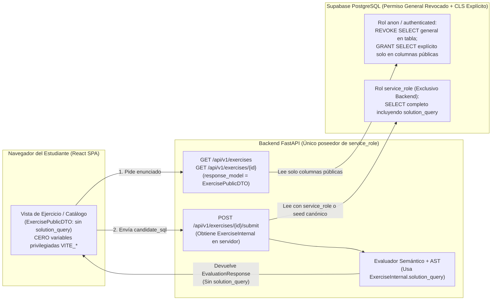
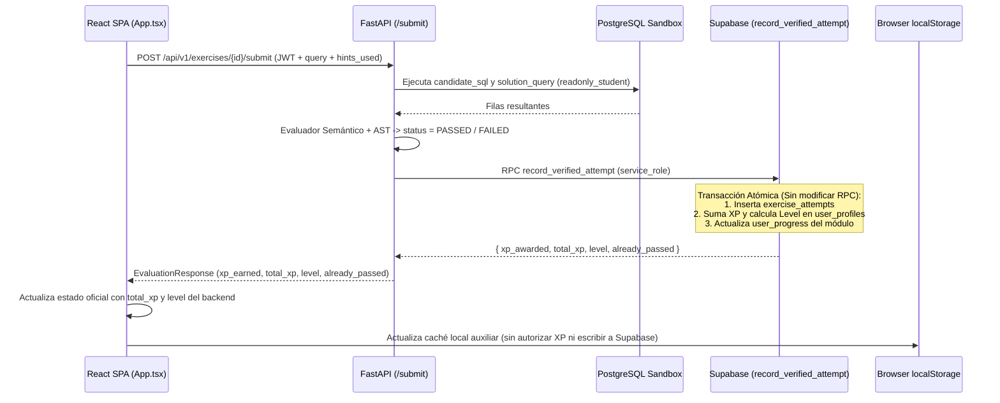
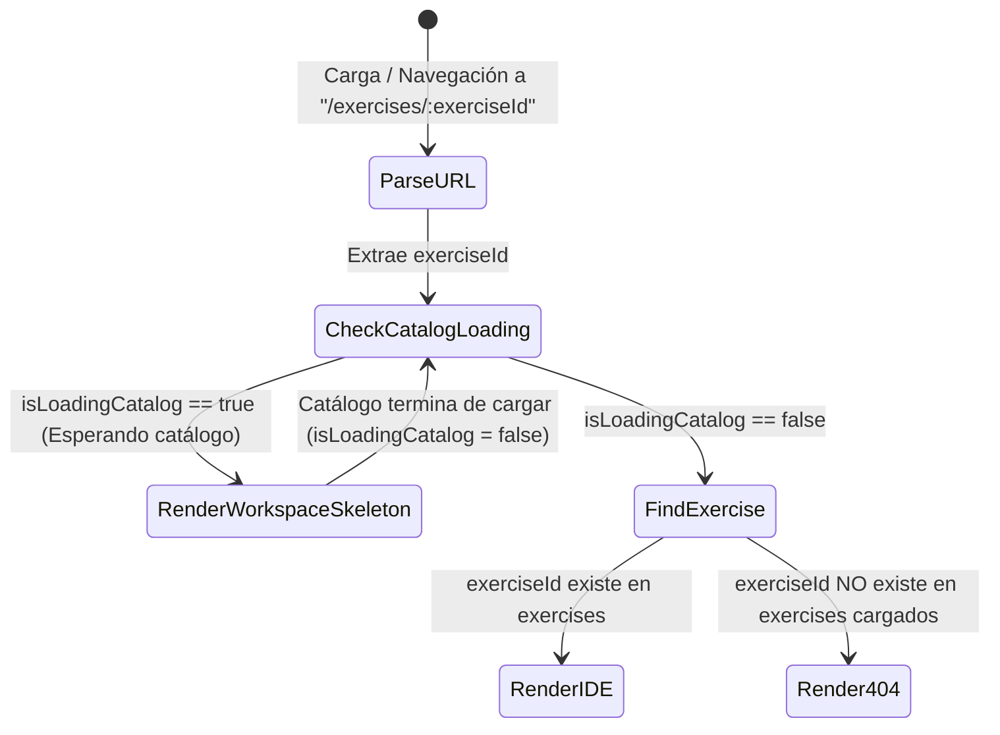
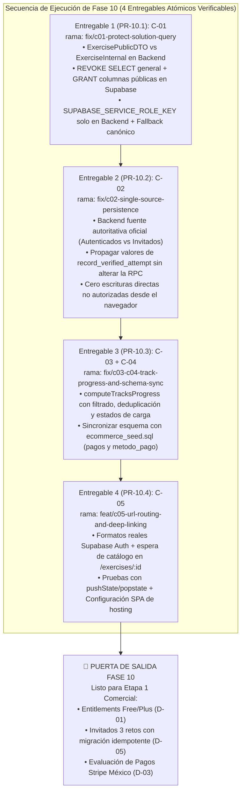

# QURIO — Plan de Ingeniería de Fase 10: Estabilización Técnica y Preparación Comercial

| Metadato | Detalle |
| :--- | :--- |
| **Documento** | `docs/roadmap/PHASE_10_STABILIZATION_PLAN.md` |
| **Versión** | `1.2` |
| **Fecha de actualización** | `10 de noviembre de 2026` |
| **Estado** | **Diagnóstico forense y especificación v1.2 completados — Planificado para ejecución (Código e infraestructura sin modificar)** |
| **Documento rector vinculado** | [`docs/product/QURIO_PRODUCT_BUSINESS_BLUEPRINT.md` (v1.2)](../product/QURIO_PRODUCT_BUSINESS_BLUEPRINT.md) |
| **Alcance exclusivo** | Brechas técnicas prioritarias **`C-01` a `C-05`** (Decisión Ejecutiva Aprobada **`D-07`**) |
| **Autoría** | Equipo Multidisciplinario de Software Architecture, Application Security, QA y UX Engineering |

---

## Historial de Cambios

| Versión | Fecha | Autor / Rol | Descripción del Cambio |
| :---: | :---: | :--- | :--- |
| **1.0** | `2026-11-09` | Equipo Multidisciplinario (Software Architecture, AppSec, QA, UX) | Elaboración inicial del Plan de Estabilización de Fase 10 cubriendo el diagnóstico forense de `C-01` a `C-05` y la secuencia de 4 entregables (`PR-10.1` a `PR-10.4`). |
| **1.1** | `2026-11-10` | Equipo Multidisciplinario (Software Architecture, AppSec, QA, UX) | Refinamiento técnico integral v1.1: (1) En **PR-10.1 (`C-01`)**, especificación de revocación del permiso `SELECT` general de tabla y concesión explícita de columnas públicas, encapsulamiento de `SUPABASE_SERVICE_ROLE_KEY` en backend, sincronización de fallback en memoria con fuente canónica y distinción entre pruebas locales y validación real en un entorno Supabase de pruebas; (2) En **PR-10.2 (`C-02`)**, distinción formal entre progreso autenticado y progreso invitado, ajuste de criterios de aceptación y documentación de alcance local de logros/actividad diaria; (3) En **PR-10.3 (`C-03` y `C-04`)**, filtrado de ejercicios activos/excluidos, manejo de rutas vacías, duplicados, carga parcial/estados de carga, fuente autorizada de IDs completados y sincronización canónica con `ecommerce_seed.sql` (`pagos` y `metodo_pago`) sin alterar esquema físico ni seed; (4) En **PR-10.4 (`C-05`)**, preservación de todos los formatos reales de autenticación de Supabase, espera de carga del catálogo antes de determinar 404 en `/exercises/:exerciseId`, pruebas con `history.pushState`/`popstate` y configuración SPA de hosting; (5) Clasificación rigurosa de pruebas en 5 categorías y rutas relativas. |
| **1.2** | `2026-11-10` | Equipo Multidisciplinario (Software Architecture, AppSec, QA, UX) | **Revisión final de consistencia técnica documental v1.2:**<br>1) En **PR-10.1 (`C-01`)**, declaración formal de `EXERCISES_SEED` en `seed_data.py` como la **única fuente maestra** del currículo y especificación de `02_seed_curriculum.sql` (seed DB con `solution_query`) y `FALLBACK_EXERCISES` en `api.ts` (catálogo cliente de respaldo sin `solution_query`) como **representaciones derivadas**, estableciendo el mecanismo de sincronización y la prueba automatizada de paridad `T-10.1-U3` en 7 atributos (IDs, Títulos, Módulos, Dificultad, XP, Orden y Metadatos públicos);<br>2) En **PR-10.2 (`C-02` / `D-05`)**, especificación detallada del protocolo de recuperación de migraciones interrumpidas para elementos que permanezcan en `syncing` tras cierre o recarga del navegador, restauración segura a `pending`, reintentos idempotentes, tratamiento de respuestas HTTP perdidas verificando el estado remoto (`PASSED` en Supabase) antes de descartar o reintentar, limpieza local exclusivamente tras confirmación de persistencia remota, prevención de sincronizaciones paralelas para el mismo `(user_id, exercise_id)` y adición de pruebas unitarias y de integración (`T-10.2-U3`, `T-10.2-I2`, `T-10.2-I3`);<br>3) En **PR-10.3a (`C-03`)**, corrección estructural de `computeTracksProgress`: eliminación de `ex.is_completed` como condición de aprobación, establecimiento de que únicamente `authoritativeCompletedIds` determina el progreso oficial de usuarios autenticados, separación lógica explícita para progreso temporal de invitados (`computeGuestTrialTracksProgress`), y tratamiento del estado `isLoading` devolviendo un estado explícito de carga (`is_progress_loading: true`, `completed_exercises: null`) para renderizar un skeleton visual en la interfaz en lugar de porcentajes definitivos incorrectos (`0%`), con pruebas unitarias, de integración y de seguridad (`T-10.3-U1`, `T-10.3-U2`, `T-10.3-U4`, `T-10.3-I1`, `T-10.3-S1`). |

---

## Tabla de Contenidos

1. [Propósito, Alcance y Estado Normativo de la Fase 10](#1-propósito-alcance-y-estado-normativo-de-la-fase-10)
2. [Invariantes de Seguridad de Fase 9 y Alineación Estratégica (`D-01` a `D-07`)](#2-invariantes-de-seguridad-de-fase-9-y-alineación-estratégica-d-01-a-d-07)
3. [Especificación Técnica de `C-01` (`PR-10.1`): Protección Estricta de `solution_query`](#3-especificación-técnica-de-c-01-pr-101-protección-estricta-de-solution_query)
4. [Especificación Técnica de `C-02` (`PR-10.2`): Fuente Única de Persistencia y Contrato Autoritativo](#4-especificación-técnica-de-c-02-pr-102-fuente-única-de-persistencia-y-contrato-autoritativo)
5. [Especificación Técnica de `C-03` (`PR-10.3a`): Cálculo Determinista de Progreso por Ruta de Aprendizaje](#5-especificación-técnica-de-c-03-pr-103a-cálculo-determinista-de-progreso-por-ruta-de-aprendizaje)
6. [Especificación Técnica de `C-04` (`PR-10.3b`): Consistencia del Esquema de Datos (`pagos` vs `metodos_pago`)](#6-especificación-técnica-de-c-04-pr-103b-consistencia-del-esquema-de-datos-pagos-vs-metodos_pago)
7. [Especificación Técnica de `C-05` (`PR-10.4`): Arquitectura de Navegación Web, Routing y Deep Linking](#7-especificación-técnica-de-c-05-pr-104-arquitectura-de-navegación-web-routing-y-deep-linking)
8. [Secuencia Recomendada de Implementación, Entregables Atómicos y Matriz Maestra de Pruebas](#8-secuencia-recomendada-de-implementación-entregables-atómicos-y-matriz-maestra-de-pruebas)

---

## 1. Propósito, Alcance y Estado Normativo de la Fase 10

La **Fase 10 (Estabilización y Preparación Comercial)** constituye el puente técnico obligatorio entre el cierre del endurecimiento de seguridad de la Fase 9 y la apertura del **MVP Comercial de Qurio** (suscripciones `Qurio Plus`, control de acceso por *entitlements* `D-01` e integración con pasarela de pagos `D-03`).

> [!IMPORTANT]
> **Estado Actual de las Brechas `C-01` a `C-05` y de las Pruebas Especificadas:** En cumplimiento estricto de las restricciones del proyecto, las brechas `C-01` a `C-05` se encuentran **diagnosticadas a nivel forense y especificadas en este plan v1.1**, pero **aún no han sido implementadas en el código fuente ni aplicadas en Supabase Cloud**. Del mismo modo, **todas las pruebas nuevas diseñadas en este documento para `PR-10.1` a `PR-10.4` están planificadas y pendientes de ejecución** (únicamente la línea base de 64 pruebas de las Fases 1 a 9 existe hoy en el repositorio).

### Matriz Resumen de las 5 Prioridades Técnicas de Fase 10 (`D-07`)

| ID | Prioridad Técnica | Severidad | ¿Bloqueante antes de Pagos / Entitlements? | Complejidad Relativa | Entregable Asociado |
| :-: | :--- | :---: | :---: | :---: | :---: |
| **C-01** | **Protección de `solution_query` en API, permisos PostgreSQL/Supabase y Frontend Fallback** | **Crítica (Seguridad / Integridad Pedagógica)** | **SÍ (Bloqueante Absoluto)** | Media (`M`) | **PR-10.1** |
| **C-02** | **Fuente única de persistencia autoritativa (`persistence.ts`, `App.tsx`, `useAuth.tsx`)** | **Alta (Integridad Transaccional / Red)** | **SÍ (Bloqueante Absoluto)** | Media (`M`) | **PR-10.2** |
| **C-03** | **Cálculo exacto, filtrado y determinista de progreso por ruta de aprendizaje** | **Media-Alta (Exactitud Funcional UX)** | **SÍ (Bloqueante antes de Paywall de Ruta)** | Baja (`S`) | **PR-10.3** |
| **C-04** | **Consistencia del esquema del Sandbox (`pagos` y `metodo_pago`, columnas y conteos)** | **Media (Fidelidad Pedagógica y DX)** | **SÍ (Bloqueante de Calidad Comercial)** | Baja (`S`) | **PR-10.3** |
| **C-05** | **Navegación web real con URLs limpias, formatos Auth, *deep linking* y fallback SPA** | **Alta (Arquitectura SPA / Retornos de Pago)** | **SÍ (Bloqueante para Checkout Redirects)** | Media (`M`) | **PR-10.4** |

---

## 2. Invariantes de Seguridad de Fase 9 y Alineación Estratégica (`D-01` a `D-07`)

Cualquier cambio implementado durante la ejecución de la Fase 10 **debe preservar intactos los controles de seguridad introducidos en las Fases 1 a 9 y respetar las decisiones ejecutivas `D-01` a `D-07`**. Está terminantemente prohibido debilitar, omitir o revertir cualquiera de los siguientes invariantes:

1. **Preservación de `public.record_verified_attempt` como Única Autoridad de Progreso ([`03_security_hardening.sql`](../../database/supabase/03_security_hardening.sql)):**
   * La función RPC `SECURITY DEFINER` con `SET search_path = ''`, bloqueo pesimista `SELECT xp, level ... FOR UPDATE`, cálculo de penalización de pistas e índice único parcial `idx_single_awarded_passed_attempt` debe seguir siendo **el único mecanismo capaz de insertar intentos verificados y otorgar XP/nivel oficial**.
   * `PUBLIC`, `anon` y `authenticated` mantienen `REVOKE ALL ON FUNCTION public.record_verified_attempt FROM PUBLIC, anon, authenticated;`; únicamente `service_role` desde el backend FastAPI puede ejecutarla.
   * **No se modificará la RPC existente durante la Fase 10**, salvo que se demuestre una necesidad técnica documentada.
2. **Preservación de Revocaciones y Column-Level Security (CLS) en Tablas de Usuario ([`03_security_hardening.sql`](../../database/supabase/03_security_hardening.sql)):**
   * En `public.user_profiles`: `anon` y `authenticated` tienen revocado `INSERT`, `DELETE` y `UPDATE` sobre `(id, username, level, xp, current_streak_days, max_streak_days, created_at)`. El rol `authenticated` conserva exclusivamente `UPDATE (display_name, avatar_url, bio, updated_at)` sobre su propia fila (`auth.uid() = id`).
   * En `public.exercise_attempts` y `public.user_progress`: `anon` y `authenticated` tienen revocado `INSERT, UPDATE, DELETE` (solo lectura de sus propios registros vía RLS `auth.uid() = user_id`).
3. **Validación Criptográfica JWT ES256 vía JWKS ([`apps/api/app/core/auth.py`](../../apps/api/app/core/auth.py)):**
   * Se mantiene intacta la verificación asimétrica `ES256` mediante `PyJWKClient` con caché de 1 hora, validación de `audience="authenticated"`, `issuer` y fallback controlado a `HS256` cuando `SUPABASE_JWT_SECRET` está configurado.
4. **Rate Limiting Dual y Control de Concurrencia ([`apps/api/app/core/rate_limit.py`](../../apps/api/app/core/rate_limit.py) y [`service.py`](../../apps/api/app/modules/runner/service.py)):**
   * Se mantienen los límites de ventana deslizante de `20 req/min` por IP para invitados y `120 req/min` por `user_id` para usuarios autenticados, así como el `asyncio.Semaphore(10)` en el runner.
5. **Inspección AST con `SQLGlot` ([`apps/api/app/modules/runner/security.py`](../../apps/api/app/modules/runner/security.py)):**
   * Se mantiene el bloqueo estricto de sentencias múltiples, comandos distintos de `SELECT`/`WITH`/`UNION`/`VALUES`, funciones administrativas/red (`pg_sleep`, `dblink`, `pg_read_file`, `lo_import`, etc.), acceso a catálogos del sistema (`pg_catalog`, `information_schema`) e inyección automática de `LIMIT 1000`.
6. **Aislamiento Físico del PostgreSQL Sandbox ([`database/sandbox/init.sql`](../../database/sandbox/init.sql)):**
   * Ninguna consulta del usuario toca jamás Supabase. Toda query se ejecuta en el contenedor `postgres:16-alpine` bajo el rol `readonly_student` con `statement_timeout = 2000ms`, `lock_timeout = 1000ms`, `work_mem = 16MB` y `temp_file_limit = 32MB`.
7. **Alineación con las Decisiones Estratégicas `D-01` a `D-07`:**
   * **`D-01`:** Free/Plus (~20 ejercicios gratuitos, fundamentos completos y control de acceso por IDs estables en backend).
   * **`D-02`:** Eslogan general *«Aprende datos. Practica. Construye tu futuro.»* y lema SQL *«Aprende SQL. Piensa en queries.»*
   * **`D-03`:** Evaluar Stripe México, sin integrar pagos todavía.
   * **`D-04`:** Arquitectura de ejecución Python como decisión independiente, sin implementación aún.
   * **`D-05`:** Tres ejercicios como invitado antes del registro, migración segura e idempotente del progreso y sin XP oficial para invitados.
   * **`D-06`:** Posponer precios y descuentos de `Teams` hasta realizar entrevistas, pilotos y análisis de costos.
   * **`D-07`:** Priorizar `C-01` a `C-05` antes de avanzar con monetización.

---

## 3. Especificación Técnica de `C-01` (`PR-10.1`): Protección Estricta de `solution_query`

### 3.1 Diagnóstico Forense
Aunque el documento de arquitectura [`docs/SAD.md`](../SAD.md) establece que el endpoint `GET /api/v1/exercises/{id}` debe retornar el reto *"sin exponer la query de solución"*, la inspección del código actual demuestra que **`solution_query` está expuesta al cliente en 5 puntos simultáneos**:

1. **Modelo Pydantic Único en Backend ([`apps/api/app/modules/curriculum/seed_data.py`](../../apps/api/app/modules/curriculum/seed_data.py)):**
   * La clase `ExerciseDetail` (líneas 18–33) define el atributo obligatorio `solution_query: str` en la línea 24. No existe diferenciación entre el modelo interno de evaluación y el DTO de respuesta HTTP pública.
2. **Endpoints Públicos del Router ([`apps/api/app/modules/runner/router.py`](../../apps/api/app/modules/runner/router.py)):**
   * `GET /api/v1/exercises` (`list_exercises`, líneas 72–80) declara `response_model=List[ExerciseDetail]` y serializa los 50 objetos completos con su `solution_query` hacia el navegador.
   * `GET /api/v1/exercises/{exercise_id}` (`get_exercise`, líneas 83–97) declara `response_model=ExerciseDetail` y devuelve `solution_query` en texto plano en el JSON de respuesta.
3. **Consultas REST del Repositorio Backend ([`apps/api/app/modules/curriculum/repository.py`](../../apps/api/app/modules/curriculum/repository.py)):**
   * Tanto `get_all()` (línea 29) como `get_by_id()` (línea 52) consultan la API REST de Supabase seleccionando explícitamente `solution_query` mediante `self._get_headers()`, el cual utiliza `SUPABASE_ANON_KEY` (líneas 18–23).
4. **Permisos de Tabla y Columna en PostgreSQL / Supabase ([`database/supabase/01_schema.sql`](../../database/supabase/01_schema.sql)):**
   * La tabla `public.exercises` tiene `CREATE POLICY "Public Read Exercises" ON public.exercises FOR SELECT USING (true);` (línea 179) y mantiene el permiso `SELECT` general a nivel de tabla para `anon` y `authenticated`. En consecuencia, cualquier usuario puede usar la `VITE_SUPABASE_ANON_KEY` pública del navegador para ejecutar `supabase.from('exercises').select('id, solution_query')` directamente contra PostgREST y descargar las 50 respuestas.
5. **Bundle Estático y Tipado del Frontend ([`apps/web/src/lib/api.ts`](../../apps/web/src/lib/api.ts) y [`apps/web/src/types/index.ts`](../../apps/web/src/types/index.ts)):**
   * La interfaz `Exercise` (`types/index.ts`, líneas 60–74) incluye `solution_query?: string;` (línea 67).
   * La constante `FALLBACK_EXERCISES` (`api.ts`, líneas 305–1860) contiene el campo `solution_query: "SELECT ..."` en cada uno de los 50 ejercicios, quedando empaquetado dentro del archivo JavaScript de producción servido al navegador.
6. **Dependencia Real del Evaluador ([`apps/api/app/modules/runner/router.py`](../../apps/api/app/modules/runner/router.py)):**
   * En el frontend, **ningún componente de UI lee jamás `exercise.solution_query`** (verificado mediante búsqueda exhaustiva en `apps/web/src/`).
   * En el backend, el único consumidor legítimo de `solution_query` es `submit_exercise_solution` (líneas 112–198), que obtiene el ejercicio mediante `exercise = await exercise_repository.get_by_id(exercise_id)` (línea 123), ejecuta `expected_result = await sandbox_runner.execute_query(exercise.solution_query)` (línea 133) y pasa `expected_sql=exercise.solution_query` a `evaluate_solution()` (línea 149) para la inspección AST de segunda capa (ej. uso de `ROUND` en [`evaluator.py`](../../apps/api/app/modules/runner/evaluator.py), líneas 89–99).

### 3.2 Archivos Afectados

| Archivo | Rol Actual | Modificación Requerida en `PR-10.1` |
| :--- | :--- | :--- |
| [`apps/api/app/modules/curriculum/seed_data.py`](../../apps/api/app/modules/curriculum/seed_data.py) | Define `ExerciseDetail` con `solution_query: str`. | Separar en `ExercisePublicDTO` (sin `solution_query`) y `ExerciseInternal` (subclase que añade `solution_query: str` exclusivamente para uso interno del evaluador en el backend). |
| [`apps/api/app/modules/curriculum/repository.py`](../../apps/api/app/modules/curriculum/repository.py) | Consulta `public.exercises` incluyendo `solution_query` con `SUPABASE_ANON_KEY`. | Separar métodos públicos (`list_public_exercises() -> List[ExercisePublicDTO]`, `get_public_by_id() -> Optional[ExercisePublicDTO]`) del método interno del evaluador (`get_internal_for_evaluation(exercise_id) -> Optional[ExerciseInternal]`, el cual utiliza `SUPABASE_SERVICE_ROLE_KEY` encapsulada en backend o la fuente canónica en memoria `EXERCISES_SEED`). |
| [`apps/api/app/modules/runner/router.py`](../../apps/api/app/modules/runner/router.py) | Expone `ExerciseDetail` en `GET /exercises` y `GET /exercises/{id}`. | Cambiar `response_model` de ambos endpoints `GET` a `List[ExercisePublicDTO]` y `ExercisePublicDTO`. En `POST /exercises/{exercise_id}/submit`, invocar `get_internal_for_evaluation(exercise_id)`. |
| [`database/supabase/04_phase10_stabilization.sql`](../../database/supabase/) *(Planificado)* | No existe aún. | Migración aditiva que ejecuta `REVOKE SELECT ON public.exercises FROM PUBLIC, anon, authenticated;` y concede `GRANT SELECT (...)` explícitamente solo sobre las columnas públicas necesarias (excluyendo `solution_query`). |
| [`apps/web/src/types/index.ts`](../../apps/web/src/types/index.ts) | Define `solution_query?: string` en `Exercise`. | Eliminar la propiedad `solution_query` de la interfaz `Exercise`. |
| [`apps/web/src/lib/api.ts`](../../apps/web/src/lib/api.ts) | Incluye `solution_query` en los 50 objetos de `FALLBACK_EXERCISES`. | Eliminar todas las propiedades `solution_query` de `FALLBACK_EXERCISES`, manteniendo sincronizados los campos públicos con la fuente canónica. |
| [`apps/api/tests/test_security_hardening.py`](../../apps/api/tests/test_security_hardening.py) | Valida reglas de `03_security_hardening.sql`. | Añadir pruebas unitarias, de integración y de seguridad para DTOs, repositorio, endpoints, bundles, variables de entorno y permisos SQL. |

### 3.3 Riesgo y Requisitos de Seguridad de Credenciales
* **Severidad:** **Crítica.**
* **Encapsulamiento estricto de `SUPABASE_SERVICE_ROLE_KEY`:**
  * El uso de `SUPABASE_SERVICE_ROLE_KEY` debe limitarse exclusivamente al backend FastAPI ([`apps/api/app/core/config.py`](../../apps/api/app/core/config.py), [`apps/api/app/core/supabase.py`](../../apps/api/app/core/supabase.py) y [`apps/api/app/modules/curriculum/repository.py`](../../apps/api/app/modules/curriculum/repository.py)).
  * **Ninguna variable privilegiada (`SUPABASE_SERVICE_ROLE_KEY`, `SUPABASE_JWT_SECRET`, credenciales de base de datos) puede exponerse jamás al frontend**, ni definirse con el prefijo `VITE_*` en archivos `.env`, ni registrarse en logs, ni incluirse en respuestas HTTP o bundles compilados (`apps/web/dist/`).
* **Por qué no basta revocar permisos de columna aislados en PostgreSQL:**
  * En PostgreSQL, si un rol (`anon` o `authenticated`) conserva el privilegio `SELECT` a nivel de tabla (`GRANT SELECT ON TABLE public.exercises`), dicho privilegio general sigue autorizando la lectura de todas las columnas de la tabla. Por ello, es técnicamente indispensable **revocar primero el permiso `SELECT` general sobre `public.exercises`** para `PUBLIC`, `anon` y `authenticated`, y acto seguido **conceder explícitamente `GRANT SELECT (...)` únicamente sobre las columnas públicas requeridas**.

### 3.4 Dependencias
* **Independiente de `C-02`, `C-03`, `C-04` y `C-05`.** Es el **primer entregable (`PR-10.1`)** de la Fase 10.
* Requiere que el método interno `get_internal_for_evaluation` esté desplegado en el backend usando `SUPABASE_SERVICE_ROLE_KEY` (con fallback a `EXERCISES_SEED`) antes de ejecutar la revocación de `SELECT` en Supabase Cloud.

### 3.5 Solución Propuesta



#### 1. Separación de Modelos Pydantic en Backend ([`seed_data.py`](../../apps/api/app/modules/curriculum/seed_data.py))
```python
class ExercisePublicDTO(BaseModel):
    """Esquema público seguro de un ejercicio. Jamás incluye solution_query."""
    id: str
    module_id: str
    title: str
    difficulty: str
    xp_reward: int
    prompt: str
    initial_code: str
    check_order: bool = False
    sort_order: int = 1
    sample_data: List[SampleTable] = []
    hints: List[ExerciseHint] = []
    wiki: Optional[ExerciseWiki] = None


class ExerciseInternal(ExercisePublicDTO):
    """Modelo privado exclusivo para el evaluador en el servidor."""
    solution_query: str

    def to_public_dto(self) -> ExercisePublicDTO:
        return ExercisePublicDTO(**self.model_dump(exclude={"solution_query"}))
```

#### 2. Revocación de Permiso General y Concesión Explícita de Columnas en PostgreSQL/Supabase
En la migración planificada de Fase 10 (`database/supabase/04_phase10_stabilization.sql`):
```sql
-- 1. Revocar el permiso SELECT general a nivel de tabla para roles públicos/cliente
REVOKE SELECT ON public.exercises FROM PUBLIC, anon, authenticated;

-- 2. Conceder SELECT explícito ÚNICAMENTE sobre las columnas públicas necesarias (excluyendo solution_query)
GRANT SELECT (
    id,
    module_id,
    title,
    prompt,
    initial_code,
    target_database,
    xp_reward,
    difficulty,
    check_order,
    sort_order,
    created_at
) ON public.exercises TO anon, authenticated;

-- 3. Garantizar que únicamente service_role (Backend FastAPI) conserve acceso a todas las columnas
GRANT SELECT ON public.exercises TO service_role;
```

#### 3. Fuente Maestra Única vs. Representaciones Derivadas y Mecanismo de Sincronización
* **Fuente Maestra Canónica Única del Currículo:**
  * Se establece formalmente a `EXERCISES_SEED` (junto con `TRACKS_SEED` y `MODULES_SEED`) en [`apps/api/app/modules/curriculum/seed_data.py`](../../apps/api/app/modules/curriculum/seed_data.py) como la **única fuente maestra canónica de verdad** del catálogo de ejercicios en todo el repositorio.
* **Representaciones Derivadas:**
  1. [`database/supabase/02_seed_curriculum.sql`](../../database/supabase/02_seed_curriculum.sql): Representación derivada generada para el sembrado inicial en PostgreSQL/Supabase; contiene `solution_query` para que la base de datos de producción disponga de las soluciones oficiales para el evaluador.
  2. `FALLBACK_EXERCISES` en [`apps/web/src/lib/api.ts`](../../apps/web/src/lib/api.ts): Representación derivada pública para el cliente web; no contiene `solution_query` y sirve como catálogo de respaldo en memoria ante contingencias de red.
* **Mecanismo de Sincronización Obligatorio:**
  * Cualquier cambio, nuevo reto o ajuste pedagógico debe realizarse primeramente en la fuente maestra `seed_data.py` y propagarse de forma controlada a `02_seed_curriculum.sql` (con `solution_query`) y a `api.ts` (sin `solution_query`).
* **Fallback en memoria del Backend (`ExerciseRepository`):**
  * Si Supabase no está configurado localmente o falla la red, `list_public_exercises()` y `get_public_by_id()` construyen su respuesta aplicando `[ex.to_public_dto() for ex in EXERCISES_SEED.values()]`, garantizando que ni siquiera en modo fallback el backend exponga `solution_query`.
  * Solo `get_internal_for_evaluation(exercise_id)` consulta Supabase autenticándose con `SUPABASE_SERVICE_ROLE_KEY` (encapsulada en backend) o recurre a `EXERCISES_SEED[exercise_id]` en memoria del servidor para entregar `ExerciseInternal` al evaluador.
* **Fallback en memoria del Frontend (`FALLBACK_EXERCISES` en [`apps/web/src/lib/api.ts`](../../apps/web/src/lib/api.ts)):**
  * Se elimina toda propiedad `solution_query` de los 50 objetos de `FALLBACK_EXERCISES` y de la interfaz `Exercise` en [`apps/web/src/types/index.ts`](../../apps/web/src/types/index.ts).
  * La sincronización estricta entre la fuente canónica maestra y las representaciones derivadas se valida mediante la prueba automatizada `T-10.1-U3`.

### 3.6 Especificación Verificable de Pruebas para `PR-10.1` (`C-01`)

> [!NOTE]
> **Distinción entre Pruebas Locales y Validación en Entorno Supabase de Pruebas (Estado: No ejecutadas aún):**
> Las pruebas locales (`pytest` con mocks/TestClient e inspección de archivos/bundles) verifican que el código de FastAPI, los DTOs, el cliente React y el archivo SQL contengan las reglas correctas, pero **no sustituyen la validación real de permisos contra el motor PostgreSQL/PostgREST de un entorno Supabase de pruebas**, donde se comprueba efectivamente el rechazo `42501` bajo los roles `anon` y `authenticated`.

| ID Prueba | Categoría | Comportamiento Verificado | Resultado Observable Esperado | Condición de Aprobación / Fallo (Pass/Fail) | Entorno Requerido | Limitaciones |
| :---: | :--- | :--- | :--- | :--- | :--- | :--- |
| **T-10.1-U1** | **1. Unitaria** | Separación estructural entre `ExerciseInternal` y `ExercisePublicDTO`. | Al convertir los 50 retos de `EXERCISES_SEED` mediante `.to_public_dto()` y `.model_dump()`, ningún diccionario resultante contiene la clave `solution_query`. | **Pasa:** `all("solution_query" not in d for d in dumps)` es `True` para los 50 ejercicios. **Falla:** Si al menos 1 objeto conserva la clave o lanza `ValidationError`. | Local (`pytest`, Python 3.12, sin red). | Solo valida la capa de serialización Pydantic en memoria; no prueba el router HTTP ni la base de datos. |
| **T-10.1-U2** | **1. Unitaria** | Separación de credenciales y columnas en métodos públicos vs. internos de `ExerciseRepository`. | `list_public_exercises()` y `get_public_by_id()` solicitan únicamente columnas públicas sin `solution_query`; `get_internal_for_evaluation()` utiliza exclusivamente el encabezado con `SUPABASE_SERVICE_ROLE_KEY` en backend. | **Pasa:** El parámetro `select` de los métodos públicos no contiene `solution_query` y el método interno envía `Authorization: Bearer <service_role_key>`. **Falla:** Si un método público pide `solution_query` o si el método interno usa `anon_key`. | Local (`pytest` con mock de `httpx.AsyncClient`). | Al usar un cliente HTTP simulado, no verifica los permisos reales configurados en PostgreSQL. |
| **T-10.1-U3** | **1. Unitaria** | Sincronización estricta entre la única fuente maestra (`seed_data.py`) y las representaciones derivadas (`02_seed_curriculum.sql` y `FALLBACK_EXERCISES` en `api.ts`). | Los 50 ejercicios coinciden con paridad exacta en los 7 atributos requeridos: 1) IDs (UUIDs); 2) Títulos (`title`); 3) Módulos (`module_id`); 4) Dificultad (`difficulty`); 5) XP (`xp_reward`); 6) Orden (`sort_order`, `check_order`); 7) Metadatos públicos (`prompt`, `initial_code`, `hints`, `sample_data`, `wiki`). | **Pasa:** Paridad 100% en los 7 atributos para los 50 retos y `0` diferencias detectadas. **Falla:** Si existe cualquier discrepancia en IDs, títulos, módulos, dificultad, XP, orden o metadatos públicos. | Local (`pytest` leyendo archivos del repositorio). | Verifica paridad estática en el repositorio; no valida el estado de datos en una instancia remota no migrada. |
| **T-10.1-I1** | **2. Integración** | Ausencia de `solution_query` en respuestas de los endpoints públicos `GET /api/v1/exercises` y `GET /api/v1/exercises/{id}`, tanto con Supabase activo como en modo fallback en memoria. | Respuestas `HTTP 200 OK` con la lista de 50 ejercicios y el detalle individual conteniendo `id`, `title`, `prompt`, `initial_code`, `sample_data`, `hints` y `wiki`, pero sin `solution_query`. | **Pasa:** Código `200` y `"solution_query" not in response.json()` en ambos modos (online y fallback). **Falla:** Si aparece `solution_query` en cualquier nodo del JSON. | Local (`pytest` + `FastAPI TestClient`). | Prueba la tubería completa de FastAPI, pero contra repositorio local/mockeado si no se conecta a Supabase. |
| **T-10.1-I2** | **2. Integración** | Funcionamiento de `POST /api/v1/exercises/{id}/submit` utilizando `ExerciseInternal` en el backend sin filtrar `solution_query` en `EvaluationResponse`. | Al enviar una consulta válida e inválida al endpoint `/submit`, el evaluador ejecuta `solution_query` internamente y devuelve `PASSED`/`FAILED` sin incluir `solution_query` en el cuerpo de respuesta. | **Pasa:** Veredicto semántico correcto y `"solution_query" not in response.json()`. **Falla:** Si falla la evaluación por falta de `solution_query` interna o si se filtra en la respuesta. | Local (`pytest` + `FastAPI TestClient` + contenedor `qurio-sandbox-db`). | Requiere que el contenedor Docker del PostgreSQL Sandbox esté en ejecución para probar la ejecución SQL real. |
| **T-10.1-S1** | **3. Seguridad** | Inspección de código fuente, variables de entorno y bundle compilado de producción (`apps/web/dist/`) para confirmar cero filtración de `solution_query` y `SUPABASE_SERVICE_ROLE_KEY`. | Al ejecutar `npm run build` en `apps/web` e inspeccionar `apps/web/src/`, `apps/web/.env*` y `apps/web/dist/assets/*.js`, no existen las cadenas `solution_query` ni `service_role`. | **Pasa:** `0` coincidencias de `solution_query` y `0` variables `VITE_*SERVICE_ROLE*` en código fuente y artefactos de `dist/`. **Falla:** Si aparece cualquier coincidencia (>= 1). | Local (`npm run build` + `pytest` / escaneo estático sobre `dist/`). | Debe ejecutarse siempre después de compilar un build fresco (`vite build`) para inspeccionar el artefacto real. |
| **T-10.1-S2** | **3. Seguridad** | Verificación estática de la migración SQL (`04_phase10_stabilization.sql`). | El archivo SQL contiene `REVOKE SELECT ON public.exercises FROM PUBLIC, anon, authenticated;` seguido de `GRANT SELECT (...)` sin `solution_query`. | **Pasa:** Ambas sentencias existen en el orden correcto y `solution_query` no figura dentro de la cláusula `GRANT SELECT (...) TO anon, authenticated`. **Falla:** Si falta el `REVOKE` general o si `solution_query` está en el `GRANT`. | Local (`pytest` sobre archivos en `database/supabase/`). | Valida el texto del script SQL, pero no confirma que el script ya haya sido ejecutado en Supabase Cloud. |
| **T-10.1-B1** | **4. Navegador / UX** | Carga del catálogo y apertura de un ejercicio en el IDE comprobando en la pestaña *Network* que los payloads JSON carecen de `solution_query` y la UI funciona sin errores. | El estudiante visualiza el enunciado, datos de muestra, pistas, wiki y editor Monaco sin errores en consola, y el JSON de `/api/v1/exercises` no incluye `solution_query`. | **Pasa:** UI renderizada al 100%, `0` errores en consola y `response.solution_query === undefined`. **Falla:** Si algún componente rompe o el payload incluye la solución. | Navegador real / Playwright contra frontend Vite + backend FastAPI local. | No prueba ataques directos contra PostgREST fuera de la interfaz de usuario. |
| **T-10.1-SB1** | **5. Entorno Supabase de Pruebas** | Validación real de permisos PostgreSQL/PostgREST aplicando la migración en un proyecto Supabase de pruebas. | 1) `GET /rest/v1/exercises?select=id,solution_query` con `apikey: <ANON_KEY>` o Bearer `<USER_JWT>` devuelve `HTTP 403/401` (`code: "42501", message: "permission denied for table exercises"`).<br>2) `GET /rest/v1/exercises?select=id,title,prompt` con `ANON_KEY` devuelve `HTTP 200 OK`.<br>3) `GET /rest/v1/exercises?select=id,solution_query` con `SERVICE_ROLE_KEY` desde backend devuelve `HTTP 200 OK`. | **Pasa:** Se cumplen simultáneamente las 3 condiciones contra PostgREST real. **Falla:** Si `anon` o `authenticated` logran leer `solution_query` o si se rompe la lectura de las columnas públicas. | Entorno Supabase de pruebas (*Staging / Test Project*) con la migración aplicada. | Requiere disponer de un proyecto o rama de pruebas en Supabase antes de promover la migración a producción. |

### 3.7 Criterios de Aceptación de `PR-10.1`
* [ ] `GET /api/v1/exercises`, `GET /api/v1/exercises/{id}` y `POST /api/v1/exercises/{id}/submit` jamás incluyen la clave `solution_query` en el JSON devuelto al cliente.
* [ ] En PostgreSQL/Supabase se revoca el permiso `SELECT` general sobre `public.exercises` para `PUBLIC`, `anon` y `authenticated`, y se concede `SELECT` explícito únicamente sobre las columnas públicas necesarias, de modo que toda consulta directa a `solution_query` desde el cliente es rechazada con `42501 permission denied`.
* [ ] `SUPABASE_SERVICE_ROLE_KEY` permanece estrictamente encapsulada en el backend y no existe en ninguna variable `VITE_*`, log ni archivo del frontend.
* [ ] El fallback en memoria del backend y del frontend se mantiene sincronizado con la fuente canónica, y el código fuente + bundle compilado del frontend (`apps/web/dist`) contienen **cero** ocurrencias de `solution_query`.

### 3.8 Estimación de Complejidad y Orden Recomendado
* **Complejidad:** **Media (`M` — ~3 a 4 horas de ingeniería y pruebas).**
* **Orden:** **Paso #1 de la Fase 10 (`PR-10.1`).**

---

## 4. Especificación Técnica de `C-02` (`PR-10.2`): Fuente Única de Persistencia y Contrato Autoritativo

### 4.1 Diagnóstico Forense
Tras el endurecimiento de seguridad de la Fase 9 ([`database/supabase/03_security_hardening.sql`](../../database/supabase/03_security_hardening.sql)), el backend FastAPI certifica los intentos invocando la RPC `public.record_verified_attempt` con `service_role` ([`apps/api/app/modules/runner/router.py`](../../apps/api/app/modules/runner/router.py), líneas 164–187). Sin embargo, el frontend conserva lógica heredada de las Fases 6–8 que intenta escribir directamente en Supabase desde el navegador:

1. **Inserción Directa de Intentos desde el Navegador ([`apps/web/src/lib/persistence.ts`](../../apps/web/src/lib/persistence.ts), líneas 47–60):**
   * `persistence.recordAttempt()` ejecuta `supabase.from('exercise_attempts').insert(...)`.
   * Debido a `REVOKE INSERT, UPDATE, DELETE ON public.exercise_attempts FROM anon, authenticated;` ([`03_security_hardening.sql`](../../database/supabase/03_security_hardening.sql), línea 87), Supabase rechaza la petición con `HTTP 403 / 42501 permission denied` en cada intento del estudiante, y la línea 59 silencia el fallo con `console.warn`.
2. **Actualización Directa de XP y Nivel desde el Navegador ([`apps/web/src/lib/persistence.ts`](../../apps/web/src/lib/persistence.ts), líneas 63–82):**
   * Cuando `status === 'PASSED'` y `xpEarned > 0`, `persistence.recordAttempt()` lee `user_profiles` y ejecuta `supabase.from('user_profiles').update({ xp: newXp, level: newLevel, updated_at })`.
   * Debido a `REVOKE UPDATE (id, username, level, xp, current_streak_days, max_streak_days, created_at) ON public.user_profiles FROM authenticated;` ([`03_security_hardening.sql`](../../database/supabase/03_security_hardening.sql), líneas 74–75), esta petición también falla sistemáticamente con `42501 permission denied`.
3. **Escritura Directa en `user_daily_activity` ([`apps/web/src/lib/persistence.ts`](../../apps/web/src/lib/persistence.ts), líneas 85–108):**
   * `persistence.recordAttempt()` intenta hacer `.update()` o `.insert()` en `public.user_daily_activity`.
   * En [`01_schema.sql`](../../database/supabase/01_schema.sql) (líneas 173 y 193), `user_daily_activity` tiene RLS habilitado con **solo una política `FOR SELECT`** (`"User Read Own Daily Activity"`), sin políticas `FOR INSERT` ni `FOR UPDATE`. Por tanto, el cliente tampoco puede escribir su actividad diaria en la nube.
4. **Fallo Crítico Silencioso en `persistence.updateProfile()` ([`apps/web/src/lib/persistence.ts`](../../apps/web/src/lib/persistence.ts), líneas 192–217) y [`useAuth.tsx`](../../apps/web/src/hooks/useAuth.tsx) (líneas 61–102):**
   * En `persistence.ts` (líneas 194–201), `updateProfile` construye `dbUpdates` incluyendo `username`, `xp` (`total_xp`), `level` (`current_level`) y `current_streak_days` junto con `display_name`, `avatar_url` y `bio`.
   * En `useAuth.tsx` (líneas 61 y 102), `fetchProfile` llama a `persistence.updateProfile(userId, loadedProfile)` pasando el objeto `UserProfile` completo recién leído. Como ese objeto contiene `username`, `total_xp`, `current_level` y `current_streak_days` (columnas con `UPDATE` revocado en CLS), **PostgreSQL rechaza toda la sentencia `UPDATE`** incluso cuando un usuario intenta cambiar legítimamente su `display_name`, `bio` o `avatar_url` desde `useAuth.tsx` (línea 348).
   * Además, `useAuth.tsx` (líneas 82–86) intenta hacer `supabase.from('user_profiles').insert(newProfileData)` desde el cliente si no encuentra perfil, lo cual está revocado por `03_security_hardening.sql` (línea 76), dado que la creación del perfil la realiza el trigger `on_auth_user_created` en `01_schema.sql` (líneas 24–41).
5. **Cálculo Local de XP en [`App.tsx`](../../apps/web/src/App.tsx) (líneas 233–311):**
   * En `App.tsx` (línea 241), el cliente calcula `xpEarned = isAlreadyCompleted ? 0 : Math.max(0, result.xp_earned - xpPenalty)` y en las líneas 244–248 suma manualmente `nextXp = user.total_xp + xpEarned` llamando a `updateUser({ total_xp: nextXp, current_level: nextLevel })`, además de llamar a `persistence.recordAttempt(...)` en los bloques `PASSED` (línea 237), `FAILED` (línea 288) y `ERROR` (línea 303).
   * Mientras tanto, [`EvaluationResponse`](../../apps/api/app/modules/runner/schemas.py) (líneas 46–54) en el backend solo devuelve `xp_earned` (que en [`router.py`](../../apps/api/app/modules/runner/router.py), línea 175, toma `xp_awarded` de la RPC cuando el usuario está autenticado), pero no propaga el `total_xp`, `level` ni `already_passed` autoritativos que la RPC `record_verified_attempt` ya retorna en su `jsonb_build_object`.

### 4.2 Archivos Afectados

| Archivo | Rol Actual | Modificación Requerida en `PR-10.2` |
| :--- | :--- | :--- |
| [`apps/api/app/modules/runner/schemas.py`](../../apps/api/app/modules/runner/schemas.py) | Define `EvaluationResponse` solo con `xp_earned`. | Añadir campos opcionales autoritativos provenientes de la RPC: `total_xp: Optional[int] = None`, `level: Optional[int] = None`, `already_passed: Optional[bool] = None`. |
| [`apps/api/app/modules/runner/router.py`](../../apps/api/app/modules/runner/router.py) | Invoca `record_verified_attempt` y extrae solo `xp_awarded`. | Extraer `total_xp`, `level` y `already_passed` del resultado de `supabase_admin.record_verified_attempt` y propagarlos en `EvaluationResponse`. |
| [`apps/web/src/types/index.ts`](../../apps/web/src/types/index.ts) | Define `EvaluationResult` en el cliente. | Añadir `total_xp?: number`, `level?: number`, `already_passed?: boolean` a `EvaluationResult`. |
| [`apps/web/src/lib/persistence.ts`](../../apps/web/src/lib/persistence.ts) | Intenta escribir `exercise_attempts`, `xp`/`level` en `user_profiles` y `user_daily_activity` directamente en Supabase, y envía columnas prohibidas en `updateProfile`. | 1) Acotar `recordAttempt` para que **solo actualice `localStorage`** (caché local / estado temporal de invitado), eliminando todas las escrituras remotas `.from('exercise_attempts').insert`, `.from('user_profiles').update({ xp, level })` y `.from('user_daily_activity').insert/update`.<br>2) En `updateProfile`, separar el caché de `localStorage` de la actualización remota en Supabase (`dbUpdates`), la cual **solo debe incluir las columnas permitidas por CLS**: `display_name`, `avatar_url`, `bio` y `updated_at`. |
| [`apps/web/src/hooks/useAuth.tsx`](../../apps/web/src/hooks/useAuth.tsx) | Llama a `persistence.updateProfile` dentro de `fetchProfile` e intenta `.insert()` en `user_profiles`. | 1) En `fetchProfile`, guardar en caché local (`persistence.cacheProfileLocally(loadedProfile)`) sin disparar un `UPDATE` a Supabase.<br>2) Eliminar el `.from('user_profiles').insert(...)` desde el cliente.<br>3) En `updateUser`, solo invocar el `UPDATE` remoto de Supabase cuando cambien `display_name`, `avatar_url` o `bio`. |
| [`apps/web/src/App.tsx`](../../apps/web/src/App.tsx) | Calcula XP manualmente y usa `localStorage` indistintamente. | Para usuarios autenticados, usar exclusivamente los valores autoritativos `result.xp_earned`, `result.total_xp`, `result.level` y `result.already_passed` devueltos por el backend. Para usuarios invitados, mantener únicamente el progreso temporal en navegador sin otorgar XP oficial. |

### 4.3 Reglas de Autoridad: Usuarios Autenticados vs. Usuarios Invitados

Para evitar cualquier ambigüedad arquitectónica, `PR-10.2` establece una frontera estricta entre el manejo de estado de un usuario autenticado y el de un visitante invitado:

1. **Reglas para Usuarios Autenticados (`session.user !== null`):**
   * **El backend es la única fuente autoritativa del progreso oficial:** Solo la ejecución de `POST /api/v1/exercises/{id}/submit` en FastAPI y su llamada interna a la RPC `public.record_verified_attempt()` pueden certificar la aprobación oficial de un ejercicio, otorgar XP o subir de nivel.
   * **Rol pasivo de `localStorage`:** Para un usuario autenticado, `localStorage` puede funcionar únicamente como caché temporal de interfaz o respaldo de lectura, pero **jamás puede autorizar la aprobación oficial de un ejercicio, ni sumar XP, ni sobrescribir el `xp`/`level` devuelto por el servidor**.
   * **Propagación de valores autoritativos:** `EvaluationResponse` propaga `xp_earned` (tomado de `xp_awarded`), `total_xp`, `level` y `already_passed` directamente desde `record_verified_attempt()`, y el frontend actualiza su estado en memoria con dichos valores.
   * **Cero escrituras directas en tablas protegidas:** El navegador nunca ejecuta `INSERT`, `UPDATE`, `UPSERT` ni `DELETE` sobre `exercise_attempts`, `user_progress`, `user_daily_activity` ni sobre las columnas de progreso de `user_profiles` (`xp`, `level`, `current_streak_days`, `max_streak_days`, `username`).
2. **Reglas para Usuarios Invitados (`session.user === null` — Alineado con `D-05`):**
   * **Progreso temporal en navegador:** El invitado puede resolver hasta los 3 ejercicios de prueba habilitados, manteniendo la constancia de sus intentos aprobados temporalmente en `localStorage` en el navegador.
   * **Sin XP oficial ni progreso persistente oficial:** Los intentos de un invitado **no otorgan XP oficial, no suben de nivel oficial y no generan filas en ninguna tabla de Supabase**. Cualquier indicador numérico mostrado al invitado en la UI debe etiquetarse claramente como progreso temporal de prueba pendiente de registro.

#### Matriz Comparativa: Progreso Invitado vs. Progreso Autenticado

| Dimensión | **Progreso de Usuario Invitado (No Autenticado)** | **Progreso de Usuario Autenticado (`Qurio Free` / `Plus`)** |
| :--- | :--- | :--- |
| **Fuente de Verdad** | Temporal y efímera en el navegador (`localStorage`). | **Autoritativa en el servidor** (Backend FastAPI + RPC `record_verified_attempt` en Supabase). |
| **Alcance de Ejercicios** | Limitado a 3 ejercicios de prueba antes de requerir registro (`D-05`). | Catálogo correspondiente a su plan (`~20` en `Free`, `100%` en `Plus` — `D-01`). |
| **Otorgamiento de XP y Nivel Oficial** | **No.** Cero XP oficial acreditado en base de datos. | **Sí.** Calculado y bloqueado transaccionalmente (`FOR UPDATE`) por `record_verified_attempt()`. |
| **Autoridad de `localStorage`** | Almacena las consultas de prueba pendientes de migrar al crear cuenta. | Mero caché local; **nunca autoriza aprobación de retos ni concesión de XP**. |
| **Sincronización entre Dispositivos** | Ninguna (restringido al navegador local hasta registrarse y migrar). | **Completa para progreso oficial (`exercise_attempts`, `user_progress`, `xp`, `level` y perfil).** |

### 4.4 Contrato de `record_verified_attempt` y Alcance de Datos Locales
* **Preservación intacta de la RPC existente (`03_security_hardening.sql`):**
  * La función `public.record_verified_attempt(p_user_id, p_exercise_id, p_submitted_sql, p_status, p_execution_time_ms, p_hints_used)` auditada en la Fase 9 **ya retorna hoy** el objeto JSONB `{ "success": true, "already_passed": ..., "xp_awarded": ..., "total_xp": ..., "level": ..., "module_completed": ..., "exercises_completed_count": ... }`.
  * Por tanto, **no existe necesidad técnica de modificar la RPC existente** en esta fase, preservando al 100% sus garantías de seguridad (`SECURITY DEFINER`, `SET search_path = ''`, bloqueo `FOR UPDATE` e índice único parcial).
* **Limitación Documentada sobre Logros (`user_achievements`) y Actividad Diaria (`user_daily_activity`):**
  * > [!WARNING]
    > **Alcance de Sincronización en Fase 10:** Dado que en esta fase no se modifica la RPC `record_verified_attempt` ni se abren permisos de escritura cliente sobre `user_daily_activity` o `user_achievements`, el registro de actividad diaria para el mapa de calor (`qurio_daily_activity`) y el desbloqueo de medallas locales (`qurio_achievements`) que permanezcan exclusivamente en `localStorage` **funcionarán a nivel del navegador actual pero NO se sincronizarán entre distintos dispositivos o navegadores**. Su migración a persistencia server-side dentro de una RPC dedicada queda documentada como mejora posterior independiente.

### 4.5 Solución Propuesta



#### 1. Enriquecimiento de `EvaluationResponse` en FastAPI ([`schemas.py`](../../apps/api/app/modules/runner/schemas.py) y [`router.py`](../../apps/api/app/modules/runner/router.py))
```python
class EvaluationResponse(BaseModel):
    exercise_id: str
    status: Literal["PASSED", "FAILED", "ERROR"]
    feedback_message: str
    xp_earned: int = 0
    total_xp: Optional[int] = None
    level: Optional[int] = None
    already_passed: Optional[bool] = None
    execution_data: Optional[QueryExecutionResponse] = None
    diff: Optional[DiffMetadata] = None
```
En [`router.py`](../../apps/api/app/modules/runner/router.py) (líneas 164–197), cuando `user` está autenticado y `record_verified_attempt` responde exitosamente, se asignan `xp_earned = int(rpc_result.get("xp_awarded", 0))`, `total_xp = rpc_result.get("total_xp")`, `level = rpc_result.get("level")` y `already_passed = rpc_result.get("already_passed")`. Cuando `user is None` (invitado), `xp_earned` se reporta como `0` para efectos oficiales (`total_xp = None`, `level = None`).

#### 2. Refactorización de [`apps/web/src/lib/persistence.ts`](../../apps/web/src/lib/persistence.ts), [`useAuth.tsx`](../../apps/web/src/hooks/useAuth.tsx) y [`App.tsx`](../../apps/web/src/App.tsx)
* **En `persistence.recordAttempt`:** Eliminar el bloque `if (isSupabaseConfigured && userId)` que realizaba escrituras directas a `exercise_attempts`, `user_profiles` y `user_daily_activity`.
* **En `persistence.updateProfile`:** Construir `dbUpdates` filtrando **exclusivamente** `display_name`, `avatar_url` y `bio` (más `updated_at`), omitiendo cualquier llamada `.update()` a Supabase si ninguno de esos 3 campos visuales fue modificado. Añadir `cacheProfileLocally(profile)` para guardar en `localStorage` sin tráfico de red.
* **En `useAuth.tsx`:** En `fetchProfile`, invocar `persistence.cacheProfileLocally(loadedProfile)` en vez de `updateProfile`, y eliminar `.from('user_profiles').insert(...)`.
* **En `App.tsx`:** Para usuarios autenticados, actualizar `user.total_xp` y `user.current_level` exclusivamente con `result.total_xp` y `result.level` devueltos por `EvaluationResponse`, y obtener la lista de ejercicios completados de la fuente autoritativa de Supabase (`getCompletedExerciseIds(user.id)`), nunca permitiendo que datos residuales de `localStorage` inflen el XP o autoricen ejercicios no registrados en el servidor.

#### 3. Especificación de Migración de Invitados (`D-05`): Recuperación ante Interrupciones, Idempotencia y Cero Falsos Descartes
Para resolver de forma determinista la migración del progreso temporal acumulado en `qurio_guest_progress_v1` hacia la cuenta autenticada:
1. **Recuperación de elementos bloqueados en `syncing`:**
   * Cada elemento en `qurio_guest_progress_v1` registra `{ exercise_id, submitted_sql, hints_used, passed_at, sync_status, sync_started_at, session_instance_id }`.
   * Si el usuario cierra el navegador, recarga con `F5` o sufre una desconexión mientras un elemento estaba en `syncing`, al inicializarse la aplicación se detecta si `sync_started_at` excede un umbral de candado obsoleto (*stale lock* de 30 s) o si la pestaña actual tiene un `session_instance_id` distinto.
2. **Tratamiento de Respuesta HTTP Perdida (Verificación Remota Previa):**
   * Antes de descartar o re-enviar un elemento que quedó interrumpido en `syncing`, el cliente ejecuta una verificación de estado remoto: `GET /rest/v1/exercise_attempts?user_id=eq.{user_id}&exercise_id=eq.{exercise_id}&status=eq.PASSED&select=id`.
   * **Caso A (Persistido remotamente antes de la desconexión):** Si el intento `PASSED` ya existe en Supabase, la persistencia remota está confirmada. El cliente retira el elemento de `localStorage` inmediatamente sin ejecutar reintentos innecesarios.
   * **Caso B (No persistido en servidor):** El cliente restaura de forma segura el elemento a `sync_status: 'pending'` y limpia `sync_started_at` para permitir un reintento limpio.
3. **Prevención de Sincronizaciones Paralelas:**
   * Se establece un candado en memoria a nivel de clave compuesta `${user_id}:${exercise_id}`. Si múltiples eventos concurrentes (`onAuthStateChange`, reconexión de red) intentan sincronizar el mismo ejercicio para el mismo usuario, solo una petición viaja a la red; las demás se descartan.
4. **Reintentos Idempotentes:**
   * Todo reintento hacia `POST /api/v1/exercises/{exercise_id}/submit` es procesado por la RPC `record_verified_attempt`. Si el intento ya había sido acreditado, la RPC retorna `{ "already_passed": true, "xp_awarded": 0, "total_xp": ..., "level": ... }`. El cliente trata esta respuesta como persistencia confirmada y elimina el elemento local.
5. **Limpieza Exclusiva tras Confirmación Remota:**
   * Jamás se elimina un elemento de `qurio_guest_progress_v1` de forma optimista. La limpieza se ejecuta única y exclusivamente tras recibir confirmación remota del backend o comprobar el registro existente en base de datos.
6. **Sin Garantías de Latencia no Verificadas:**
   * No se comprometen tiempos artificiales (como $< 100\text{ ms}$). La interfaz muestra un indicador no intrusivo de sincronización en segundo plano hasta recibir la respuesta del servidor.

### 4.6 Especificación Verificable de Pruebas para `PR-10.2` (`C-02` y `D-05`)

> [!NOTE]
> **Estado de las Pruebas:** Las pruebas listadas a continuación están **planificadas para `PR-10.2` y aún no han sido ejecutadas**.

| ID Prueba | Categoría | Comportamiento Verificado | Resultado Observable Esperado | Condición de Aprobación / Fallo (Pass/Fail) | Entorno Requerido | Limitaciones |
| :---: | :--- | :--- | :--- | :--- | :--- | :--- |
| **T-10.2-U1** | **1. Unitaria** | Propagación de campos autoritativos de `record_verified_attempt` hacia `EvaluationResponse` en FastAPI. | Cuando la RPC retorna `{"xp_awarded": 10, "total_xp": 150, "level": 2, "already_passed": False}`, el endpoint `/submit` devuelve exactamente esos valores en `xp_earned`, `total_xp`, `level` y `already_passed`. | **Pasa:** Los 4 campos coinciden exactamente en el JSON de respuesta. **Falla:** Si alguno es `None` o si `xp_earned` se calcula en cliente/router ignorando la RPC. | Local (`pytest` con mock de `supabase_admin.record_verified_attempt`). | No ejecuta la función PL/pgSQL real en Supabase; valida el contrato de salida de FastAPI. |
| **T-10.2-U2** | **1. Unitaria** | Filtrado estricto de columnas permitidas en `persistence.updateProfile`. | 1) Si se invoca con `{ total_xp: 500, current_level: 4 }`, se realizan `0` llamadas a `supabase.from('user_profiles').update`.<br>2) Si se invoca con `{ display_name: "Ana", bio: "SQL", total_xp: 999 }`, el payload enviado a `.update()` contiene solo `display_name`, `bio` y `updated_at`. | **Pasa:** Cero llamadas en el caso 1 y ausencia total de `xp`, `level`, `username`, `current_streak_days` en el payload del caso 2. **Falla:** Si se incluye cualquier columna protegida. | Local (Vitest / test unitario TS con mock del cliente Supabase). | Valida el cliente TypeScript en aislamiento; la política CLS real se verifica en `T-10.2-SB1`. |
| **T-10.2-U3** | **1. Unitaria** | Detección de candado obsoleto y prevención de ejecuciones paralelas por `(user_id, exercise_id)` en la migración de invitados. | 1) Un elemento con `sync_status: 'syncing'` y `sync_started_at` de hace más de 30 s es restaurado a `pending`.<br>2) Dos llamadas simultáneas de sincronización para el mismo `(user_id, exercise_id)` provocan que solo 1 llamada ejecute la petición de red, mientras la segunda es contenida por el candado en memoria. | **Pasa:** Restauración segura a `pending` y exactamente 1 despacho de red para llamadas concurrentes idénticas. **Falla:** Si se permiten llamadas de red paralelas o el candado obsoleto queda colgado indefinidamente. | Local (Vitest / TypeScript puro). | Prueba la máquina de estados del cliente en aislamiento sin red real. |
| **T-10.2-I1** | **2. Integración** | Diferenciación entre intento de usuario autenticado e intento de usuario invitado en `POST /api/v1/exercises/{id}/submit`. | 1) Con JWT válido: se invoca `record_verified_attempt` una vez y se devuelven `total_xp` y `level`.<br>2) Sin JWT (invitado): no se invoca `record_verified_attempt`, `xp_earned == 0`, `total_xp is None` y `level is None`. | **Pasa:** Ambos flujos cumplen exactamente las aserciones. **Falla:** Si el invitado dispara la RPC o recibe XP oficial. | Local (`pytest` + `FastAPI TestClient` + Sandbox Docker). | La persistencia en Supabase se simula mediante espía sobre `supabase_admin`. |
| **T-10.2-I2** | **2. Integración** | Recuperación ante interrupción del navegador y respuesta HTTP perdida en la migración de invitados (`D-05`). | Se inyecta en `localStorage` un elemento en estado `syncing` con respuesta HTTP perdida, habiendo quedado registrado `PASSED` en la base de datos simulada. Al montar la aplicación tras recarga (`F5`), el cliente verifica el estado remoto en Supabase, constata que ya está aprobado y limpia el ítem localmente sin re-enviar la consulta. | **Pasa:** Detección de persistencia remota huérfana, eliminación de `localStorage` y `0` re-envíos duplicados de submit. **Falla:** Si se descarta el elemento sin verificar el servidor o si se re-ejecuta innecesariamente. | Local (Vitest + React Testing Library con mock de Supabase REST). | Simula la respuesta de PostgREST localmente. |
| **T-10.2-I3** | **2. Integración** | Sincronización parcial con fallo temporal y reintento idempotente (`D-05`). | Se simulan 3 ejercicios de invitado donde los retos 1 y 2 retornan `200 OK` (`PASSED`), y el reto 3 retorna `503 Service Unavailable`. Los retos 1 y 2 se limpian de `localStorage`, mientras que el reto 3 regresa a `pending`. En el segundo intento, el reto 3 responde `already_passed: true, xp_awarded: 0` y se limpia de `localStorage`. | **Pasa:** Conservación estricta de ítems fallidos en `localStorage`, acreditación de aprobados y manejo idempotente sin otorgar XP duplicado. **Falla:** Si se pierde el ítem 3 o se duplica XP. | Local (Vitest con mock de backend FastAPI y Supabase). | Prueba la resiliencia del cliente ante fallos transitorios de red. |
| **T-10.2-S1** | **3. Seguridad** | Prohibición de que `localStorage` autorice XP o aprobación oficial de ejercicios para usuarios autenticados. | Si un usuario autenticado manipula `localStorage` inyectando `total_xp: 99999` o IDs falsos en `qurio_attempts`, al cargar o refrescar la sesión prevalecen exclusivamente el `xp`/`level` de `public.user_profiles` y los intentos `PASSED` de `public.exercise_attempts` en el servidor. | **Pasa:** La UI muestra el XP real del servidor y solo marca como completados los ejercicios certificados en Supabase. **Falla:** Si el valor adulterado en `localStorage` altera el XP o el estado oficial. | Local (Test de integración Frontend con sesión autenticada simulada). | Verifica la inmunidad del cliente ante manipulación de `localStorage`. |
| **T-10.2-B1** | **4. Navegador / UX** | Monitoreo de peticiones HTTP desde el navegador durante login, envío de ejercicio (`PASSED`/`FAILED`) y edición de perfil. | Se permiten las lecturas legítimas (`GET /rest/v1/user_profiles`, `GET /rest/v1/exercise_attempts`) y el `PATCH` legítimo al editar `display_name`/`bio`, pero ocurren **cero escrituras directas no autorizadas** (`POST`/`PATCH`) hacia `exercise_attempts`, `user_daily_activity` o columnas de XP/nivel al resolver ejercicios. | **Pasa:** `0` peticiones de escritura directa no autorizada desde el navegador y `0` respuestas `403 / 42501` en la pestaña *Network*. **Falla:** Si el navegador intenta insertar intentos o actualizar XP directamente. | Navegador real / DevTools con frontend Vite y backend FastAPI. | Requiere inspección del tráfico hacia el dominio `*.supabase.co/rest/v1/*`. |
| **T-10.2-SB1** | **5. Entorno Supabase de Pruebas** | Ejecución real end-to-end contra un proyecto Supabase de pruebas: envío de ejercicio autenticado y edición de `display_name` y `bio` en `ProfileView`. | 1) La RPC `record_verified_attempt` incrementa `xp` en la primera aprobación y devuelve `already_passed: true, xp_awarded: 0` en la segunda.<br>2) `PATCH /rest/v1/user_profiles` con `{ display_name, bio }` devuelve `200/204`.<br>3) `PATCH /rest/v1/user_profiles` intentando enviar `{ xp: 9999 }` con JWT de usuario devuelve `403 (42501)`. | **Pasa:** Las 3 operaciones se comportan conforme a las políticas RLS/CLS reales de Supabase. **Falla:** Si falla la edición legítima de perfil o si se permite modificar `xp` desde el cliente. | Entorno Supabase de pruebas (*Staging / Test Project*). | Confirma la compatibilidad real entre el código refactorizado en `PR-10.2` y `03_security_hardening.sql`. |

### 4.7 Criterios de Aceptación de `PR-10.2`
* [ ] Para usuarios autenticados, el backend es la única fuente autoritativa del progreso oficial; `localStorage` jamás autoriza la aprobación oficial de ejercicios ni la concesión de XP.
* [ ] `EvaluationResponse` propaga `xp_earned`, `total_xp`, `level` y `already_passed` devueltos por `record_verified_attempt()`, sin modificar la RPC existente.
* [ ] Para usuarios invitados, el progreso se mantiene solo de forma temporal en el navegador sin otorgar XP oficial ni escribir en Supabase.
* [ ] El protocolo de migración de invitados recupera de forma segura elementos interrumpidos en `syncing`, restaura a `pending`, verifica el estado remoto en Supabase antes de descartar o reintentar ante respuestas HTTP perdidas, y previene sincronizaciones paralelas por `(user_id, exercise_id)`.
* [ ] Existen **cero escrituras directas no autorizadas desde el navegador** hacia tablas de intentos, XP, niveles o actividad oficial en Supabase (manteniendo operativas las lecturas legítimas `GET` y la edición autorizada de `display_name`, `avatar_url` y `bio`).
* [ ] Queda documentado explícitamente que los logros y la actividad diaria que permanecen en `localStorage` no se sincronizan entre dispositivos.

### 4.8 Estimación de Complejidad y Orden Recomendado
* **Complejidad:** **Media (`M` — ~3 a 4 horas).**
* **Orden:** **Paso #2 de la Fase 10 (`PR-10.2`)**, inmediatamente después de `PR-10.1`.

---

## 5. Especificación Técnica de `C-03` (`PR-10.3a`): Cálculo Determinista de Progreso por Ruta de Aprendizaje

### 5.1 Diagnóstico Forense
La inspección de [`apps/web/src/App.tsx`](../../apps/web/src/App.tsx) confirmó defectos lógicos en la forma en que se calcula y actualiza el progreso de las rutas de aprendizaje (`tracks`):

1. **Asignación Global Indiscriminada al Cargar Datos ([`apps/web/src/App.tsx`](../../apps/web/src/App.tsx), líneas 126–131):**
   ```typescript
   // Código actual defectuoso en App.tsx:126-131
   if (completedIds.length > 0) {
     setTracks(
       tracksData.map((tr) => ({
         ...tr,
         completed_exercises: completedIds.length,
       }))
     );
   }
   ```
   * `completedIds` contiene los IDs de todos los ejercicios aprobados por el usuario en **todas** las rutas combinadas (e incluso fusiona IDs de `localStorage` sin distinguir si corresponden al usuario autenticado). Al asignar `completedIds.length` a cada `tr`, si un estudiante completó 12 ejercicios de la Ruta 1 (*SQL Foundations*), la interfaz muestra que también lleva `12 / 18` en la Ruta 2 (*Relational SQL & Joins*) y `12 / 10` (100% saturado) en la Ruta 3 (*Advanced Queries & Analytics*), aun sin haber abierto un solo ejercicio de las Rutas 2 o 3.
2. **Incremento Ciego en Todas las Rutas al Aprobar un Ejercicio ([`apps/web/src/App.tsx`](../../apps/web/src/App.tsx), líneas 261–266):**
   ```typescript
   // Código actual defectuoso en App.tsx:261-266
   setTracks((prev) =>
     prev.map((tr) => ({
       ...tr,
       completed_exercises: Math.min(tr.total_exercises || 0, (tr.completed_exercises || 0) + 1),
     }))
   );
   ```
   * Cada vez que el usuario obtiene `PASSED` en un ejercicio:
     * Se suma `+1` a `completed_exercises` en **todas** las rutas del arreglo `tracks` (no solo en la ruta a la que pertenece el ejercicio).
     * Se suma `+1` **incluso si el ejercicio ya estaba completado anteriormente** (`isAlreadyCompleted === true`), inflando artificialmente el progreso de la ruta al repetir el Ejercicio 1 varias veces.
3. **Contraste con los Componentes Hijos ([`TrackCard.tsx`](../../apps/web/src/components/molecules/TrackCard/TrackCard.tsx) vs. [`ModuleAccordion.tsx`](../../apps/web/src/components/molecules/ModuleAccordion/ModuleAccordion.tsx)):**
   * `TrackCard.tsx` (líneas 22–25) lee `track.completed_exercises` y `track.total_exercises` para calcular `progressPercent = Math.round((completed / total) * 100)`, mostrando porcentajes erróneos en el catálogo `/tracks` y en el `DashboardView`.
   * En cambio, cuando el usuario entra al detalle de una ruta en [`TracksView.tsx`](../../apps/web/src/components/organisms/TracksView/TracksView.tsx) (líneas 26–29) y `ModuleAccordion.tsx` (líneas 26–27), el acordeón de módulo sí filtra `exercises.filter((e) => e.is_completed).length`, provocando una contradicción visual evidente entre el porcentaje de la tarjeta de la ruta y la suma real de sus módulos.

### 5.2 Archivos Afectados

| Archivo | Rol Actual | Modificación Requerida en `PR-10.3` |
| :--- | :--- | :--- |
| [`apps/web/src/App.tsx`](../../apps/web/src/App.tsx) | Almacena `tracks` con contadores mutados manualmente en líneas 126–131 y 261–266, y mezcla `localStorage` con servidor en `getCompletedExerciseIds`. | Eliminar las mutaciones manuales de `completed_exercises` en `setTracks`, obtener los IDs completados de una fuente autorizada según el estado de sesión y derivar `tracksWithProgress` mediante una función pura `computeTracksProgress(tracks, exercises, completedIds, isLoading)`. |
| [`apps/web/src/lib/persistence.ts`](../../apps/web/src/lib/persistence.ts) | `getCompletedExerciseIds(userId)` mezcla `localStorage` con la consulta a Supabase. | Cuando `userId` está presente (usuario autenticado), devolver la lista autoritativa de Supabase (`exercise_attempts` con `status = 'PASSED'`). Reservar la lectura de `localStorage` exclusivamente para el modo invitado (`!userId`) o fallback explícito sin red. |
| [`apps/web/src/components/molecules/TrackCard/TrackCard.tsx`](../../apps/web/src/components/molecules/TrackCard/TrackCard.tsx) | Calcula `progressPercent` a partir de `track.completed_exercises` y `track.total_exercises`. | Asegurar protección ante rutas vacías (`total_exercises === 0` $\to$ `0%`, nunca `NaN`) y acotar el porcentaje al rango `[0, 100]`. |
| [`apps/web/src/components/organisms/TracksView/TracksView.tsx`](../../apps/web/src/components/organisms/TracksView/TracksView.tsx) | Muestra en el encabezado del syllabus `selectedTrack.total_exercises` estático. | Sincronizar la vista de detalle de ruta para reflejar el progreso real calculado y filtrar ejercicios activos/no excluidos en cada módulo. |

### 5.3 Riesgo y Dependencias
* **Severidad:** **Media-Alta (Integridad Funcional de Progreso y Confianza del Usuario).**
* **Dependencias:** Se implementa junto con o inmediatamente después de `PR-10.2` (`C-02`), aprovechando la fuente autoritativa de intentos aprobados.

### 5.4 Solución Propuesta

En lugar de mantener contadores mutables e incrementar `+1` de forma imperativa o depender de banderas frágiles como `ex.is_completed`, **el progreso de las rutas se calcula mediante funciones puras, deterministas y con estricta separación de autoridad entre usuarios autenticados e invitados**:

```typescript
export interface TrackProgressOptions {
  /** Indica si el catálogo de ejercicios o el historial de intentos sigue cargando */
  isLoading?: boolean;
}

export interface TrackWithProgress extends Track {
  /** Indica si el cálculo está en espera de la carga de catálogo o intentos */
  is_progress_loading: boolean;
  /** Cantidad de ejercicios completados; null durante la carga para evitar falsos ceros */
  completed_exercises: number | null;
  /** Porcentaje de avance [0, 100]; null durante la carga */
  progress_percent: number | null;
}

/**
 * Calcula de forma determinista el progreso oficial para usuarios autenticados.
 * ÚNICAMENTE authoritativeCompletedIds (proveniente de la base de datos o de
 * respuestas confirmadas del backend) puede marcar un ejercicio como completado.
 * La propiedad local ex.is_completed es ESTRICTAMENTE IGNORADA.
 */
export function computeOfficialTracksProgress(
  tracks: Track[],
  exercises: Exercise[],
  authoritativeCompletedIds: Iterable<string>,
  options: TrackProgressOptions = {}
): TrackWithProgress[] {
  // 1. Mientras la carga inicial o sincronización de intentos siga en curso,
  //    retornar estado de carga explícito (null), NUNCA un 0 definitivo ni 0%.
  if (options.isLoading) {
    return tracks.map((track) => ({
      ...track,
      is_progress_loading: true,
      completed_exercises: null,
      progress_percent: null,
    }));
  }

  const completedSet = new Set<string>(authoritativeCompletedIds);
  const seenExerciseIds = new Set<string>();
  const statsByModule = new Map<string, { total: number; completed: number }>();

  // 2. Filtrar ejercicios activos y no archivados
  for (const ex of exercises) {
    if (!ex || !ex.id || !ex.module_id) continue;
    if ((ex as { is_active?: boolean }).is_active === false) continue;
    if ((ex as { is_archived?: boolean }).is_archived === true) continue;
    if (seenExerciseIds.has(ex.id)) continue;

    seenExerciseIds.add(ex.id);

    const current = statsByModule.get(ex.module_id) ?? { total: 0, completed: 0 };
    current.total += 1;

    // REGLA ESTRICTA C-03: Solo el conjunto autoritativo puede acreditar aprobación oficial
    if (completedSet.has(ex.id)) {
      current.completed += 1;
    }
    statsByModule.set(ex.module_id, current);
  }

  return tracks.map((track) => {
    const seenModuleIds = new Set<string>();
    const modules = track.modules ?? [];
    let trackTotal = 0;
    let trackCompleted = 0;

    for (const mod of modules) {
      if (!mod?.id || seenModuleIds.has(mod.id)) continue;
      seenModuleIds.add(mod.id);

      const modStats = statsByModule.get(mod.id);
      if (modStats) {
        trackTotal += modStats.total;
        trackCompleted += modStats.completed;
      }
    }

    const safeCompleted = trackTotal > 0 ? Math.min(trackTotal, trackCompleted) : 0;
    const progressPercent = trackTotal > 0 ? Math.min(100, Math.round((safeCompleted / trackTotal) * 100)) : 0;

    return {
      ...track,
      is_progress_loading: false,
      total_exercises: trackTotal,
      completed_exercises: safeCompleted,
      progress_percent: progressPercent,
    };
  });
}

/**
 * Función separada y explícita para progreso temporal de usuarios invitados (D-05).
 * Acotada estrictamente a los 3 ejercicios de prueba del Módulo 1.
 */
export function computeGuestTrialTracksProgress(
  tracks: Track[],
  exercises: Exercise[],
  guestTrialCompletedIds: Iterable<string>,
  options: TrackProgressOptions = {}
): TrackWithProgress[] {
  const allowedTrialIds = new Set([
    'e0000000-0000-0000-0000-000000000001',
    'e0000000-0000-0000-0000-000000000008',
    'e0000000-0000-0000-0000-000000000019',
  ]);
  const filteredGuestIds = Array.from(guestTrialCompletedIds).filter((id) => allowedTrialIds.has(id));
  return computeOfficialTracksProgress(tracks, exercises, filteredGuestIds, options);
}
```

#### Representación Visual del Estado de Carga (`isLoading`) en la Interfaz:
* **Problema resuelto:** Anteriormente, cuando el catálogo o los intentos tardaban 300–800 ms en cargar, la función retornaba `completed_exercises: 0`, provocando un parpadeo de `"0 / 22 (0%)"` antes de saltar a `"15 / 22 (68%)"`, o confundiendo a un usuario novato que pensaba que su progreso se había reiniciado.
* **Comportamiento en UI (`TrackCard`, `TracksView`, `DashboardView`):**
  * Cuando `track.is_progress_loading === true` o `track.completed_exercises === null`:
    1. La barra de progreso muestra una animación de carga (*shimmer skeleton* en `bg-surface-container-highest animate-pulse`).
    2. El texto de conteo numérico (`"X / Y"`) y el porcentaje se sustituyen por una etiqueta sutil: `"Sincronizando progreso..."`.
    3. Se evita por completo mostrar porcentajes numéricos incorrectos o `0%` transitorio.

#### Garantías sobre Casos Borde Obligatorios:
1. **Exclusividad de `authoritativeCompletedIds` para usuarios autenticados:** Ninguna propiedad local del catálogo (`ex.is_completed = true`) ni ningún arreglo manipulado en `localStorage` puede incrementar el contador oficial de ejercicios completados.
2. **Separación lógica de invitados:** El progreso de prueba de un invitado se calcula mediante una función independiente (`computeGuestTrialTracksProgress`), impidiendo cualquier mezcla con las estadísticas de usuarios registrados.
3. **Filtrado de ejercicios activos y excluidos:** Ejercicios con `is_active: false`, `is_archived: true` o con `module_id` ajeno no suman al numerador ni al denominador.
4. **Prevención de duplicaciones y rutas vacías:** El uso de conjuntos `Set` previene duplicados; rutas sin módulos o con cero ejercicios devuelven `0 / 0` y `0%` de manera segura, sin arrojar `NaN` ni `Infinity`.

### 5.5 Especificación Verificable de Pruebas para `C-03` (`PR-10.3a`)

> [!NOTE]
> **Estado de las Pruebas:** Las pruebas listadas a continuación están **planificadas para `PR-10.3` y aún no han sido ejecutadas**.

| ID Prueba | Categoría | Comportamiento Verificado | Resultado Observable Esperado | Condición de Aprobación / Fallo (Pass/Fail) | Entorno Requerido | Limitaciones |
| :---: | :--- | :--- | :--- | :--- | :--- | :--- |
| **T-10.3-U1** | **1. Unitaria** | Aislamiento entre rutas y conteo exacto basado exclusivamente en `authoritativeCompletedIds`. | Dados 3 tracks (`sql-foundations` con 22 retos, `relational-sql` con 18, `advanced-queries` con 10) y 5 IDs completados de `m01`/`m02`, devuelve `5/22 (23%)`, `0/18 (0%)` y `0/10 (0%)`. | **Pasa:** `completed_exercises` es `[5, 0, 0]` y `total_exercises` es `[22, 18, 10]`. **Falla:** Si alguna otra ruta muestra `> 0`. | Local (Vitest / TypeScript puro). | Prueba lógica pura en memoria; no valida el renderizado DOM. |
| **T-10.3-U2** | **1. Unitaria** | Manejo de duplicados, ejercicios inactivos, rutas vacías y estado `isLoading: true`. | 1) Ejercicios duplicados cuentan `1` vez.<br>2) Ejercicios con `is_active: false` o `is_archived: true` se excluyen de total y completados.<br>3) Rutas sin ejercicios devuelven `0 / 0 (0%)` sin `NaN`.<br>4) Con `isLoading: true`, devuelve `is_progress_loading: true`, `completed_exercises: null` y `progress_percent: null`. | **Pasa:** Se devuelven valores `null` en carga y enteros correctos sin `NaN` al finalizar. **Falla:** Si en `isLoading: true` se emite `0` o `0%` indistinguible de progreso real. | Local (Vitest / TypeScript puro). | No evalúa la consulta de red a Supabase. |
| **T-10.3-U4** | **1. Unitaria** | Separación entre progreso oficial autenticado y progreso de prueba de invitado (`computeGuestTrialTracksProgress`). | 1) `computeGuestTrialTracksProgress` solo permite como completados los 3 retos de prueba de M01.<br>2) Si un invitado intenta inyectar el ID del reto #35 (M07), dicho ID es filtrado y el progreso permanece en `0`. | **Pasa:** Solo los 3 retos autorizados de M01 son computables en la función de invitado. **Falla:** Si un ID ajeno a los 3 de prueba suma en la función de invitado. | Local (Vitest / TypeScript puro). | Valida el aislamiento algorítmico en cliente. |
| **T-10.3-I1** | **2. Integración** | Inmunidad del progreso autenticado ante inyección manual de `localStorage` y de `ex.is_completed = true` en el catálogo. | Se inyectan 8 IDs en `qurio_attempts` de `localStorage` y se mutan 5 objetos de `exercises` asignándoles `is_completed: true`. Cuando el usuario autenticado tiene solo 2 intentos `PASSED` en Supabase, la vista de rutas muestra estrictamente `2 / 22`. | **Pasa:** El progreso mostrado es `2 / 22`. **Falla:** Si `localStorage` o `ex.is_completed = true` incrementan el progreso oficial. | Local (Vitest + React Testing Library con mock de Supabase Auth/REST). | Prueba la integración de componentes React con el store de sesión. |
| **T-10.3-S1** | **3. Seguridad** | Prohibición absoluta de que `ex.is_completed` autorice avance oficial o desbloqueo de certificados. | Un script altera el arreglo en memoria asignando `ex.is_completed = true` a todos los ejercicios de la Ruta 1. El motor de certificación y las tarjetas de ruta consultan la función oficial y comprueban que el progreso permanece vinculado a los IDs verificados del servidor. | **Pasa:** Cero aprobación oficial y `0%` sin certificados emitibles. **Falla:** Si la mutación cliente autoriza la ruta. | Local (Vitest / TypeScript puro). | Verifica integridad frente a manipulaciones de DevTools. |
| **T-10.3-B1** | **4. Navegador / UX** | Coherencia matemática entre `TrackCard` y `ModuleAccordion`, y renderizado del skeleton de carga durante `isLoading`. | 1) Durante la carga inicial, `TrackCard` muestra el skeleton `Sincronizando progreso...` sin parpadear `0%`.<br>2) Al resolverse la carga, muestra los porcentajes reales.<br>3) Re-aprobar un ejercicio ya completado mantiene el conteo inalterado.<br>4) $\sum \text{completados por módulo} == \text{completados en TrackCard}$. | **Pasa:** Paridad matemática exacta y transición fluida del skeleton al valor definitivo sin parpadeo de 0%. **Falla:** Si parpadea un 0% transitorio o re-aprobar incrementa el contador. | Navegador real / Playwright contra frontend + backend local. | Requiere flujo interactivo de navegador. |

---

## 6. Especificación Técnica de `C-04` (`PR-10.3b`): Consistencia del Esquema de Datos (`pagos` vs `metodos_pago`)

### 6.1 Diagnóstico Forense
La comparación cruzada entre el motor físico del Sandbox, el evaluador del backend, el autocompletado del IDE, los paneles visuales y la documentación del proyecto reveló las siguientes discrepancias sobre el esquema `Ecommerce_Production_DB`:

1. **Fuente Canónica Física en PostgreSQL Sandbox ([`database/sandbox/ecommerce_seed.sql`](../../database/sandbox/ecommerce_seed.sql)):**
   * El script SQL ejecutado al construir el contenedor `qurio-sandbox-db` crea exactamente **10 tablas físicas** con el siguiente conteo real de filas insertadas:
     1. `clientes` (`15` filas — líneas 18, 99–115).
     2. `categorias` (`5` filas — líneas 26, 118–124).
     3. `proveedores` (`5` filas — líneas 32, 127–133).
     4. `productos` (`15` filas — líneas 40, 136–152).
     5. `almacenes` (`3` filas — líneas 49, 155–159).
     6. `inventario` (`19` filas — líneas 56, 162–182).
     7. `pedidos` (`15` filas — líneas 65, 185–201).
     8. `detalle_pedidos` (`24` filas — líneas 73, 204–229).
     9. `facturas` (`13` filas — líneas 81, 232–246).
     10. **`pagos`** (`11` filas — líneas 89–96, 249–261), cuyas columnas son: `id`, `factura_id`, `metodo_pago`, `monto`, `fecha_pago`, `referencia_transaccion`.
2. **Consultas Reales de los 50 Ejercicios ([`seed_data.py`](../../apps/api/app/modules/curriculum/seed_data.py) y [`02_seed_curriculum.sql`](../../database/supabase/02_seed_curriculum.sql)):**
   * Los ejercicios que evalúan cobros (ej. Reto 27 `e0000000-0000-0000-0000-000000000035` en `seed_data.py`, línea 988, y Reto 34 `e0000000-0000-0000-0000-000000000040` en `seed_data.py`, línea 1210) **ya consultan correctamente la tabla `pagos` y su columna `metodo_pago`**.
3. **Inconsistencia #1 — `README.md` ([`README.md`](../../README.md), líneas 268–277):**
   * La tabla documental del esquema lista erróneamente **`metodos_pago` (`5` filas)** en la línea 275 en lugar de **`pagos` (`11` filas)**, además de reportar conteos de filas antiguos para `proveedores` (6 vs 5), `productos` (20 vs 15), `pedidos` (30 vs 15), `detalle_pedidos` (45 vs 24), `facturas` (30 vs 13), `almacenes` (4 vs 3) e `inventario` (25 vs 19).
4. **Inconsistencia #2 — `docs/CURRICULUM_SPEC.md` ([`docs/CURRICULUM_SPEC.md`](../CURRICULUM_SPEC.md), línea 110):**
   * La fila del ejercicio `27` (*Conciliación de Pagos*) dice: *"Cruzar `facturas` con `metodos_pago` mostrando `factura_id`, `total` y `nombre_metodo`"*, contradiciendo al propio ejercicio 27 en `seed_data.py` y `02_seed_curriculum.sql`, donde se cruza `facturas` con `pagos` mostrando `folio_fiscal`, `metodo_pago`, `monto` y `referencia_transaccion`.
5. **Inconsistencia #3 — `ECOMMERCE_TABLES_SCHEMA` en Frontend ([`apps/web/src/lib/api.ts`](../../apps/web/src/lib/api.ts), líneas 2069–2151):**
   * Aunque nombra correctamente la tabla `pagos` y sus columnas (`id`, `factura_id`, `metodo_pago`, `monto`, `fecha_pago`, `referencia_transaccion`), tiene el metadato `rowCount` desactualizado en 8 de las 10 tablas (`proveedores: 6`, `productos: 20`, `pedidos: 30`, `detalle_pedidos: 60`, `almacenes: 4`, `inventario: 25`, `facturas: 30`, `pagos: 30`).
6. **Inconsistencia #4 — Pestaña "Esquema" Incompleta en el IDE ([`ExerciseSpecPanel.tsx`](../../apps/web/src/components/organisms/ExerciseSpecPanel/ExerciseSpecPanel.tsx), líneas 57–74):**
   * Cuando el estudiante abre la pestaña **"Esquema"** dentro de un ejercicio, `ExerciseSpecPanel.tsx` tiene *hardcodeadas* únicamente **4 tablas** (`clientes`, `pedidos`, `productos`, `categorias`) con columnas resumidas e inexactas (ej. `pedidos.monto` en vez de `pedidos.total`, `categorias.activa` que no existe en el sandbox), omitiendo las otras 6 tablas (`proveedores`, `almacenes`, `inventario`, `detalle_pedidos`, `facturas`, `pagos`).

### 6.2 Archivos Afectados

| Archivo | Rol Actual | Modificación Requerida en `PR-10.3` |
| :--- | :--- | :--- |
| [`README.md`](../../README.md) | Documenta las 10 tablas del Sandbox (menciona `metodos_pago` y conteos antiguos). | Sincronizar la tabla markdown con `database/sandbox/ecommerce_seed.sql`, manteniendo la tabla `pagos` (con su columna `metodo_pago`) y el conteo exacto de filas de las 10 tablas. |
| [`docs/CURRICULUM_SPEC.md`](../CURRICULUM_SPEC.md) | Describe el reto #27 mencionando `metodos_pago` y `nombre_metodo`. | Actualizar la descripción del reto #27 para reflejar fielmente el cruce entre `facturas` y `pagos` (`folio_fiscal`, `metodo_pago`, `monto`, `referencia_transaccion`). |
| [`apps/web/src/lib/api.ts`](../../apps/web/src/lib/api.ts) | Define `ECOMMERCE_TABLES_SCHEMA` con `rowCount` desfasados. | Sincronizar los valores de `rowCount` de las 10 tablas con `ecommerce_seed.sql` (`clientes: 15`, `categorias: 5`, `proveedores: 5`, `productos: 15`, `pedidos: 15`, `detalle_pedidos: 24`, `almacenes: 3`, `inventario: 19`, `facturas: 13`, `pagos: 11`). |
| [`apps/web/src/components/organisms/ExerciseSpecPanel/ExerciseSpecPanel.tsx`](../../apps/web/src/components/organisms/ExerciseSpecPanel/ExerciseSpecPanel.tsx) | Hardcodea solo 4 tablas con nombres de columna inexactos en la pestaña `schema`. | Reemplazar el arreglo hardcodeado de 4 tablas por el renderizado dinámico de `ECOMMERCE_TABLES_SCHEMA` mostrando las 10 tablas reales con sus columnas y tipos exactos. |

### 6.3 Solución Propuesta y Restricción sobre el Esquema Físico
1. **Declaración de Fuente Canónica del Esquema (`Single Source of Truth`):**
   * Se establece oficialmente a [`database/sandbox/ecommerce_seed.sql`](../../database/sandbox/ecommerce_seed.sql) como la **fuente canónica única** del esquema de la base de datos de ejemplo `Ecommerce_Production_DB`, manteniendo la tabla **`pagos`** y su columna **`metodo_pago`** como las referencias correctas.
   * **Restricción explícita:** **No se modifica el esquema físico de PostgreSQL ni los datos seed (`database/sandbox/ecommerce_seed.sql` ni `02_seed_curriculum.sql`)** ni en esta fase documental ni durante la implementación de `PR-10.3`.
2. **Sincronización de Documentación, Metadatos y Componentes Visuales:**
   * Sincronizar `ECOMMERCE_TABLES_SCHEMA` en [`apps/web/src/lib/api.ts`](../../apps/web/src/lib/api.ts) con los nombres de tablas, columnas, tipos y conteos exactos de filas insertadas en `database/sandbox/ecommerce_seed.sql`.
   * Conectar [`ExerciseSpecPanel.tsx`](../../apps/web/src/components/organisms/ExerciseSpecPanel/ExerciseSpecPanel.tsx) directamente a `ECOMMERCE_TABLES_SCHEMA` para que la pestaña "Esquema" del IDE y el explorador del Playground compartan exactamente la misma definición canónica.
   * Alinear [`README.md`](../../README.md) y [`docs/CURRICULUM_SPEC.md`](../CURRICULUM_SPEC.md) eliminando toda referencia obsoleta a la tabla inexistente `metodos_pago`.

### 6.4 Especificación Verificable de Pruebas para `C-04` (`PR-10.3b`)

> [!NOTE]
> **Estado de las Pruebas:** Las pruebas listadas a continuación están **planificadas para `PR-10.3` y aún no han sido ejecutadas**.

| ID Prueba | Categoría | Comportamiento Verificado | Resultado Observable Esperado | Condición de Aprobación / Fallo (Pass/Fail) | Entorno Requerido | Limitaciones |
| :---: | :--- | :--- | :--- | :--- | :--- | :--- |
| **T-10.3-U3** | **1. Unitaria** | Detección automatizada de divergencias entre la fuente canónica (`database/sandbox/ecommerce_seed.sql`), `ECOMMERCE_TABLES_SCHEMA` (`api.ts`), `ExerciseSpecPanel.tsx`, `README.md` y `docs/CURRICULUM_SPEC.md`. | Un test en `pytest` parsea las sentencias `CREATE TABLE` e `INSERT INTO` de `ecommerce_seed.sql` y comprueba que las 10 tablas, sus nombres de columnas y sus conteos de filas (`rowCount`) coinciden exactamente con `ECOMMERCE_TABLES_SCHEMA`, que `pagos` y `metodo_pago` están presentes, y que `metodos_pago` no aparece en docs ni componentes. | **Pasa:** Coincidencia 100% en las 10 tablas, columnas y conteos de filas, y `0` apariciones de `metodos_pago`. **Falla:** Si difiere algún nombre de tabla, columna o conteo de filas. | Local (`pytest` analizando archivos del repositorio). | Prueba estática sobre archivos; previene regresiones en CI ante cualquier cambio futuro. |
| **T-10.3-B2** | **4. Navegador / UX** | Renderizado de las 10 tablas canónicas en la pestaña "Esquema" de `ExerciseSpecPanel` y en el autocompletado de Monaco (`sqlCompleter.ts`). | Al abrir cualquier ejercicio en el IDE y seleccionar la pestaña "Esquema", se muestran las 10 tablas reales (incluyendo `facturas` y `pagos` con `metodo_pago`), sin columnas inexistentes como `pedidos.monto` o `categorias.activa`. | **Pasa:** Las 10 tablas y sus columnas exactas son visibles en el DOM de la pestaña "Esquema". **Falla:** Si faltan tablas o aparecen columnas ficticias. | Local (Vitest + React Testing Library / Navegador real). | Verifica la representación visual en el frontend. |

### 6.5 Criterios de Aceptación de `PR-10.3` (`C-03` + `C-04`)
* [ ] Para usuarios autenticados, únicamente `authoritativeCompletedIds` determina los ejercicios completados; `ex.is_completed` es estrictamente ignorado y jamás autoriza aprobación oficial.
* [ ] El progreso temporal para invitados opera bajo una función explícita separada (`computeGuestTrialTracksProgress`) sin mezclarse con el progreso de usuarios autenticados.
* [ ] Mientras el catálogo o los intentos continúen cargando (`isLoading: true`), `completed_exercises` y `progress_percent` retornan `null` y la interfaz renderiza un skeleton visual sin mostrar porcentajes incorrectos ni ceros falsos.
* [ ] Las pruebas comprueban que manipular tanto `localStorage` como propiedades locales del catálogo (`ex.is_completed = true`) no incrementa el progreso oficial de usuarios autenticados.
* [ ] Cada tarjeta de ruta en `TracksView` y `DashboardView` muestra exclusivamente el conteo de ejercicios completados pertenecientes a esa ruta, y re-ejecutar un ejercicio ya completado jamás incrementa `completed_exercises`.
* [ ] `database/sandbox/ecommerce_seed.sql` queda establecida como fuente canónica (manteniendo la tabla `pagos` y la columna `metodo_pago` sin modificar el esquema físico ni los datos seed).
* [ ] `README.md`, `docs/CURRICULUM_SPEC.md`, `ECOMMERCE_TABLES_SCHEMA` (`api.ts`) y `ExerciseSpecPanel.tsx` están 100% sincronizados en nombres de tablas, columnas y conteos de filas, respaldados por una prueba automatizada contra divergencias.

### 6.6 Estimación de Complejidad y Orden Recomendado
* **Complejidad combinada (`C-03` + `C-04`):** **Baja-Media (`S-M` — ~2.5 a 3 horas).**
* **Orden:** **Paso #3 de la Fase 10 (`PR-10.3`).**

---

## 7. Especificación Técnica de `C-05` (`PR-10.4`): Arquitectura de Navegación Web, Routing y Deep Linking

### 7.1 Diagnóstico Forense
La inspección del sistema de navegación actual en [`apps/web/src/App.tsx`](../../apps/web/src/App.tsx), [`DashboardLayout.tsx`](../../apps/web/src/components/templates/DashboardLayout/DashboardLayout.tsx), [`SidebarNav.tsx`](../../apps/web/src/components/organisms/SidebarNav/SidebarNav.tsx) y [`TopHeader.tsx`](../../apps/web/src/components/organisms/TopHeader/TopHeader.tsx) identificó las siguientes limitaciones estructurales:

1. **Enrutamiento Exclusivamente en Memoria ([`apps/web/src/App.tsx`](../../apps/web/src/App.tsx), líneas 55–67):**
   * `App.tsx` define `type AppPath = 'dashboard' | 'tracks' | 'ide' | 'playground' | 'achievements' | 'profile' | 'auth-confirm' | 'reset-password' | '404'` y mantiene el estado con `const [currentPath, setCurrentPath] = useState<AppPath>('dashboard')`.
   * Cuando el usuario navega entre secciones haciendo clic en `SidebarNav` o `TopHeader`, solo cambia la variable `currentPath` en memoria de React; **`window.location.pathname` permanece siempre en `/`**.
2. **Pérdida de Contexto al Recargar la Página (`F5`) y Botones Atrás/Adelante Inoperantes:**
   * Si un estudiante está resolviendo el Ejercicio #34 en el IDE, explorando el syllabus de la ruta *Relational SQL & Joins*, o consultando su Perfil, y recarga el navegador (`F5`), la aplicación vuelve siempre al Dashboard inicial y reinicia `currentExerciseIndex` a `0`.
   * Si el usuario presiona el botón **Atrás** del navegador esperando volver del IDE al listado de módulos de la ruta, sale abruptamente del sitio web.
3. **Detección Frágil de Enlaces de Autenticación de Supabase ([`apps/web/src/App.tsx`](../../apps/web/src/App.tsx), líneas 137–157):**
   * El código actual asume que basta con buscar cadenas literales como `hash.includes('#auth-confirm')` o `hash.includes('#reset-password')` en `window.location.hash`. Sin embargo, **Supabase Auth utiliza múltiples formatos reales** según el flujo y la configuración del proyecto (fragmentos `#access_token=...&type=recovery|signup`, parámetros query PKCE `?code=...` o `?token_hash=...&type=recovery`, errores `#error=...` y eventos asíncronos `PASSWORD_RECOVERY` en `onAuthStateChange` que limpian el hash antes o durante el montaje).
4. **Riesgo de Falso `404` durante la Carga Asíncrona del Catálogo en `/exercises/:exerciseId`:**
   * Al cargar inicialmente la aplicación, el catálogo `exercises` se obtiene de forma asíncrona desde `GET /api/v1/exercises`. Si el router evalúa `/exercises/:exerciseId` cuando `exercises` aún está vacío o en estado de carga (`isLoadingCatalog === true`), determinaría erróneamente que el ejercicio no existe y mostraría `NotFoundView` (`404`) antes de que llegue la respuesta del backend.
5. **Página 404 Inalcanzable por URL ([`apps/web/src/App.tsx`](../../apps/web/src/App.tsx), líneas 561–569):**
   * Aunque existe el organismo [`NotFoundView`](../../apps/web/src/components/organisms/NotFoundView/NotFoundView.tsx) cumpliendo la regla 1.1 de [`AGENTS.md`](../../AGENTS.md), si un usuario escribe una ruta inexistente en el navegador, `App.tsx` ignora `window.location.pathname` y muestra el Dashboard, pasando además un texto fijo `missingPath="v_reporte_anual"`.

### 7.2 Archivos Afectados

| Archivo | Rol Actual | Modificación Requerida en `PR-10.4` |
| :--- | :--- | :--- |
| [`apps/web/src/lib/router.ts`](../../apps/web/src/lib/) *(Nuevo en implementación)* o [`apps/web/package.json`](../../apps/web/package.json) | Sin módulo de enrutamiento URL real. | Implementar módulo declarativo de enrutamiento sobre History API (`pushState` + `popstate`) o `react-router-dom` que parsee `pathname`, `search` y `hash`. |
| [`apps/web/src/App.tsx`](../../apps/web/src/App.tsx) | Gestiona `currentPath`, `selectedTrack` y `currentExerciseIndex` solo en memoria, con detección simple de hash. | 1) Sincronizar vista, `trackId` y `exerciseId` bidireccionalmente con la URL.<br>2) Preservar todos los formatos reales de Supabase Auth (`hash` implícito, `search` PKCE/token_hash y evento `PASSWORD_RECOVERY` de `onAuthStateChange`).<br>3) Esperar a `isLoadingCatalog === false` antes de resolver si un `:exerciseId` o `:trackId` no existe (`404`). |
| [`apps/web/src/components/organisms/TracksView/TracksView.tsx`](../../apps/web/src/components/organisms/TracksView/TracksView.tsx) | Guarda `selectedTrack` en un `useState<Track | null>(null)` interno aislado de la URL. | Sincronizar el `trackId` seleccionado con la URL (`/tracks` vs `/tracks/:trackId`) para soportar recarga `F5` y navegación Atrás/Adelante. |
| [`apps/web/src/components/organisms/NotFoundView/NotFoundView.tsx`](../../apps/web/src/components/organisms/NotFoundView/NotFoundView.tsx) | Recibe `missingPath`. | Recibir dinámicamente el `pathname` o identificador real no encontrado. |
| Configuración de Hosting SPA (`vercel.json` / `netlify.toml` / `nginx.conf`) | No existe archivo de proveedor cloud en el repositorio (solo `vite.config.ts` local). | Añadir la configuración de *SPA fallback rewrite* correspondiente al proveedor de hosting que utiliza Qurio. |

### 7.3 Solución Propuesta

#### 1. Preservación Integral de los Formatos Reales de Autenticación de Supabase
El sistema de enrutamiento **no debe asumir que basta con buscar una subcadena fija en `window.location.hash`**. Debe evaluar un detector estructurado de flujos de autenticación tanto en la carga inicial (`pathname`, `search`, `hash`) como mediante la suscripción a `supabase.auth.onAuthStateChange`:

1. **Parámetros en Fragmento Hash (Flujo Implícito de Supabase):**
   * Parsear `window.location.hash` extrayendo parámetros tipo query (`new URLSearchParams(hash.replace(/^#\/?/, ''))`) además de rutas hash explícitas:
     * Si `hashParams.get('type') === 'recovery'` o el hash contiene `reset-password` $\to$ activar vista `ResetPasswordView` y conservar los tokens para que el SDK de Supabase establezca la sesión de recuperación.
     * Si `hashParams.get('type')` es `'signup'`, `'magiclink'`, `'invite'` o `'email_change'`, o el hash contiene `auth-confirm` $\to$ activar vista `AuthConfirmView`.
     * Si `hashParams.has('error')` o `hashParams.has('error_code')` (ej. `otp_expired`) $\to$ mostrar el estado de error de autenticación inline con opción de solicitar un nuevo enlace, en lugar de ignorar el hash o caer en `404`.
2. **Parámetros Query en URL (`window.location.search` — Flujo PKCE y `token_hash`):**
   * Parsear `new URLSearchParams(window.location.search)`:
     * Soportar URLs de retorno con `?code=...` (intercambio PKCE de Supabase) y `?token_hash=...&type=recovery|signup|email`.
     * Soportar las rutas dedicadas `/auth/confirm` y `/auth/reset-password` independientemente de si los parámetros llegan por `search` (`?...`) o por `hash` (`#...`).
3. **Coordinación con `supabase.auth.onAuthStateChange`:**
   * Como el cliente de Supabase (`createClient` con `detectSessionInUrl: true`) puede procesar y limpiar el fragmento `#access_token=...` antes de que un efecto secundario de React lea `window.location.hash`, `useAuth` / `App.tsx` debe escuchar los eventos `PASSWORD_RECOVERY` (redirigiendo o manteniendo al usuario en `ResetPasswordView`) y `SIGNED_IN` tras confirmación.

#### 2. Hidratación Segura del Catálogo al Abrir `/exercises/:exerciseId` y `/tracks/:trackId`
Para evitar falsos positivos de página `404` en enlaces profundos (*deep links*) o al recargar con `F5`:



* **Regla de espera obligatoria:** Cuando la ruta solicitada es `/exercises/:exerciseId` (o `/tracks/:trackId`), si `isLoadingCatalog === true` (la petición inicial a `GET /api/v1/exercises` aún no ha concluido), el componente **nunca debe declarar que el recurso no existe**. En su lugar, mantiene la URL `/exercises/:exerciseId` intacta en la barra de direcciones y renderiza un estado de carga visual (*Workspace Skeleton*) hasta que `isLoadingCatalog` pase a `false`.
* Una vez que `isLoadingCatalog === false`:
  * Si el `exerciseId` existe en el catálogo cargado, se posiciona el IDE en ese ejercicio y se actualiza `document.title`.
  * Solo si `isLoadingCatalog === false` y el `exerciseId` no coincide con ningún ejercicio del catálogo cargado, se renderiza `NotFoundView` (`404`) informando la ruta real (`missingPath`).

#### 3. Comportamiento según Estado de Sesión (Autenticado vs. No Autenticado)
* **Rutas públicas y de prueba para invitados (`user === null`):**
  * Un usuario no autenticado puede navegar a `/`, `/dashboard`, `/tracks`, `/tracks/:trackId`, `/playground` y abrir enlaces directos a los ejercicios permitidos en el modo de prueba (`D-05`).
  * Si un usuario no autenticado intenta acceder mediante enlace directo a una vista que requiere cuenta o intenta ejecutar más allá del límite de prueba de invitado, la aplicación conserva la URL de destino (*returnUrl*) y presenta el modal contextual de inicio de sesión / registro sin romper la navegación ni arrojar un error `404`.
* **Sesiones autenticadas (`user !== null`):**
  * Resuelven cualquier enlace directo (`/exercises/:exerciseId`, `/tracks/:trackId`, `/profile`, `/achievements`) hidratando tanto el catálogo como el estado oficial del usuario desde el servidor.

#### 4. Jerarquía Oficial de URLs Limpias de Qurio

| Patrón de URL | Vista Renderizada | Título Dinámico (`document.title`) | Comportamiento en Recarga (`F5`), Deep Link e Historial |
| :--- | :--- | :--- | :--- |
| `/` o `/dashboard` | `DashboardView` | `Dashboard \| Qurio` | Carga el panel principal del estudiante. |
| `/tracks` | `TracksView` (Catálogo) | `Rutas de Aprendizaje \| Qurio` | Muestra las tarjetas de todas las rutas con su progreso real. |
| `/tracks/:trackId` | `TracksView` (Detalle de ruta) | `[Nombre de la Ruta] — Rutas \| Qurio` | Espera carga de catálogo; abre los módulos de `:trackId` o muestra `404` si no existe tras cargar. |
| `/exercises/:exerciseId` | `WorkspaceLayout` (IDE SQL) | `[Título del Reto] — [Ruta] \| Qurio` | Espera a que el catálogo esté cargado (`isLoadingCatalog === false`); abre el ejercicio por su UUID o muestra `404` si no existe. |
| `/playground` | `PlaygroundView` | `SQL Playground \| Qurio` | Abre el entorno de práctica libre sobre `Ecommerce_Production_DB`. |
| `/achievements` | `AchievementsView` | `Logros y Rangos \| Qurio` | Muestra las medallas y progreso de gamificación. |
| `/profile` | `ProfileView` | `Mi Perfil \| Qurio` | Muestra la configuración y estadísticas del perfil. |
| `/auth/confirm` *(más formatos hash/PKCE de Supabase)* | `AuthConfirmView` | `Cuenta Confirmada \| Qurio` | Procesa confirmación de correo (`type=signup\|email`, `code`, `token_hash` o `#auth-confirm`). |
| `/auth/reset-password` *(más `type=recovery`)* | `ResetPasswordView` | `Restablecer Contraseña \| Qurio` | Procesa flujo de recuperación (`type=recovery`, evento `PASSWORD_RECOVERY` o `#reset-password`). |
| Cualquier otra ruta (`/*`) | `NotFoundView` (`404`) | `ERROR 404 — Relation Not Found \| Qurio` | Pasa el `window.location.pathname` real a `NotFoundView`. |

#### 5. Configuración SPA para el Proveedor de Hosting de Qurio
* **Estado actual verificado en el repositorio:** En la raíz del proyecto y en `apps/web/` existen únicamente [`apps/web/vite.config.ts`](../../apps/web/vite.config.ts) (que en desarrollo y `vite preview` opera con `appType: 'spa'`) y [`docker-compose.yml`](../../docker-compose.yml) (que levanta el contenedor PostgreSQL Sandbox). **Aún no existe en el repositorio un archivo declarativo de proveedor de hosting de producción** (`vercel.json`, `netlify.toml`, `nginx.conf` ni `wrangler.toml`).
* **Requisito obligatorio para `PR-10.4`:**
  1. Confirmar con el propietario del producto el proveedor de hosting donde se despliega el frontend de Qurio:
     * **Si el frontend se despliega en Vercel:** Incluir `apps/web/vercel.json` con `{ "rewrites": [{ "source": "/(.*)", "destination": "/index.html" }] }`.
     * **Si se despliega en Netlify o Cloudflare Pages:** Incluir `apps/web/public/_redirects` con `/* /index.html 200`.
     * **Si se sirve mediante contenedor Nginx en VPS/Docker:** Incluir `nginx.conf` con `location / { try_files $uri $uri/ /index.html; }`.
  2. De este modo, cualquier petición HTTP directa a `/exercises/e0000000-0000-0000-0000-000000000001` o `/auth/reset-password` en producción responderá `HTTP 200` entregando `index.html` para que el router del cliente resuelva la ruta.

### 7.4 Especificación Verificable de Pruebas para `PR-10.4` (`C-05`)

> [!IMPORTANT]
> **Regla Técnica para Pruebas de Enrutamiento (Estado: No ejecutadas aún):**
> Ninguna prueba automatizada debe depender de asignaciones directas como `window.location.pathname = '/ruta'` (lo cual no es un mecanismo válido de navegación SPA en JSDOM/Vitest). Todas las pruebas deben utilizar **`window.history.pushState({}, '', '/ruta')`**, el despacho de eventos **`window.dispatchEvent(new PopStateEvent('popstate'))`** o las herramientas nativas del router (`MemoryRouter` / función `navigate()`).

| ID Prueba | Categoría | Comportamiento Verificado | Resultado Observable Esperado | Condición de Aprobación / Fallo (Pass/Fail) | Entorno Requerido | Limitaciones |
| :---: | :--- | :--- | :--- | :--- | :--- | :--- |
| **T-10.4-U1** | **1. Unitaria** | Resolución de rutas limpias, rutas inexistentes (`404`) y preservación de todos los formatos reales de autenticación de Supabase en el parser de rutas. | La función de resolución reconoce: 1) `/`, `/dashboard`, `/tracks`, `/tracks/:id`, `/exercises/:id`, `/playground`, `/achievements`, `/profile`; 2) `#access_token=xyz&type=recovery`, `?token_hash=abc&type=recovery` y `/auth/reset-password` $\to$ `reset-password`; 3) `#access_token=xyz&type=signup`, `?code=123&type=signup` y `/auth/confirm` $\to$ `auth-confirm`; 4) `/ruta-inexistente` $\to$ `404` con `missingPath: '/ruta-inexistente'`. | **Pasa:** Todos los formatos de Supabase Auth y rutas de aplicación se resuelven al destino exacto sin depender únicamente de `#auth-confirm` o `#reset-password`. **Falla:** Si `type=recovery` o `?code=` caen en Dashboard o en `404`. | Local (Vitest / TypeScript puro). | Prueba el parser y detector de URLs en aislamiento; no prueba el ciclo de vida asíncrono de React. |
| **T-10.4-I1** | **2. Integración** | Espera de carga del catálogo (`isLoadingCatalog`) al abrir directamente `/exercises/:exerciseId` mediante `window.history.pushState`. | Mientras la promesa de `api.getExercises()` está pendiente (`isLoadingCatalog === true`), se muestra el indicador de carga y **no** se renderiza `NotFoundView`. Al resolverse la promesa: si el ID existe, se abre el IDE en ese ejercicio; si no existe, se renderiza `NotFoundView`. | **Pasa:** `0` renderizados de `NotFoundView` durante la carga para un ID válido, y transición a `404` solo tras finalizar la carga si el ID es inválido. **Falla:** Si parpadea o queda en `404` antes de que cargue el catálogo. | Local (Vitest + React Testing Library usando `window.history.pushState` y promesa controlada). | Utiliza entorno DOM simulado (JSDOM). |
| **T-10.4-I2** | **2. Integración** | Navegación hacia adelante y atrás mediante `window.history.pushState` y eventos `PopStateEvent('popstate')`, en sesiones autenticadas y no autenticadas. | Al navegar `/dashboard` $\to$ `/tracks` $\to$ `/tracks/sql-foundations` $\to$ `/exercises/e0000000-0000-0000-0000-000000000001` y despachar dos eventos `popstate` (simulando Atrás), la vista regresa primero a `/tracks/sql-foundations` y luego a `/tracks`, manteniendo el estado coherente tanto para un usuario autenticado como para un invitado. | **Pasa:** Las vistas, parámetros y `document.title` cambian en correspondencia exacta con el historial en ambos estados de sesión. **Falla:** Si el evento `popstate` es ignorado o pierde el `trackId`. | Local (Vitest + React Testing Library con `history.pushState` y `new PopStateEvent('popstate')`). | No evalúa la configuración de reescritura del servidor web externo. |
| **T-10.4-B1** | **4. Navegador / UX** | Prueba en navegador real de enlace directo (*deep link*), recarga completa (`F5`), botones nativos Atrás/Adelante y ruta `404`. | 1) Abrir directamente `/exercises/e0000000-0000-0000-0000-000000000020` carga el Reto #10 en el IDE.<br>2) Presionar `F5` mantiene al usuario en el Reto #10.<br>3) Abrir `/tabla-fantasma` muestra `ERROR 404: Relation '/tabla-fantasma' does not exist in schema public`. | **Pasa:** Los 3 flujos funcionan sin errores en consola ni redirecciones indebidas al Dashboard. **Falla:** Si `F5` reinicia al ejercicio 1 o al Dashboard. | Navegador real / Playwright contra servidor Vite (`dev` y `preview`). | En producción requiere que el proveedor de hosting tenga activa la regla de *SPA fallback*. |
| **T-10.4-SB1** | **5. Entorno Supabase de Pruebas** | Flujo real de correo de confirmación de registro y correo de recuperación de contraseña emitidos por Supabase Auth. | Al hacer clic en el enlace real enviado por Supabase Auth (con sus parámetros `#access_token=...&type=recovery` o `?token_hash=...`), la SPA abre `ResetPasswordView` o `AuthConfirmView` y permite completar el cambio de contraseña sin perder la sesión. | **Pasa:** El flujo completo de recuperación y confirmación de Supabase Auth culmina con éxito en el navegador. **Falla:** Si el router limpia el hash/query antes de que Supabase Auth procese el token. | Entorno Supabase de pruebas (*Staging / Test Project*) con `Site URL` y `Redirect URLs` configuradas. | Requiere configuración de URLs permitidas en el panel de Supabase Auth del entorno de pruebas. |

### 7.5 Criterios de Aceptación de `PR-10.4`
* [ ] Se preservan todos los formatos reales de autenticación de Supabase (fragmentos `#access_token=...&type=recovery|signup`, parámetros PKCE `?code=...`, `?token_hash=...`, eventos `onAuthStateChange` y rutas `/auth/confirm` y `/auth/reset-password`), sin asumir que basta con buscar una cadena fija en `window.location.hash`.
* [ ] Al abrir `/exercises/:exerciseId` (o `/tracks/:trackId`), la aplicación espera a que el catálogo termine de cargarse antes de determinar si el recurso no existe, evitando falsos errores `404`.
* [ ] Todas las pruebas automatizadas de navegación utilizan `history.pushState`, eventos `popstate` o utilidades del router, sin depender de asignaciones directas a `window.location.pathname`.
* [ ] Se incluye y documenta la configuración de *SPA fallback* correspondiente al proveedor de hosting de Qurio.
* [ ] Recarga (`F5`), navegación atrás/adelante, enlaces directos, rutas inexistentes (`404` con path real) y sesiones autenticadas/no autenticadas funcionan de forma consistente.

### 7.6 Estimación de Complejidad y Orden Recomendado
* **Complejidad:** **Media (`M` — ~3.5 a 4.5 horas).**
* **Orden:** **Paso #4 de la Fase 10 (`PR-10.4`)**, cerrando la estabilización pre-comercial.

---

## 8. Secuencia Recomendada de Implementación, Entregables Atómicos y Matriz Maestra de Pruebas

### 8.1 Diagrama de Secuencia de Ejecución de la Fase 10



### 8.2 Tabla de los Cuatro Entregables y Secuencia de Trabajo Propuesta

Siguiendo la regla de flujo Git de [`AGENTS.md`](../../AGENTS.md) y el principio de implementación incremental, la Fase 10 conserva los **4 entregables aislados y verificables (`PR-10.1` a `PR-10.4`)**:

| Orden | Entregable | Rama Git Propuesta | Brechas Cubiertas | Verificación de Salida Obligatoria (Pendiente de Ejecución) |
| :---: | :--- | :--- | :---: | :--- |
| **1** | **PR-10.1: Protección de `solution_query`** | `fix/c01-protect-solution-query` | **`C-01`** | Pruebas `T-10.1-U1..U3` (paridad en 7 atributos), `T-10.1-I1..I2`, `T-10.1-S1..S2`, `T-10.1-B1` y validación real de permisos en entorno Supabase de pruebas (`T-10.1-SB1`). |
| **2** | **PR-10.2: Fuente Única de Persistencia y Migración D-05** | `fix/c02-single-source-persistence` | **`C-02` + `D-05`** | Pruebas `T-10.2-U1..U3` (candado y prevención de paralelas), `T-10.2-I1..I3` (recuperación de interrupciones, respuesta HTTP perdida, reintentos idempotentes), `T-10.2-S1`, `T-10.2-B1` y `T-10.2-SB1`. |
| **3** | **PR-10.3: Progreso por Ruta y Esquema Canónico** | `fix/c03-c04-track-progress-and-schema-sync` | **`C-03` + `C-04`** | Pruebas `T-10.3-U1..U4` (aislamiento oficial vs invitado y skeleton loading), `T-10.3-I1` (inmunidad ante localStorage y `ex.is_completed`), `T-10.3-S1` y `T-10.3-B1..B2` (tablas canónicas y skeleton en UI). |
| **4** | **PR-10.4: Routing, Deep Linking y Formatos Auth** | `feat/c05-url-routing-and-deep-linking` | **`C-05`** | Pruebas `T-10.4-U1`, `T-10.4-I1..I2` (con `pushState`/`popstate`), `T-10.4-B1` y `T-10.4-SB1` (flujos reales de Supabase Auth y espera de catálogo). |

---

### 8.3 Clasificación General de Pruebas de Fase 10 por Categoría (Resumen de Cobertura)

Para garantizar trazabilidad completa, todas las pruebas especificadas en las secciones 3.6, 4.6, 5.5, 6.4 y 7.4 se agrupan en las **5 categorías normativas** (ninguna de las pruebas de Fase 10 listadas abajo ha sido ejecutada aún):

1. **Categoría 1 — Pruebas Unitarias (Ejecución local rápida sin red):**
   * `T-10.1-U1` (DTOs públicos vs. internos sin `solution_query`), `T-10.1-U2` (métodos públicos vs. internos del repositorio), `T-10.1-U3` (sincronización estricta de la única fuente maestra `seed_data.py` con representaciones derivadas en los 7 atributos requeridos: IDs, títulos, módulos, dificultad, XP, orden y metadatos públicos).
   * `T-10.2-U1` (propagación de campos de `record_verified_attempt` en `EvaluationResponse`), `T-10.2-U2` (filtrado de columnas visuales permitidas en `persistence.updateProfile`), `T-10.2-U3` (detección de candado obsoleto `syncing` $\to$ `pending` y deduplicación de cerradura `${user_id}:${exercise_id}`).
   * `T-10.3-U1` (aislamiento estricto de `authoritativeCompletedIds`), `T-10.3-U2` (retorno de `null` y skeleton en `isLoading: true`), `T-10.3-U3` (detección automatizada de divergencias de esquema frente a `database/sandbox/ecommerce_seed.sql`), `T-10.3-U4` (separación total entre `computeOfficialTracksProgress` y `computeGuestTrialTracksProgress`).
   * `T-10.4-U1` (parser de rutas limpias, 404 y formatos reales de Supabase Auth en `hash` y `search`).
2. **Categoría 2 — Pruebas de Integración (Coordinación entre módulos / API / Router):**
   * `T-10.1-I1` (endpoints `GET /exercises` y `GET /exercises/{id}` en modo online y fallback), `T-10.1-I2` (`POST /submit` evaluando con `ExerciseInternal` sin filtrar `solution_query`).
   * `T-10.2-I1` (flujo `/submit` diferenciando usuario autenticado vs. invitado sin XP oficial), `T-10.2-I2` (recuperación de interrupción post-recarga `F5` y tratamiento de respuesta HTTP perdida verificando estado remoto en Supabase antes de descartar), `T-10.2-I3` (sincronización parcial con reintento idempotente y `already_passed: true`).
   * `T-10.3-I1` (manipulación simultánea de `localStorage` y `ex.is_completed = true` en catálogo para comprobar que ninguno incrementa el progreso oficial de usuarios autenticados).
   * `T-10.4-I1` (espera de carga del catálogo antes de evaluar 404 en `/exercises/:exerciseId`), `T-10.4-I2` (navegación con `history.pushState` y eventos `popstate` en sesiones autenticadas y no autenticadas).
3. **Categoría 3 — Pruebas de Seguridad (Prevención de fugas de datos y escalación de privilegios):**
   * `T-10.1-S1` (inspección de código fuente, `.env*` y bundle compilado `apps/web/dist/` verificando cero exposición de `solution_query` y `SUPABASE_SERVICE_ROLE_KEY`), `T-10.1-S2` (verificación de `REVOKE SELECT` general + `GRANT SELECT` explícito por columna en el script SQL).
   * `T-10.2-S1` (inmunidad del progreso oficial y XP de usuarios autenticados ante adulteración manual de `localStorage`).
   * `T-10.3-S1` (inmunidad del progreso oficial y certificados ante manipulación de `ex.is_completed = true` en memoria del cliente).
4. **Categoría 4 — Pruebas de Navegador y Experiencia de Usuario (Browser / UX):**
   * `T-10.1-B1` (funcionamiento completo del IDE sin `solution_query` en respuestas de red).
   * `T-10.2-B1` (auditoría de red en navegador verificando cero escrituras directas no autorizadas a Supabase y permitiendo lecturas legítimas).
   * `T-10.3-B1` (coherencia visual entre `TrackCard` y `ModuleAccordion`, y renderizado de skeleton en `isLoading` sin parpadear 0%), `T-10.3-B2` (visualización de las 10 tablas reales incluyendo `pagos` y `metodo_pago` en la pestaña "Esquema" de `ExerciseSpecPanel`).
   * `T-10.4-B1` (recarga `F5`, enlaces directos, botones nativos Atrás/Adelante y vista `404` con ruta real).
5. **Categoría 5 — Pruebas contra un Entorno Supabase de Pruebas (Validación real de permisos y Auth):**
   * `T-10.1-SB1` (comprobación real contra PostgREST de que `anon` y `authenticated` reciben `42501 permission denied` al pedir `solution_query`, mientras `service_role` y las columnas públicas funcionan).
   * `T-10.2-SB1` (ejecución real de `record_verified_attempt` desde FastAPI y edición real de `display_name`/`bio` en `user_profiles` respetando CLS).
   * `T-10.4-SB1` (redirección real de enlaces de confirmación y recuperación de contraseña de Supabase Auth hacia la SPA).

---

### 8.4 ¿Qué Debe Completarse Obligatoriamente Antes de Introducir Pagos o Entitlements?

Conforme a la decisión aprobada **`D-07`**, ninguna funcionalidad de cobro (`D-03`) ni bloqueo por plan (`D-01`) debe iniciarse antes de cerrar los 4 entregables de la Fase 10:

1. **Bloqueante Absoluto #1 — `C-01` (`PR-10.1`):** Impide que las soluciones de los ejercicios viajen en respuestas API, consultas PostgREST o bundles del navegador antes de comercializar `Qurio Plus` o emitir certificados.
2. **Bloqueante Absoluto #2 — `C-02` (`PR-10.2`):** Garantiza que el backend sea la única autoridad de progreso oficial para usuarios autenticados y separa limpiamente el estado temporal de invitados (`D-05`).
3. **Bloqueante de Experiencia Comercial #3 — `C-03` y `C-04` (`PR-10.3`):** Asegura que los porcentajes de progreso por ruta sean exactos antes de mostrar *paywalls* contextuales y que el esquema visual del IDE muestre las 10 tablas reales (`pagos`).
4. **Bloqueante de Infraestructura SPA #4 — `C-05` (`PR-10.4`):** Habilita URLs reales indispensables para enlaces compartibles, flujos de autenticación de Supabase y futuras URLs de retorno de pasarela de pagos (`success_url` / `cancel_url`).

---

*Fin del Plan de Estabilización de Fase 10 — `docs/roadmap/PHASE_10_STABILIZATION_PLAN.md` v1.2*
