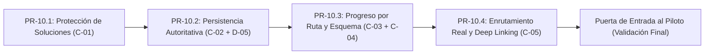

# Qurio — Nueva Línea Base Operativa de Desarrollo

| Metadato | Detalle |
| :--- | :--- |
| **Documento** | `docs/roadmap/QURIO_OPERATIONAL_BASELINE.md` |
| **Versión** | `1.0` (Línea Base Oficial para Grupo Piloto) |
| **Fecha de emisión** | 10 de noviembre de 2026 |
| **Identificador** | `QURIO-OPERATIONAL-BASELINE-01` |
| **Documentos de referencia** | [`docs/audits/QURIO_OPERATIONAL_AUDIT.md`](../audits/QURIO_OPERATIONAL_AUDIT.md) [`docs/product/QURIO_PRODUCT_BUSINESS_BLUEPRINT.md`](../product/QURIO_PRODUCT_BUSINESS_BLUEPRINT.md) (v1.2) [`docs/roadmap/PHASE_10_STABILIZATION_PLAN.md`](PHASE_10_STABILIZATION_PLAN.md) (v1.2) |
| **Estado de Gobernanza** | **Línea base operativa aprobada para guiar la estabilización antes del piloto de estudiantes** |
| **Autoría** | Software Architecture, Application Security, Full Stack Engineering, QA Automation & EdTech Product Management |

---

## 1. Declaración de Intención y Prioridad Estratégica Inmediata

A partir de esta revisión técnica y forense, la prioridad absoluta e indeclinable del proyecto Qurio es:

> **Construir una experiencia de aprendizaje SQL confiable, íntegra, didáctica y funcional para sus primeros estudiantes.**

Qurio no intentará escalar prematuramente como plataforma SaaS, ni activar pasarelas de pago, ni lanzar modelos de suscripción, ni ramificarse hacia runners de Python o Inteligencia Artificial antes de que su núcleo educativo esté 100% probado y estabilizado.

Primero demostraremos que un estudiante real puede:
1. Crear una cuenta e iniciar sesión sin fricción.
2. Explorar las rutas formativas y visualizar su avance exacto.
3. Escribir y ejecutar consultas SQL en un IDE profesional sin trampas ni fugas de soluciones.
4. Recibir evaluaciones semánticas justas con retroalimentación precisa.
5. Acumular XP y niveles de manera autoritativa y persistente en la nube.
6. Cerrar su navegador, regresar días después y continuar exactamente donde se quedó sin perder datos.

---

## 2. Delimitación Estricta del Alcance: Qué SÍ y Qué NO

### 2.1 Iniciativas EXPLÍCITAMENTE EXCLUIDAS de la Línea Base Inmediata
Las siguientes funcionalidades permanecen registradas en el *Blueprint v1.2*, pero **no forman parte del trabajo operativo inmediato** y queda terminantemente prohibido implementarlas antes de la validación del grupo piloto:
* ❌ Pasarelas de pago (Stripe México, SPEI, OXXO).
* ❌ Modelos comerciales de suscripción (*Free* vs *Plus*).
* ❌ Motor de *Entitlements* comerciales o paywalls.
* ❌ Licenciamiento B2B o institucional (*Qurio Teams*).
* ❌ Motor de ejecución de Python (Pyodide, WebAssembly, Docker workers o Jupyter).
* ❌ Librerías de datos (Pandas, NumPy, Matplotlib).
* ❌ Tutor socrático impulsado por IA o LLMs.
* ❌ Simuladores de entrevistas técnicas.
* ❌ Generación y verificación de certificados digitales en PDF.
* ❌ Creación de nuevas rutas curriculares o retos adicionales a los 50 existentes.
* ❌ Funcionalidades adicionales de gamificación (ligas, duelos, avatares 3D).

### 2.2 Alcance Inmediato Obligatorio (Fase 10: Brechas `C-01` a `C-05`)
El trabajo inmediato se concentra de forma exclusiva en resolver los problemas detectados en la auditoría técnica:
* ✅ **`C-01` (Seguridad Curricular):** Blindaje total de las soluciones oficiales (`solution_query`).
* ✅ **`C-02` (Persistencia Confiable):** Eliminación de doble escritura en frontend y consolidación del backend como única autoridad de progreso.
* ✅ **`C-03` (Integridad del Avance):** Cálculo puro y determinista de progreso por ruta sin distorsiones globales y con skeleton de carga.
* ✅ **`C-04` (Consistencia de Datos):** Sincronización canónica con la base de datos física (`pagos`, `metodo_pago`) y visualización de las 10 tablas en el IDE.
* ✅ **`C-05` (Navegación Web Real):** Enrutamiento con History API, URLs para retos (`/exercises/:id`), soporte de recarga (`F5`) y preservación de flujos de Auth.

---

## 3. Estado Actual Verificado vs. Estado Objetivo

| Dimensión | Estado Actual Verificado (Auditoría) | Estado Objetivo Requerido (Línea Base para Piloto) |
| :--- | :--- | :--- |
| **Seguridad de Soluciones (`C-01`)** | `solution_query` expuesta en 50 lugares del bundle JS compilado (`dist/`), en `FALLBACK_EXERCISES`, en respuestas de la API (`GET /exercises`) y en PostgREST (`SELECT * FROM exercises`). | Separación estricta entre `ExercisePublicDTO` y `ExerciseInternal`. `solution_query` existe exclusivamente en backend y base de datos interna. 0 menciones en bundles JS, endpoints públicos o PostgREST. |
| **Persistencia y Progreso (`C-02`)** | Frontend intenta escrituras directas rechazadas con error `42501` silenciado en consola. `persistence.ts` mezcla datos huérfanos de `localStorage` con la cuenta remota. | Backend y RPC `record_verified_attempt` son la única autoridad oficial de persistencia. Cero escrituras directas del cliente a tablas protegidas. `localStorage` se usa solo como caché de lectura. |
| **Progreso de Rutas (`C-03`)** | Contador global asignado a todas las rutas por igual (`tracks.map`). Al resolver cualquier ejercicio, todas las rutas suben `+1` y se vuelven a inflar si se repite el reto. | `computeOfficialTracksProgress` calcula de forma pura y aislada el avance por ruta basándose únicamente en `authoritativeCompletedIds`. Skeleton visual durante la carga asíncrona. |
| **Esquema Didáctico (`C-04`)** | Tabla `pagos` llamada `metodos_pago` en docs y especificaciones; conteos de filas ficticios en `api.ts`; solo 4 tablas visibles en el panel del IDE. | `database/sandbox/ecommerce_seed.sql` como fuente canónica absoluta (`pagos`, `metodo_pago`). Conteos reales en `ECOMMERCE_TABLES_SCHEMA`. Las 10 tablas visibles en el IDE. |
| **Enrutamiento Web (`C-05`)** | Estado local en memoria (`useState`). La URL no cambia de `/`. Recargar (`F5`) regresa al Dashboard perdiendo el reto. Botones del navegador inoperantes. | Enrutamiento web estándar (History API / `react-router-dom`). URLs limpias y compartibles (`/exercises/:id`, `/tracks/:slug`). Recargar conserva la vista activa y soporta Atrás/Adelante. |
| **Pruebas Automatizadas** | 64 pruebas en backend bloqueadas si Docker está apagado (`conftest.py`). Cero pruebas automatizadas en frontend (sin Vitest). | Backend con pruebas unitarias desacopladas de la red y pruebas de integración con sandbox activo. Vitest configurado en frontend cubriendo lógica de progreso y componentes clave. |

---

## 4. Secuencia Operativa de Trabajo (Plan de Estabilización)

La implementación se dividirá estrictamente en **4 entregables secuenciales**, cada uno en su propia rama Git de trabajo, con validación obligatoria de salida antes de fusionar:

### Entregable 1: `PR-10.1` — Protección Absoluta de `solution_query` (`C-01`)
* **Rama:** `fix/c01-protect-solution-query`
* **Objetivos:**
  1. Crear `ExercisePublicDTO` en Pydantic sin la clave `solution_query`.
  2. Modificar `ExerciseRepository` y `router.py` en FastAPI para que `GET /exercises` y `GET /exercises/{id}` devuelvan únicamente `ExercisePublicDTO`.
  3. Modificar el cliente `api.ts` y la interfaz TypeScript `Exercise` retirando `solution_query`.
  4. Script SQL para revocar el permiso `SELECT` general sobre `public.exercises` y conceder `SELECT` explícito a `anon` y `authenticated` solo sobre las columnas públicas necesarias.
  5. Asegurar que `FALLBACK_EXERCISES` y el bundle de producción de Vite contengan **cero apariciones** de `solution_query`.
* **Criterio de salida:** `npm run build` genera un bundle en `dist/` donde `grep solution_query` arroja `0` resultados.

### Entregable 2: `PR-10.2` — Fuente Única de Persistencia y Migración de Invitados (`C-02` + `D-05`)
* **Rama:** `fix/c02-single-source-persistence`
* **Objetivos:**
  1. Eliminar de `apps/web/src/lib/persistence.ts`, `App.tsx` y `useAuth.tsx` toda llamada a `.from('exercise_attempts').insert` y `.from('user_daily_activity').update`.
  2. Restringir `updateProfile()` en cliente estrictamente a campos visuales (`display_name`, `avatar_url`, `bio`), impidiendo que envíe `xp` o `level`.
  3. Consolidar la respuesta de `POST /api/v1/exercises/{id}/submit` como única fuente de actualización inmediata de XP y nivel en la sesión.
  4. Implementar el protocolo de recuperación de migraciones de invitados ante interrupciones de navegador, respuestas HTTP perdidas e idempotencia.
* **Criterio de salida:** Resolver retos en el IDE produce **cero errores 42501** en la consola del navegador y cero escrituras directas no autorizadas hacia Supabase.

### Entregable 3: `PR-10.3` — Progreso Determinista por Ruta y Esquema Canónico (`C-03` + `C-04`)
* **Rama:** `fix/c03-c04-track-progress-and-schema-sync`
* **Objetivos:**
  1. Implementar `computeOfficialTracksProgress` como función pura que calcula el avance cruzando exclusivamente los módulos de cada ruta con los IDs completados autoritativos de Supabase.
  2. Implementar tratamiento de `isLoading: true` devolviendo `null` y renderizando un *shimmer skeleton* en `TrackCard` para evitar parpadeos de `0%`.
  3. Sincronizar `README.md`, `CURRICULUM_SPEC.md` y `ECOMMERCE_TABLES_SCHEMA` con la fuente canónica física (`database/sandbox/ecommerce_seed.sql`, tabla `pagos` y columna `metodo_pago`).
  4. Actualizar `ExerciseSpecPanel.tsx` para exponer las 10 tablas completas del sandbox en su pestaña de esquema.
* **Criterio de salida:** Las 3 tarjetas de ruta reflejan conteos independientes exactos (ej. 5/22, 0/18, 0/10) y `ExerciseSpecPanel` permite inspeccionar las 10 tablas.

### Entregable 4: `PR-10.4` — Enrutamiento Web, Deep Linking y Formatos Auth (`C-05`)
* **Rama:** `feat/c05-url-routing-and-deep-linking`
* **Objetivos:**
  1. Reemplazar la máquina de estados `useState<AppPath>` por enrutamiento basado en History API / `react-router-dom`.
  2. Habilitar URLs limpias y compartibles: `/`, `/tracks`, `/tracks/:trackSlug`, `/exercises/:exerciseId`, `/playground`, `/achievements`, `/profile`.
  3. Garantizar que recargar (`F5`) dentro de un ejercicio conserve el reto activo sin expulsar al estudiante al Dashboard.
  4. Soportar navegación nativa del navegador (Atrás y Adelante).
  5. Manejar redirecciones de Supabase Auth (confirmación de cuenta y recuperación de contraseña) preservando tokens en hash y search params.
* **Criterio de salida:** Navegación fluida por URLs, soporte total de recarga en el editor y retroceso en el historial.

---

## 5. Criterios de Aceptación Cuantitativos y Cualitativos

Para considerar completada la estabilización antes de invitar al grupo piloto, el proyecto debe cumplir simultáneamente:

1. **Seguridad Curricular:** **0 fugas de soluciones**. Ni en red, ni en consola, ni en código compilado de producción.
2. **Integridad de Base de Datos:** **0 escrituras directas no autorizadas** (`403 / 42501`) desde el cliente hacia Supabase.
3. **Exactitud Matemática:** Los contadores de las 3 rutas suman exactamente el total de ejercicios completados sin duplicaciones ni inflación por re-ejecución.
4. **Resiliencia de Navegación:** Recargar la página (`F5`) en cualquier punto de la aplicación conserva la vista y los datos del estudiante.
5. **Calidad de Pruebas:**
   * Backend: **64/64 pruebas en Pytest pasando limpiamente**, con capacidad de correr pruebas unitarias sin levantar Docker.
   * Frontend: Suite inicial de pruebas configurada verificando el cálculo de progreso y el enrutamiento.
   * Build de producción: `npm run build` sin errores TypeScript.

---

## 6. Puerta de Entrada al Grupo Piloto (Gate Checklist)

Antes de autorizar la apertura de Qurio a los primeros 10 a 20 estudiantes de prueba, se verifica la siguiente lista de control obligatoria:

- [x] **G-01:** `C-01` resuelto y verificado: `solution_query` no se filtra en ningún componente, API ni bundle compilado.
- [x] **G-02:** `C-02` + `D-05` resuelto y verificado: la consola del navegador está limpia de errores `42501` durante login, resolución y edición de perfil; migración de invitados e idempotencia probadas.
- [x] **G-03:** `C-03` + `C-04` resuelto y verificado: cada ruta refleja su progreso real independiente, skeleton en carga y las 10 tablas están visibles en el IDE.
- [x] **G-04:** `C-05` resuelto y verificado: recargar en cualquier ejercicio conserva el ejercicio activo y las URLs son navegables con History API.
- [x] **G-05:** Los 50 ejercicios han sido ejecutados contra el Sandbox Docker y devuelven respuestas válidas (69/69 pruebas pytest).
- [ ] **G-06:** El flujo completo de 21 pasos del estudiante ha sido probado interactivamente en navegador por el equipo.
- [ ] **G-07:** Autorización formal y expresa del propietario del producto para el inicio de pruebas piloto.
